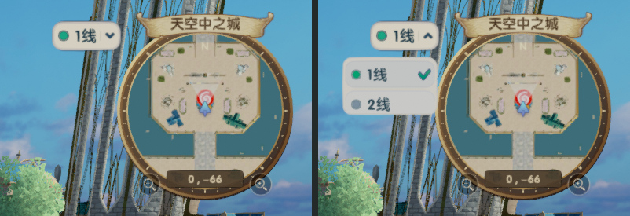
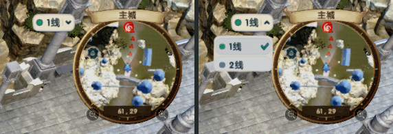

# RO 小地图与世界地图

## 入口与参考

单击游戏右上角的小地图会进入所在区域。右下角的世界地图按钮打开羊皮总图。天空中之城和主城分别使用城堡图标及蓝色横幅，红水晶标识角色实际所在的城市。选择另一座城可以查看地标，返回主界面时角色保持原位。

交互参考开发者提供的录像 `D:/录屏/wyclx64 2026-11-25 16-29-38-580.mp4`。美术使用 RO 原项目 `F:/UnityPro/ro/Ro_cs422nb/clientproj/Assets/artres/Resources/UI` 下的 `Prefabs/WorldMap.prefab` 和 `Texture/PrefabBg/RO_Map_BG1.png`、`RO_Map_BG2.png`。世界地图双幅、横向城名签、城堡与水晶使用 RO 原项目的资源和构图。控件复用本项目已有的 RO 图集。区域图对应本项目的真实场景。

RO 客户端的 `MMiniMapComponent.cs` 与 `MapObjMgr.cs` 提供实体标记和位置更新的参考，`WorldMapCtrl.lua` 用于核对世界地图的地点与当前位置图层。正式业务入口由现有 `MainView`、`MainCtrl` 和 `WindowBase` 管理。

## 场景与操作

- 天空中之城配置六个固定地标，主城配置三个。HUD 和区域图共用从本场景导航数据绘制的道路图。区域图保留矩形宽高比。
- 区域图支持拖动、滚轮缩放、按地标查找、点击本区域地图寻路及手动停止。点击后取地面高度，交给现有角色导航组件执行。地点列表也可以启动本地区路线。
- 角色使用朝向箭头，附近 NPC、怪物和其他玩家分别用金、红和青色标记。小地图的加减缩放和分线入口可单独点击。

## 业务改动文件

相对项目根目录列出业务提交中的 22 个文件。同一行末的 .meta 与前一文件同目录。

| 操作 | 路径 | 变化 |
| --- | --- | --- |
| 新增 | `LYF_MMO/Assets/LYF_Game/Prefabs/UIPrefabs/AreaMapWindow.prefab`、`AreaMapWindow.prefab.meta` | 正式地图窗口。保存区域图、世界图双幅底图、城堡与横向城名签、搜索列表、当前位置水晶、地点按钮和各控件的引用。 配套 .meta 保存资源标识和 Unity 导入设置。 |
| 修改 | `LYF_MMO/Assets/LYF_Game/Prefabs/UIPrefabs/UIRoot.prefab` | 把地图窗口挂到主视图功能层入口，给右上角小地图绑定区域资源和点击按钮，沿用分线及缩放按钮。 |
| 修改 | `LYF_MMO/Assets/LYF_Game/Scripts/Common/EnumDefine.cs` | 给地图窗口分配 WindowType.AreaMapWindow = 1005。 |
| 修改 | `LYF_MMO/Assets/LYF_Game/Scripts/Common/Utils/MinMapHelp.cs` | 把 Unity 场景 XZ 米制坐标和地图平面坐标双向换算，校准不同场景的原点、比例与地标位置。 |
| 修改 | `LYF_MMO/Assets/LYF_Game/Scripts/UI/Main/MainView.cs` | 实例化地图预制体，注册到既有 WindowBase 窗口表并设置初始显隐。 |
| 新增 | `LYF_MMO/Assets/LYF_Game/Scripts/UI/Main/Window/AreaMapWindow.cs`、`AreaMapWindow.cs.meta` | 驱动区域和世界两级视图、地图切换、当前位置、地标搜索、拖动缩放、目的地及停止状态。 配套 .meta 保存资源标识和 Unity 导入设置。 |
| 修改 | `LYF_MMO/Assets/LYF_Game/Scripts/UI/Main/Window/MinMapWindow.cs` | 右上角小地图和区域图共用道路贴图和坐标换算，更新朝向、附近标记、坐标。点击打开区域图。 |
| 新增 | `LYF_MMO/Assets/LYF_Game/Scripts/UI/Main/Window/Widget/MapEntityMarkers.cs`、`MapEntityMarkers.cs.meta` | 沿实体 UID 更新 NPC、怪物与其他玩家标记，随实体离场移除。 配套 .meta 保存资源标识和 Unity 导入设置。 |
| 新增 | `LYF_MMO/Assets/LYF_Game/Scripts/UI/Main/Window/Widget/MapSurfaceInput.cs`、`MapSurfaceInput.cs.meta` | 通过 Unity EventSystem 的 IPointerClickHandler 与 IScrollHandler 接收地图点击和滚轮，拖动沿用 ScrollRect。 配套 .meta 保存资源标识和 Unity 导入设置。 |
| 修改 | `LYF_MMO/Assets/LYF_Game/Scripts/controller/UIController/MainCtrl.cs` | 绑定和解绑窗口事件，走现有主界面和角色寻路、停止流程，并将本地角色绑定给地图。 |
| 新增 | `LYF_MMO/Assets/LYF_Game/UISprites/bg/AtlasMainCity.png`、`AtlasMainCity.png.meta` | 主城区域底图，从实际导航三角网绘制道路与轮廓，与地图坐标共用比例尺。 配套 .meta 保存资源标识和 Unity 导入设置。 |
| 新增 | `LYF_MMO/Assets/LYF_Game/UISprites/bg/AtlasSkyCity.png`、`AtlasSkyCity.png.meta` | 天空中之城区域底图，从实际导航三角网绘制平台和连接桥的俯视轮廓。 配套 .meta 保存资源标识和 Unity 导入设置。 |
| 新增 | `LYF_MMO/Assets/LYF_Game/UISprites/bg/RO_Map_BG1.png`、`RO_Map_BG1.png.meta` | RO 世界地图西半幅原图，SHA-256 前 16 位 93bf333c388c2ee5。 配套 .meta 保存资源标识和 Unity 导入设置。 |
| 新增 | `LYF_MMO/Assets/LYF_Game/UISprites/bg/RO_Map_BG2.png`、`RO_Map_BG2.png.meta` | RO 世界地图东半幅原图，SHA-256 前 16 位 6ecdafdabe9d4c28。 配套 .meta 保存资源标识和 Unity 导入设置。 |

## 验证与截图

- 当前工作区的完整客户端程序集经 Unity 2023.2.20f1c1 对应 Roslyn 编译通过。隔离 Unity Play 使用正式地图资源和角色移动、碰撞、导航组件，在 1920×1080、1366×768 合计通过 34 项，详见 `_temp/minimap-20261125/ro-verify.log`。
- 在天空中之城通过 UI 点击目标 XZ (17, -10)，实际角色停在 (17.00, 0.56, -10.00)。预览主城期间点地标，当前玩家路线未改变。定位、停止、重新打开、拖动、滚轮和分线按钮均通过点击检查。
- 单独载入正式主城场景核对三个地标的反向投影。主城商人附近从 (60.32, 18.71, 95.36) 到 (60.32, 18.75, 98.36) 可计算出五个路径点，证据为 `_temp/minimap-20261125/ro-town.log`。两个 RO 原始地图文件与提交内容逐字节一致。
- 两张主预览为 `_temp/minimap-20261125/world-1920.jpg` 与 `_temp/minimap-20261125/region-1920.jpg`，同目录有 `hud-1920.jpg`、`route-1920.jpg`、`search-1920.jpg` 及 `other-city-1366.jpg`。
- 以纯 Git 树重新编译，在 `QuickTaskPanelWidget.cs` 得到 3 条 CS0117，均为 `TaskPageFilter` 缺少 `Adventure`、`Story`、`Other`。父提交 `5727650` 得到完全相同的三条诊断。结果和覆盖边界见 `_temp/minimap-20261125/release-check.json`。正式账号联机显示、多人同时移动及客户端打包发布仍待复验。

## Git 与记录入口

业务提交为 `8e6551c1bdec6a5683b731fc5fe37c10d9f09c18`，分支为 `codex/feature-development`。本次 22 个业务文件已经推送至 `origin/codex/feature-development`，在 2026-11-25 通过 `git ls-remote` 确认远端该分支指向此提交。

本次授权记录还包括 `Docs/AI/CURRENT_TASK.en.md`、`Docs/AI/CURRENT_TASK.md` 的实现入口，`Docs/AI/TEST_REPORT.en.md`、`Docs/AI/TEST_REPORT.md` 的验收摘要，以及 `Docs/AI/RECORD_INDEX.md` 的定位条目，编号为 `RO-CITY-MAPS-20261125`。本机用量工具的汇总与原始输出保存在 `_temp/minimap-20261125/token-summary.json`、`token-collect.txt`、`token-report.json` 及 `context-compactions.json`。

用量快照取自 2026-11-25T18:32:26+08:00，主会话本任务记录 25,501,882 token（含缓存输入 24,841,600）。对话原始记录至 2026-11-25T18:32:28+08:00 累计压缩 11 次。双语同步子任务单列 188,999 token。账户剩余额度本地日志不可测。

## 羊皮世界地图的标题与按钮

- 范围为 `LYF_MMO/Assets/LYF_Game/Prefabs/UIPrefabs/AreaMapWindow.prefab` 一个预制体。城名使用 RO 原图集 `Map/UI_Map_Hengfu` 对拼成卷边纸签，标题使用 `Common/UI_Common_Hengfu_08` 及飞花宋体，文字取深棕墨色。两座城各按字数调整纸签宽度，城堡仍是 RO 原图标，红水晶指示角色所在区域。
- 将关闭、搜索和地图切换入口收进画框。搜索和关闭使用暖铜包边的圆形小钮。切换入口将印记与文字并排。地点目录换为同色纸面、棕墨字和分隔线。各控件独立持有图像和点击区，沿用地图底图、地标坐标与路线。
- 首次验收发现宋体城名所需行高约 35.52，文字框只有 35，Unity 触发了省略。把文字框调为 44 后，在 1920×1080 和 1366×768 两档确认标题、两座城名和切换文字全部完整可见。通过 55 项隔离 Unity Play 检查，覆盖世界搜索、打开两座城、切换区域、关闭、实际点击寻路与停止。正式账号联机及发布包未复验。
- 画面对照为 `_temp/world-map-ink-20261125/before-after.jpg`，世界图、低分辨率与搜索展开图分别为 `_temp/world-map-ink-20261125/world-1920.jpg`、`_temp/world-map-ink-20261125/world-1366.jpg`、`_temp/world-map-ink-20261125/world-search-1920.jpg`。点击结果和预制体引用核对记录在同目录 `play.log` 与 `asset-check.txt`。
- 业务提交 `35866646cca0c81fe20792d5bbca8b2ca5cb2e5f` 已推送至 `origin/codex/feature-development`。本次同步原编号下的 `Docs/AI/CURRENT_TASK.en.md`、`Docs/AI/CURRENT_TASK.md`（美术来源及控件入口），`Docs/AI/TEST_REPORT.en.md`、`Docs/AI/TEST_REPORT.md`（两档画面与点击），并更新 `Docs/AI/RECORD_INDEX.md`。本轮用量及原始统计在 `_temp/world-map-ink-20261125/token-summary.json`、`token-collect.txt`、`token-report.json` 和 `context-compactions.json`，账户余额本地日志不可测。
- 用量快照截至 2026-11-25T19:55:20+08:00，主会话本次增量 10,174,863 token，含缓存输入 10,082,560。对话原始记录累计压缩 11 次。

## 天空中之城在世界地图上的位置

- 调整 `LYF_MMO/Assets/LYF_Game/Prefabs/UIPrefabs/AreaMapWindow.prefab` 中 `WorldPainting/RegionSeal_0` 的两个锚点为 `(0.66129, 0.701324)`。用用户截取的海岸线在 2048×1024 地图中定位，以截图中心 `(1354.32, 232.84)` 放置城堡。城名、水晶与点击区随父节点移至东北海岸外侧。
- 1920×1080 和 1366×768 两档隔离 Unity Play 共通过 29 项检查。城堡中心偏差分别为 0.04 和 0.12 屏幕像素，新位置点击进入天空中之城，旧位置不再选中该城，主城锚点保持原值。正式账号联机和发布包未复验。截图见 `_temp/world-map-sky-pin-20261125/world-1920.jpg`、`east-coast.png` 和 `world-1366.png`，配准、点击、预制体差异与用量分别见同目录 `registration.json`、`play.log`、`asset-check.txt` 和 `token-summary.json`。
- 业务提交 `94de353ce2ec5c9aa6c726e16074bba349795b23` 已推送至 `origin/codex/feature-development`。`Docs/AI/CURRENT_TASK.en.md` 与 `Docs/AI/CURRENT_TASK.md` 记录新位置，`Docs/AI/TEST_REPORT.en.md` 与 `Docs/AI/TEST_REPORT.md` 记录两档点击验收，`Docs/AI/RECORD_INDEX.md` 更新对应行号。

## 两座公共城市的传送门、小地图与线路入口（2026-11-26）

#### 在游戏内使用

- 在小地图上点红色传送标记，角色会沿可行走路线前往传送门。直接走入门圈也会触发传送。主城门心为 X 62.15、Y 18.71、Z 93.67，天空中之城门心为 X 0、Y 0.008、Z -52.7。两边的到达点与门圈相隔约 13 米，抵达后可以自行走回传送门返程。
- 两座城各用一张实景俯视图。黄铜表圈与羊皮纸标题分开绘制，人物箭头跟随模型朝向，路标跟随导航尚未走过的转折点。超出圆形视野的传送标记会停在朝向门的圆边。
- 第一版把分线控件放在地图下方。根据这次反馈，现将线路入口放回小地图左上外侧。收起时用浅色圆签显示当前线路，点开后列表在下方展开，当前行使用 RO 对勾。入口箭头随列表开合翻转；点另一条线路沿既有区服切线流程提交。

#### 本次业务文件

| 文件 | 变动 | 用途 |
| --- | --- | --- |
| `LYF_MMO/Assets/LYF_Game/Plugins/Net/Network.dll` | 修改 | 将本次共享协议编译入客户端，传送请求与服务端使用相同消息号和门配置。 |
| `LYF_MMO/Assets/LYF_Game/Prefabs/UIPrefabs/UIRoot.prefab` | 修改 | 保存圆形遮罩、罗盘、底图、城名与坐标、角色箭头、导航、传送点和选线控件的独立引用。线路入口锚在地图左上外侧，展开模板在入口下方。入口、状态灯、下拉箭头、选中勾和点击区各自独立。 |
| `LYF_MMO/Assets/LYF_Game/Scripts/Common/Utils/MinMapHelp.cs` | 修改 | 按已加载的公共城市场景选取对应的传送门，在副本中隐藏城际门。 |
| `LYF_MMO/Assets/LYF_Game/Scripts/Manger/MainCityMgr.cs` | 修改 | 生成场景内的传送阵，并在本地角色实际走入门圈时通知控制器。 |
| `LYF_MMO/Assets/LYF_Game/Scripts/SceneEntity/Component/MNavigationComponent.cs` | 修改 | 提供尚未走过的寻路转折点，供小地图绘制当前路段。 |
| `LYF_MMO/Assets/LYF_Game/Scripts/UI/Main/Window/MinMapWindow.cs` | 修改 | 同步方形地图投影、角色朝向、坐标、路径与传送标记。线路回包驱动状态点与当前线，箭头随菜单翻转，满员线路使用红字。 |
| `LYF_MMO/Assets/LYF_Game/Scripts/UI/Main/Window/Widget/MinimapCompassRim.cs` | 新增 | 用 uGUI 网格绘制圆形遮罩、黄铜表圈、刻度和铆钉。 |
| `LYF_MMO/Assets/LYF_Game/Scripts/UI/Main/Window/Widget/MinimapCompassRim.cs.meta` | 新增 | 保存罗盘脚本的 Unity 资源标识，供预制体引用。 |
| `LYF_MMO/Assets/LYF_Game/Scripts/UI/Main/Window/Widget/MinimapRouteTrail.cs` | 新增 | 用可复用的 RO 方向标绘制剩余路径和终点。 |
| `LYF_MMO/Assets/LYF_Game/Scripts/UI/Main/Window/Widget/MinimapRouteTrail.cs.meta` | 新增 | 保存路径组件的 Unity 资源标识。 |
| `LYF_MMO/Assets/LYF_Game/Scripts/controller/UIController/MainCtrl.cs` | 修改 | 接入点击传送点自动寻路、走进门后请求传送、收到服务器结果后加载目标城市。 |
| `LYF_MMO/Assets/LYF_Game/UISprites/bg/bg_minimap.png` | 修改 | 用主城实际场景的 1024 × 1024 俯拍底图呈现地形。 |
| `LYF_MMO/Assets/LYF_Game/UISprites/bg/bg_minimap.png.meta` | 修改 | 将主城地图默认导入上限设为 1024，保留道路与屋顶的纹理。 |
| `LYF_MMO/Assets/LYF_Game/UISprites/bg/bg_skycity_minimap.png` | 修改 | 用天空中之城实际场景的 1024 × 1024 俯拍底图呈现地形。 |
| `LYF_MMO/Assets/LYF_Game/UISprites/bg/bg_skycity_minimap.png.meta` | 修改 | 将天空中之城地图默认导入上限设为 1024。 |
| `LYF_Server/GameServer/GameServer.csproj` | 修改 | 纳入新的游戏服城门消息处理器。 |
| `LYF_Server/GameServer/MessageHandler/CityPortalHandler.cs` | 新增 | 使用现有消息分派契约 IGameMessageHandler，校验门的位置与楼层，处理单服传送和目标到达点。 |
| `LYF_Server/GameServer/MessageHandler/ClientMessageManager.cs` | 修改 | 向既有分派器注册城门消息处理器。 |
| `LYF_Server/GameServer/MessageHandler/SceneLineHandler.cs` | 修改 | 在公共场景交接时校验源城传送门，给同宿主与跨宿主的目标角色设置到达点。 |
| `LYF_Server/GateServer/Ctrl/GateClientResponseForwarder.cs` | 修改 | 为单游戏服模式核对并转发城门回包。 |
| `LYF_Server/GateServer/GateServerApp.cs` | 修改 | 注册 Gate 与 Game 的城门消息转发入口。 |
| `LYF_Server/GateServer/RealmGameLink.cs` | 修改 | 复用区服的地图线路分配与角色交接，成功或失败后向原会话回送传送结果。 |
| `LYF_Server/Network/Network.csproj` | 修改 | 将两座公共城市的门配置编入共享通信程序集。 |
| `LYF_Server/Network/Socket/com/PublicCityPortal.cs` | 新增 | 集中定义两座城的门心、到达点以及源城判定，供客户端和游戏服读取。 |
| `LYF_Server/Network/Socket/com/SceneLineCode.cs` | 修改 | 在既有线路消息号集合中加入公共城市传送命令。 |

#### 验收与回执

- 客户端业务程序集及测试区服编译通过。在隔离 Unity Play 中分别载入两座城，1920×1080、1366×768 两档共通过 80 项检查，每城 40 项。检查覆盖入口在圆图左上外侧、菜单在按钮下方且位于屏内、当前行勾选、实际点选第二条线、导航至传送门、取消路径、角色朝向与传送特效着色器。
- 主城裁剪验收工程在退出时保存其单独的完整 UIRoot 提示缺失脚本。实际参加验证的小地图子树与正式预制体具有相同的 156 个序列化对象，9 种脚本引用均可在正式源码或 uGUI 包中解析。定位结果见 `_temp/ro-minimap-hud-20261126/channel-references.txt`。
- 测试区服的同宿主、跨宿主共 7 项通过，旧单游戏服模式另有 5 项通过。覆盖双向传送、抵达点不会立即送回、离门太远或位于平台下层时拒绝传送。正式账号联机与发布资源包尚未复验。
- 证据目录为 `_temp/ro-minimap-hud-20261126/`。`sky-channels.jpg` 与 `town-channels.jpg` 并排显示收起、展开状态，`town-compact-channels.jpg` 显示小分辨率，`sky-gate.png` 显示场景内的门。两城点击检查见 `channel-sky.log`、`channel-town.log`，测试区服与单服见 `e2e.txt`、`legacy-e2e.log`。客户端编译记录在 `build/compile.log`。
- 两笔业务提交均已推送到 `origin/codex/feature-development`。`f810504a5397512beda55b06724f2ff1386352f1` 接入小地图与传送门，`7e5fca6a09bea1caf6101934684d7498caa3510c` 修正线路位置及收起、展开样式。推送回执保存在同一证据目录的 `receipts-feature.txt` 与 `receipts-channel.txt`。
- 实现与验收摘要分别追加至 `Docs/AI/CURRENT_TASK.en.md`、`Docs/AI/CURRENT_TASK.md`、`Docs/AI/TEST_REPORT.en.md` 和 `Docs/AI/TEST_REPORT.md` 的 `RO-CITY-MAPS-20261125` 条目。`Docs/AI/RECORD_INDEX.md` 更新其定位。
- 本机用量快照、采集输出和压缩统计保存在上述证据目录中的 `token-summary.json`、`token-collect.txt`、`report.json` 与 `context-compactions.json`。统计包含缓存输入，账户剩余额度本地日志不可测。
- 用量快照截至 2026-11-26T12:22:51+08:00，本任务主会话 25,976,003 token，其中缓存输入 25,262,464。双语同步子会话单列 489,531 token。当前对话截至 2026-11-26T12:22:52+08:00 在原始记录中观测到 14 次上下文压缩。

#### 线路收起与展开的实测截图

天空中之城，1920×1080。左图收起，右图展开。

主城，1366×768。左图收起，右图展开。

