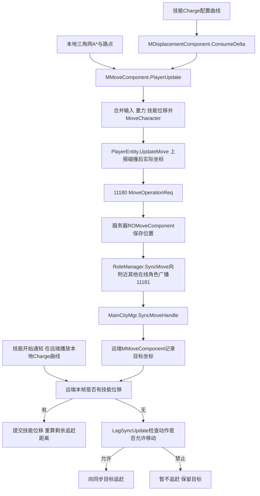

# 寻路与技能位移网络同步检查（2026-10-22）

## 结论

基线 `b04e75bd1536a933c7311c3fdc25c53f71066961`，分支 `codex/feature-development`。本轮只检查并记录，不修改业务实现。

寻路和技能配置曲线位移都接入了现有位置同步。服务器保存客户端上报坐标并向同地图100米内的其他在线角色转发，未接服务器寻路重算或位移权威结算。远端技能会自行运行相同Charge曲线，逐帧与影子追赶互斥；不能据此认为两端技能轨迹严格一致。已在生产方法隔离执行中复现：禁止普通移动的技能动作期间，大于0.1米的远端误差暂不追赶；恢复默认动作后再追赶。正式双客户端、网络延迟与真实碰撞未验。

## 调用流程

## 实际源码依据

以下路径均从项目根目录起算；行号用于本轮版本定位。

| 环节 | 文件与入口 | 实际行为 |
| --- | --- | --- |
| 导航移动 | `LYF_MMO/Assets/GM_Game/Scripts/SceneEntity/Component/MNavigationComponent.cs`：`navigate`、`TryGetNextStep`；`MMoveComponent.cs:500` | 导航开始设移动状态，PlayerUpdate按路点计算水平位移；本地统一碰撞提交，没有另起位置同步协议。 |
| 曲线移动 | `LYF_MMO/Assets/GM_Game/Scripts/SceneEntity/Skill/MArtSkill.cs:261`；`Component/MDisplacementComponent.cs:61`、`:314` | Charge按冻结方向和全局计时求曲线差量，ConsumeDelta一次消费。 |
| 更新顺序 | `LYF_MMO/Assets/GM_Game/Scripts/SceneEntity/MEntity.cs:255`；`Component/base/EntityComponentContainer.cs:149`；`Component/MComponentMgr.cs:149` | 位移组件先求值，Move提交，其后技能等组件；PlayerEntity在base.Update后比较实际位置。 |
| 主角上报 | `LYF_MMO/Assets/GM_Game/Scripts/SceneEntity/Entity/PlayerEntity.cs:40`、`:125` | CostTime每帧按秒累计；普通包须间隔大于0.1秒，并有厘米级坐标、移动状态或超过1度朝向变化。跳跃段变化另有即时上报。IsMoved基于实际位置变化或方向输入，因此普通IsMoving=false的技能位移也可上报。停止包同样遵守普通节拍；各轴不足1厘米且无其他状态变化时不因位置单独触发。 |
| 协议 | `LYF_Server/ProtoBuf/proto/RequestEntity.proto:118`；`ResultEntity.proto:365` | 传世界XYZ米、朝向度、耗时秒、IsMoving、IsMoved、JumpCount；广播增加RoleId。移动协议不传完整路点、曲线或技能运动时间轴。 |
| 服务端 | `LYF_Server/GameServer/MessageHandler/Role/MoveOperationHandler.cs`；`Components/ROMoveComponent.cs:21`；`manger/RoleManager.cs:551` | 更新基础位置快照，逐字段透传，排除本人及非附近/非在线角色。附近判断是同地图且三维距离不超过100米。移动包不负责给观察者创建实体。 |
| 远端入口 | `LYF_MMO/Assets/GM_Game/Scripts/Manger/MainCityMgr.cs:93`；`SceneEntity/Component/MMoveComponent.cs:854`、`:943` | 查询已存在角色，派MEvent_Move；误差不超过0.1米且不要求继续移动时直接吸附，否则设置追赶段。 |
| 同帧去重 | `LYF_MMO/Assets/GM_Game/Scripts/SceneEntity/Component/MMoveComponent.cs:192` | 有非零曲线差量时MoveCharacter，只重算到同步终点的剩余向量，不再调用同帧LagSyncUpdate。无差量时才调用追赶。 |
| 技能权限 | `LYF_MMO/Assets/GM_Game/Scripts/SceneEntity/Component/Action/MSkillComponent.cs:47`；`Data/Skill/Resources/SkillCastingRules.json` | 技能IsActiveMovable取MoveCasting。当前10010、10040、10050、10060、10070全部false，缺配置也返回false。 |
| 原生根运动 | `LYF_MMO/Assets/GM_Game/Scripts/SceneEntity/3DModel/MModel.cs:364` | Animator.applyRootMotion=false；当前讨论的根运动实际为配置曲线程序位移，已非采集器驱动。 |

## 技能同步的实际限制

1. `SkillCtrl.OnSkillCastStart → MSkillComponent.OnSkillStart → ApplyServerStart`会为远端启动技能表现和Charge。本地已存在同UUID实例只确认，不重播；这是独立于11181的技能表现链。
2. `ResultEntity.proto:199`的SkillCastStartNtf含服务器开始时间，但本轮检索客户端业务未找到StartServerTimeUnixMs消费。ApplyServerStart以远端当前Entity.Position发事件，MSkill.Fire以接收执行时的全局计时器起算，并锁定远端模型当前Forward；开始通知没有施法方向与起点字段。故两端起算时刻、方向/碰撞不同均可能形成误差，未做统一网络时钟对齐。
3. 有曲线差量的帧优先播放曲线，避免同帧双加；没有曲线差量时，LagSyncUpdate仍先检查CurrentState.IsActiveMovable。当前禁止MoveCasting的技能期间，超过0.1米的目标差量会保留而不追赶。隔离验证中恢复默认动作后成功追到保留终点。
4. 小误差路径在onSyncMoveEvent直接吸附，不受LagSyncUpdate门禁影响，因而不能笼统说“技能中所有位置包都不生效”。
5. 普通远端追赶直接写Entity.Position，曲线差量则走MoveCharacter碰撞。这两种消费方式并非完全同一路径；本轮未用原生墙体或弱网验证表现，不能断言必然穿墙或严格一致。

建议后续现场用两账号同地图100米内验证：导航绕障/到达、静止释放有位移技能、紧贴墙体释放技能、技能期间快速转向与延迟；观察者记录技能中/结束时位置误差与追赶。若用户要求修复，再单独限定远端纠偏和技能广播参数范围并委派开发，本轮不擅自改实现。

## 本轮验证

执行 `_temp/navigation-root-sync-20261022/verify_sync.py`：抽取当前生产PlayerEntity.Update/UpdateMove、MMoveComponent.Update/onSyncMoveEvent/LagSyncUpdate方法原文，服务端ROMoveComponent整文件原文参与隔离编译运行；宿主、网络发送、数学/朝向、状态机与碰撞为薄边界。运行结果 `SYNC_CHECK_PASS assertions=11`，零编译错误，1条抽取上下文导致的未使用字段警告。

验证覆盖无方向输入导航发包、停止发包、IsMoving=false的技能位移发包、服务端位置保存和全部移动字段透传、默认远端追赶、技能禁止移动时暂停大误差追赶与默认态恢复、小误差吸附、曲线和追赶同帧互斥及剩余距离追赶。生产输入哈希见同目录source-hashes.json，日志runtime.log。

这些断言包含已复现限制的行为确认，“通过”不代表该限制已修复。没有进行真实Socket双端、Unity原生运行、部署版本/DLL生效、完整客户端构建或服务器上线验证；历史报告不算本轮联机结果。

记录：`项目修改日志/2026-10-22-NAVIGATION-CHARGE-SYNC-CHECK-CHANGELOG.md`；难点：`项目分析/项目难点.md`对应2026-10-22条目。
