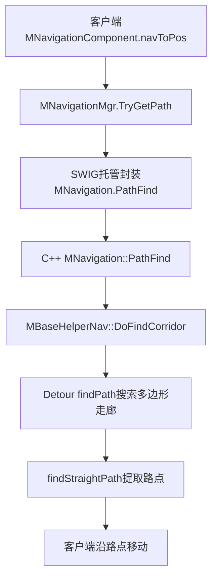
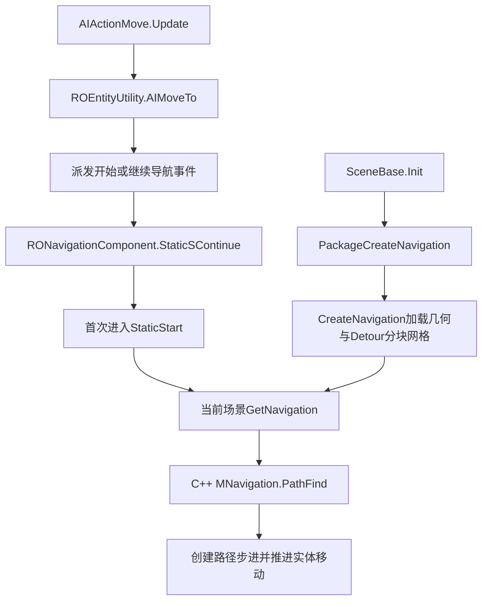

# RO两端寻路与源码查找对比实验

日期：2026-10-22。项目：LYFMMORGP。分支：`codex/feature-development`。源码基线：`1fbe5a2bca1135aa68dcc92da4dd79bdad459acb`。

## 当前结论

RO客户端和服务器都有真实寻路。客户端为玩家计算本地图的导航路线；服务器为AI等实体计算路径，并对玩家上报的移动执行位置、移动状态和速度相关检查。服务器还处理跨地图路线规划，这与本地图几何寻路属于不同层次。

LYF当前已接入客户端纯C#三角网A*。同份算法编入服务端Common，但服务器导航组件仍是空壳，正式角色移动主要保存并广播客户端上报终点，尚未接入服务器地图加载、运行寻路及RO同等移动合法性结算。

本轮仅静态核查磁盘源码，没有启动RO或LYF的客户端和服务器。

## RO客户端调用链

| 环节 | 当前源码证据 |
| --- | --- |
| 业务发起 | [MNavigationComponent.cs:723](F:/UnityPro/ro/Ro_cs422nb/clientcode/CSProject/MoonClient/Skill/MNavigationComponent.cs:723)：`navToPos()`调用`MNavigationMgr.singleton.TryGetPath(Entity.PredictedPos, pos, _pathPoints)`。 |
| 管理器查询 | [MNavigationMgr.cs:536](F:/UnityPro/ro/Ro_cs422nb/clientcode/CSProject/MoonClient/Transfer/MNavigationMgr.cs:536)：调用`_navGlb.PathFind(fstPos, dpos, _pathGlb, _halfExtents)`。 |
| 托管与原生边界 | [SWIG MNavigation.cs:204](F:/UnityPro/ro/Ro_cs422nb/clientcode/CSProject/MoonClient/SwigTools/CppInterface/rocommongamelibs/MNavigation.cs:204)：进入`rocommongamelibsPINVOKE.MNavigation_PathFind__SWIG_2`。 |
| 真实搜索入口 | [m_navigation.cpp:630](F:/UnityPro/ro/Ro_cs422nb/rogamelibs/rocommongamelibs/navigation/m_navigation.cpp:630)：调用`helper->DoFindCorridor(...)`。 |
| 搜索与路点 | [MBaseHelperNav.cpp:531](F:/UnityPro/ro/Ro_cs422nb/rogamelibs/rocommongamelibs/navigation/MBaseHelperNav.cpp:531)：`DoCalculateCorridor()`调用`nav_query_->findPath(...)`，546行再调用`findStraightPath(...)`。 |
| A*依据 | [DetourNavMeshQuery.cpp:1162](F:/UnityPro/ro/Ro_cs422nb/rogamelibs/thirdparty/recast/DetourNavMeshQuery.cpp:1162)：累计`cost`，计算到终点的`heuristic`，1166行为`total = cost + heuristic`；1060行从待扩展优先队列取节点。 |
| 地图加载 | [MNavigationMgr.cs:146](F:/UnityPro/ro/Ro_cs422nb/clientcode/CSProject/MoonClient/Transfer/MNavigationMgr.cs:146)：`OnSceneLoaded()`调用`InitNavigationC(...)`。[m_navigation_manager.cpp:168](F:/UnityPro/ro/Ro_cs422nb/rogamelibs/rocommongamelibs/navigation/m_navigation_manager.cpp:168)随后读取`.nav`几何数据和`.bytes`的Detour分块网格二进制，再经`InitCollider()`加载。 |

因此，RO的C#导航业务运行在客户端，而底层A*实现在原生共享库。不能因为C#里只看到`PathFind`封装，就判断客户端没有算法。

## RO服务器调用链与职责

| 环节 | 当前源码证据 |
| --- | --- |
| AI实际发起 | [ai_node_move.cpp:88](F:/UnityPro/ro/Ro_cs422nb/rogamelibs/ai/nodes/ai_node_move.cpp:88)：`AIActionMove::Update()`调用`ROEntityUtility::AIMoveTo(unit, move_dest)`。 |
| 事件接入 | [entity_common_tool.cpp:547](F:/UnityPro/ro/Ro_cs422nb/rogamelibs/utility/entity_common_tool.cpp:547)：构造`kActionStartOrContinueNavigation`事件，553行选择Static方法，559行派发。导航组件51行注册该事件，395行调用`StaticSContinue`，679行首次转入`StaticStart`。 |
| 真正算路 | [navigation_component.cpp:601](F:/UnityPro/ro/Ro_cs422nb/rogamelibs/entity/component/navigation_component.cpp:601)：`RONavigationComponent::StaticStart()`调用`navigation->PathFind(scene_obj_comp->GetPosition(), dest_pos, search_path_)`；610行创建步进。690行另有继续导航时的重算。 |
| 实体装配 | [assemble_factory.cpp:297](F:/UnityPro/ro/Ro_cs422nb/rogamelibs/system/assemble_factory.cpp:297)：怪物实际附加`RONavigationComponent`。 |
| 场景接入 | [scene_base.cpp:131](F:/UnityPro/ro/Ro_cs422nb/rogamelibs/scene/scene_base.cpp:131)：`SceneBase::Init()`保存`PackageCreateNavigation(...)`返回值。该分支依赖`ROGAMELIBS_USE_PROTO`，服务端构建在[CMakeLists.txt:249](F:/UnityPro/ro/Ro_cs422nb/rogamelibs/CMakeLists.txt:249)定义该宏及`FOR_SERVER`。 |
| 导航实例与文件 | [m_navigation_manager.cpp:60](F:/UnityPro/ro/Ro_cs422nb/rogamelibs/rocommongamelibs/navigation/m_navigation_manager.cpp:60)：服务器复用场景导航，首次进入`CreateNavigation`；112行创建`MNavigation`，120行`Init()`，127行`InitCollider()`。[m_navigation.cpp:24](F:/UnityPro/ro/Ro_cs422nb/rogamelibs/rocommongamelibs/navigation/m_navigation.cpp:24)定义服务器`gsconf/nav_datas/`目录，96行加载`.nav`，151行读取`.bytes`分块网格。 |

服务器与客户端调用同一套C++导航查询实现。服务器默认`PathFind`重载在`m_navigation.cpp:590`调用`DoFindCorridor`，也会追到Detour搜索。

`.bytes`不能只称为碰撞数据。[MBaseDynamicObstacle.cpp:1144](F:/UnityPro/ro/Ro_cs422nb/rogamelibs/rocommongamelibs/navigation/MBaseDynamicObstacle.cpp:1144)读取`NavMeshSetHeader`，1169行用`header.params`初始化网格，1200行`addTile(data, tileHeader.dataSize, DT_TILE_FREE_DATA, tileHeader.tileRef, 0)`装入分块。这里虽从`InitCollider()`进入，文件本身包含Detour导航网格。本文已纠正早先称呼；冻结Codex初稿保持原样。

玩家移动走另一条入口：[ptcc2g_moveoperationreq.cpp:20](F:/UnityPro/ro/Ro_cs422nb/roserver/gameserver/protocol/action/ptcc2g_moveoperationreq.cpp:20)解析上报终点和耗时并派发移动事件；[move_component.cpp:542](F:/UnityPro/ro/Ro_cs422nb/rogamelibs/entity/action/move_component.cpp:542)进入`MoveGround()`。该函数170行检查终点`IsPtValid`，不合法则拉回；231行取得移动距离，243行按速度、时间和容差计算允许距离，246行处理超距，263行更新合法位置并同步。这里能证明服务器检查上报移动，不能据此声称每次玩家点击都由服务器重新计算到最终目标的完整A*路线。

跨地图规划由[role.cpp:4286](F:/UnityPro/ro/Ro_cs422nb/roserver/gameserver/unit/role.cpp:4286)的`Role::EasyFindPath()`调用`WorldMap::EasyNavigation`，4295行将路线发给客户端。[world_map.cpp:119](F:/UnityPro/ro/Ro_cs422nb/roserver/gameserver/worldmap/world_map.cpp:119)的`EasyBrightPath()`分别处理同地图、全程跑、卡普拉等路线。这是地图和传送段级别的规划，与Detour的本地图多边形A*分别说明。

豆包进一步追到[world_map.cpp:692](F:/UnityPro/ro/Ro_cs422nb/roserver/gameserver/worldmap/world_map.cpp:692)的`FindShortestPath()`：700行建`std::queue`，708/709行出队，721至723行记已访问节点、前驱并入队，确为地图图上的BFS。此结论已独立回读源码核实。

## LYF目前接入到哪里

| 层次 | 当前状态与证据 |
| --- | --- |
| 客户端业务 | [MNavigationComponent.cs:263](D:/unitypro/LYFMMORGP/LYF_MMO/Assets/GM_Game/Scripts/SceneEntity/Component/MNavigationComponent.cs:263)从`navToPos()`调用管理器查询。 |
| 客户端地图与查询 | [MNavigationMgr.cs:22](D:/unitypro/LYFMMORGP/LYF_MMO/Assets/GM_Game/Scripts/Navigation/MNavigationMgr.cs:22)从`StreamingAssets/NavigationData`读地图，33行构造纯C#`MNavigation`，48行调用`PathFind`。字段`_cppNav`沿RO命名，但此处并未进入C++。 |
| 真实算法 | [MNavigation.cs:83](D:/unitypro/LYFMMORGP/LYF_MMO/Assets/GM_Game/Scripts/Navigation/MNavigation.cs:83)实现三角网A*；145行累计费用，147行估算剩余距离，158行`cost + heuristic`，117行生成路径。 |
| 服务端共享编译 | [MMoRpgCommon.csproj:44](D:/unitypro/LYFMMORGP/LYF_Server/MMoRpgCommon/MMoRpgCommon.csproj:44)直接链接客户端同份算法、几何及地图格式等8份源文件。编入程序集说明可调用，不能证明运行中已经调用。 |
| 服务端导航组件 | [NavigationComponent.cs:5](D:/unitypro/LYFMMORGP/LYF_Server/GameServer/SceneEntity/Component/NavigationComponent.cs:5)只有类型和构造函数；[EntityFactory.cs:236](D:/unitypro/LYFMMORGP/LYF_Server/GameServer/SceneEntity/World/EntityFactory.cs:236)创建该组件，但未实现导航查询或步进。 |
| 服务端真实移动 | [MoveOperationHandler.cs:24](D:/unitypro/LYFMMORGP/LYF_Server/GameServer/MessageHandler/Role/MoveOperationHandler.cs:24)解析上报后交给`ROMoveComponent.OnMoveStart()`；[ROMoveComponent.cs:25](D:/unitypro/LYFMMORGP/LYF_Server/GameServer/Components/ROMoveComponent.cs:25)直接保存终点并广播。27行注释明确当前没有RO场景高度和导航结算。 |

限定检索`LYF_Server/GameServer`与`LYF_Server/MMoRpgCommon`的`.cs`及`.csproj`、排除`bin/obj`后，未找到运行端`new MNavigation`、`PathFind`、`TryGetPath`或导航地图加载调用。本结论限定当前源码，未据此声称其他版本也没有实现。

豆包还指出`EntityWorld/EntityFactory`缺少实例化入口；主Agent复查`LYF_Server`的`.cs`源码，未找到`new EntityWorld`或`new EntityFactory`。这能支持当前源码未接常规实例化入口，不作为排除一切动态装配可能性的运行证明。豆包自报的旧`MMoRpgCommon.dll`反射结果未独立复跑，不把它当作当前源码重新编译或运行通过的依据。

## 同题源码查找实验：已完成

任务标识：`SEARCH-RO-NAV-20261022`。用户确认退出后，已恢复豆包官方Windows桌面连接，完成本项目local工作任务。最终对比只使用双方冻结初稿，旧受污染轮次已作废。

### 冻结题目与评分

双方同题：RO客户端业务至算法和地图加载；RO服务器AI实际寻路、场景加载、玩家移动检查及跨图职责；LYF客户端算法、Common同源编译、服务器组件和正式移动处理。只读本地源码，不联网，不启动Unity或服务器，不改业务、资源、场景。

原始协议：`_temp/source-search-comparison-20261022/protocol.md`。预设15项各1分，核心结论正确且有可核源码才得分，不按篇幅评分。本次逐项回读实际源码，结果如下：

| 核心证据项 | Codex | 豆包 | 核对落点 |
| --- | --- | --- | --- |
| RO客户端业务导航 | 1 | 1 | MNavigationComponent.cs:723，TryGetPath |
| 管理器查询 | 1 | 1 | MNavigationMgr.cs:536，PathFind |
| 托管到原生边界 | 1 | 1 | SWIG MNavigation.cs:204，PINVOKE调用 |
| 实际搜索算法 | 1 | 1 | DetourNavMeshQuery.cpp:1166，cost + heuristic |
| 客户端地图加载 | 1 | 1 | m_navigation_manager.cpp:168/171/186/194 |
| 服务器组件实际寻路 | 1 | 1 | navigation_component.cpp:601，PathFind |
| AI实际调用 | 1 | 1 | ai_node_move.cpp:88，AIMoveTo |
| 场景取得导航 | 1 | 1 | scene_base.cpp:131，PackageCreateNavigation |
| 服务器管理器加载 | 1 | 1 | m_navigation_manager.cpp:112/120/127 |
| 玩家移动检查 | 1 | 1 | move_component.cpp:170/231/243/263 |
| 跨地图职责区别 | 1 | 1 | role.cpp:4286与world_map.cpp地图级规划 |
| LYF客户端算法 | 1 | 1 | MNavigation.cs:83/145/147/158 |
| Common同源编译 | 1 | 1 | MMoRpgCommon.csproj:44起8份链接源 |
| 服务器组件现状 | 1 | 1 | NavigationComponent.cs:5起空壳 |
| 正式移动协议处理 | 1 | 1 | MoveOperationHandler.cs:25至ROMoveComponent.cs:25/28 |
| 合计 | **15/15** | **15/15** | 只表示本次预设核心证据覆盖 |

此分数不是全文正确率。以下错误单独披露：有正确的核心调用证据时，不因附加摘录错误临时改动原评分口径；同样不把15分写成全文无误。评分依据、实际源码行及冻结校验存于`_temp/source-search-comparison-20261022/final-score-verification.json`。

### 实际配置与耗时

| 项目 | 当前Codex会话 | 豆包有效新会话 |
| --- | --- | --- |
| 模型/推理 | 精确运行型号及档位未从会话元数据独立核实 | 豆包2.1 Pro，key=5；最高推理，effort=7 |
| 运行方式 | 当前项目会话的本地工具查找 | 官方桌面agentMode=1、runtime_type=2（local） |
| 开始，UTC+8 | 2026-10-22 07:33:48.4680837 | 2026-10-22 08:11:03.2758243 |
| 答案落盘，UTC+8 | 07:36:46.693220 | 08:36:24.006840 |
| 开始至落盘 | **178.225秒，约2分58秒** | **1520.731秒，约25分21秒** |
| 初稿行数 | 36 | 624 |
| 预设核心证据覆盖 | 15/15 | 15/15 |

耗时统一采用任务开始至答案文件落盘。此前Codex的178.604秒包含落盘后约0.379秒的计时结束差；本轮已统一口径。豆包CLI连接中断或主Agent首次看见文件的时刻，不当作答案完成时间。行数只描述输出规模，不计分；豆包自报533行与实际624行不符，采用实际文件统计。

有效豆包conversationId：`38448622087397122`；runId：`59302623239101442`；localMessageId：`31da5d56-6eb3-420a-93ac-d048e56ba922`。已确认原生任务`completed`并取得实际文件，不依靠模型自报完成。固定项目`38435310952198914`（LYFMMORGP），目录`D:/unitypro/LYFMMORGP`，本地设备`2543626118275075`。

原生配置证据为`doubao-clean-native-settings.jsonl`及`doubao-clean-final-status.json`，菜单证据为`doubao-models.json`。实际使用菜单中的Pro＋最高；不据此宣称公开独立证明了全部豆包模型的一般能力排名。其他可见会话的`model current`不代替本实验会话回读。

冻结答案及SHA256：

- `_temp/source-search-comparison-20261022/codex-answer.md`：`84B3ADB8D062464879C24F4136EFDE0023D7201D185B3276F803437D6C763630`。
- `_temp/source-search-comparison-20261022/doubao-answer.md`：`7EC5B1A134B7096094FCD595DB073FE071D898B86EA55EE71180A493A3B6A200`。

两份初稿保持原字节；统一时间、行数与哈希见同目录`frozen-answer-metadata.json`。

### 初稿错误与补充发现

| 初稿 | 实际问题 | 源码核对与修正 |
| --- | --- | --- |
| Codex | 把客户端加载的.bytes笼统称为“碰撞.bytes” | 实际是NavMeshSet分块导航网格，见本文前述MBaseDynamicObstacle.cpp:1144/1169/1200；加载链正确，数据用途描述不准。 |
| 豆包 | DllImport摘录缺少EntryPoint中的ROGameLibs，行号也不符；把__Internal条件说成IL2CPP | [rocommongamelibsPINVOKE.cs:2469](F:/UnityPro/ro/Ro_cs422nb/clientcode/CSProject/MoonClient/SwigTools/CppInterface/rocommongamelibs/rocommongamelibsPINVOKE.cs:2469)实际EntryPoint为CSharp_ROGameLibs_MNavigation_PathFind__SWIG_2；2466行条件为UNITY_IOS，普通声明在2479行。它另给出的MNavigation.cs:204调用正确，因此核心边界项仍成立。 |
| 豆包 | 声称LoadServerNavClient短代码为摘录，但改写签名、header/data/tile引用等 | 实际1130行为const std::string& filename、buff_len；1144/1145行是栈上header和memcpy；1169行为&header.params；1200行为data和tileHeader.tileRef。文件用途结论正确，代码不能当逐字引用。 |
| 豆包 | AIMoveTo事件摘录把构造参数改成另设args->type，把派发对象、行号也改了 | [entity_common_tool.cpp:547](F:/UnityPro/ro/Ro_cs422nb/rogamelibs/utility/entity_common_tool.cpp:547)真实构造传kActionStartOrContinueNavigation，553行设置Static，559行entity派发；其ai_node_move.cpp的AIActionMove调用证据不受影响。 |
| 豆包 | “服务器不替玩家跑A*”概括过宽 | 应限定本次所查MoveGround玩家上报移动链，不推广全部玩家特殊逻辑。 |

上述为本次核对发现，不是对624行每句话的完整穷尽审计。豆包另外追到地图图BFS、LYF实体装配缺少常规new入口，均有实际源码依据，本文已吸收并标明静态边界。旧DLL反射自报未独立复跑，不计额外得分或当前编译验收。

### 真实失败、作废与恢复

最初桌面未开启9225本地端口，CLI返回available=false/fetch failed。用户保存并托盘退出后，使用既有Windows启动入口恢复；未强杀，不转网页或headless。

首次通过.cmd传多行提示时Windows截断，仅首行到达，尾部模型参数也未生效。该run `59302645190689538`已cancelled。同conversationId `38448621930977794`补发完整单行提示，run `59303569835540226`虽completed且配置已回读为Pro/最高，但它披露在截断轮次读过本次完整分析报告的Git提交，答案受污染。该轮整体作废，保留`doubao-contaminated-answer.md`和原生回执，不评分、不计0分。

随后才新建上述有效会话，从首条完整单行提示禁止读取Git历史、本次分析/日志、旧临时答案。新答案及原生回复声明未读取这些；这属于任务约束和执行者声明，未做系统调用级访问审计。新会话确已完成，CLI中途的“Inspected target navigated or closed”仅为等待连接断开，不当作模型任务失败或取消。

### 如何理解本次差距

在这三题的预设核心证据上没有查找覆盖差距。豆包展开更多支线，输出更长，也出现额外源码摘录不忠实；Codex较快完成精简主线，但同样存在数据用途表述错误。两方答案都需要源码复核。

本轮不能推导普遍能力排名或固定速度倍率，原因是：Codex此前开发LYF导航，计时前也已读部分RO源码；根AGENTS要求双方读取的四份Docs/AI入口含线索；仅做一轮三题；耗时包含工具、阅读和写作，输出规模明显不同；当前Codex精确模型/推理未独立核实。首次污染轮次不参与比较。无须为了确认会话型号重复联网；此前官方模型页读取403未提供该会话的运行证明。

逐项文件变化、验证及Git结果见`项目修改日志/2026-10-22-NAVIGATION-SEARCH-COMPARISON-CHANGELOG.md`。仅完成静态源码与本轮比较验收，不代表正式游戏运行、服务器导航接入或移动反作弊已经完成。
