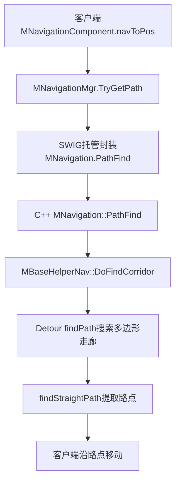

# RO两端寻路与源码查找对比实验

日期：2026-10-22。项目：LYFMMORGP。分支：`codex/feature-development`。源码基线：`1fbe5a2bca1135aa68dcc92da4dd79bdad459acb`。

## 当前结论

RO客户端和服务器都有真实寻路。客户端为玩家计算本地图的导航路线；服务器为AI等实体计算路径，并对玩家上报的移动执行位置、移动状态和速度相关检查。服务器还处理跨地图路线规划，这与本地图几何寻路属于不同层次。

LYF当前已接入客户端纯C#三角网A*。同份算法编入服务端Common，但服务器导航组件仍是空壳，正式角色移动主要保存并广播客户端上报终点，尚未接入服务器地图加载、运行寻路及RO同等移动合法性结算。

本轮仅静态核查磁盘源码，没有启动RO或LYF的客户端和服务器。

## RO客户端调用链

| 环节 | 当前源码证据 |
| --- | --- |
| 业务发起 | [MNavigationComponent.cs:723](F:/UnityPro/ro/Ro_cs422nb/clientcode/CSProject/MoonClient/Skill/MNavigationComponent.cs:723)：`navToPos()`调用`MNavigationMgr.singleton.TryGetPath(Entity.PredictedPos, pos, _pathPoints)`。 |
| 管理器查询 | [MNavigationMgr.cs:536](F:/UnityPro/ro/Ro_cs422nb/clientcode/CSProject/MoonClient/Transfer/MNavigationMgr.cs:536)：调用`_navGlb.PathFind(fstPos, dpos, _pathGlb, _halfExtents)`。 |
| 托管与原生边界 | [SWIG MNavigation.cs:204](F:/UnityPro/ro/Ro_cs422nb/clientcode/CSProject/MoonClient/SwigTools/CppInterface/rocommongamelibs/MNavigation.cs:204)：进入`rocommongamelibsPINVOKE.MNavigation_PathFind__SWIG_2`。 |
| 真实搜索入口 | [m_navigation.cpp:630](F:/UnityPro/ro/Ro_cs422nb/rogamelibs/rocommongamelibs/navigation/m_navigation.cpp:630)：调用`helper->DoFindCorridor(...)`。 |
| 搜索与路点 | [MBaseHelperNav.cpp:531](F:/UnityPro/ro/Ro_cs422nb/rogamelibs/rocommongamelibs/navigation/MBaseHelperNav.cpp:531)：`DoCalculateCorridor()`调用`nav_query_->findPath(...)`，546行再调用`findStraightPath(...)`。 |
| A*依据 | [DetourNavMeshQuery.cpp:1162](F:/UnityPro/ro/Ro_cs422nb/rogamelibs/thirdparty/recast/DetourNavMeshQuery.cpp:1162)：累计`cost`，计算到终点的`heuristic`，1166行为`total = cost + heuristic`；1060行从待扩展优先队列取节点。 |
| 地图加载 | [MNavigationMgr.cs:146](F:/UnityPro/ro/Ro_cs422nb/clientcode/CSProject/MoonClient/Transfer/MNavigationMgr.cs:146)：`OnSceneLoaded()`调用`InitNavigationC(...)`。[m_navigation_manager.cpp:168](F:/UnityPro/ro/Ro_cs422nb/rogamelibs/rocommongamelibs/navigation/m_navigation_manager.cpp:168)随后读取`.nav`和碰撞`.bytes`，并初始化查询器与碰撞数据。 |

因此，RO的C#导航业务运行在客户端，而底层A*实现在原生共享库。不能因为C#里只看到`PathFind`封装，就判断客户端没有算法。

## RO服务器调用链与职责

| 环节 | 当前源码证据 |
| --- | --- |
| AI实际发起 | [ai_node_move.cpp:88](F:/UnityPro/ro/Ro_cs422nb/rogamelibs/ai/nodes/ai_node_move.cpp:88)：`AIActionMove::Update()`调用`ROEntityUtility::AIMoveTo(unit, move_dest)`。 |
| 事件接入 | [entity_common_tool.cpp:547](F:/UnityPro/ro/Ro_cs422nb/rogamelibs/utility/entity_common_tool.cpp:547)：构造`kActionStartOrContinueNavigation`事件，553行选择Static方法，559行派发。导航组件51行注册该事件，395行调用`StaticSContinue`，679行首次转入`StaticStart`。 |
| 真正算路 | [navigation_component.cpp:601](F:/UnityPro/ro/Ro_cs422nb/rogamelibs/entity/component/navigation_component.cpp:601)：`RONavigationComponent::StaticStart()`调用`navigation->PathFind(scene_obj_comp->GetPosition(), dest_pos, search_path_)`；610行创建步进。690行另有继续导航时的重算。 |
| 实体装配 | [assemble_factory.cpp:297](F:/UnityPro/ro/Ro_cs422nb/rogamelibs/system/assemble_factory.cpp:297)：怪物实际附加`RONavigationComponent`。 |
| 场景接入 | [scene_base.cpp:131](F:/UnityPro/ro/Ro_cs422nb/rogamelibs/scene/scene_base.cpp:131)：`SceneBase::Init()`保存`PackageCreateNavigation(...)`返回值。该分支依赖`ROGAMELIBS_USE_PROTO`，服务端构建在[CMakeLists.txt:249](F:/UnityPro/ro/Ro_cs422nb/rogamelibs/CMakeLists.txt:249)定义该宏及`FOR_SERVER`。 |
| 导航实例与文件 | [m_navigation_manager.cpp:60](F:/UnityPro/ro/Ro_cs422nb/rogamelibs/rocommongamelibs/navigation/m_navigation_manager.cpp:60)：服务器复用场景导航，首次进入`CreateNavigation`；112行创建`MNavigation`，120行`Init()`，127行`InitCollider()`。[m_navigation.cpp:24](F:/UnityPro/ro/Ro_cs422nb/rogamelibs/rocommongamelibs/navigation/m_navigation.cpp:24)定义服务器`gsconf/nav_datas/`目录，96行加载`.nav`，151行读取碰撞`.bytes`。 |

服务器与客户端调用同一套C++导航查询实现。服务器默认`PathFind`重载在`m_navigation.cpp:590`调用`DoFindCorridor`，也会追到Detour搜索。

玩家移动走另一条入口：[ptcc2g_moveoperationreq.cpp:20](F:/UnityPro/ro/Ro_cs422nb/roserver/gameserver/protocol/action/ptcc2g_moveoperationreq.cpp:20)解析上报终点和耗时并派发移动事件；[move_component.cpp:542](F:/UnityPro/ro/Ro_cs422nb/rogamelibs/entity/action/move_component.cpp:542)进入`MoveGround()`。该函数170行检查终点`IsPtValid`，不合法则拉回；231行取得移动距离，243行按速度、时间和容差计算允许距离，246行处理超距，263行更新合法位置并同步。这里能证明服务器检查上报移动，不能据此声称每次玩家点击都由服务器重新计算到最终目标的完整A*路线。

跨地图规划由[role.cpp:4286](F:/UnityPro/ro/Ro_cs422nb/roserver/gameserver/unit/role.cpp:4286)的`Role::EasyFindPath()`调用`WorldMap::EasyNavigation`，4295行将路线发给客户端。[world_map.cpp:119](F:/UnityPro/ro/Ro_cs422nb/roserver/gameserver/worldmap/world_map.cpp:119)的`EasyBrightPath()`分别处理同地图、全程跑、卡普拉等路线。这是地图和传送段级别的规划，与Detour的本地图多边形A*分别说明。

## LYF目前接入到哪里

| 层次 | 当前状态与证据 |
| --- | --- |
| 客户端业务 | [MNavigationComponent.cs:263](D:/unitypro/LYFMMORGP/LYF_MMO/Assets/GM_Game/Scripts/SceneEntity/Component/MNavigationComponent.cs:263)从`navToPos()`调用管理器查询。 |
| 客户端地图与查询 | [MNavigationMgr.cs:22](D:/unitypro/LYFMMORGP/LYF_MMO/Assets/GM_Game/Scripts/Navigation/MNavigationMgr.cs:22)从`StreamingAssets/NavigationData`读地图，33行构造纯C#`MNavigation`，48行调用`PathFind`。字段`_cppNav`沿RO命名，但此处并未进入C++。 |
| 真实算法 | [MNavigation.cs:83](D:/unitypro/LYFMMORGP/LYF_MMO/Assets/GM_Game/Scripts/Navigation/MNavigation.cs:83)实现三角网A*；145行累计费用，147行估算剩余距离，158行`cost + heuristic`，117行生成路径。 |
| 服务端共享编译 | [MMoRpgCommon.csproj:44](D:/unitypro/LYFMMORGP/LYF_Server/MMoRpgCommon/MMoRpgCommon.csproj:44)直接链接客户端同份算法、几何及地图格式等8份源文件。编入程序集说明可调用，不能证明运行中已经调用。 |
| 服务端导航组件 | [NavigationComponent.cs:5](D:/unitypro/LYFMMORGP/LYF_Server/GameServer/SceneEntity/Component/NavigationComponent.cs:5)只有类型和构造函数；[EntityFactory.cs:236](D:/unitypro/LYFMMORGP/LYF_Server/GameServer/SceneEntity/World/EntityFactory.cs:236)创建该组件，但未实现导航查询或步进。 |
| 服务端真实移动 | [MoveOperationHandler.cs:24](D:/unitypro/LYFMMORGP/LYF_Server/GameServer/MessageHandler/Role/MoveOperationHandler.cs:24)解析上报后交给`ROMoveComponent.OnMoveStart()`；[ROMoveComponent.cs:25](D:/unitypro/LYFMMORGP/LYF_Server/GameServer/Components/ROMoveComponent.cs:25)直接保存终点并广播。27行注释明确当前没有RO场景高度和导航结算。 |

限定检索`LYF_Server/GameServer`与`LYF_Server/MMoRpgCommon`的`.cs`及`.csproj`、排除`bin/obj`后，未找到运行端`new MNavigation`、`PathFind`、`TryGetPath`或导航地图加载调用。本结论限定当前源码，未据此声称其他版本也没有实现。

## 同题源码查找实验

任务标识：`SEARCH-RO-NAV-20261022`。用户要求豆包最高模型、最高推理，与当前Codex会话比较。本轮尚未取得豆包初稿，不能给出差距、胜负或倍率。

### 冻结题目与证据标准

1. 查RO客户端业务组件、管理器、托管与原生边界、实际算法及地图加载。
2. 查RO服务器真实寻路、AI实际调用、场景及地图加载，并区分玩家移动校验和跨地图规划。
3. 查LYF客户端真实算法、Common同源编译、服务器导航组件及正式移动处理。

两方允许读取LYF的`LYF_MMO`、`LYF_Server`，以及RO的`clientcode/CSProject/MoonClient`、`rogamelibs`、`roserver`。只读本地源码，不联网、不启动Unity或服务器，不改业务、资源、场景，不读凭据。各自只写自己的临时答案，禁止读取另一方答案。

预先确定15项证据，每项1分，结论正确且给出可核对源码才得分：

| 分组 | 逐项标准 | 数量 |
| --- | --- | --- |
| RO客户端 | 业务导航调用、管理器查询、托管与原生边界、真实搜索算法、地图加载 | 5 |
| RO服务器 | 组件真实寻路、AI实际调用、场景取得导航、管理器加载数据、玩家移动检查、跨地图职责区别 | 6 |
| LYF | 客户端真实算法、Common同源编译、服务器组件现状、实际移动协议处理 | 4 |

初稿均冻结后逐项回查源码评分；不按文风评分，不将连接失败计成模型能力0分。原始协议见`_temp/source-search-comparison-20261022/protocol.md`。

### 已取得结果与当前阻断

| 项目 | 当前Codex会话 | 豆包桌面工作任务 |
| --- | --- | --- |
| 实际模型与推理档位 | 未从本会话运行元数据独立核实；本机默认配置不作为证明 | 连接未恢复，尚未读取可用模型列表和原生推理设置，未核实最高配置 |
| 初稿 | 已落盘并冻结 | 未派发，无初稿 |
| 查找起止 | 2026-10-22 07:33:48.4680837至07:36:47.0719779，UTC+8 | 未开始 |
| 耗时 | 178.604秒 | 无数据 |
| 评分 | 双方初稿齐备前不公布比较分数 | 待实验 |
| 任务标识 | 当前Codex会话内查找 | 未生成conversationId/runId |

Codex原始初稿：`_temp/source-search-comparison-20261022/codex-answer.md`。SHA256：`84B3ADB8D062464879C24F4136EFDE0023D7201D185B3276F803437D6C763630`。计时文件为同目录`codex-start.txt`与`codex-end.txt`，初稿冻结后仅核查源码，未改写初稿。

本轮多次执行官方桌面入口`E:/doubao-cli/doubao-windows.cmd cdp status --json`，实际返回`available=false`、`http://127.0.0.1:9225`、`fetch failed`。客户端进程存在，但本地连接端口未开启。此前模型、项目和运行环境查询同样受阻，没有向原生模型发送任务。

已请用户保存工作并从系统托盘退出豆包，收到确认后才用既有`start-doubao-windows.cmd`启动。没有强行结束客户端，没有切换网页、headless或较低配置代替。桌面执行方式见`项目分析/DOUBAO_CLI_WINDOWS.md`。

### 实验限制与续接

这是一轮三题的源码工具协作观察，并非盲测。Codex此前参与LYF导航工作，且计时前的连接排查阶段已读过部分RO源码和目录，具有先验与准备优势。178.604秒只表示该会话本轮查找区间，不代表纯模型速度；不能据此推广为一般能力差距。启动配置、连接恢复、文档整理和Git不计入查找耗时。

用户确认退出后，先恢复官方桌面连接，读取实际可用模型、local运行环境和LYFMMORGP项目ID`38435310952198914`。从实际可用列表核实最高模型，再设置并回读最高推理；CLI的`max`映射原生effort `7`，仍须核会话实际设置。若最高模型顺序无法确认，记录不确定性，不能只凭模型名字猜测。

豆包任务固定使用`--runtime local --project 38435310952198914 --workspace D:/unitypro/LYFMMORGP --permission AskOnRisk`的原生工作任务，保存conversationId、runId、实际配置及时间；不给它Codex初稿和评分。超时沿原run恢复，初稿到盘后冻结、回查15项源码证据，再更新本报告。

逐项文件变化与本轮验收记录见`项目修改日志/2026-10-22-NAVIGATION-SEARCH-COMPARISON-CHANGELOG.md`。
