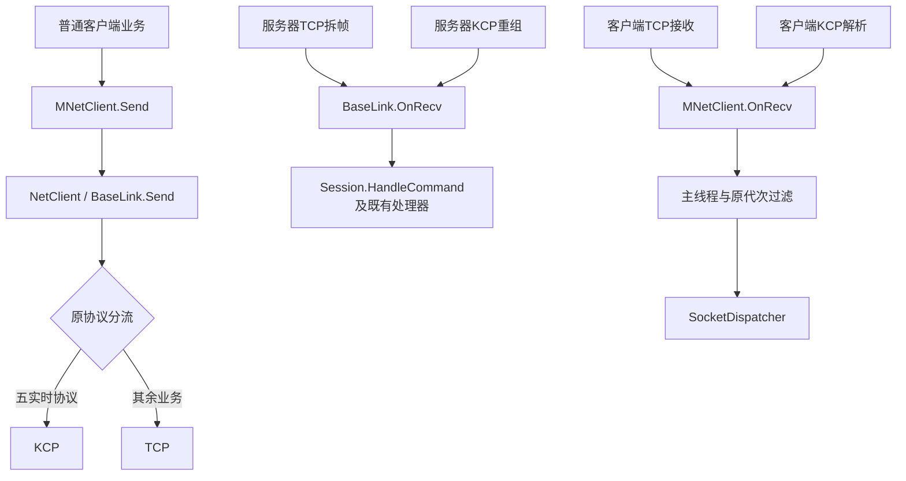

# RO网络公共入口与本项目对照

## 目标与已核验依据

本轮按用户要求对齐网络共用接口，方便逐项阅读RO与本项目源码。参考目录`F:/UnityPro/ro/Ro_cs422nb`只读。本项目继续使用protobuf及已有会话模型，移动/技能固定KCP、其余业务TCP、Gate↔Game内网TCP；对齐接口不改变这些业务规则。

以下为实际读取的参考实现，不代表已运行RO或核实其线上KCP启用情况。

| RO源文件（相对RO根） | 实际职责 |
| --- | --- |
| `clientcode/CSProject/MoonClient/Network/ApplicationLayer/MNetClient.cs` | 持有`_connection`并通过`ConnectionObj`暴露；`Connect`交连接层，`Send(MProtocolBase protocol)`最终调用`_connection.SocketObj.Send(protocol)`。 |
| `roserver/common/include/baselink.h` | `BaseLink`公开`Send`与`OnRecv(UINT32 dwConnID, const char* pcData, UINT32 dwLen)`，处理协议层入口。 |
| `roserver/gateserver/network/clientlink.h` | `CClientLink : ListenLink, ForwardInterface`，`ListenLink : BaseLink`，客户端入口继承公共协议处理。 |
| `roserver/gateserver/network/clientlink.cpp` | `CClientLink.Send`组织客户端包头和序列化内容，交`CNetProcessor.Send`。 |
| `roserver/gateserver/udpnet/kcppeer.cpp` | `CKcpPeer.Update`调用`ikcp_recv`取得完整消息，再调用网络的`GetHandler().OnRecv(conv, buffer, len)`。 |
| `roserver/gateserver/udpnet/udphandler.cpp` | `CUdpDataHandler.OnRecv`转交`CClientLink::Instance()->OnRecv`，KCP复用已有协议处理入口。 |

RO的`CKcpPeer`本身没有继承`BaseLink`；公共的是重组完成后的协议入口，不能误写为TCP和KCP实现继承同一传输接口。当前参考客户端主网络路径已核实为TCP；RO仓库存在KCP模块不等于移动、技能业务已启用它。

## 本轮设计边界

1. 统一业务发送和完整协议接收入口，优先沿用RO的`Send/OnRecv`名称与职责；TCP保留拆帧，KCP保留可靠重组。
2. 客户端业务通过统一网络管理入口发送，避免业务自行选择TCP/KCP；分流仍由网络层按现有五协议执行。
3. 原KCP上行会话字段清理、旧连接/旧代次过滤、主线程派发、绑定失败断线与令牌日志脱敏必须保持。不能为接口对齐降低已验证行为，也不增加新的通用防御框架。
4. RO为C++/C#混合网络，本项目为共享C#网络库；签名只做现有protobuf与单连接对象需要的适配。现有`NetClient`兼具连接和TCP套接字职责，不为凑齐`MConnection/MSocket`名称增空壳包装。

## 当前已落盘接口对应

| RO入口 | 本项目当前入口 | 必要差异 |
| --- | --- | --- |
| MNetClient.Send(MProtocolBase) | MNetClient.Send(int protoCode, ByteString data) | 保留现有protobuf协议号和载荷，返回本地提交bool。 |
| BaseLink.Send(...) | BaseLink.Send(BasePackage,int,ByteString)、Send(int,ByteString)、Send(int,int,ByteString) | 保留原封包及Unity目标会话三种调用；不增加RO协议类型包装。 |
| BaseLink.OnRecv(connID,data,len) | BaseLink.OnRecv(byte[] payload,bool resetGateSessionId=false) | 本项目每连接一个对象，无需另传connID；数组已有长度。true仅KCP上行清原自填GateSessionId。 |
| ikcp_recv→UdpDataHandler→CClientLink.OnRecv | KcpPeer重组→UdpNetwork→session.OnRecv(message,true) | KCP自身继续独立，重组后共用协议入口。 |
| 客户端连接层Socket.Send | MNetClient→NetClient.Send→BaseLink.Send→TrySendRealtime | 五实时协议固定KCP，其余TCP；没有为命名增MConnection/MSocket空壳。 |

客户端原NetSocketMgr.cs及meta真实移为MNetClient.cs及meta；服务端ServerBase.cs真实移为BaseLink.cs。正式Network.dll已配套本轮构建；实际运行仍需重新构建热更程序集，用户原有GM_Game.dll.bytes保持。

商城ShopMgr仍保留原捕获连接与代次后对该连接Send的语义，不能强行换成当前单例发送。客户端公共OnRecv保留fromRealtime来源参数：绑定控制仅TCP消费，KCP保留原归属过滤。此处对齐公共职责与命名，并非声称RO所有签名或内部结构完全相同。

## 验证和当前边界

最终独立五服务工程及289客户端源0错误，真实Socket/KCP122/0、入场8/0、客户端薄边界54/0。输入哈希及用户9文件保持；33机械迁移业务语义保持，meta GUID与导入设置保持。客户端资源/Unity前置用桩，KCP下行接线测试反射调用真实回调，不能当正式Unity双号或真实UDP下行验收。

WorkBuddy原轮超时并有前台未显示的原生审批；用户授权自动同意后实际允许并恢复，原轮idle和过期占用确认后沿同会话限定收尾。重复检查、Send局部简化与注释收尾已验；正式Network.dll与主Agent最终构建SHA一致，正式插件路径289源编译0错误。Git回执查本轮修改日志；不能用保留的旧GM_Game.dll.bytes宣称已部署。

## 关联记录

- 网络分流方案与已核验参考：`项目分析/RO_NETWORK_TCP_KCP_DESIGN.md`。
- 当前固定KCP实现：`项目分析/KCP_NETWORK_IMPLEMENTATION.md`。
- 本轮文件、开发轮次和提交推送：`项目修改日志/2026-10-22-RO-NETWORK-INTERFACE-CHANGELOG.md`。
- 临时开发与独立验收证据：`_temp/network-ro-interface-20261022/`。
