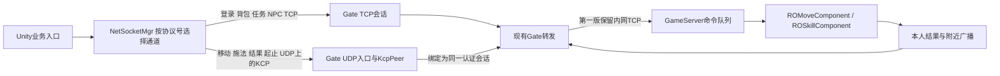

# 参考 RO 的 TCP 与 UDP/KCP 双通道方案

本轮为设计建议，尚未实施。用户需求：玩家移动、技能释放及技能位移采用 UDP，其他业务使用 TCP。采用豆包先查找、Codex 沿路线核验；未修改游戏代码、协议、DLL、资源或场景。

## 一、建议选择

第一版采用 TCP + KCP over UDP：所有当前实时协议（移动、技能请求、技能结果、技能开始和结束）走同一个角色的可靠有序 KCP 通道；登录、角色装载、背包、任务、NPC 交互及其他业务继续 TCP。KCP 底层就是 UDP，但通过确认与重传提供可靠有序交付。这样先满足用户双通道目标，也保留现有“先更新移动位置，再处理施法”的调用顺序。

连续位置采样使用不可靠 UDP 是后续可选优化，需要性能证据再实施。原生 KCP 没有不可靠模式。不能把所有位置和技能都当作可随意丢弃的数据，也不能保证换 UDP 后延迟一定降低。

## 二、RO 与本项目的真实依据

以下路径以对应工程根目录为起点；RO 根目录为 F:/UnityPro/ro/Ro_cs422nb，本项目根目录为 D:/unitypro/LYFMMORGP。

| 工程与文件 | 核验依据 | 能说明什么 |
| --- | --- | --- |
| RO：clientcode/CSProject/MoonClient/Network/SessionLayer/MSocket.cs:84、85、179、189 | SocketType.Stream / ProtocolType.Tcp，NoDelay=true；Send 与 SendByLua 共用发送队列 | 此客户端主游戏网络路径为 TCP |
| RO：clientcode/CSProject/MoonClient/Network/ApplicationLayer/MNetClient.cs:33、167 | 创建 MConnection，通过 SocketObj.Send 发送 | 业务统一进入连接层 |
| RO：roserver/gateserver/udpnet/udpnetwork.cpp:47、71、205、215、277 | UDP Socket、conv 查 Peer、Input、sendto | 仓库存在 UDP/KCP 适配实现 |
| RO：roserver/gateserver/udpnet/kcppeer.cpp:20、46、57、62、65 | ikcp_create/send/input/update/recv | 此模块采用可靠有序 KCP |
| RO：roserver/gateserver/udpnet/kcputil.h:14 | MAX_UDP_PACKET_SIZE=1400 | 仅是参考模块的限制，不能直接视为本项目最佳 MTU |
| RO：roserver/gateserver/process.cpp 与 udpnet 引用检索 | gateserver 中相关类型使用集中于 udpnet 自身，未找到业务主流程实例化与初始化 | 未证明技能、移动已经接入 KCP；不能把仓库源码存在写成线上启用 |
| RO：clientcode/CSProject/MoonClient/Network/ApplicationLayer/MQueryServerState.cs:68 | 独立 Dgram/Udp Socket | 用于服务器状态查询，不是技能移动通道 |
| LYF：LYF_Server/Network/Socket/NetServer.cs:37；NetClient.cs:53 | TCP Socket | 当前游戏连接及服务间现有连接为 TCP |
| LYF：LYF_Server/Network/Socket/com/NetUtils.cs:11、30、38 | 两字节长度、压缩标志、CRC16；大于200字节才GZip | 现有封包是 TCP 流帧；不是所有消息均压缩 |
| LYF：LYF_Server/GateServer/GateServerApp.cs:19、23、51、58 | Gate连接Game，监听Unity，注册移动技能 | 默认客户端→Gate 10140，Gate→Game 10130 |
| LYF：LYF_MMO/Assets/GM_Game/Scripts/SceneEntity/Entity/PlayerEntity.cs:40、69 | UpdateMove 发11180，包含完整终点、朝向、耗时和跳跃状态 | 导航、普通移动、技能程序位移已共用位置上报入口 |
| LYF：LYF_MMO/Assets/GM_Game/Scripts/SceneEntity/Component/MNavigationComponent.cs:377、403 | 先UpdateMove，再发11170，随后本地预表现 | 改造必须保留施法前位置与施法请求的顺序关系 |
| LYF：LYF_Server/GameServer/MessageHandler/Role/MoveOperationHandler.cs:24；Components/ROMoveComponent.cs:21 | 解析移动，保存客户端终点并广播 | 当前尚无服务端导航、速度或碰撞权威结算 |
| LYF：LYF_Server/GameServer/MessageHandler/Skill/SkillCastHandler.cs:50、89 | 按会话反查角色，提交MP/CD并回结果和广播 | 技能准入与MP/CD由游戏服决定 |

RO 的具体客户端施法发包点本轮豆包未完整追踪；不能给出未经核实的技能 UDP 协议号。RO gate 底层部分实现为预编译库，未做运行抓包；本轮结论限定于所核源码，不声称已验证 RO 线上部署。

豆包第1轮有三项误述，第2轮已纠正：BaseLink 的 public OnRecv 能由 CClientLink 公有继承调用，不能据此判无法链接；KCP 没有原生不可靠模式；1～9999循环的 skill_uuid 不能单独充当永久幂等键。继承声明见 roserver/common/include/baselink.h:103、117、145 与 gateserver/network/clientlink.h:25。

## 三、消息划分

| 当前消息或业务 | 第一版推荐通道 | 原因与处理 |
| --- | --- | --- |
| MoveOperationReq，11180 | KCP | 普通移动、导航、跳跃和技能位移共用；先保留完整有序处理，停止与落地不会因单包丢失而永远漏掉 |
| SyncMoveNtf，11181 | KCP | 附近玩家位置和动画状态保持现有顺序；旧状态积压是后续测量重点 |
| SkillCastReq / SkillCastRet，11170 | KCP | 释放意图、拒绝原因、权威MP/CD必须交付；请求与位置上报同通道 |
| SkillCastStartNtf，11171；SkillCastEndNtf，11173 | KCP | 起止事件保序，避免远端动作停留或倒序播放 |
| 登录、选服、创建角色、进出场景与初始角色快照 | TCP | 管理生命周期和初始状态 |
| 技能列表、背包、商城、任务、NPC对话、聊天与持久化等 | TCP | 保持现有业务链；未来未实现业务仅定义分流原则 |

当前项目未有完整命中、伤害结算同步，本轮不新增这些功能。以后若新增关键战斗事件，应按其交付语义明确通道，不能自动归为可丢位置消息。

## 四、数据流和职责

客户端仍调用原来的移动与施法入口，由网络管理层集中按已有协议号分流，不让各业务散写UDP Socket。参考RO的职责沿用 UdpNetwork、KcpPeer 的边界；本项目是C#，不能直接把C++模块整份接入，也不复制RO整套网络框架。

Gate负责UDP收发、KCP更新、会话绑定和路由，不结算技能。GameServer继续使用现有命令队列和逻辑线程，不在UDP回调线程直接修改角色。下行仍按目标玩家会话选通道，本人及附近角色不要求共享同一个传输连接。

第一版保留Gate↔GameServer的TCP以控制改动范围。这能隔离客户端外网TCP中普通业务与实时包的队头阻塞，但内网共享TCP及GameServer队列仍可能积压；不能宣传为端到端无阻塞。若实测瓶颈在内网，再单独设计实时内网链路，本轮不顺带改造。

## 五、连接建立、封包和生命周期

1. 客户端先通过原TCP链路完成现有登录及进入世界流程。
2. Gate只向已经绑定在线角色的TCP会话下发UDP地址、端口、conv、短期随机绑定凭据及必要会话信息。UDP端口独立配置，不能把默认建议端口当已经部署。
3. 客户端发UDP绑定请求，Gate验证后把KcpPeer绑定至该TCP会话和当前角色。conv只用于查找Peer，不能当身份凭据；报文认证通过后才能接受地址变更。
4. 通道就绪后才开始本会话实时协议的KCP发送。初次无法建立UDP时，本会话继续全部使用TCP，并明确记录当前传输模式。
5. TCP断开、退出角色或重新进入场景时释放旧绑定，按现有生命周期重新绑定。UDP不能在所属会话失效后继续操控角色。

封包建议：外层包含协议版本、通道类型、conv/会话标识、认证需要的计数和校验信息，内层KCP载荷复用“协议号＋protobuf业务载荷”。客户端报文不可信任其中自填的GateSessionId/UnitySessionId，由Gate根据已验证绑定补入现有BasePackage再转发GameServer。KCP报文自身携带序号与确认信息，不在业务层重复实现一套重传。

绑定与数据报需有随机凭据和消息认证，CRC16、conv都不能防伪造；密钥下发依赖的TCP链路是否具备TLS保护要在部署前明确，普通明文TCP不能承诺抵抗中间人窃取。选用成熟KCP实现及现有加密库，不自行发明加密算法。初始UDP数据报预算建议不超过1200字节（包括认证封装），具体按路径MTU和所选库验证；大角色/背包快照继续TCP。小实时消息不套现有GZip与流拆包流程。

运行中UDP失效的第一版策略：走现有重连与状态恢复流程，不把未确认施法自动复制到TCP重发。两条连接之间没有全局顺序；热切换、跨通道补发及其去重不是KCP天然提供的能力。若未来要求无感热切换，必须另行批准明确的业务请求序号和去重设计。现有skill_uuid保留表现关联语义，不把1～9999循环值改称永久唯一。

场景创建/销毁在TCP，实时数据在KCP，接收方不能假设二者到达顺序。沿角色进入世界与实体创建完成点启用实时流，场景离开点停用；旧场景绑定不复用。初次实现需定向验证“远端实体尚未创建而技能/位置先到”这一真实双通道边界，确定现有派发点能否满足；确需适配时只补最小接入，不设计通用缓存框架。

## 六、移动、技能与根运动怎么同步

移动链：键盘或NPC导航→MMoveComponent计算实际碰撞后位置→PlayerEntity.UpdateMove→KCP→Gate→MoveOperationHandler→ROMoveComponent→附近角色KCP→远端现有移动及动画处理。不要另造“导航网络协议”，导航只是移动来源。

技能链：现有准入→先UpdateMove→同一KCP流发SkillCastReq→立即本地预表现→GameServer检查并结算MP/CD→同一可靠通道返回SkillCastRet及Start/End→本人与远端按现有逻辑校正和播放。本地预表现不等待服务器确认，拒绝仍执行原回滚。

技能位移继续由RO式Program/Charge配置生成，在原MMoveComponent单次碰撞入口合并，最后走11180/11181。无需逐帧传动画骨骼或重新启用SkillRootMotionCollector，也不要让“远端程序位移”和“远端坐标追赶”各驱动一次相同位移。

必须明确：本次是传输层改造，现有服务器只保存和广播客户端终点；不会因为换成UDP就自动变成服务器权威移动。速度、穿墙、服务端导航与技能位移碰撞结算属于单独需求，不能声称已具备。

## 七、后续可选的不可靠位置通道

如果测试证明KCP可靠移动因旧位置重传阻塞技能，可把连续完整位置快照移到经过认证的UDP数据报，技能关键事件继续KCP。必须同时完成以下具体适配，否则不要启用：

- 每角色移动序号，接收方仅接纳更新快照；时间戳不代替序号，位置必须是完整绝对位置而非丢一包便无法恢复的增量。
- 不能假定施法前的UDP位置一定先于KCP施法到达：施法携带必要起点快照或沿可靠通道先交付施法前位置，不能强制等待一份可能已经丢失的UDP包。
- 松键、落地、技能末段不能只发一次不可靠包。采用可靠的带移动序号状态收尾，并通过后续完整快照恢复；旧UDP包不得覆盖已确认的更新收尾。普通静止快照恢复漏掉的最终位置。
- 远端位置插值需基于新快照时间点，不能把缺包后的耗时误当连续完整区间。跳跃等短暂事件若必须观察到应有可靠事件语义，仅最新状态不保证看见每一段。

此阶段可让KCP与不可靠数据共用一个UDP Socket，按外层类型分流；并非必须另开Socket，也不声称这是原生KCP的模式。快照频率如10～20Hz仅为测试起点，正式参数由实测决定。

## 八、开发范围与验收

| 阶段 | 主要范围 | 通过标准 |
| --- | --- | --- |
| 1 通道原型 | Network新增UdpNetwork/KcpPeer及所选KCP库；专用测试场景/测试组件 | 认证绑定、双向收发、丢包重传、释放；真实构建通过，不挂正式场景 |
| 2 业务接入 | NetSocketMgr、GateServerApp、Gate路由与RoleNetSender等发送接入；仅必要的协议及生成工程 | 五类实时消息走KCP，其余TCP；现有处理器与预表现保留；移动先于同次施法 |
| 3 联调与集成 | 正式客户端/服务端配套Network程序集与必要主包；记录及修改日志 | 双客户端导航、跳跃、六技能位移与打断，抓包确认路由；TCP业务回归 |
| 可选4 | 独立位置UDP与移动快照语义 | 经实测需要且用户要求后再开发；覆盖上述丢包与跨通道因果 |

拟修改现有文件范围：LYF_Server/Network/Network.csproj、LYF_Server/Network/Socket/com/NetDefine.cs、LYF_MMO/Assets/GM_Game/Scripts/Manger/NetSocketMgr.cs、LYF_Server/GateServer/GateServerApp.cs、GateServer/Ctrl/GateMoveCtrl.cs、GateSkillCtrl.cs、GateClientResponseForwarder.cs、GameServer/Entity/Role/RoleNetSender.cs；如需绑定协议再修改ProtoBuf/proto与对应生成文件，若实测需要处理客户端实时派发则限定现有接收入口。最终开发任务应先根据选定库和既有生命周期明确逐项文件，不能将本表当开放式重构授权。PlayerEntity/MNavigationComponent原则上只改发送接入需要的最小调用，避免重写移动或技能。

验证矩阵：正常网络；30/100/200毫秒模拟延迟；1%/5%/10%丢包；乱序/重复；UDP被阻断；绑定失败；运行中断链与重登；切场景；旧Peer数据；实体创建与实时消息交错。验收不重复扣MP、不丢施法结果、Start/End不倒序、最终停止/落地位置一致、旧场景数据不落到新角色。统计端到端P50/P95、带宽、KCP重传/积压与GameServer排队，和当前TCP基线比较，不预报收益。

客户端Network.dll位于主包/AOT边界，已有历史MissingMethod故障；网络/协议程序集修改后需确认HybridCLR与IL2CPP主包配套，不能只换GM_Game热更就宣称生效。

## 九、本轮查找与验收记录

任务NET-TRANSPORT-RO-DESIGN-20261022，豆包官方桌面local项目38435310952198914，目录D:/unitypro/LYFMMORGP，会话38448607062546178。第1轮59328209991283202完成查找，第2轮59334090250597122完成三项定向纠正；Codex回读关键源文件核验，没有转交WorkBuddy开发，也没有进入独立接管回退。

仅静态源码核查和方案文档验证；没有运行RO抓包、Unity联机、弱网测试或性能实验。后续待用户决定是否按第一版进入实施，所有阶段均是拟议而非完成项。逐项文件与Git结果见 项目修改日志/2026-10-22-NETWORK-TRANSPORT-DESIGN-CHANGELOG.md。
