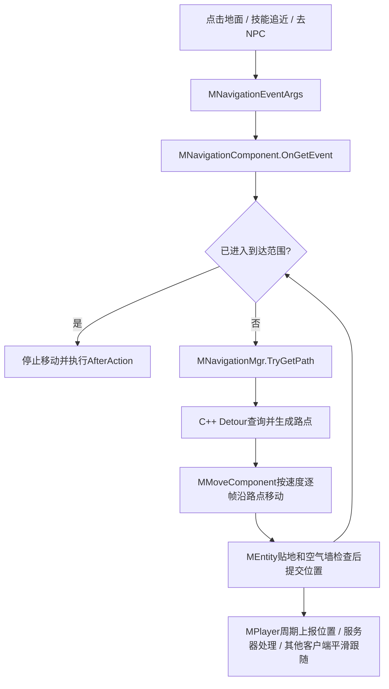

# RO寻路实现整理

2026-10-21实施更新：本文保留2026-10-20源码分析时点事实；本项目现已完成公共查询与客户端导航源码接入，详见`项目分析/RO_NAVIGATION_IMPLEMENTATION.md`。下文“本轮未移植”“导航尚为空”等属于分析当时状态，不作为最新实现结论。

核查日期：2026-10-20。参考根目录：`F:/UnityPro/ro/Ro_cs422nb`。本文所有以`clientcode/`、`rogamelibs/`、`roserver/`开头的源码位置均相对此目录；以`LYF_MMO/`开头的位置相对本项目根目录。

本轮是源码分析，未运行RO、没有移植寻路，也没有改客户端或服务器业务。下述流程以实际函数体为依据，不把原文件注释、接口名称或第三方库存在本身当作实现证明。

## 1. 先看玩家实际经历了什么

玩家点击地面后，RO先把屏幕位置转换为场景目标点，再在导航网格上算一条可走路线。路线表现为一串三维路点；角色每帧按照移动速度消耗一段路程，到拐角就切换下一段。到达目标附近后停止，并根据本次请求执行交互、施法或传送等后续动作。

它把以下三件事分开：

| 工作 | 主要负责人 | 实际产物 |
| --- | --- | --- |
| 决定去哪里、到多近、到了做什么 | 输入、技能、任务等入口 + `MNavigationComponent` | 目的点/目标实体、距离范围、到达回调 |
| 根据地图算可走路线 | `MNavigationMgr` → C++ `MNavigation` → Detour | 路点列表 |
| 沿路线走、贴地、碰撞与同步 | `MMoveComponent`、`MEntity`、`MPlayer` | 每帧位移和移动上报 |



## 2. 核心类、函数和成员怎么对应

RO客户端C#目录前缀为`clientcode/CSProject/MoonClient/`。

| 类或参数 | 关键内容 | 用途 |
| --- | --- | --- |
| `Input/TouchObject.cs` | `ClickGround` | 点地射线、生成点地导航请求 |
| `Event/MEventDefine.cs` | `MNavigationEventArgs` | 统一表达点地、追目标、范围及到达动作 |
| `Skill/MNavigationComponent.cs` | `OnGetEvent`、`navigate`、`navToPos`、`navToTarget` | 消费请求并维护一次导航过程 |
| 同上 | `_pathPoints`、`_currentPathIdx` | 当前路线及已经消费到的路点索引 |
| 同上 | `_tarPosition`、`_destination` | 当前目标位置、已设定的目的位置；实际查询端点另由`calcTargetPos`计算 |
| 同上 | `_target`、`_naviWithTarget` | 目标UID及是否跟随实体更新目标点 |
| 同上 | `_upperRange`、`_lowerRange`、`_customRange` | 到达判定距离，按场景世界长度使用 |
| 同上 | `_afterAction`、`_useAfterAction` | 到达后做什么，是否执行该动作 |
| `Transfer/MNavigationMgr.cs` | `TryGetPath`、`TrySetHeight`、`TryRaycastTerrain` | C#到原生导航的接口适配 |
| `Components/Common/MMoveComponent.cs` | `PlayerUpdate` | 按速度向导航组件索取下一步位置 |
| `Entity/MEntity.cs` | `AppendMove`、`Move`、`MoveModel` | 累加位移、消费位移、落到实际模型坐标 |
| `Transfer/MTransferMgr.cs` | `GotoNpc`、`GotoPosition`、`Arrive` | NPC/任务/跨图导航编排 |

距离示例按项目常见的“1世界单位≈1米”解释，速度按世界单位/秒；实际资源比例仍以场景为准。C#移动`deltaTime`和上行`Time`是秒；原生服务器内部有毫秒计时及显式秒/毫秒转换。

## 3. 点击地面如何发起一次导航

源码：`Input/TouchObject.cs:45`，关键导航请求在110—135行附近。

1. 输入松开时，由游戏相机执行`ScreenPointToRay`。
2. 调用`MNavigationMgr.TryRaycastTerrain`，射线终点为`origin + direction × 1000`，取得地形命中点。这里查询的是RO原生地形接口。
3. 清除技能等待与自动攻击，构造池化`MNavigationEventArgs`。
4. 设置`NeedTarget=false`、`Pos=命中点`，上下限均0，`IsAuto=false`、`NeedClear=true`。
5. 派发全局`MEvent_Navigation`；另外通知停止跟随、点击地面移动开始等表现。

上下限均0表达“走到这个点”，不是攻击范围。`isTargetInRange`实际带约0.01世界单位的边界余量。

`MNavigationComponent.OnGetEvent`（1166行）先处理旧导航，再保存请求参数、目标和回调；若当前位置已经满足范围，直接走到达流程，否则调用`navigate`开始查询。它还处理自动导航保存、结束朝向、坐骑与现有状态互斥，这些属于完整RO玩法外围。

手动方向输入走另一条入口：`MVirtualTab.fireMoveEvent`（243行）会先`NavComp.Interrupt(false)`，再发普通移动事件。因此摇杆接管会打断自动行走，不需要等路线走完。

## 4. 底层到底用什么寻路算法

### 4.1 普通角色主线的实际调用

```text
MNavigationComponent.navToPos / navToTarget
  → MNavigationMgr.TryGetPath(Entity.PredictedPos, 计算后的目标点, _pathPoints)
  → MNavigation.PathFind(start, end, path, halfExtents)   [SWIG调用C++]
  → MBaseHelperNav.DoFindCorridor
  → MBaseHelperNav.DoCalculateCorridor
  → dtNavMeshQuery.findPath
  → dtNavMeshQuery.findStraightPath
  → Vector3Vector转换为C# List<Vector3>
```

关键位置：`Transfer/MNavigationMgr.cs:518`；`rogamelibs/rocommongamelibs/navigation/m_navigation.cpp:613`；同目录`MBaseHelperNav.cpp:160`、`:516`；`rogamelibs/thirdparty/recast/DetourNavMeshQuery.cpp:1046`附近。

这里实际使用Detour导航网格查询。`findPath`维护开放列表，以累计代价`g`加启发代价`h`排序，可确认是A*搜索；搜索对象是导航多边形连接关系。`findStraightPath`再从多边形走廊提取直线路点，默认选项是`DT_STRAIGHTPATH_ALL_CROSSINGS`，会保留穿过多边形边界的交点。

因此不能把输出一律描述为“只有转弯处的最少几个角点”，也没有证据把这条流程说成样条曲线平滑。C#文件虽然有`using UnityEngine.AI`，普通主线没有调用Unity的`NavMeshAgent.SetDestination`。

实际代价还受区域影响：`MBaseHelperNav.init`设置普通区域1、跳跃区域2、攀爬区域5。它们是搜索代价，不是该C#函数已经驱动了完整跳跃或攀爬动画的证明。

### 4.2 起终点如何修正

`MNavigationMgr.TryGetPath`按以下顺序执行：

1. 尝试`TryGetNearstValidPt`修正目的点。
2. `GetFirstPoint`处理起点。
3. `PathFind`使用搜索盒半尺寸`(4, 8, 4)`寻找对应导航多边形。
4. 将原生路径复制到调用方列表，更新原生`_corridorStep`。

`(4, 8, 4)`是世界坐标中的搜索盒**半尺寸**，不是4米寻路长度、角色体积或技能射程。`TryGetPath`并不清空调用方传入的列表，导航组件会在查询前自己清空`_pathPoints`并重置索引。

吸附接口的返回值还有原生边界：`MBaseHelperNav.cpp:251`的`TrySetHeight`没有检查`findNearestPoly`的状态码或多边形引用，随后便写回临时坐标并返回true。因此不能把`TryGetNearstValidPt=true`理解为一定找到了有效多边形；C#这里也没有按该返回值阻断查询。这是源码核查结果，未运行复现，也未在本轮修改。

### 4.3 查询成功不等于完整可达

这点从实际代码可以直接看到：

- `DoCalculateCorridor`如果最后找到的多边形不是目标多边形，会把终点投影到最后可达多边形，再生成路点；原生允许得到部分路径。
- 普通`halfExtents`重载不会在末尾强行追加原始目标点。
- C# `TryGetPath`没有读取底层完整/部分路径状态，最终只看原生路径是否非空来返回true。
- 另一份`PathFind(..., float movespeed)`重载的末尾行为不同，会在有路点时追加原目标点，不能混用两份代码作结论。

这表示“有路线可走”与“能最终到达原目标”需要分开理解。C#到达判定仍检查目标范围；本文不据此虚构已复现卡死，也不在分析任务中修改其容错。

普通这条调用栈是同步查询：函数返回前拿到路点。Detour目录存在切片查询和路径队列，不等于该玩家入口已经使用异步寻路或工作线程。

## 5. 导航数据怎么加载

`MScene.cs:331`在场景加载流程调用`MNavigationMgr.OnSceneLoaded`。管理器根据场景表取得Unity场景文件名，调用原生`RONavigationManager.InitNavigationC`。

原生文件：`rogamelibs/rocommongamelibs/navigation/m_navigation_manager.cpp:168`。

| 文件 | 实际处理 | 不能仅凭名称作的判断 |
| --- | --- | --- |
| `<场景名>.nav` | 进入`MNavigation.Load → InputGeom.loadClient → rcMeshLoaderObj.loadC`，按文本几何内容解析 | 扩展名nav不代表它就是Detour最终二进制网格 |
| `<场景名>.bytes` | 经`InitCollider → LoadServerNavClient`解析`NavMeshSetHeader`及分块数据，创建/加载`dtNavMesh`、`dtNavMeshQuery`并重新初始化helpers | 接口叫InitCollider，也不能只称为碰撞附件；它实际加载运行查询用的导航网格 |

分块网格头可见magic `RONV`、version 1。具体解析在`MBaseDynamicObstacle.cpp:1130`附近，数据结构在`MBaseDynamicObstacle.h:14`附近。这里核实的是加载链及格式，不是本轮已重新烘焙或验证了所有场景资源。

### 5.1 这些导航数据怎样制作出来

用户追问“把地图能走的地方做成数据”具体怎样做。进一步找到独立工具`clientproj/Tools/RONavigation/RONavigation.exe`及源码目录`clientcode/ToolsProject/navigation/`。`clientproj/Tools/RoToolMgr/script/CommonTools.py`也提供打开该工具目录的入口。

这里的制作过程通常称为“烘焙”：开发阶段把地图几何按行走规则计算一次，保存成文件，游戏加载后查询该文件。源码展示的普通地图流程为：

```text
地图源几何：顶点、三角形面、可选连接/区域/参数
  → .nav文本文件
  → RONavigation读取几何和烘焙参数
  → Recast筛选坡度、栅格化、过滤不可通行位置
  → 按角色半径收缩可走区域，划分区域并生成多边形网格
  → Detour格式的分块网格数据
  → 同名.bytes文件
  → 游戏运行时加载并查询路线
```

**第一步：准备地图几何。** `src/MeshLoaderObj.cpp`解析`v`顶点、`f`面，并拆成三角形；还支持`o`离网连接、`a`区域标记和`s`构建参数。因此烘焙依赖几何和规则。地面、墙面等是否参与，取决于输入几何的制作/导出范围，不能凭这里的读取代码宣称“Unity所有可见模型都会自动参与”。本次在所查C#/Python/脚本中没有定位到从Unity场景或美术软件生成首份.nav的具体导出器，所以这一步的原始按钮、筛选层和美术操作尚未确认。

**第二步：设置角色能怎样走。** `src/MBase.cpp`的`ResetCommonSettings`给出以下默认值；`HandleMeshChanged`会从输入构建参数覆盖它们，不能当作每张地图的最终值。

| 参数 | 代码默认值 | 对行走区域的影响 |
| --- | --- | --- |
| 水平栅格尺寸`cell_size_` | 0.3世界单位 | 空间采样粒度；越小通常越能保留细小结构，也增加制作成本 |
| 垂直栅格尺寸`cell_height_` | 0.02世界单位 | 高度采样粒度 |
| 角色高度`agent_height_` | 2世界单位 | 过滤头顶空间不足的位置 |
| 角色半径`agent_radius_` | 0.5世界单位 | 给墙边留出身体宽度，过窄通道可能被过滤 |
| 最大跨越高度`agent_maxclimb_` | 0.6世界单位 | 判定相邻高度差是否可步行跨过 |
| 最大坡度`agent_maxslope_` | 45度 | 按三角形法线过滤过陡表面 |

例如角色半径为0.5，身体直径约1世界单位，导航区域要给墙体预留宽度；一条只有0.6单位宽的夹缝就不适合生成供该角色通过的路线。这个例子解释参数含义，实际边界还受栅格离散、几何和地图设置影响，不是精确到厘米的运行测试。

**第三步：工具生成可走面。** 工具目录`include/MBaseDynamicObstacle.cpp`中的普通`HandleBuild()`调用`BuildTileMesh()`，逐块执行`buildTileMesh()`：

1. `rcMarkWalkableTriangles`按坡度标记候选地面，`rcRasterizeTriangles`把三角形写入高度栅格。
2. `rcFilterLowHangingWalkableObstacles`、`rcFilterLedgeSpans`、`rcFilterWalkableLowHeightSpans`处理低矮障碍、边缘落差和净空。
3. `rcBuildCompactHeightfield`压缩高度数据，`rcErodeWalkableArea`按角色半径向内收缩可走区域。
4. 按分区模式划分区域，再通过`rcBuildContours`、`rcBuildPolyMesh`、`rcBuildPolyMeshDetail`得到轮廓、多边形与细节高度。
5. `dtCreateNavMeshData`转换成Detour分块数据，供之后的查询使用。

Recast在这里负责生成导航网格，Detour负责生成对应运行数据并提供路径查询。游戏内的一次点击主要执行查询和角色移动，不需要重新计算整张静态地图。

**第四步：保存并供游戏加载。** `src/BatchToolMenu.cpp`会扫描`.nav`，普通地图调用`HandleBuild → CreateServerNav`；工具显示`CREATE SERVER NAV LAYER <.bytes>`，按钮为`Push Into Assets/NavDatas`。实际文件位置应看`CreateServerNav`传入的目录，不能只凭按钮文字认定固定导出路径。`include/MBaseDynamicObstacle.cpp:842`的`CreateServerNav`写入RONV/version头、导航参数及各分块数据，文件后缀为.bytes。函数虽叫ServerNav，前节已经核实客户端也加载这种.bytes文件。桥接地图另走专用分支，本文不将其格式概括为普通地图完全相同。

本轮确认了工具源码中的输入解析、默认参数、构建和保存流程，未启动工具、未写入参考资源、未重新烘焙；也未验证现有exe与这份工具源码完全对应。`ronavigation.vcxproj:264`已将上述位于include目录的`MBaseDynamicObstacle.cpp`列为编译输入，不能因目录名为include就当作未编译的示例文件；本轮仍未实际重新编译工具。原始几何导出器仍待定位，不影响已确认的.nav到.bytes烘焙原理。

补充证据见`_temp/ro-navigation-bake-20261020`，修改记录见`项目修改日志/2026-10-20-RO-NAVIGATION-BAKE-CHANGELOG.md`。

### 5.2 我们项目有没有.nav，它从哪里来

2026-10-20用户继续追问。RO这里的.nav是地图几何的文本输入格式，读取器按`v`顶点、`f`面以及连接/区域/参数解析；应由地图几何导出环节制作，输入每张地图自己的空间数据。已确认的是内容和读取/烘焙链，首份文件由哪个具体Unity或美术导出器生成仍未定位，不能把推测写成已有菜单。

对本项目磁盘做包含隐藏与被忽略文件的扫描，排除.git、Library、Temp、Logs、obj、bin及项目_temp等缓存/中间目录，未找到.nav文件。进一步检查：

- `LYF_MMO/Assets/GM_Game/Scenes/Scene_MainCity.unity:121`及`Scene_MainCity 1.unity:121`均为`m_NavMeshData: {fileID: 0}`；Assets文本资源未查到NavMeshData类型块或NavMeshSurface记录。
- `LYF_MMO/ProjectSettings/NavMeshAreas.asset`是Unity的区域、代价和角色烘焙参数配置，不是主城已生成的导航多边形数据。
- `LYF_MMO/Packages/manifest.json`包含Unity基础AI模块，未声明`com.unity.ai.navigation`；有模块引用不代表主城已烘焙或接入寻路。
- 正式业务目录未查到NavMesh查询/烘焙调用。客户端MNavigationComponent仍直接执行技能到达动作，服务端NavigationComponent只有构造接入；模型通过CharacterController移动。
- 动作编辑器包中有`NavMeshAgentBackend`，用于已有Agent和CharacterController的技能位移适配，不负责生成地图数据，不作为主城寻路已接入的证据。

结论限定为当前磁盘资源与活动代码：本项目没有查到RO格式.nav，也没有查到已烘焙并接入主城的导航网格。此次没有进入Unity核内存/运行时导航数据。未来若选择Unity NavMesh，可以生成Unity自己的导航资源；若选择RO工具链，再适配本项目地图几何的.nav导出。两种方向都不在本轮实施范围，不能直接用RO其他地图的空间数据替代本项目主城。

证据`_temp/project-navigation-assets-20261020/validation.json`；修改记录`项目修改日志/2026-10-20-PROJECT-NAVIGATION-ASSETS-CHANGELOG.md`。

### 5.3 服务器也要使用时，具体接入顺序

后续用户明确“简单方案即可，不必跟RO，自写多地图导出工具”。当前实施方向改为Unity已烘焙三角网直接导出和纯C#共用读取，见`项目分析/UNITY_NAVIGATION_EXPORT.md`。本节保留为此前参考方案，不能当作本轮使用RONavigation/Recast工具链的实施记录。

**后续状态更新。** 用户安装并烘焙后，本轮已在`LYF_MMO/Packages/manifest.json`读到`com.unity.ai.navigation: 2.0.6`；已找到`LYF_MMO/Assets/GM_Game/Scenes/Scene_MainCity/NavMesh-MainCityNavigation.asset`（17,755,640字节）。场景972行的NavMeshSurface以GUID`0241a054f78c9b4489b3f2b28088524c`引用该资源，meta对应。第5.2节“未查到”是较早检查时点的事实，不能继续当作当前状态；121行场景全局导航引用为0，也不能忽略Surface自己已保存的数据引用。本轮没有更改这些用户资源，没有验证蓝色区域覆盖与运行路径。

服务端实际为.NET Framework 4.8：`LYF_Server/GameServer/GameServer.csproj:13`和公共工程目标框架均为v4.8。`ROMoveComponent.OnMoveStart`当前直接保存客户端终点并转发，`SceneEntity/NavigationComponent`及`manger/SceneManager`没有地图导航查询实现；依赖文件未查到Recast/Detour/DotRecast接入。

因此，按前述RO两端共用查询数据的方向，建议按以下阶段实施。以下是待开发方案，本轮未编写导出器、安装依赖或修改业务。

| 阶段 | 必须做什么 | 验收产物 |
| --- | --- | --- |
| 1. 验证查询后端 | 选择能供当前Unity和.NET 4.8调用的Recast/Detour实现；DotRecast只作为候选，先核目标框架/API与文件格式，或评估独立C++库包装 | 两端可加载同一个小测试网格并查询路线，不升级服务器框架 |
| 2. 导出地图输入 | Unity编辑器按实际NavMeshSurface的收集范围、层和几何类型收集地图原始几何，转换为世界坐标三角形并导出角色参数；若采用RO工具，则适配其.nav解析格式 | 对应本项目主城的几何输入及角色参数 |
| 3. 生成公共导航文件 | 用选定的Recast实现烘焙，并保存双方加载器支持的导航文件；必须明确格式，不凭.bytes后缀假设与RO兼容 | 同一份可加载的主城导航数据 |
| 4. 服务端先接加载和查询 | 按当前主城地图加载数据，在现有场景/导航职责下提供找最近有效点、路径查询、可行走点/表面连通查询 | 给定主城两点，返回绕障路点；不可达结果明确 |
| 5. 客户端接RO流程 | 保留OnGetEvent/navigate/TryGetPath/TryGetNextStep/Interrupt/onCloseTarget的职责，查询公共数据、按现有移动组件消费路点 | 点击移动和中断，后续再按用户范围接技能追近 |

阶段2导出原始几何与“把Unity已烘焙网格三角化导出”是两种输入。若把已因角色半径收缩的可走面再按同半径烘焙，会重复缩边；不能无差别把`NavMesh.CalculateTriangulation`结果当原场景几何喂入Recast。该API也不会直接提供一份完整可加载的Detour网格文件，连接、区域、坐标和格式还要适配验证。选定共享Recast方向时应以原始几何及统一参数烘焙，现有Unity资源先保留作为可视化参考。

最小业务外验证先选主城两个地面点：直路、绕墙、不可达区域及上下层/楼梯。分别在客户端查询端和服务器查询端检查是否可达、路径端点/经过区域是否相符，不要求等价最短路径的每个浮点坐标逐字一致。再接角色移动。普通地面导航网格不能单独证明空中跳跃或技能根运动合法；当前移动协议已有JumpCount和特殊移动表现，接服务端校验需另按真实需求确定相应处理，不在本轮顺带拒绝全部非贴地上报。

最先应完成的是**小网格兼容验证及主城输入导出/服务端查询链**；怪物AI、移动回拉、速度检查、跨图导航和完整防作弊都不是这一阶段自动增加的需求。生成的公共导航文件属于正式资源，应在明确加载目录后归档，不能放_temp；隔离验证的工具输出和报告才放_temp。

本轮已核当前代码/资源，不保证候选库可直接安装到.NET 4.8。一次只读获取DotRecast上游csproj请求20秒超时，未据此断言其支持或不支持当前框架，也未重复请求、安装或升级。接入前先确认版本支持，是待完成的工程适配；本轮没有宣称寻路已实现。

记录见`项目修改日志/2026-10-20-SHARED-NAVIGATION-PLAN-CHANGELOG.md`，证据`_temp/shared-navigation-plan-20261020/validation.json`。

## 6. 角色怎样沿路走，为什么拐角不会一帧一停

`MMoveComponent.PlayerUpdate`（461行）中，处于导航状态时：

1. 计算本帧路程：`VehicleOrRunSpeed × deltaTime`。
2. 调用**实体导航组件**的`TryGetNextStep(Entity.Position, 路程, out next_position)`。
3. 检查本帧起点到下一点之间的空气墙；阻挡则中断导航。
4. 更新模型水平朝向，并`AppendMove`累加本帧水平位移。
5. `MEntity.Move`消费位移；普通`MoveModel`再次修正高度、处理圆形空气墙滑动和墙体检测，最后写模型位置。

导航组件`TryGetNextStep`（246行）逐段消耗距离。如果本帧剩余路程足以走到当前路点，就扣掉这一段、索引加一，继续消费下一段。

例如每帧可走0.2米，距离当前拐角只有0.05米：先到拐角，余下0.15米继续沿下一段行走。这样不会因为每经过一个路点都等下一帧而降低速度。地面路径沿水平距离推进，高度由后续贴地查询处理。

不要把它与`MNavigationMgr.TryGetNextStep`混为同一个实现：管理器另有原生`GetPathNextPoint`包装，但上面这条普通玩家移动实际调用的是导航组件内的C#路点步进。

`navToPos/navToTarget`从`Entity.PredictedPos`算路，而非简单只传当前坐标。该属性是`Position + 本帧累计位移`；原代码明确用于避免组件更新先后造成重算路线时回头，不能理解为预测未来多秒的服务器位置。

## 7. 技能自动追近如何复用寻路

入口在`UISystem/Ctrl/Skill/MWaitingDataMgr.cs:343`的`DoCastSkill`。

它构造同一份导航参数，把`UseAfterAction=true`，将`NavAction.type`设为`MEvent_Skill`，缓存原技能事件。目标、目标点、`LowRange`和`UpRange`一起传给导航组件；该入口对自身为中心的技能使用`UpRange / 2`作为上限，其他技能使用`UpRange`。这是**该技能入口的具体规则**，不能推广为所有技能的范围都要乘二或除二。

导航组件主要做两次计算：

- `isTargetInRange`（573行）：先检查非飞行角色与目标的高度差，再计算水平距离。普通范围约为`lower - 0.01 < distance < upper + 0.01`；自定义范围非0时走自定义比较。
- `calcTargetPos`（1028行）：距离不在范围内时，用上下限中点确定查询目的点，避免把路径查询终点始终放在目标身体中心。

若自己在0米、目标在20米，施放距离为0～10米，查询目的点大致放在15米处，使自己与目标间剩5米。但角色**不必真的走到15米**：途中每帧进入10米左右的可施放范围，就会先触发到达流程。因此“路线上规划到哪里”和“何时停止追近”并非同一判断。

到达技能流程为：

```text
onCloseTarget
  → close：清路径/标记/地图轨迹
  → StopMove
  → closeTargetAfter 的 MEvent_Skill 分支
  → Player.UpdateMove：先提交已有位置变化
  → OnAfterAction：组装并发送施法请求
  → 发送成功后启动本地预表现
```

发送成功指网络发送接口返回成功，不等于服务器已经确认施法或命中。权威施法结果仍是另一条回包流程。

`OnAfterAction`里还有施法目标、技能空气墙及打击点修正等逻辑。此前讨论的`TryGetClosetValidPt`只是在导航表面修正一个点，单独调用它没有生成路线，更没有让角色自动走过去。

## 8. 目标移动、到达与中断怎么处理

`LateUpdate`（942行）负责目标跟踪与到达检查，放在较靠后的阶段：

- `NeedTarget=true`时保存目标UID；每次取目标最新`GetCastPoint`，位置变化就调用`navigate`重新查询。
- 目标失效或不可见时中断，不能沿旧位置无限追。
- 当前不可移动时先返回，不等价于本次导航立即被删除。
- 还在导航则`moveNext`，维持移动状态并检查是否进入到达范围。

所以它不是固定“每0.5秒重算一次”。该函数按帧检测目标点变化后重算，本轮没有运行性能采样，不能承诺查询成本或高密度追踪的帧率。

正常到达会清路线、停止、设置合法的结束朝向、发到达事件，再执行`AfterAction`。回调支持技能、采集、去NPC、去坐标、便捷寻路等。中断则走取消分支，发对应取消/停止事件并回收回调参数，不执行正常到达动作。

自动导航可用`_saveArg`保存指令；加载导航后`onLoadNavigation`重放。本地指令可重新派发，跨图`EasyPath`则重发协议。它不是把上一场景的路点坐标直接拿到新场景继续走。

## 9. 导航网格、空气墙与高度修正各管什么

| 机制 | 实际作用 | 示例 |
| --- | --- | --- |
| 导航网格查询 | 选择可行走表面和绕障路线 | 从墙左边绕到右边 |
| `TrySetHeight` | 把下一点落到导航表面，并约束水平修正偏差 | 上坡、楼梯、墙角贴边 |
| `MAirWallMgr.CheckWall` | 按游戏规则检查这一步或技能连线是否允许穿越 | 副本封门、单向墙、不可穿透技能墙 |
| `CheckSphereCollision` | 对圆形空气墙的移动点作滑动修正 | 沿圆形阻挡边缘移动 |

`Transfer/MNavigationMgr.cs:187`的`TrySetHeight`检查原点与修正点水平距离小于0.3，并会更新坐标；原文解释该余量用于墙角更顺滑，不能把它当0.3米射程或重新算完整路线。

`MAirWallMgr.CheckWall`（104行）区分移动和技能：`checkSkill=true`检查是否允许穿透攻击，普通移动还区分单向墙。当前算出的路线在执行时仍可能被空气墙阻断；移动分支遇阻会中断，不能说A*必然已经绕开所有动态玩法墙。

## 10. 跨地图寻路是另一层编排

例如任务要求去另一张地图找NPC，仅算本张地图的多边形路线不够，还需要知道选哪道传送门、是否走卡普拉、传送后从哪里继续。

`MTransferMgr.GotoNpc`（986行）和`GotoPosition`（1075行）有明显分流：

| 同地图 | 跨地图 |
| --- | --- |
| 直接构造本地`MNavigationEventArgs`，设置NPC/坐标的到达回调 | 发送`RpcC2G_EasyNavigate`，包含目标地图、位置、类型等 |
| 由本机导航组件算当前场景路线 | 服务器`RpcC2G_EasyNavigate → Role.EasyFindPath → WorldMap.EasyNavigation`编排地图/传送路线 |

服务器按世界地图连接、传送类型及当前玩法条件生成分段`WorldPath`；客户端收到当前段数据后，`MTransferMgr.Update`（448行）把该段目的坐标转换为普通导航请求。到段末`Arrive`（545行）先上传移动，再发送`PtcC2G_EasyPathDestinationNtf`，推动后续段或完成。

这里的世界地图搜索和前述场景内Detour A*是不同层次。服务器`world_map.cpp`还有多种世界路径搜索/策略，本文不把它们全部叫成同一套A*或保证全程几何距离最短。

参考：`roserver/gameserver/protocol/scene/rpcc2g_easynavigate.cpp:173`的`OnCall`，实际调用`EasyFindPath`在283行；`roserver/gameserver/unit/role.cpp:4250`；`roserver/gameserver/worldmap/world_map.cpp:216`。

## 11. 自己走的路线要发给其他玩家吗

普通玩家移动上行不是逐点发送整条`_pathPoints`。`MPlayer.Update`（345行）检查位置、朝向或移动状态变化，通常在累计间隔超过0.1秒时调用`UpdateMove`；另有强制同步和攀爬分支，不能把0.1秒说成所有情况下严格固定发包周期。

`UpdateMove`（411行）发`PtcC2G_MoveOperationReq`，包含当前位置`Dx/Dy/Dz`、移动耗时`Time`及`Common`打包的场景、朝向和移动标记。字段虽叫D，源码赋的是位置坐标，不是本帧位移增量。

服务器不是仅凭到达包就无条件接受：

- `ptcc2g_moveoperationreq.cpp:21`核会话角色、场景、NaN、传送等，再派发`ROMoveStartActionArgs`。
- `rogamelibs/entity/action/move_component.cpp:125`的`MoveGround`对普通角色校验导航点有效性，结合可用移动时间、近期速度与距离校验；不合法会`ForcedBack`。
- 这证明RO有这些具体服务端检查，不代表本轮验证了所有碰撞、防作弊或每种特殊移动。

其他客户端的`MMoveComponent.onSyncMoveEvent`（270行）和`LagSyncUpdate`（614行）用同步目标点和时间平滑追赶，不重新执行主角那条点击路径列表。当前代码常规估计速度为`距离 / (delay × 1.1 + 0.03)`；高延迟非本地移动会换系数1.5，停止末包还有沿用上次速度的分支。

地面远端在追到目标后按`keep_moving`处理朝向/移动状态；不能仅凭旧注释将所有地面远端行为概括为一直沿朝向外推。飞行分支另有自己的位置推进。

## 12. 还有哪些旁路

- 小地图目标修正：`MapDataModel.SeekMovePoint`（213行）从点选位置朝起点方向逐步回退，最多检查索引0～20，每步1世界单位，找到有高度且能返回路线的候选点。它是该地图辅助入口，不是所有点地寻路都自动执行这20次检查。
- 本地剧情NPC：`Components/Local/NpcNavigationComponent.cs`有独立事件、路径和到达回调，调用`TryGetPathByUID`，按路点推进；不能把玩家的事件接入等同于所有NPC/怪物AI。
- 飞行：`MNavigationComponent`为飞行实体构造起终两点，`TryGetNextStep`沿水平方向直走，不按普通地面A*多边形路线处理；不能据此宣称实现了三维飞行避障。
- 地图表现：主导航会生成地图路径点和终点特效，中断/到达时清理；这属于路线展示，不承担角色移动计算。

## 13. 和我们项目当前代码的关系

只核当前源码，不在本轮实施以下能力。

| 能力 | RO | 本项目当前证据 |
| --- | --- | --- |
| 导航事件入口 | 参数含目的地、实体、距离、到达回调 | 已有同名`MNavigationEventArgs`，当前主要承载技能动作 |
| 真正算路径与沿路点走 | 管理器原生查询 + 导航组件路点步进 | `SceneEntity/Component/MNavigationComponent.cs`尚未实现，`OnGetEvent`直接进入到达动作，`Interrupt`为空 |
| 点击地面走过去 | `TouchObject.ClickGround` | 本项目TouchObject只接实体选择，未接点击寻路 |
| 技能距离不足自动追近 | 把射程/目标传给导航，进入范围才发技能 | 本项目导航当前直接调用`UpdateMove/OnAfterAction`；目标辅助选取/转向不代表已经自动追近 |
| 地面推进 | 导航高度/空气墙后提交模型位置 | 当前`MMoveComponent.PlayerUpdate`通过既有CharacterController移动；`MEntity.MoveModel`中的RO导航/空气墙示例大块被注释，不能计为已实现 |
| 跨图任务导航 | MTransferMgr及服务器WorldMap配套 | 本轮未发现已接入同等完整链，不宣称已具备 |

本项目对应路径：

- `LYF_MMO/Assets/GM_Game/Scripts/SceneEntity/Component/MNavigationComponent.cs`
- `LYF_MMO/Assets/GM_Game/Scripts/SceneEntity/event/eventclassArg/MNavigationEventArgs.cs`
- `LYF_MMO/Assets/GM_Game/Scripts/controller/InputController/TouchObject.cs`
- `LYF_MMO/Assets/GM_Game/Scripts/SceneEntity/Component/MMoveComponent.cs`
- `LYF_MMO/Assets/GM_Game/Scripts/SceneEntity/MEntity.cs`

后续若明确要落地，最小主线可以保RO的`OnGetEvent → navigate → TryGetPath → TryGetNextStep → onCloseTarget → AfterAction`职责与命名，再对接本项目实际可用的导航数据/查询后端及既有移动组件。底层选择和移植应另开实现范围；不能只复制C#外壳就当RO原生库、地图数据、跨图协议已经接好。

## 14. 阅读顺序与验证边界

建议先读`TouchObject.ClickGround → MNavigationComponent.OnGetEvent/navToPos/TryGetNextStep → MMoveComponent.PlayerUpdate → MEntity.MoveModel`，理解一次点地移动；再读`MWaitingDataMgr.DoCastSkill → isTargetInRange/calcTargetPos/closeTargetAfter`理解技能追近；最后读`MTransferMgr`及原生查询实现。

本轮只完成源码定位与交叉核对，没有测量寻路耗时/GC/成功率，没有重新烘焙地图，没有登录RO或双端运行，没有修改本项目业务。原生部分路径/状态码处理、地形多层高度、动态障碍更新及各玩法的全部特殊分支也没有做运行验收，不能把本文当作这些功能的测试通过报告。

源码证据与定位清单放`_temp/ro-pathfinding-analysis-20261020`；修改记录见`项目修改日志/2026-10-20-RO-PATHFINDING-ANALYSIS-CHANGELOG.md`。本轮是参考分析，未新增真实实现难题，不将RO能力写为本项目个人贡献或已上线成果。
