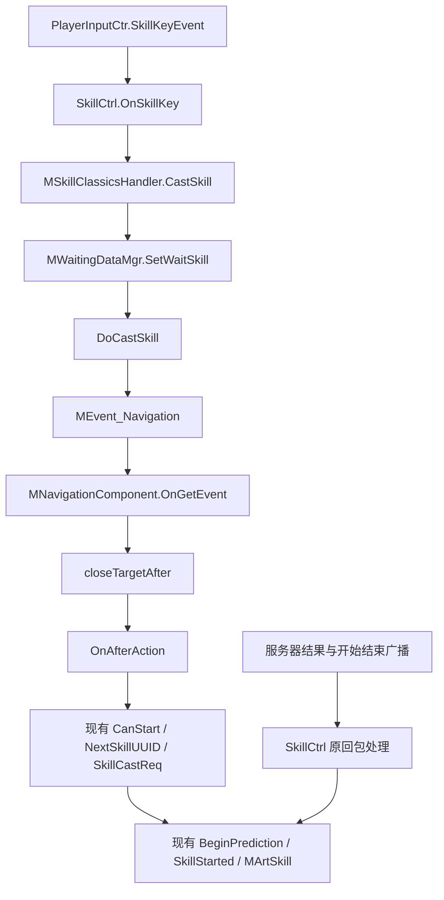

# RO 技能发送模块流程

## 本次范围

按用户要求补齐技能发送经过的模块和导航入口。沿用 RO 的类型、函数名及职责；当前没有的寻路、选目标、自动普攻、技能缓存及吟唱功能不在本次实现。保留本项目已有协议、预测、权威回包、CD、跳跃限制及滑步特殊规则。

## RO 实际源码流程

参考根目录：`F:/UnityPro/ro/Ro_cs422nb/clientcode/CSProject/MoonClient/`。

| 位置 | 入口 | 现有职责 |
| --- | --- | --- |
| `UISystem/Ctrl/Skill/MSkillClassicsHandler.cs` | `CastSkill` | 接收技能栏选择及施法点，提交原始技能核心给等待模块 |
| `UISystem/Ctrl/UISkillController.cs` | `GetTargetFilterSkill` | 技能栏根据技能目标类型筛选施法目标，位于提交等待模块之前 |
| `UISystem/Ctrl/Skill/MWaitingDataMgr.cs` | `SetWaitSkill` | 普攻与主动技能的等待入口；原项目会缓存技能 |
| 同上 | `DoCastSkill` | 构造 `MSkillEventArgs` 和 `MNavigationEventArgs`，调用 `player.NavComp.Interrupt(false)`，派发 `MEvent_Navigation` |
| `Skill/MNavigationComponent.cs` | `OnGetEvent` | 接收导航目标及到达后动作；在范围内直接到达，否则寻路逼近 |
| 同上 | `onCloseTarget` → `closeTargetAfter` | 到达后按动作类型分派；技能分支调用 `Player.UpdateMove()` 后进入 `OnAfterAction` |
| 同上 | `OnAfterAction` | 检查当前技能，生成 `NextSkillUUID`，构造并发送 `RpcC2G_SingingRequest` |
| 同上及原网络监听 | `MGamelibNetEventListener.FireSkill` | 发送成功后，无吟唱技能先播放表现，再接服务器同步 |

这里的到达分发函数实际名称为 `closeTargetAfter`，不是另造的 `ProcessAfterAction`。原项目包含连击替换、气墙、打击点校正、骑乘、吟唱和等待服务器状态，本项目没有相应业务，不照搬这些依赖。

## 本项目接入方式

导航组件作为普通组件挂在本地主角实体上，由 `PlayerEntityBuilder` 创建，`MEntity.NavComp` 从既有组件容器取引用。其生命周期与订阅遵循现有组件基类，不在移动组件中再拥有一份，也不另加全局事件管理器。

`SetWaitSkill` 保留 RO 名称，本轮即时交接，不保存等待队列。`Interrupt` 留空，导航事件收到后即时进入到达回调；这不代表寻路已经实现。`NavAction` 只承载当前实际需要的强类型技能参数，不引入多用途到达动作容器。`SkillCtrl.GetTargetFilterSkill` 暂不选择目标，返回空目标；`PlayerEntity.UpdateMove` 保留发送前位置同步入口，暂为空体，不重复执行当前本地移动。

RO 的 UI 参数、C++ 接口、全局事件管理器和 RPC 类型与本项目不同，函数参数只作必要适配；方法名和责任保留。发送仍使用 `NetSocketMgr.Client` 和 `SkillCastReq`，发送后的表现仍使用现有 `BeginPrediction`，不新增只有一层转发的网络模块。本项目请求目前仅携带技能 ID 和 UUID，不新增目标或坐标协议字段。

最终文件范围、编译和专项验证记录见 `项目修改日志/2026-10-12-RO-SKILL-SEND-MODULES-CHANGELOG.md`。本轮临时证据统一位于 `_temp/ro-skill-send-flow-20261012/`。
