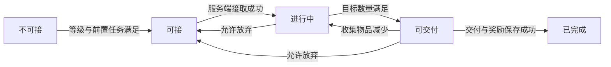

# 任务系统设计：RO 对照与本项目接入方案

日期：2026-10-23。任务编号：`TASK-SYSTEM-DESIGN-20261023`。本文为拟实施设计，不代表任务业务已经实现；本轮不修改业务代码、协议、配置、数据库或 Unity 资源。

## 1. 设计范围与当前资源

沿用 RO 的核心划分：静态任务定义、角色任务实例、目标判定、任务协议、客户端任务管理、任务主窗口与快捷追踪。客户端使用本项目 C#、现有 UI 框架与导航；不引入 RO 的 Lua/MoonClient 运行时。

首期建议完成主线和支线的接取、单个击杀/收集/对话目标、可交付、交付领奖、放弃、任务列表与追踪。日常、周常、活动、组队共享和通用任务脚本不作为首期前置工程；这些是范围建议，不将 RO 已有的全部功能默认为本次实现要求。

现有正式 UI 位于 `LYF_MMO/Assets/artres/Resources/UI/Prefabs`。`QuickTaskPanel.prefab` 已恢复四个缺失 Text，现有黄色目标文本保留；本轮无需重新清理、删除或重建这些节点。前期 `项目分析/RO任务系统设计-2026-10-23.md` 中 `UI/Task`、资源尚待修复等描述是历史状态，不能作为当前接入依据。本轮保留该未跟踪初稿，不混入提交。

## 2. 一条任务如何运行

以“与接取 NPC 交谈→击杀指定怪物→交付 NPC 领奖”为例：NPC 界面请求接取；服务端创建角色任务；实际死亡结算推进目标；目标满足后客户端把同一任务投影为可交付；玩家与交付 NPC 交互并提交；奖励与完成记录保存成功后通知客户端完成，再根据前置关系出现后续任务。

当前 `#QuestInfo.xlsx` 是单目标、单种物品奖励表（另含经验、金币），因此“先交谈再击杀”先用多条相连任务表达。首期不提供同一任务的多个并行目标；等实施多目标配置并完成存档迁移设计后再支持，本期不增加阶段解释器。

| 状态 | 含义与数据来源 | 操作 |
| --- | --- | --- |
| 不可接 | 当前没有任务实例，接取条件不满足。 | 不显示接取入口。 |
| 可接 | 当前没有实例，服务端计算条件满足。 | 前往接取 NPC、请求接取。 |
| 进行中 | 已接取，目标未达标。 | 查看、前往目标、支线可放弃。 |
| 可交付 | 已接取且目标满足；奖励尚未发放。 | 前往交付 NPC、请求交付，支线可放弃。 |
| 已完成 | 交付成功且奖励、完成记录已保存。 | 查询完成记录、开放后续任务。 |

数据库不为每个不可接/可接任务创建空记录；它们由配置和角色条件计算。角色实例只持久化已接和已完成；客户端根据服务器同步的目标进度投影“可交付”，服务端在交付时再次计算并验证。“可交付”不等于“已领奖”。收集物品减少时允许回到进行中。首期非重复任务完成后不再接取；放弃删除当前实例和目标进度，重新接取从接取规则重新初始化。

## 3. 沿用 RO 的职责，接入本项目现有流程

以下是拟新增的业务职责，不是当前已存在的类型声明；最终路径与接口须按本文源码对照核定。

| RO 职责 | 我方设计职责 | 约束 |
| --- | --- | --- |
| `RoleTask` | 角色任务组件保存进行中与完成记录，任务业务服务处理接取、目标变化、交付。 | 挂在在线角色业务域，不挂到场景显示实体。 |
| 任务配置与目标判定 | 先读取现有 `QuestInfo` 单目标定义，三个明确目标分支完成判定。 | 不预建通用目标工厂、任务脚本解释器或触发器树。 |
| `TaskMgr` | 客户端保存服务端同步后的任务集合、完成记录，并提供筛选与当前追踪查询。 | UI 共用同一份数据，不自行增加进度或奖励。 |
| `TaskCtrl` | 沿现有 Ctrl 注册协议、发起操作、更新任务数据并通知界面。 | 窗口不直接解析网络包或修改业务状态。 |
| 任务主窗口 | `MainView` 持有并注册 `TaskWindow : WindowBase`。 | 使用 `WindowType`、现有 Ctrl 和 `ShowMainWindow`。 |
| `QuickTaskPanelHandler` | 主界面拥有快捷任务控件，读取同一个任务集合。 | 不新建独立 UI 管理器或窗口生命周期。 |

任务协议继续进入本项目既有 GameServer 逻辑线程分发；目标变化在原业务成功处通知任务业务，不由网络线程直接修改任务。服务端完成任务判断，客户端只做展示和请求。

## 4. 配置设计

下表是拟定的业务字段，须接入现有配置工程生成，不另写一套配置加载器。任务 ID、怪物 ID、物品 ID、NPC ID 分别使用对应配置的 ID，不能把场景实体实例 ID 当配置 ID。

| 配置对象 | 首期字段与语义 |
| --- | --- |
| 当前 `QuestInfo`（已存在） | `Id/Name/Type/Description/MinLevel/PreQuestId/AcceptNpcId/SubmitNpcId/TargetType/TargetId/TargetCount/RewardExp/RewardGold/RewardItemId/RewardItemCount/NextQuestId/IsAutoAccept/IsAutoSubmit/TimeLimit`。当前是单目标、单种物品奖励（另含经验、金币），服务端已生成但无业务调用。 |
| 首期目标解释 | 沿现有枚举值：`TargetType=1` 击杀、`2` 收集、`3` 对话；`TargetId` 对应目标对象配置 ID，`TargetCount` 为所需数量。显示文本优先用现有 Name/Description 与目标类型模板生成。 |
| 奖励解释 | 现有经验、金币、物品 ID/数量字段；不接收客户端给出的奖励参数。 |

现有表中一条任务只有一个 `TargetId`，所以首期任务进度以任务 ID 为键持久化即可。`PreQuestId` 指定的前置任务完成后才开放；`NextQuestId` 用于提示后续任务，后续任务仍须通过自身接取条件。现有 `TargetId` 是怪物、物品或 NPC 的配置 ID，不是目标序号；若后续扩展多目标，另设计任务内目标键与迁移，不混用这两个概念。

首期主线不可放弃，支线可放弃，按现有 `Type` 区分，不凭空引用尚不存在的 `CanAbandon` 字段。`TimeLimit` 必须为 0，`IsAutoAccept/IsAutoSubmit` 必须关闭；现有到达类 `TargetType=4` 样例暂不纳入首期。当前五条样例不能原样全部视为首期可用，实施时须按这三类目标筛选并验收配置。后续需要自动接交、时限或到达目标时再明确规则。

接取条件先使用真实需要的等级与前置任务。额外职业、时间、活动、组队条件在有需求时单独明确，不先设计任意条件表达式。

## 5. 三类目标的明确规则

| 目标 | 进度来源 | 接取与交付规则 |
| --- | --- | --- |
| 击杀 `KillMonster` | 服务端实际死亡结算后的击杀归属角色与怪物配置 ID。 | 接取后才计数；同一死亡结算只推进一次；进度显示不超过目标数量。导航不等于击杀，不新增自动战斗。 |
| 收集 `CollectItem` | 服务端当前背包中满足该物品定义的持有数量。 | 接取时已有物品计入；背包增加/减少后重算；提交扣除 `TargetCount` 个 `TargetId` 物品。不能将重复背包通知当成新增拾取次数。 |
| 对话 `TalkNpc` | 服务端认可的 NPC 交互/对话结果及 NPC 配置 ID。 | 客户端导航到达不直接完成；首期 `TargetCount=1`，接取成功后独立确认一次符合条件的交互，接取行为本身不同时计入。 |

收集目标显示 `min(当前持有量, TargetCount)`；首期所有收集任务均为消耗型，没有 `Consume` 配置开关。多目标消耗同物品的汇总规则留待多目标扩展时设计，首期单目标没有该歧义。背包变化、死亡、NPC 交互的具体接入位置以源码核对表为准；当前未核验到完整服务端目标入口，必须先补为实施前置项。

## 6. 运行数据与存档

拟新增角色任务记录，进度存于同一记录，复用现有角色标识、数据库访问和在线角色加载流程：

- 任务主记录：角色 ID、任务 ID、已接/已完成状态、当前进度、接取时间、完成时间。角色 ID 沿用现有类型；时间由服务端产生，协议采用明确标注单位的 UTC Unix 毫秒。
- 首期一条任务一个目标，进度与主记录同表即可：击杀和对话计数需要持久化；收集进度由背包恢复后计算，不能用过期存档覆盖当前背包事实。
- 非重复任务按“角色 ID＋任务 ID”保持唯一完成记录。无需为静态标题、描述和奖励文本复制一份角色存档。
- 客户端任务集合来自服务端全量与增量。当前选中和当前导航目标是界面状态，不参与任务是否完成的权威判断；首期不为追踪偏好新增服务端存档协议。

登录时先恢复角色、背包、任务实例及需要的进度，再计算收集进度与可接/可交付状态，最后发送任务全量。客户端主窗口和快捷面板都从这份数据刷新，不能在完整恢复前先发送一份错误任务状态。

## 7. 协议设计

消息名为拟定名，协议号在实现时对照现有编号分配，本轮不占用或修改协议文件。

| 消息 | 必要内容 | 发送时机 |
| --- | --- | --- |
| `TaskListNtf` | 可接任务 ID、进行中任务的当前/目标数量、已完成任务 ID。 | 角色任务恢复完成后发送全量。 |
| `TaskUpdateNtf` | 更新的任务实例、移除的任务 ID、新增的完成任务 ID及可接状态变化。 | 权威业务造成任务变化时发送增量。 |
| `TaskOperationReq` | 接取/交付/放弃枚举、任务 ID、触发操作的 NPC 配置 ID。 | 用户通过已有交互发起操作。 |
| `TaskOperationAck` | 操作类型、任务 ID、现有错误码及本次任务变化。 | 服务端业务操作完成后返回。 |

共用强类型任务结构：任务 ID、已接/已完成状态、接取时间、当前数量，以及展示所需名称、描述、任务类型、目标类型、目标对象配置 ID、目标数量、NPC 配置 ID 和奖励摘要。客户端由当前/目标数量派生可交付显示；可接任务也下发必要展示字段。客户端当前没有 `QuestInfo` 生成物，首期不要求再生成一套客户端配置。目标数量和奖励以服务端配置为准。普通击杀、收集、对话进度不能由客户端上传计数；NPC 交互补齐正式业务入口，不能把任务请求伪装成击杀/拾取事实。

成功响应携带的任务变化与推送使用同一种结构，按任务 ID 替换状态，避免界面各维护一套变更规则。沿用现有请求处理和错误展示，不新增请求队列、代次、超时重试或另一层确认协议。

## 8. 交付、奖励与保存边界

一次交付需要读取角色的已接任务，按服务端当前目标/背包重算是否满足，并核对请求 NPC 配置 ID 与该任务 `SubmitNpcId` 一致；首期沿现有 `NpcCtrl.TalkDistance=10f` 在客户端阻止远距离开启对话。服务端目前没有 NPC 交互协议、场景/距离校验依据，不能在设计中宣称已经校验；若后续新增服务端位置权威，再以独立需求补强。背包容量等失败条件沿用现有奖励入口的真实返回结果。失败时不能先显示已完成或丢弃任务。

任务完成记录和本次奖励/消耗的持久化应处于同一可核验的数据库事务边界；提交成功后才通知客户端成功。实现时扩展现有 `SaveRoleDataReq`、`RoleDataFieldManager` 与 `CRoleWriteTask` 的同一版本事务，把任务表、物品消耗/奖励、经验与金币的实际存储字段一起提交。仅把任务表与物品表放入事务仍不能覆盖经验、金币，实施时须核定它们的正式写入入口。数据库成功写入已完成状态的任务再次提交，不再发奖。内存结果的发布与失败恢复须配合原保存回执完成并实测，不能先广播奖励再把失败当成功。该规则是待实施的任务交付要求，不意味着现有背包系统已经具备此能力。

本项目现有 GameServer/CenterServer 的实际落库链、可复用奖励接口与不足，须在源码对照节逐项注明。若现有奖励只是“先改内存再异步保存”，不能据此宣称崩溃恢复和重复领奖已经解决；应把最小落库适配列为实现任务，不在本设计轮修改或承诺线上结果。

## 9. UI 与追踪绑定

`Task.prefab` 用于主任务列表、选中详情、目标、奖励和操作入口；具体控件绑定须读取现有预制体层级，不凭旧初稿重新命名。窗口由对应 View 创建与注册，显示只经过现有 UI 入口。

快捷模板共同前缀为 `QuickTaskPanel/TaskList/Viewport/TaskScrollView/Content/TaskTpl/`：

| 原节点（保持名称与层级） | 绑定数据 |
| --- | --- |
| `Title/TitleText` | 任务标题与必要的任务类型显示。 |
| `Target/TargetText1..5` | 目标描述及“当前数量/目标数量”，沿用黄色目标文本。 |
| `Des/DesText` | 任务或目标描述。 |
| `Deadline` 自身 | 时间信息；首期没有时限任务，不创建倒计时业务，正式绑定时隐藏无数据行。 |
| `Limit/LimitText` | 配置中的补充显示说明；没有内容时隐藏。 |

任务主窗口与快捷面板使用同一份任务集合：主窗口按页签筛选，快捷面板显示已接取且被追踪的任务，首期默认追踪主线，用户点击可切换当前追踪。首期单目标只启用 `TargetText1`，隐藏其余目标行；不删除或改名 RO 原节点。选中任务、切换已有页签、接取/交付/放弃按钮都交给任务 Ctrl 处理；Widget 只更新控件与转发点击。`LimitText` 当前没有专用配置字段，无内容时隐藏，不增加虚构业务条件。正式字体、引用和控件保存在预制体中，不用运行时临时搭建正式 UI。

## 10. 导航与 NPC 交互

可接任务前往接取 NPC；进行中任务前往首个未完成目标；可交付任务前往交付 NPC。接入现有导航/移动模块，不在任务模块复制寻路算法。

导航到达只表示到达。NPC 的接取、对话确认、交付仍由正常交互完成；保留现有到达 NPC 自动打开对话的行为，但不能自动接交或发奖。NPC 位置沿现有 NPC 实体解析；`QuestInfo` 没有怪物刷新点、采集点或坐标字段，只有已核验到目标位置时才提供“前往”，击杀不自动攻击，找不到来源时隐藏导航入口。跨图传送能力未核验前，只承诺已具备的导航范围，不将地图 ID 字段当成跨图能力已经实现。

## 11. 实施顺序与验收标准

| 阶段 | 修改范围 | 验收条件 |
| --- | --- | --- |
| 配置与角色任务数据 | 调用现有 `QuestInfo`、角色任务记录、加载保存接入。 | 一条单目标任务可正确读写，重登恢复一致；配置 ID 与实体 ID 不混用。 |
| 最小协议与 UI | 正式任务协议、客户端任务数据、Ctrl、WindowBase 与两个界面。 | 登录全量与权威增量同时驱动任务主窗口和快捷面板；打开、关闭、切换与选中正常。 |
| 目标业务接入 | 服务端死亡、背包变化、NPC 交互入口。 | 已有物品计入、数量减少回退、未接不计杀怪、寻路到达不冒充对话。`OnlineRole.GetItemCount` 当前固定返回 0，验收前必须以真实背包组件计数替换。 |
| 交付与完整闭环 | 消耗、奖励、完成状态的保存边界。 | 成功只发一次奖励；失败不扣物、不完成；重登后进度与奖励一致，后续任务正确开放。 |

至少用一条对话任务、一条击杀任务、一条消耗型收集任务串成主线验收；另用一条可放弃支线检查重新接取。正式实现应使用专用测试数据和测试场景，不把 Mock 或测试组件挂在正式预制体。

本轮仅完成设计文档验收，不能把上表计划当作已通过的运行测试。

## 12. 源码对照后的实施前置项

本节来自一次只读核对，详细路径、行号与未确认事项见 `_temp/task-system-design-20261023/lookup.md`（临时证据，不提交）。

1. RO 的 `Achievable` 是客户端根据目标进度把 `Taken` 投影出来的显示状态；`Finished` 才是服务器权威完成状态。因此我方不持久化“可交付”枚举，也不允许客户端据此发奖。
2. 我方已经有服务端 `#QuestInfo.xlsx`、生成的 `QuestInfo/TbQuestInfo` 和 `LubanMgr.GetQuestInfoById`，但没有业务调用者；复用其字段结构，五条样例按首期目标/自动接交/时限限制筛选，而不是新建第二张任务表或重新生成 UI 配置。客户端没有 QuestInfo 生成物，首期把必要显示数据随任务快照下发。
3. `OnlineRole.InitSerializes` 只注册次数、背包、商店、技能、移动五个组件；任务组件、任务快照协议、任务消息处理器、`WindowType.TaskWindow`、任务 Ctrl 都是新增范围。`GameServer/MessageHandler/Task` 目前只有 `.gitkeep`。
4. 当前任务持久化不能拆成独立异步保存：`SaveRoleDataReq` 只含物品与次数，`CRoleWriteTask` 的现有事务也只写物品/次数与同一保存版本。任务表及字段必须扩入同一请求、同一版本校验、同一事务，才满足“奖励与完成状态不分裂”。
5. 服务端 `OnlineRole.AddItem` 可作为发放物品入口，但 `OnlineRole.GetItemCount` 当前固定返回 0；收集目标必须先接到真实服务端背包计数，不能误用客户端 `RoItemComponent` 作为权威。本轮调查范围内尚未找到完整击杀/死亡、掉落或 NPC 对话业务链；这不是全仓绝对不存在的证明，正式实施前须定向确认入口，再补缺失部分。
6. 客户端导航已具备路径、到达和 NPC 自动开对话，但 `MNavigationComponent.onCloseTarget` 到达后硬编码 `NpcCtrl.OpenTalk`，无任务到达事件。新增任务导航回调时必须保持普通 NPC 对话和 `UseAfterAction` 技能流程原语义；到达不自动完成、接取、交付或发奖。
7. 任务资源已可接入：`Task.prefab` 有列表/详情/目标/奖励/截止时间/页签结构，`QuickTaskPanel.prefab` 已有16个原生 Text；核对的十份任务预制体均无旧 RO 脚本 GUID。正式开发在既有资源绑定 C# 控件，不重建预制体。

### 可续作的源码定位

下列我方路径从项目根目录起算；RO 路径从 `F:/UnityPro/ro/Ro_cs422nb` 起算。行号为本轮只读时的位置，后续修改后可能移动。静态证据不等于玩法已运行。

| 范围 | 文件与定位 | 依据 |
| --- | --- | --- |
| RO 客户端状态 | `clientproj/Assets/Scripts/Lua/ModuleMgr/TaskMgr.lua:248,2700,2782` | 状态枚举、单任务更新、Taken 到 Achievable 的客户端投影。 |
| RO 任务交付 | `roserver/gameserver/task/role_task.cpp:658`；`roserver/gameserver/task/cache/task_cache.cpp:573` | 服务端交付检查、完成与奖励调用顺序；未据此证明上层持久化事务保证。 |
| RO 收集 | `roserver/gameserver/task/target/derive/task_target_item_dynamic.cpp` 的 `Refresh` | 从背包数量重算目标进度。 |
| 现有配置 | `Luaban/MiniTemplate/Datas/#QuestInfo.xlsx`；`LYF_Server/Network/LubanManage/Codes/QuestInfo.cs` | 当前单目标、单物品奖励的19字段结构。 |
| 角色组件和背包接口 | `LYF_Server/GameServer/Entity/Role/OnlineRole.cs:129,352,374` | 五个既有组件、计数固定返回0、现有 AddItem。 |
| 保存协议和事务 | `LYF_Server/ProtoBuf/proto/RequestEntity.proto:92`；`LYF_Server/CenterServer/DB/Task/CRoleWriteTask.cs:70` | 物品/次数快照与同版本事务，当前无任务保存字段。 |
| 登录恢复边界 | `LYF_Server/GameServer/MessageHandler/Knapsack/RoleKnapsackInfoHandler.cs:51,60,87` | 角色数据装载完成门闩，任务恢复需纳入。 |
| 窗口注册 | `LYF_MMO/Assets/GM_Game/Scripts/UI/Main/MainView.cs:112`；`LYF_MMO/Assets/GM_Game/Scripts/Common/EnumDefine.cs:6` | 现有 View/WindowBase/WindowType 模式，尚无任务窗口注册。 |
| NPC 与导航 | `LYF_MMO/Assets/GM_Game/Scripts/controller/RoleController/NpcCtrl.cs:16`；`LYF_MMO/Assets/GM_Game/Scripts/SceneEntity/Component/MNavigationComponent.cs:328` | TalkDistance 与到达开对话流程，复用而不复制导航。 |

## 13. RO 采用与不采用

采用：RO 的角色任务聚合、服务器权威目标/奖励、全量加增量同步、主窗口与快捷追踪读同一任务集合、收集按背包实数重算、完成状态和目标已达成的区分。

首期不移植：RO 的 Lua/MoonClient 运行时、庞大目标与触发器类型集、任务缓存派生树和任务脚本解释器。NPC 请求核对配置 NPC ID；距离/场景权威校验仍是已知边界，待本项目位置同步和 NPC 交互协议具备后明确，不能仅凭客户端上报宣称服务端已验证到达。
