# ET 框架源码解析（ET10.0 昭君）

> **文档信息**
>
> - 项目名：ET（仓库内自称 **ET10.0「昭君」**，副标题 The AI Native Framework）
> - 仓库来源：本地只读镜像 `F:\MMORPG_OpenSource\ET\`，上游为 GitHub `egametang/ET`
> - 版本/分支：ET10（Package 模式，包版本号 4.0.0），从 `Packages/packages-lock.json` 与 `README.md` 确认；不是旧版 ET6/7（旧版根目录有 `Unity/` 与 `Hotfix/Model` 程序集目录，本版顶层是 `Assets/` + `Packages/cn.etetet.*`）
> - 许可证：ET License（广州一踢互联网科技有限公司），商业使用需付费 4999 元，禁止修改后再开源
> - 解析日期：2026-10-15
> - 解析方式：**仅静态源码走读，未实际编译/运行**（本机未安装 Unity 2022.3.62f3 与 .NET 8 服务端，未连接 MongoDB）。所有结论以仓库内真实文件为准
> - 一句话定位：Unity + C# 双端、Fiber 单线程 Actor 运行时、分布式 MMO 框架，与 LYFMMORGP 技术栈最接近的参考实现

---

## 1. 项目概览

ET 是国内开发者 pandara（熊猫）发起的开源游戏双端框架：客户端基于 Unity，服务端基于 C# .NET，主打「一套 C# 代码同时跑客户端和分布式服务端」。从 `README.md` 的发布历史看，本仓库已经历 ET6（ILRuntime 热更）→ ET7（双端合并、All in One）→ ET8（纤程 Fiber、MemoryPack、纯 C# KCP、多进程多线程）→ ET9（Package 包模式、KCP 非托管）→ **ET10（AI Native、.NET Aspire 编排、服务发现、分析器约束 AI 行为）**。

ET10 的核心叙事变了：它不再只是给人用的框架，而是「给 AI 写代码也能不出事」的框架——通过 Roslyn 分析器（await 分析器、Entity 生命周期分析器、包依赖分析器）强制架构规则，配合 `cn.etetet.harness` 里的 AI skills（et-code / et-async / et-excel / et-test 等）和 `cn.etetet.unitybridge`（68 条 Unity Editor 指令），让 AI 能在 Unity 里直接建 GameObject、跑 PlayMode、读日志、写双端测试。

目标人群：有一定 C# 基础、想一个人或小团队做分布式 MMO 的独立开发者；README 列举了 20+ 个用 ET 上线的商业项目（千古风流、危境、新生等），其中「千古风流」宣称 64 核 128G 单机 1.5W 在线。

### 1.1 版本演进脉络

从 README 发布历史可梳理出 ET 的关键转折：
- **ET6**：ILRuntime 客户端全热更、服务端热重载、机器人框架、测试用例框架。
- **ET7**：客户端服务端代码合并（All in One）、软路由防攻击、huatuo(HybridCLR) 热更、网络独立线程。
- **ET8**：引入 Fiber 纤程抽象、多进程多线程 Actor、MemoryPack 替代 Protobuf、纯 C# KCP、预测回滚帧同步 demo、纯 C# Recast 寻路——ET8 是架构分水岭。
- **ET9**：改 Package 模式、KCP 非托管内存、新 LICENSE。
- **ET10（本版）**：AI Native，Aspire 编排、服务发现、分析器约束、unitybridge。

理解这个脉络很重要：网上大部分 ET 教程基于 ET7.2（纤程还没引入），直接套到本版会对不上目录。

### 1.2 与 LYFMMORGP 技术栈对照

| 维度 | ET10 | LYFMMORGP |
|---|---|---|
| 客户端引擎 | Unity 2022.3.62f3 | Unity 2023.2.20f1 |
| 服务端运行时 | .NET 8 dotnet 进程 | .NET Framework 4.8 控制台 |
| 双端关系 | 同一工程共享代码 | 客户端/服务端分工程 |
| 序列化 | MemoryPack | Google.Protobuf |
| 网络 | 纯 C# KCP（可切 TCP/WS） | TCP Socket |
| 数据库 | MongoDB | MySQL + Redis |
| 配置表 | Luban | Luban |
| 热更 | HybridCLR | HybridCLR |
| 资源 | YooAsset | YooAsset |
| 并发模型 | Fiber 单线程 Actor | 主线程 20Hz Tick + 回调队列 |
| 同步模型 | 状态同步（另有帧同步 demo） | 状态同步 |

两边技术栈高度相似（Unity+HybridCLR+YooAsset+Luban+状态同步），差异在并发模型和存储。这也是为什么 ET 是 LYFMMORGP 最值得参考的开源项目。

### 1.3 活跃度与商业验证

README 列举 20+ 商业上线项目，包括 100 人团队 2 年开发的大型 MMO「千古风流」、多个一人开发的 MMO。说明 ET 不仅是学习项目，确实支撑了线上产品。但商业版需付费许可。

与同类对比：
- 相比 LYFMMORGP 当前的「四服分立 + 主线程 20Hz Tick」，ET 的纤程模型把「一个逻辑单元 = 一个单线程 Fiber」做到了语言级抽象，锁更少、扩展性更强。
- 相比纯服务端框架（NF/Neva），ET 客户端服务端共享程序集，协议、Unit、MoveComponent 双端共用一份代码。

## 2. 技术栈与运行环境

| 维度 | 实际情况 | 证据 |
|---|---|---|
| 客户端引擎 | Unity **2022.3.62f3** | `ProjectSettings/ProjectVersion.txt` |
| 服务端运行时 | **.NET 8**（独立 dotnet 进程 `ET.App.dll`） | `Book/1.1运行指南.md` 要求安装 .NET 8；`cn.etetet.aspire/DotNet~/Program.cs` |
| 语言 | C#（双端共享） | 全仓库 4261 个 .cs 文件 |
| 序列化 | **MemoryPack**（非 protobuf）；Entity 同时挂 MongoDB Bson 特性 | `Entity.cs` 同时引用 `MemoryPack` 与 `MongoDB.Bson.Serialization.Attributes`；README「protobuf 换成了 memorypack」 |
| 网络传输 | 纯 C# KCP，抽象层支持 TCP / KCP / Websocket / UDP | `Network/NetworkProtocol.cs` 枚举；`Network/Kcp/ikcpc.cs` |
| 数据库 | **MongoDB**（MongoDB.Driver，BSON 直接落库） | `DBComponent.cs` `MongoClient mongoClient`；Localhost 配置 `mongodb://127.0.0.1` |
| 配置表 | **Luban**（Excel 导 C#），StartConfig 分组 Localhost/Mmo/Moba/Release | `cn.etetet.startconfig/Luban/*/Datas/*.xlsx` |
| 客户端热更 | **HybridCLR**（huatuo） | `cn.etetet.hybridclr` 包；运行指南打包步骤 |
| 资源管理 | **YooAsset** | `cn.etetet.yooassets` 包；运行指南 YooAsset Build |
| 数学库 | Unity.Mathematics（float3/quaternion，双端统一） | `MoveComponent.cs using Unity.Mathematics` |
| 分布式编排 | .NET Aspire + OTLP/OpenTelemetry | `cn.etetet.aspire` 包；`WithOtlpExporter()` |
| 服务发现 | 自研 `cn.etetet.servicediscovery` | `C2R_LoginHandler` 里 `ServiceDiscoveryProxy.GetBySceneTypeAndZone` |
| 寻路 | 纯 C# Recast（dotrecast） | `cn.etetet.recast` 包；`NavmeshComponent.cs` |

注意：ET10 **不再使用 protobuf**。LYFMMORGP 用 Google.Protobuf，ET 用 MemoryPack（零 GC 序列化）。协议消息是 C# class 上打 `[Message]` 特性，由源生成器生成 Opcode，而不是 .proto 文件。

### 2.1 .NET 版本与跨平台

服务端跑在 .NET 8 上，可跨 Windows/Linux。README 提到提供一键同步工具到 Linux。本解析未验证 Linux 部署。

### 2.2 Unity 包管理

ET10 全部业务代码用 UPM 本地包（`Packages/cn.etetet.*`），`packages-lock.json` 记录包版本 4.0.0。这种包模式让功能可拆分、可独立发布（ET9 起的变化）。

## 3. 许可证与商用/二次开发注意事项

`LICENSE` 文件全文要点：
1. 版权属于广州一踢互联网科技有限公司。
2. **不允许**拿 ET10 代码修改后再开源；要加功能只能向官方提交 PR。
3. 任何人/公司用 ET10 代码做游戏或商业项目，上线前必须获得官方许可，费用 **4999 元人民币**。
4. 许可范围只覆盖 ET10 自有非商业代码；仓库内集成了 Odin 等商业插件，需自行购买。

对 LYFMMORGP 的意义：ET 只能作为**学习与架构参考**，不能把其源码直接拷进商业项目。可以借鉴其 Fiber/Entity/消息分发的设计思想，用自己的代码重写。

### 3.1 商业插件注意

LICENSE 提到仓库内集成了 Odin 等商业插件，使用者需自行购买。本解析未逐一清点仓库内第三方插件。

## 4. 目录结构详解

顶层真实结构（`Get-ChildItem F:\MMORPG_OpenSource\ET`）：

```text
ET/
├── Assets/                # Unity 资源（GameRes/Plugins/SharedAssets，逻辑代码不在这）
├── Packages/              # ★ 全部 C# 代码都在这，56 个 cn.etetet.* 业务包（Packages/ 共 61 个目录）
├── Scripts/               # PowerShell 工具脚本（Publish/Initialize/Launch）
├── ProjectSettings/       # Unity 工程设置
├── Book/                  # 中英文官方教程（协程/Entity/EventSystem/Actor 模型）
├── docs/                  # 英文文档 + superpowers
├── README.md / ChangeLog.md / 课程大纲.md
├── AGENTS.md / CLAUDE.md  # AI 协作约定
├── LICENSE
└── ET.sln.DotSettings
```

关键包职责（`Packages/cn.etetet.*`）：

| 包 | 职责 |
|---|---|
| `cn.etetet.core` | 一切根基：Entity/Scene/Fiber/EventSystem/ObjectPool/ETTask/网络层(KCP/TCP) |
| `cn.etetet.startconfig` | 进程/场景/机器/分区配置（Luban Excel 生成） |
| `cn.etetet.netinner` | 进程间内网通信 MessageSender |
| `cn.etetet.actorlocation` | ActorId 位置服务（LocationComponent + MongoDB 持久化） |
| `cn.etetet.login` | Realm 登录、Gate 网关、客户端登录流程 |
| `cn.etetet.map` | 地图场景、Unit、AOI 通知、跨纤程消息 |
| `cn.etetet.move` | MoveComponent、C2M/M2C 移动消息、寻路移动 |
| `cn.etetet.aoi` | 九宫格/格子 AOI（Cell、AOIEntity、AOIManagerComponent） |
| `cn.etetet.db` | DBManagerComponent / DBComponent（MongoDB） |
| `cn.etetet.unit` | Unit 实体与组件 |
| `cn.etetet.numeric` | 数值组件（属性层叠计算） |
| `cn.etetet.spell` | 技能与 Buff |
| `cn.etetet.behaviortree` | 行为树（怪物 AI/技能流程） |
| `cn.etetet.servicediscovery` | 服务注册/发现/心跳租约 |
| `cn.etetet.router` | 软路由（防攻击，KCP 底层切 TCP/WS 不掉线） |
| `cn.etetet.aspire` | .NET Aspire 分布式编排入口 Program.cs |
| `cn.etetet.statesync` | **状态同步 MMO demo**（本解析的主要分析对象） |
| `cn.etetet.lockstep` | 预测回滚帧同步 demo |
| `cn.etetet.loader` | CodeLoader，客户端/服务端热重载加载器 |
| `cn.etetet.hybridclr` / `cn.etetet.yooassets` | 客户端热更与资源 |
| `cn.etetet.unitybridge` / `cn.etetet.harness` | AI 工具链（ET10 特色） |

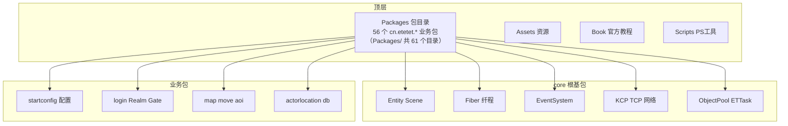

图 1：ET10 目录与包依赖结构。所有逻辑代码都收敛在 `Packages/` 下，core 包被业务包依赖，业务之间通过消息而非直接引用通信。

### 4.1 与旧版 ET 目录差异

旧版 ET7 根目录有 `Unity/`、`Hotfix/`、`Model/` 程序集目录；本版 ET10 根目录只有 `Assets/`、`Packages/`、`Scripts/`，全部代码在 `Packages/cn.etetet.*`。这是阅读时最容易踩的坑。

## 5. 工程获取、创建与打开方式

来自 `Book/1.1运行指南.md`：
1. 安装 Rider 2024.3、.NET 8、Unity **2022.3.62**、IL2CPP。
2. clone 新工程（强调三遍），根目录执行 `pwsh ./Scripts/Initialize-Project.ps1`。
3. UnityHub 打开 ET 目录，External Script Editor 选 Rider，Generate csproj。
4. 编译整个 `ET.sln`（需联网还原 nuget 包，MemoryPack 等）。
5. 客户端运行：双击 `Packages/cn.etetet.statesync/Scenes/Init` 场景 Play。
6. 独立服务端：Unity 管理员启动 → 菜单 `ET -> Loader -> Server Tools -> Start Server(Single Process)`；或命令行 `dotnet Bin/ET.App.dll --Console=1`（运行目录是 Bin 的上一层）。

### 5.1 关键环境清单

- Unity **2022.3.62f3**（`ProjectSettings/ProjectVersion.txt`）。
- .NET **8**（服务端 dotnet 进程）。
- Rider 2024.3（官方指定 IDE）。
- MongoDB（本机 `mongodb://127.0.0.1`）。
- HybridCLR、YooAsset、MemoryPack、Unity.Mathematics 均通过 UPM 包引入（`Packages/packages-lock.json`）。
- 配置表 Luban（Excel 在 `cn.etetet.startconfig/Luban/*/Datas/`）。

### 5.2 初始化脚本

`Scripts/Initialize-Project.ps1` 是首次 clone 后跑的初始化脚本；`Scripts/Launch.ps1`、`Scripts/Publish.ps1`、`Scripts/PublishAspire.ps1` 分别是启动、发布、Aspire 发布脚本。本解析未执行这些脚本。

## 6. 编译与运行步骤（能验证到哪一步）

**本解析未实际编译运行**，仅记录官方步骤与静态确认的事实：
- 服务端入口：`cn.etetet.statesync/DotNet~/App/Program.cs` → `Init.Start()` + `while(true){ init.Update(); init.LateUpdate(); }`。
- 编排入口：`cn.etetet.aspire/DotNet~/Program.cs` 读环境变量 `SceneName/StartConfig/SingleThread`，按 `StartProcessConfig` 为每个进程 `dotnet ./Bin/ET.App.dll --Process=X --ReplicaIndex=Y ...`。
- 默认配置组 `Localhost`：单进程 Process=1，内网端口 40001（`StartProcessConfig(1, 1, 40001, 0, "Localhost")`）。
- MongoDB 需要本机 `mongodb://127.0.0.1` 可用，库名 `ET0`（zone0）。
- 未验证：编译是否一次通过、端口实际监听、登录流程端到端跑通。

### 6.1 官方 Book 文档要点

`Book/` 目录提供了设计原理教程，本解析参照了其中概念：
- `2.1CSharp的协程.md` / `2.2更好的协程.md` / `2.3单线程异步.md`：解释为什么用 ETTask 而不是 Task，单线程异步如何避免锁。
- `3.3一切皆实体.md`：Entity 是数据树，一切皆 Entity。
- `3.4事件机制EventSystem.md`：事件发布订阅模型。
- `5.4Actor模型.md` / `5.5Actor Location.md`：位置透明 Actor 消息。
- `6.1AI框架.md`：游戏内行为 AI。

这些文档与本版源码基本一致，但部分例子可能基于旧版类名，阅读时以本仓库实际代码为准。

### 6.2 运行时目录与产物

- 开发态：Unity Play 直接跑，服务端在 Unity 进程内。
- 独立服务端：`dotnet Bin/ET.App.dll --Console=1`，工作目录是 ET 根目录。
- Aspire 编排：`dotnet` 启动 Aspire host，由它拉起多个 ET.App 进程。
- 日志：`ET/Logs` 目录。

本解析未实际运行，以上为静态阅读官方文档所得。

## 7. 整体架构

ET10 的架构核心是 **「进程 → Fiber 纤程 → Scene 根实体 → Entity 树」** 四层：
- 一个 dotnet 进程内可以跑多个 Fiber；
- 每个 Fiber 是一个**单线程 Actor**，有自己的 `Scene` 根实体、`EntitySystem`、`Mailboxes`、`ThreadSynchronizationContext`；
- Fiber 间不共享内存，通过 Actor 消息（`MailBoxComponent` + `LocationComponent` 定位）通信；
- 调度方式三种：`SchedulerType.Main`（主线程）、`ThreadPool`（线程池）、`Parent`（寄生在父 Fiber 线程上，适合开发调试时 N 合 1）。

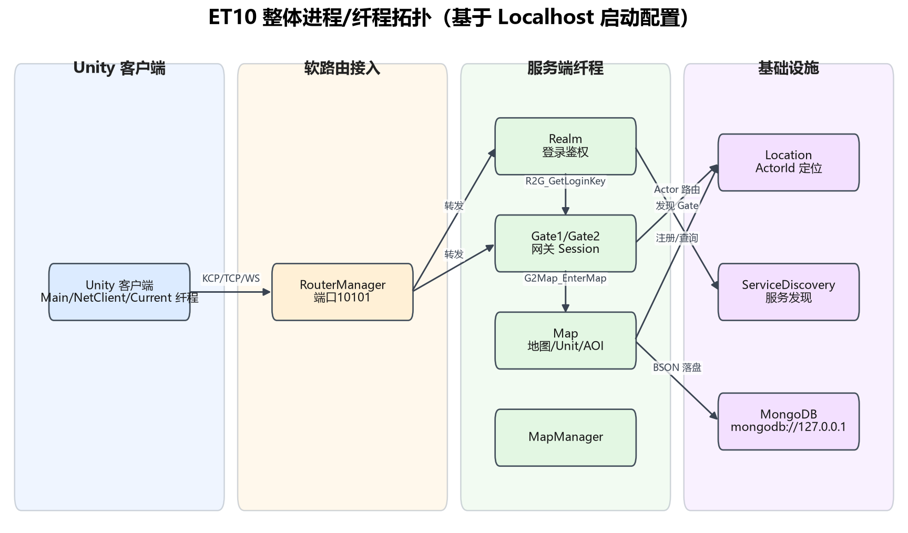

图 2：ET10 整体进程/纤程拓扑（PNG）。客户端经 RouterManager(10101) 软路由接入；Realm 鉴权后下发 Gate；Gate 再通过 Location/MapManager 把玩家送进 Map 纤程；MongoDB 做持久化。

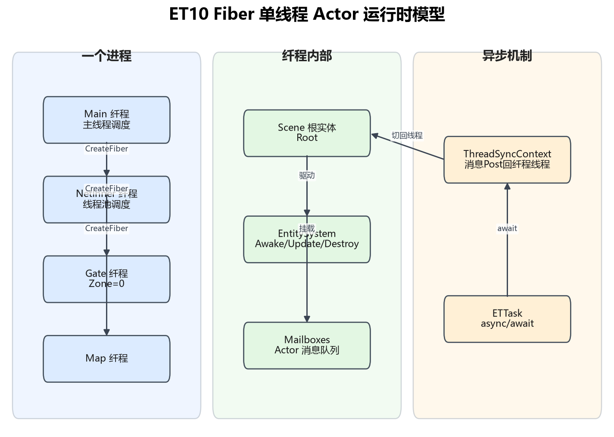

图 3：Fiber 单线程 Actor 运行时模型（PNG）。Main 纤程用 `CreateFiber` 派生出 NetInner/Gate/Map 等纤程；每个纤程内 EntitySystem 驱动 Awake/Update/Destroy，跨纤程调用通过 ThreadSynchronizationContext 把消息 Post 回目标纤程线程执行，从而避免锁。

### 7.1 为什么用 Fiber 而不是多线程锁

传统多线程服务端要在共享数据上加锁，复杂且易错。ET 的思路是「把数据切到不同纤程，每个纤程单线程访问自己的数据，纤程间只通过消息通信」：
- 同一份数据永远只在一个纤程的线程上被读写，不需要锁。
- 跨纤程调用 `await MessageSender.Call(...)`，框架自动把回调切回当前纤程线程。
- 三种调度方式让你灵活分配：`SchedulerType.Parent`（寄生父线程，开发调试用）、`ThreadPool`（独立线程，跑网络/Map）、`Main`（Unity 主线程）。
- `Options.Instance.SingleThread == 1` 时所有子纤程强制 Parent 调度，即「N 合 1」单进程调试模式。

这和 Erlang 的 Actor、Unity 的 JobSystem 是同一类思想：用并发单元隔离代替锁。区别是 ET 的「纤程」仍跑在真线程上，靠 SynchronizationContext 切回，不是操作系统级协程切换。

### 7.2 Scene 与 IScene

ET8 起 `Entity` 的 domain 改成 `IScene` 接口（README 第 8 条）：只要实现 IScene，Entity 就属于该 domain。`Scene` 类是 Fiber 的根实体，每个 Fiber 一个 Scene。`SceneType` 用 partial class 分包定义（Realm/Gate/Map/Location 等），SceneTypeSingleton 负责数值与名称互查。

### 7.3 Zone 分区

ET 支持多分区（Zone）：同一套进程拓扑跑多个游戏区，数据按 `{DBName}_zone_{0001}` 分库。StartZoneConfig 定义每个区的 DBConnection 和 DBName。这对应「多开服」场景。

### 7.4 与 LYFMMORGP 架构对比

| 维度 | ET10 | LYFMMORGP |
|---|---|---|
| 进程划分 | 配置驱动，可 1 可 N | 写死四服 |
| 并发单元 | Fiber 纤程 | 主线程 |
| 锁 | 无（单线程隔离） | 无（单线程） |
| 跨单元通信 | Actor 消息 + Location | 进程内直接调用 |
| 服务发现 | ServiceDiscovery | 配置写死 |
| 接入层 | Router 软路由 | 无 |

两边当前都是单线程逻辑，ET 的优势在未来多核扩展和动态拓扑。

进程职责（按 `cn.etetet.startconfig/.../Localhost/StartSceneConfigCategoryFactory_Localhost.cs` 真实配置）：

| Scene 名 | SceneType | 职责 |
|---|---|---|
| ServiceDiscovery | ServiceDiscovery | 服务注册/发现主节点 |
| Location | Location | ActorId → 进程地址定位，数据落 MongoDB Share 库 |
| RouterManager | RouterManager | 软路由管理，对外端口 10101 |
| Router01~04 | Router | 软路由节点，KCP/TCP/WS 转发，防攻击 |
| Realm | Realm | 账号登录鉴权（C2R_Login），分配 Gate |
| Gate1/Gate2 | Gate | 网关 Session、Key 校验、玩家 Player 管理 |
| MapManager | MapManager | 地图/副本纤程的创建与回收 |

## 8. 服务端模块与职责

ET 服务端没有传统「管理器类」大一统，而是**组件挂在 Scene 上 + System 扩展方法**：
- 数据（Entity/Component）和行为（System 静态扩展方法）分离；
- 一个类型如 `NetComponent` 只声明字段，行为写在 `xxxComponentSystem.cs` 里用 `[EntitySystem]` 标记 Awake/Destroy；
- 启动时 `EntryEvent2_InitServer` 根据 `StartSceneConfig` 为每个场景创建 Fiber，Fiber 根 Scene 自动挂上该 SceneType 需要的组件。

注册方式（`EntryEvent2_InitServer.cs` 真实代码）：
```csharp
// 先建 NetInner 纤程（线程池调度），负责进程间内网收发
await fiber.CreateFiber(SchedulerType.ThreadPool, 0, id, SceneType.NetInner, $"NetInner@{process}@{replica}");
// 服务发现代理纤程
await fiber.CreateFiber(SchedulerType.ThreadPool, 0, id, SceneType.ServiceDiscoveryAgent, ...);
// 按 StartScene 配置逐个建 Realm/Gate/Map/Location 纤程
foreach (StartSceneConfig sc in scenes) {
    await fiber.CreateFiber(SchedulerType.ThreadPool, sc.Zone, sc.Id, sceneType, $"{sc.Name}@{process}@{replica}");
}
```

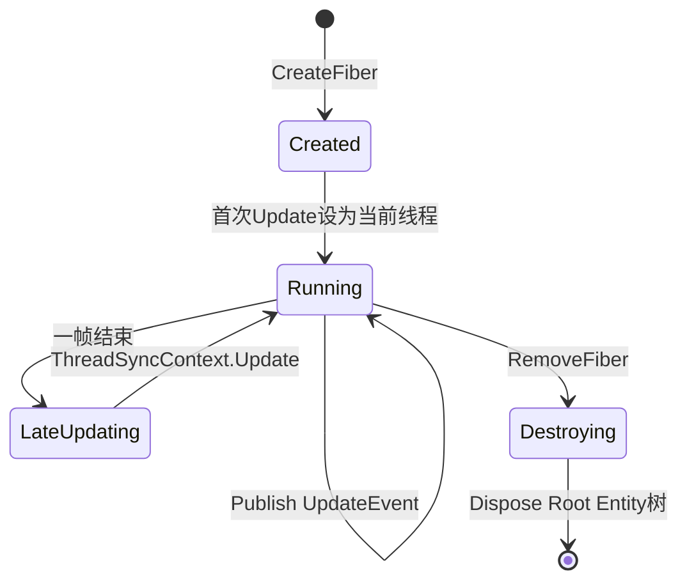

图 4.5：Fiber 生命周期状态。创建后挂到调度队列，每帧先 Update 再 LateUpdate；销毁时整个 Root Entity 树递归 Dispose，子纤程一并回收。

### 8.1 组件式设计的意义

ET 把一个服务器进程能提供的功能拆成组件（Realm 鉴权组件、Gate 网关组件、Map 场景组件……），开发时全部挂在一个进程上（N 变 1），发布时按 StartConfig 把不同组件分到不同进程（1 变 N）。新增功能时开发者不用关心它最终落在哪个服务器进程，只写组件；拆服务器拓扑只改 Luban 配置不改代码。这正是 README「随意可拆分功能的分布式服务端」的核心思想。

对比 LYFMMORGP 的四服（Center/Login/Gate/Game）是写死的进程划分；如果未来要拆 Game 成多个地图进程，ET 的组件化拓扑会更灵活，但代价是理解成本高。

### 8.2 System 与生命周期接口

ET 的 System 通过接口标记生命周期：
- `IAwake` / `IAwake<P1>`：组件创建时初始化。
- `IUpdate`：每帧 Update。
- `IDestroy`：销毁清理。
- `ILateUpdate`：晚更新。
- `ISerializeToEntity`：需要随父序列化。

`EntitySystem` 在 Entity 注册时扫描这些接口，自动调用对应 System 方法。开发者只写静态扩展方法并打 `[EntitySystem]` 特性，源生成器接线。

## 9. 客户端模块与职责

客户端同样是多纤程：
- `Main` 纤程：Unity 主线程，跑表现层、UI、Current 场景。
- `NetClient` 纤程：每次登录由 `ClientSenderComponentSystem.LoginAsync` 用 `CreateFiber(SchedulerType.ThreadPool, ..., SceneType.NetClient, "NetClient")` 新建，专跑网络收发。
- `Current` 场景：玩家所在地图的客户端镜像，收到 M2C 消息在这里驱动 Unit。

热更：HybridCLR（打包时 `HybridCLR -> Generate -> All` + CopyAotDlls），资源用 YooAsset（HostPlayMode）。开发态按 F6 编译、F7 热重载，不用重启 Unity。

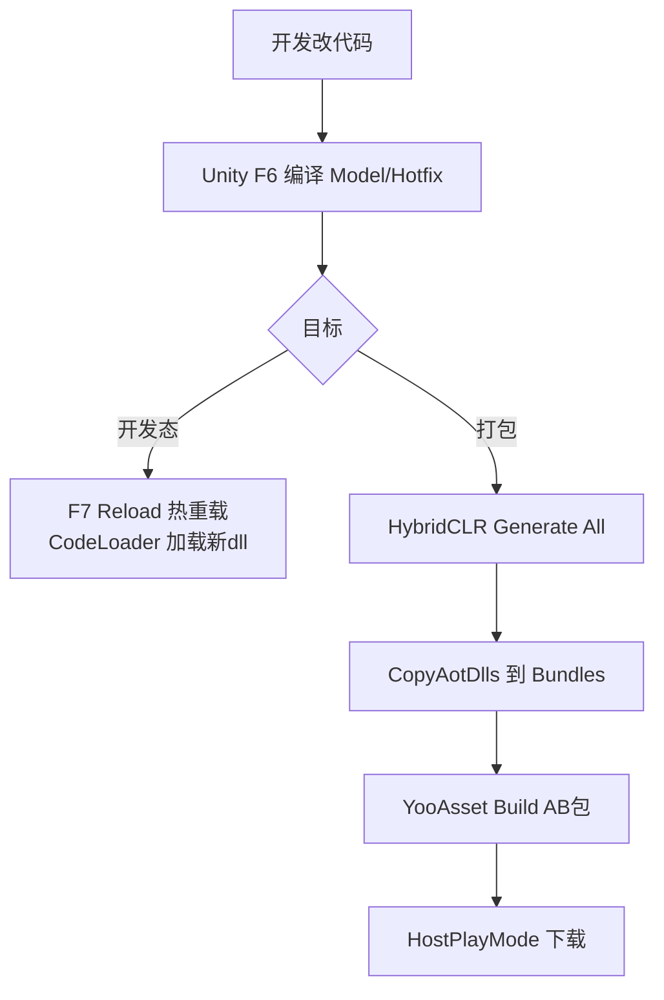

图 9.5：客户端热更与发布管线。开发时 F6 编译 + F7 热重载双端都不重启；上线时走 HybridCLR + YooAsset。

### 9.1 协程、定时器与跨纤程锁

ET 没有用 Unity 协程，而是自己的 `ETTask` + async/await：
- `ETTask`（`cn.etetet.core/Scripts/Core/Share/ETTask/ETTask.cs`）：类似 `Task` 但不进线程池，回调在当前 Fiber 的同步上下文上执行，所以 `await` 之后代码仍在本纤程线程，不用加锁。
- `TimerComponent`（`cn.etetet.core/Scripts/Core/Share/Timer/TimerComponent.cs`）：每个 Scene 挂一个，内部 `MultiMap<long,long> timeId` 按到期时间排序，支持 OnceTimer/OnceWaitTimer/RepeatedTimer 三种。业务里 `await fiber.Root().TimerComponent.WaitAsync(1000)` 就能等 1 秒而不阻塞线程（见 `C2R_LoginHandler.CloseSession`）。
- `CoroutineLockComponent`（`cn.etetet.core/Scripts/Core/Share/CoroutineLock/`）：协程级锁。因为单线程没有真锁，跨协程要顺序访问同一资源（如落库）时用 `await coroutineLockComponent.Wait(coroutineLockType, id)`，按类型+id 排队，避免「读一半另一个协程又写」。这是单线程 Actor 模型里处理逻辑竞态的标准手段。

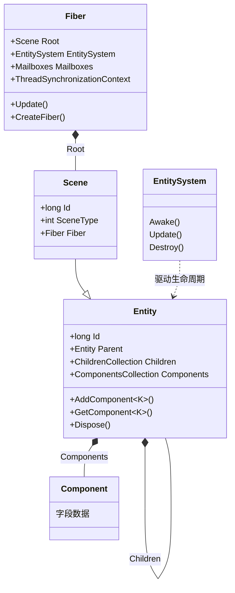

图 7：ET 的 ECS/实体核心类关系。Fiber 持有 Scene 根实体；Entity 既是父子树节点又是组件容器；行为不在 Entity 上，而在 EntitySystem 静态扩展方法里。

### 9.2 客户端网络线程隔离

客户端 `ClientSenderComponentSystem.LoginAsync` 每次登录新建一个 NetClient 纤程（ThreadPool 调度），网络收发在那个线程，主线程通过 `ProcessInnerSender` 给它发消息。这和服务端 NetInner 纤程是同一套模式——网络独立线程，不卡表现。

### 9.3 客户端 UI 框架

ET 自带 YIUI 系列包（`cn.etetet.yiui*`），是免费的 UGUI 框架，含循环列表、红点、Tip、特效、3D 展示等。本解析未精读 UI 实现。

## 10. 网络通信

### 10.1 传输层抽象

`Packages/cn.etetet.core/Scripts/Core/Share/Network/NetworkProtocol.cs`：
```csharp
public enum NetworkProtocol { TCP, KCP, Websocket, UDP }
```

抽象类 `AService`（`Network/AService.cs`）定义统一接口：`GetBindPoint/Create/Send/Remove/Update`，回调 `AcceptCallback/ReadCallback/ErrorCallback`，内部自带 `MemoryBuffer` 对象池（超过 1024 字节不回收，池上限 10 个 buffer）。具体实现：
- `KService/KChannel`：纯 C# KCP（`Network/Kcp/ikcpc.cs`、`Kcp.cs`，README 强调 ET8 起 KCP 改非托管内存分配）。
- `TService/TChannel`：TCP。
- Websocket/UDP 在 router/相关包里实现（ET8 起底层支持运行时在 UDP/TCP/Websocket 间切换，玩家不掉线）。

`NetComponent`（`cn.etetet.core/Scripts/Model/Share/Message/NetComponent.cs`）极薄：
```csharp
[ComponentOf(typeof(Scene))]
public class NetComponent: Entity, IAwake<IKcpTransport>, IDestroy, IUpdate
{
    public AService AService { get; set; }
}
```
一个 Scene 挂一个 NetComponent 就拥有了收发能力。

### 10.2 Session 与 RPC

`Session.cs`：
```csharp
[ChildOf]
public sealed class Session: Entity, IAwake<AService>, IDestroy
{
    public AService AService { get; set; }
    public int RpcId { get; set; }
    public readonly Dictionary<int, RpcInfo> requestCallbacks = new();
    public long LastRecvTime { get; set; }
    public long LastSendTime { get; set; }
    public int Error { get; set; }
    public Address RemoteAddress { get; set; }
}
```
RPC 用 `RpcInfo`（`ETTask<IResponse>`）挂在 `requestCallbacks` 字典里，按 RpcId 匹配回包，超时 40 秒（`MessageSender.TIMEOUT_TIME = 40*1000`）。

### 10.3 消息分发

`MessageDispatcher`（`cn.etetet.core/Scripts/Model/Share/Actor/MessageDispatcher.cs`）在 Awake 时扫描所有打了 `[MessageHandler]` 特性的类，按消息类型注册；分发时按 `SceneType` 过滤——同一个消息类型可以在 Realm/Gate/Map 不同场景挂不同处理器：
```csharp
[MessageSessionHandler(SceneType.Realm)]
public class C2R_LoginHandler : MessageSessionHandler<C2R_Login, R2C_Login> { ... }

[MessageSessionHandler(SceneType.Gate)]
public class C2G_LoginGateHandler : MessageSessionHandler<C2G_LoginGate, G2C_LoginGate> { ... }

[MessageHandler(SceneType.Map)]
public class C2M_PathfindingResultHandler : MessageLocationHandler<Unit, C2M_PathfindingResult> { ... }
```
注意三种 Handler 基类：
- `MessageSessionHandler`：挂在 Session 上，客户端↔网关的连接消息。
- `MessageHandler`：挂在 Scene 上。
- `MessageLocationHandler`：先经 Location 定位到目标 Unit 的 Actor，再把消息投递给该 Unit（Map 服里玩家移动就是这种）。

协议号由源生成器根据 `[Message]` 特性自动生成到 `Opcode`（`cn.etetet.proto/Scripts/Model/Share/Opcode.cs` 是个空的 `static partial class Opcode`，实际常量由 SourceGenerator 注入）。

### 10.4 封包与粘包

底层用 `PacketParser` + `Circularbuffer`（`Network/` 目录）做拆包；序列化走 MemoryPack，0 GC。心跳由各 `PingComponent` 自管（客户端 `PingComponentSystem`、Gate 侧 `C2G_PingHandler`）。

### 10.5 KCP 协议字与内外网

`KService.cs` 里定义了协议字：
```csharp
public static class KcpProtocalType {
    public const byte SYN = 1;            // 建连
    public const byte ACK = 2;
    public const byte FIN = 3;            // 断开
    public const byte MSG = 4;            // 业务消息
    public const byte RouterReconnectSYN = 5;  // 软路由重连
    public const byte RouterReconnectACK = 6;
    public const byte RouterSYN = 7;
    public const byte RouterACK = 8;
}
public enum ServiceType { Outer, Inner }  // 外网(客户端) / 内网(进程间)
```
- `Outer`：面向客户端的连接，经过 Router 软路由。
- `Inner`：进程间内网（NetInner 纤程），走直连 KCP，不经过软路由。
- 连接超时 `ConnectTimeoutTime = 20*1000`。
- RouterReconnect 系列协议字支持「UDP 断了切到另一个软路由/协议而不断开玩家连接」，这是防攻击和弱网切换的底层。

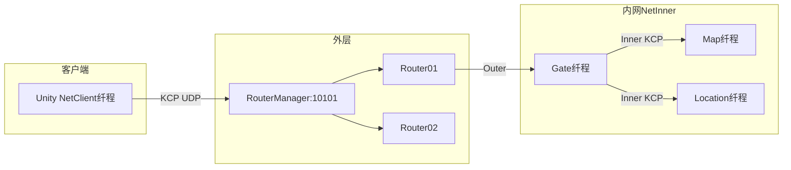

图 8：内外网分层与软路由。客户端只连 Router；Router 转发到 Gate 的 Outer 端口；Gate/Map/Location 之间用 NetInner 内网 KCP 通信。

### 10.6 Actor 消息路由全过程

当 Gate 要给 Map 里某个 Unit 发消息时：
1. `MessageSender.Call(targetActorId, message)`。
2. 如果 targetActorId 的地址就是本进程，直接 `ProcessInnerSender` 投递，不走网络（README 第 7 条：Actor 发自己进程直接处理）。
3. 否则经 NetInner 纤程把消息发给目标进程的 NetInner。
4. 目标进程 NetInner 收到后，根据 ActorId 里的 FiberInstanceId 找到目标 Mailbox，Post 到那个 Fiber 的线程执行。
5. 如果只知道 EntityId 不知道地址，先 `LocationProxyComponent` 查 Location 纤程拿 ActorId。

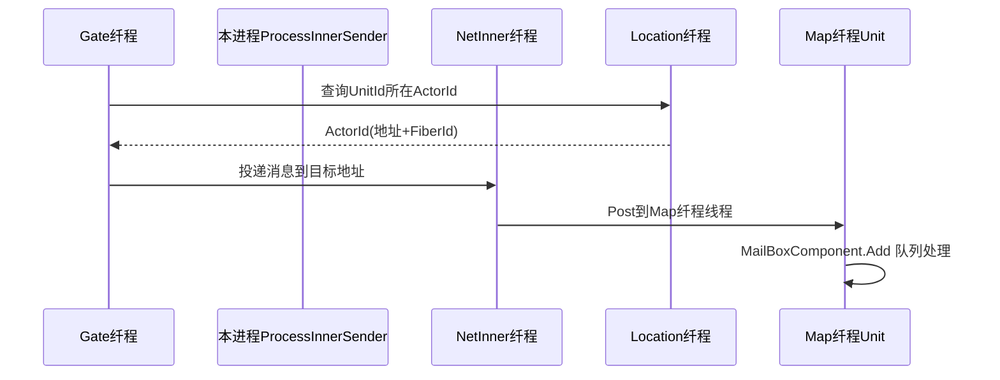

图 9：跨纤程 Actor 消息路由。位置查询、网络投递、目标线程切换三段分离，业务代码无感。

### 10.7 消息类型与 Handler 基类对照

| 基类 | 挂载对象 | 用途 | 例子 |
|---|---|---|---|
| `MessageSessionHandler` | Session | 客户端连接消息（C2X/X2C） | C2R_Login、C2G_LoginGate |
| `MessageHandler` | Scene | 场景内普通消息 | M2C_PathfindingResult |
| `MessageLocationHandler` | Unit(Actor) | 先查 Location 定位到 Unit 再投递 | C2M_PathfindingResult |

协议号由源生成器根据消息类上的 `[Message]` 特性自动生成到 partial `Opcode` 类。响应类型通过 `[ResponseType]` 关联，`MessageDispatcher.Awake` 会校验 Handler 声明的响应类型与 Opcode 注册一致，不一致直接抛异常。

### 10.8 与 LYFMMORGP 网络对比

| 项 | ET10 | LYFMMORGP |
|---|---|---|
| 传输 | 纯 C# KCP（可切 TCP/WS） | TCP Socket |
| 序列化 | MemoryPack 0GC | Google.Protobuf |
| 连接管理 | Session + AService 抽象 | 自写 Socket |
| 分发 | 特性注册 + SceneType 过滤 | 网络回调入队 GameCommand |
| 内外网 | Outer(客户端)/Inner(进程间) 分层 | 四服间直连 |
| 超时 | RPC 40 秒 | 自管 |

ET 的网络层抽象更成熟（KCP 多协议、0GC、内外网分层），但 LYFMMORGP 的「回调入队主线程消费」和 ET 的「Fiber 单线程消费」思想一致，都是把网络消息切回逻辑线程。

### 10.9 心跳与断线

- 客户端 `PingComponent` 定期发 `C2G_Ping`。
- Gate 侧 `C2G_PingHandler` 回包。
- `Session.LastRecvTime/LastSendTime` 记录最近收发时间。
- KCP 20 秒无包会断（`KService.ConnectTimeoutTime = 20*1000`）。
- 重连时 Gate 侧 `player == null` 分支处理已有玩家的 Session 切换。

### 10.10 序列化

ET8 起用 MemoryPack（README「protobuf 换成了 memorypack，实现无 gc 的网络」）。Entity 上同时挂 MemoryPack 和 BSON 特性，所以同一个对象既走网络序列化又走 Mongo 落盘。协议消息是 C# class 打 `[Message]` 特性，源生成器生成 Opcode。


## 11. 数据存储

数据库是 **MongoDB**，不是 MySQL/Redis（与 LYFMMORGP 的 MySQL+Redis 不同）。

`cn.etetet.db/Scripts/Model/Server/DBComponent.cs`：
```csharp
[ChildOf(typeof(DBManagerComponent))]
public class DBComponent: Entity, IAwake<string, string>
{
    public const int TaskCount = 32;
    public MongoClient mongoClient;
    public IMongoDatabase database;
    public HashSet<string> CollectionDic = new();
}
```

连接串在 Luban 配置里（`StartZoneConfigCategoryFactory_Localhost.cs`）：
```csharp
[0] = new StartZoneConfig(0, 1, @"mongodb://127.0.0.1", @"ET0")
```
多分区时库名自动加后缀：`DBManagerComponentSystem.GetZoneDBName` 生成 `{DBName}_zone_{0001}` 形式。

Entity 直接同时是 MemoryPack 模型和 MongoDB BSON 文档——`Entity.cs` 字段上同时挂 `[MemoryPackIgnore]`、`[BsonIgnore]`、`[BsonId]`，所以**内存里的 Entity 树直接序列化就是 Mongo 文档**，不需要 ORM 转换层。这是 ET 「用 BSON 做一切序列化」思路的延续。

位置服务也持久化到 Mongo：`LocationComponent.cs` 里 `LocationPersistenceConst.DBName = "Share"`、`RouteCollection = "LocationInfo"`，ActorId 路由信息写在 Share 库的 LocationInfo 集合里。

配置表体系：Luban（Excel → C#），StartConfig 分 Localhost/Mmo/Moba/Release 四套分组，按 `ConfigGroup` 特性在运行时选择。

### 11.1 落盘模型

ET 的 Entity 树本身就是 BSON 文档：`Entity.cs` 字段上 `[MemoryPackIgnore]` + `[BsonIgnore]` 双标注，`Id` 是 `[BsonId]`，`children/components` 是嵌套文档。落盘时不需要 ORM 把 Entity 转成 DTO，直接 `database.GetCollection<T>().ReplaceOneAsync` 即可。`DBComponent.TaskCount = 32` 表示一个 DBComponent 内并发 Mongo 操作数上限。分库规则是 `{DBName}_zone_{0001}`，不同分区（Zone）数据物理隔离。

对 LYFMMORGP 的差异：我们用 MySQL + SqlSugar + Redis，需要手写实体映射；ET 用 Mongo 的文档模型天然匹配 Entity 树，省了映射层，但 Mongo 的事务和报表能力不如 MySQL。

### 11.2 Location 持久化

`LocationComponent` 里 `LocationInfo` 是 Entity，挂在 LocationComponent 下，`TypeStates` 字典存 ActorId 和锁 token。位置信息同时在内存和 MongoDB Share.LocationInfo 集合里——进程重启后能从 Mongo 恢复 ActorId 路由。这是分布式 Actor 位置服务的常见做法。

### 11.3 DBManagerComponent

`DBManagerComponent` 是 DB 进程的根组件，按 Zone 建子 DBComponent。`GetZoneDB(zone)` 懒加载：第一次访问某分区才建对应的 Mongo 连接。`DropDB(zone)` 用于测试清库。


## 12. 启动流程

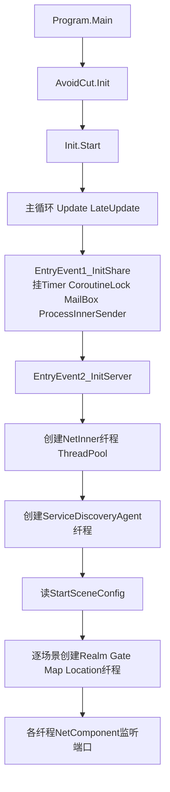

图 4：ET 服务端启动流程。Program 是个空壳 while 循环，真正的初始化全是事件驱动：EntryEvent1 挂共享组件，EntryEvent2 按配置建纤程。

关键源码（`cn.etetet.statesync/Scripts/Hotfix/Share/EntryEvent1_InitShare.cs`）：
```csharp
root.AddComponent<TimerComponent>();
root.AddComponent<CoroutineLockComponent>();
root.AddComponent<ObjectWait>();
root.AddComponent<MailBoxComponent, int>(MailBoxType.UnOrderedMessage);
root.AddComponent<ProcessInnerSender>();
```

### 12.1 启动配置数据

`StartSceneConfig` 字段（由 Luban 生成，`StartSceneConfig.cs`）：Id、Process、Zone、Name、SceneType、Port。Localhost 组里：
- Process=1 单进程，内网 Port=40001。
- Scene 列表 11 个：ServiceDiscovery、Location、RouterManager(10101)、Router01~04、Realm、Gate1、Gate2、MapManager。
- `StartMachineConfig` 提供 InnerIP/OuterIP；`StartZoneConfig` 提供每个分区的 DBConnection 和 DBName。

Aspire 模式下（`Program.cs`），这些配置被翻译成 `dotnet ./Bin/ET.App.dll --Process=X --ReplicaIndex=Y --SceneName=... --StartConfig=Localhost` 命令行，每个进程一个 Aspire 服务，接 OTLP 观测。

### 12.2 与 LYFMMORGP 启动对比

LYFMMORGP 是四个独立控制台进程（Center/Login/Gate/Game）各自 Main 启动；ET 是一个 Program + StartConfig 配置驱动建纤程，开发时一个进程跑全部，发布时按配置拆。ET 的启动更像「配置即拓扑」。

### 12.3 启动流程总结

1. `Program.Main` → `Init.Start()` → `while(true) Update/LateUpdate`。
2. `EntryEvent1_InitShare`：挂 Timer/CoroutineLock/MailBox/ProcessInnerSender。
3. `EntryEvent2_InitServer`：建 NetInner 纤程、ServiceDiscoveryAgent 纤程。
4. 按 StartSceneConfig 逐个建 Realm/Gate/Map/Location 纤程。
5. 各纤程 NetComponent 监听端口，开始收消息。

整个过程是事件驱动的，没有巨大的初始化函数。

## 13. 登录与账号流程

真实消息链（全部来自 `cn.etetet.login` 包源码）：

1. 客户端 `LoginHelper.Login` → `ClientSenderComponentSystem.LoginAsync`：新建 NetClient 纤程，发 `Main2NetClient_Login`（account/password/routerAddress）。
2. NetClient 纤程连 Realm，发 `C2R_Login`。
3. Realm 的 `C2R_LoginHandler`：用 `ServiceDiscoveryProxy.GetBySceneTypeAndZone(SceneType.Gate, zone)` 拿到所有 Gate，按 account 哈希取模选一个，再 `Call` 这个 Gate 的 `R2G_GetLoginKey`，把 Key 和 Gate 地址回给客户端。
4. 客户端拿 Key 连 Gate，发 `C2G_LoginGate`。
5. Gate 的 `C2G_LoginGateHandler`：`GateSessionKeyComponent.Get(key)` 校验，通过则建/取 Player，挂 `PlayerSessionComponent` + `MailBoxComponent(MailBoxType.GateSession)`，回 `G2C_LoginGate(PlayerId)`。
6. 客户端发 `C2G_EnterMap`，Gate 的 `C2G_EnterMapHandler` 创建 `GateMapComponent`，等一帧结束后向 Map 纤程发 `G2Map_EnterMap(PlayerId, GateActorId, MapName, MapId, UnitConfigId)`。

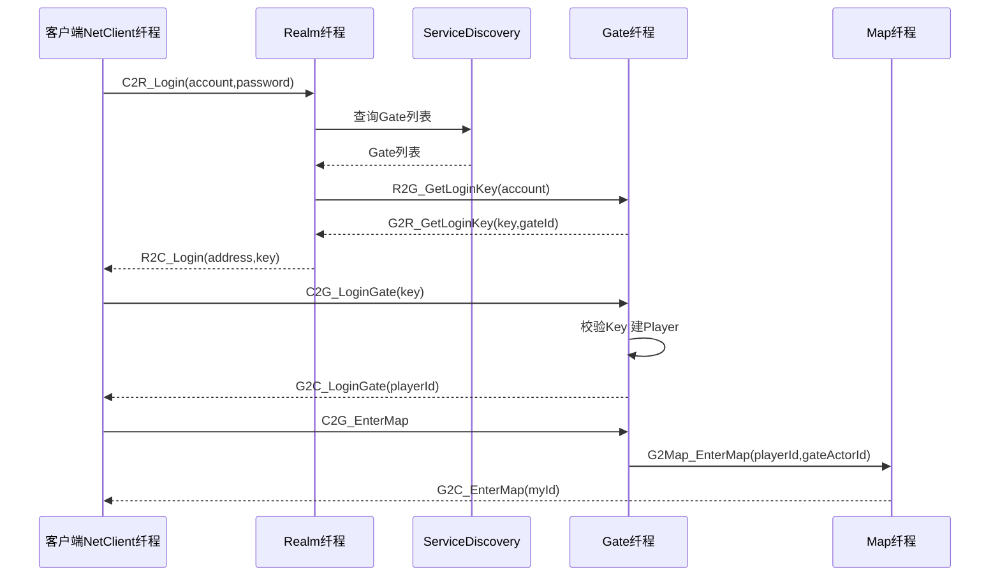

图 5：登录到进图时序。注意 Realm 不直连数据库校验账号密码——demo 里 `C2R_LoginHandler` 只做 Gate 分配，真实项目会在这里接账号系统。

### 13.1 Player 生命周期

- Gate 登录成功后 `PlayerComponent.AddChild<Player,string>(account)` 创建 Player，挂 `PlayerSessionComponent` + `MailBoxComponent(GateSession)`。
- 重连时 `player == null` 分支：去掉 `WaitLogoutComponent`、换 Session 引用——说明 ET 设计了断线重连，玩家掉线不立即删 Player，等重连或登出。
- 进图后 `GateMapComponent.Create` 创建一个临时 Map 纤程，进图完成后 `RemoveFiber(gateMapComponent.Fiber.Id)` 回收，对应「动态副本/分线按需分配用完回收」。
- `WaitFrameFinish()` 再发 G2Map_EnterMap，确保 G2C_EnterMap 先回客户端，切场景消息不插队——这是细节上的帧序保证。

### 13.2 登录与 LYFMMORGP 对比

| 步骤 | ET10 | LYFMMORGP |
|---|---|---|
| 客户端连谁 | RouterManager(10101) → Realm | LoginServer(10120) |
| 鉴权 | Realm 选 Gate + Key | LoginServer 校验账号 |
| 网关门 | Gate Key 校验建 Player | GateServer 建会话 |
| 进图 | Gate → Map 纤程 | GameServer |
| 服务发现 | ServiceDiscovery 动态选 Gate | 配置写死 |

两边流程相似，ET 多了软路由和服务发现两层。

## 14. 进入场景/地图（无选角/创角）

> **注意**：本状态同步 demo **没有角色列表/选角/创角界面**。登录成功（C2R_Login → C2G_LoginGate）后直接进入默认地图 Map2，由 C2G_EnterMapHandler 在 Map 纤程创建 Unit。这是 demo 的简化设计，商业项目需自行补选角流程。

进图后在 Map 纤程创建 Unit（`cn.etetet.map/Scripts/Hotfix/Server/Unit/UnitHelper.cs`，未逐行精读）。Unit 是 Entity，挂 `MoveComponent`、`NumericComponent`、`AOIEntity`、`MailBoxComponent` 等。

AOI 模型（`cn.etetet.aoi`）：
- `AOIManagerComponent.CellSize = 50 * 1000`（位置坐标单位是毫米，即格子边长 50 米）。
- `ChangePosition_NotifyAOI` 事件：Unit 坐标变化时按新坐标算 cellX/cellY，格子变了才调 `AOIManagerComponent.Move(aoiEntity, newCellX, newCellY)` 做 AOI 重定位，避免每次移动都重算。
- AOI 观察者进出通过 `AOIEventType` 事件通知，再由 Map 层广播给周围 Unit。

初始同步：进图后 Map 把周围 Unit 列表和自身属性通过 `G2C_EnterMap` 及后续 M2C 消息推给客户端 Current 场景。

### 14.1 软路由防攻击设计

`cn.etetet.router` 包实现软路由：客户端只连 RouterManager（对外 10101），不直连 Gate。被攻击时攻击流量打在 Router 上，Router 把玩家连接切到其他路由节点或切换底层协议（UDP→TCP/WebSocket），玩家无感知不断线。`KService` 里的 `RouterReconnectSYN/ACK/RouterSYN/ACK` 协议字就是干这个的。

这对 LYFMMORGP 的启示：当前 TCP Socket 直连 Gate，未来上线要防 DDoS，可以在最外层加一层接入转发，把真 IP 藏在后面。

### 14.2 MapManager 与动态副本

`cn.etetet.mapmanager` 包负责地图/副本纤程的动态创建与回收。玩家进图时 Gate 临时建一个 Map 纤程，进图完成后回收（见 `C2G_EnterMapHandler` 的 `RemoveFiber`）。这对应 README「动态副本跟分线，按需分配，用完回收」。多副本时 MapManager 负责分配和负载。

### 14.3 Unit 与组件

Unit 是玩家/怪物在 Map 里的实体（`cn.etetet.unit`）。它挂：
- `MoveComponent`：移动路点。
- `NumericComponent`：属性。
- `AOIEntity`：AOI 观察者位置。
- `MailBoxComponent`：接收 Actor 消息（如移动消息）。
- `UnitGateInfoComponent`：Gate 关联信息。

这种「一个 Unit = 多个功能组件」正是 ET 组件式设计的体现，加新功能就加组件。

## 15. 移动同步

同步模型：**状态同步**（服务端权威），不是帧同步。

- 客户端点地板 → 寻路 → 发 `C2M_PathfindingResult(Position)` 给 Map。
- Map 的 `C2M_PathfindingResultHandler`：
```csharp
[MessageHandler(SceneType.Map)]
public class C2M_PathfindingResultHandler : MessageLocationHandler<Unit, C2M_PathfindingResult>
{
    protected override async ETTask Run(Unit unit, C2M_PathfindingResult message)
    {
        unit.FindPathMoveToAsync(message.Position).Coroutine();
    }
}
```
`MessageLocationHandler<Unit, ...>` 意味着消息先经 Location 定位到玩家 Unit 的 Actor，再投递。
- 服务端 `MoveComponent`（`cn.etetet.move/Scripts/Model/Share/MoveComponent.cs`）持有路点列表 `List<float3> Targets`、当前段索引 `N`、速度 `Speed`（m/s）、起止时间 `StartTime/BeginTime`，按时间在服务端驱动移动。
- 移动过程中通过 AOI 广播 `M2C_PathfindingResult(Id, Points)` 给周围客户端。
- 客户端 `M2C_PathfindingResultHandler`：
```csharp
Unit unit = currentScene.GetComponent<UnitComponent>().Get(message.Id);
float speed = unit.NumericComponent.GetAsFloat(NumericType.Speed);
await unit.GetComponent<MoveComponent>().MoveToAsync(message.Points, speed, 200);
```
其他玩家的移动由服务端下发路点，客户端按 speed 播放插值；自己的移动是客户端预测后发消息，服务端只接受目标点再广播（demo 里没有严格的速度校验和回滚，与 README 描述一致——预测回滚是 `cn.etetet.lockstep` 包的帧同步 demo 才有的）。

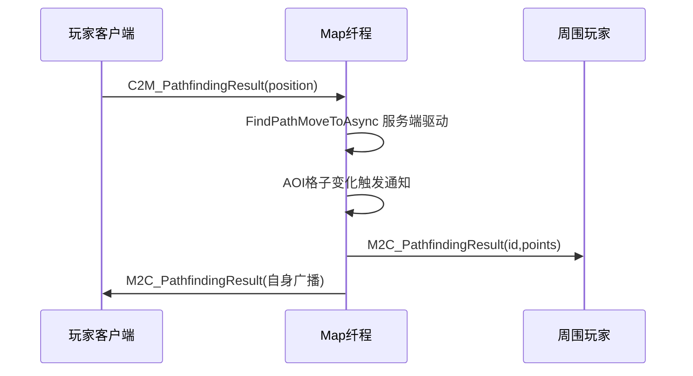

图 6：移动同步时序。服务端权威移动 + AOI 范围广播，客户端按路点插值。

### 15.1 与 LYFMMORGP 移动同步的对比

| 项 | ET10 状态同步 demo | LYFMMORGP 现状 |
|---|---|---|
| 权威方 | 服务端 | 服务端 |
| 客户端预测 | 点地板直接播，不等服务端 | 预表现 + 权威校正 |
| 移动消息 | C2M_PathfindingResult 发目标点，服务端寻路后广播路点 | 收一包广播一次 |
| 广播范围 | AOI 50 米格子，跨格才重算 | 同图约 100 米 AOI |
| 速度校验 | demo 无严格校验 | 无服务端物理/速度校验 |
| 插值 | 客户端按 NumericComponent.Speed 播放路点 | 客户端插值 |

结论：两边同步模型高度相似，ET 的优势在 AOI 格子计算和服务端寻路（纯 C# Recast）；LYFMMORGP 可以借鉴 ET「跨格才重算 AOI」和「数值组件驱动移动速度」两点。

### 15.2 Unit 创建链路

进图时 Gate 的 `GateMapComponent.Create(playerId)` → 向 Map 纤程发 `G2Map_EnterMap` → Map 纤程在自己的 Scene 下 `AddChild<Unit>()`，挂上 `MoveComponent`、`NumericComponent`、`AOIEntity`、`MailBoxComponent` → 触发 `AfterServerUnitCreate` 事件 → AOI 注册 → 广播周围 Unit。Unit 的 `Position` 是 `float3`（Unity.Mathematics），坐标单位毫米，所以 `ChangePosition_NotifyAOI` 里要 `oldPos.x * 1000 / CellSize` 换算。

### 15.3 移动消息清单

- `C2M_PathfindingResult`：客户端发目标点给 Map。
- `M2C_PathfindingResult`：Map 广播路点给周围客户端。
- `C2M_Stop`：客户端停止。
- `M2C_Stop`：服务端通知停止。
- `M2C_Turn`：朝向变化。

这些消息由 `[MessageHandler(SceneType.Map/Current)]` 特性注册分发。

### 15.4 同步模型结论

ET 状态同步 demo 与 LYFMMORGP 现状高度一致：服务端权威、客户端插值、AOI 范围广播。差异在 ET 有服务端纯 C# Recast 寻路和更细的 AOI 格子计算。预测回滚是 `cn.etetet.lockstep` 包的帧同步 demo，不在本状态同步 demo 里。

## 16. 战斗、技能与属性

属性：`cn.etetet.numeric` 的 `NumericComponentSystem`，分层叠算（Base + Add + Percent），`M2C_PathfindingResultHandler` 里 `unit.NumericComponent.GetAsFloat(NumericType.Speed)` 就是从数值组件取速度。
- 技能/Buff：`cn.etetet.spell` 包，`SpellComponentSystem`、`BuffComponentSystem`，配置来自 Luban，复用行为树导出链路。
- 攻击判定：本状态同步 demo 未做完整战斗，技能系统以配置+行为树为主。

数值系统要点（`cn.etetet.numeric`）：每个属性是一棵 Numeric 节点树，最终值 = 基础值 + 各层修正；`NumericType.Speed` 变化时触发 `NumericWatcher_Speed_ChangeMoveSpeed`（move 包）联动移动速度，说明 ET 的属性变化是事件驱动的，改属性会自动通知依赖它的组件。

### 16.1 对 LYFMMORGP 的启示

ET 的数值组件事件驱动模式值得借鉴：属性变化自动通知依赖组件，避免手动同步。LYFMMORGP 当前属性结算可参考这种分层+监听模式。

## 17. AI 与怪物

- `cn.etetet.behaviortree`：Sequence/Selector/Condition/Action 节点，带 Unity 可视化编辑器。
- `cn.etetet.btnode`：节点定义。
- 怪物 AI 用行为树配置，寻路用 `cn.etetet.recast` 的纯 C# Recast（`NavmeshComponent.cs`），服务端可独立寻路不依赖 Unity。

ET README 还强调「AI 框架比写 UI 还简单」——这里的 AI 指游戏内怪物/NPC 行为 AI，不是现代大模型 AI。ET10 新增的 `cn.etetet.harness` 才是给大模型写代码用的工具链，两者不要混淆。

### 17.1 行为树与条件表达式

- `cn.etetet.behaviortree`：Sequence/Selector/Not/Condition/Action 节点，带 Unity 可视化编辑、参数配置、运行路径调试和配置导出。
- `cn.etetet.conditionexpr`：把 Excel/Luban 里的条件表达式（数值比较、&&、||、!、括号）编译成行为树节点，用于副本进入/奖励领取/任务接取/功能开启条件。
- `cn.etetet.spell`：技能与 Buff 复用行为树配置导出链路。

这套「行为树 + 条件表达式」让策划在 Excel 里配技能/任务条件，程序不用写硬编码分支。对 LYFMMORGP 的启示：未来任务/副本前置条件可考虑类似的可配置规则。

## 18. 背包、物品、装备

- `cn.etetet.item`：物品模型。
- `cn.etetet.equipment`：装备槽。
- 均为标准 Entity + Component 结构，数据走 MongoDB BSON。本解析未逐行精读这两个包，不展开。

这些系统在 ET 里都是「一个功能一个 Package」的独立包，`packages-lock.json` 里能看到包之间的依赖关系（如 aoi 依赖 unit、numeric、proto、config）。这种包式拆分让项目可以按需裁剪，也是 ET9 之后的核心架构变化。

### 18.1 对 LYFMMORGP 的启示

LYFMMORGP 当前业务模块集中在 GameServer 里，未来业务膨胀时可参考 ET「一个功能一个包/模块」的拆分方式，避免单文件膨胀。但不必照搬 61 包的粒度，按实际需要拆分即可。

## 19. 任务、NPC、对话

- `cn.etetet.quest`：任务系统。
- `cn.etetet.achievement`：成就。
- 本解析未逐行精读，结构上仍是 Entity+Component+Luban 配置驱动。

`cn.etetet.conditionexpr` 包能把 Excel/Luban 里填的条件表达式（数值比较、&&、||、!）编译成行为树节点，用于副本进入条件、奖励领取条件、任务接取条件等——这是策划可配置的规则引擎，对应任务/NPC 对话里的前置条件判断。

### 19.1 对 LYFMMORGP 的启示

LYFMMORGP 当前任务条件可能硬编码在 C# 里，未来可参考 ET「Excel 配条件表达式 → 编译成节点」的方式，让策划自己配任务接取/完成条件，减少程序改代码。

## 20. 交易、经济、商城、社交

状态同步 demo 未完整实现交易/邮件/好友。ET 的设计哲学是「这些功能做成独立 Package，需要时集成」——README 里 YIUI 系列、FGUI 系列插件就是这种生态。

对 LYFMMORGP 的启示：ET 把「框架核心」和「业务功能」彻底分开，核心只提供 Fiber/Entity/网络/位置服务，业务系统全部做成可插拔包。这意味着框架本身不会因为业务膨胀而变臃肿。

### 20.1 框架核心与业务包的边界

通读 56 个业务包后可归纳三层：
- **运行时层**（core/startconfig/netinner/actorlocation/db/servicediscovery）：框架骨架，不写业务。
- **能力层**（aoi/move/unit/numeric/spell/behaviortree/recast/yooassets/hybridclr）：可复用通用能力。
- **业务层**（login/map/mapmanager/mapplay/quest/achievement/equipment/item/statesync/lockstep）：示例游戏逻辑。

这种分层让 ET 既能做状态同步 MMO（statesync），也能做帧同步 MOBA（lockstep），同一套运行时跑不同游戏类型。

## 21. 其他特色系统（ET 独有亮点）

1. **Fiber 纤程模型**：类似 Erlang 进程，一个逻辑单元一个单线程，三种调度（Main/ThreadPool/Parent），开发时所有逻辑合在一个进程（N 变 1），发布时按配置拆多进程（1 变 N），代码不用改。
2. **位置透明 Actor 消息**：挂 `MailBoxComponent` 的 Entity 就是 Actor，只要知道 ActorId 就能发消息，不用关心它在哪个进程；`LocationComponent` 负责 ActorId→进程地址映射，甚至持久化到 MongoDB。
3. **软路由防攻击**：Router/RouterManager 在最外层，KCP 底层支持 UDP↔TCP/WebSocket 运行时切换，被攻击时玩家客户端秒切路由不掉线。
4. **AI Native 工具链**：`cn.etetet.unitybridge` 68 条指令让 AI 直接操作 Unity Editor，`cn.etetet.test` 用完整游戏环境写双端机器人测试（5 个机器人组队测组队逻辑）。
5. **分析器约束**：Roslyn 分析器强制 async 规范、Entity 生命周期、包依赖，AI 写出不符合 ET 风格的代码直接编译报错。
6. **.NET Aspire 编排**：`Program.cs` 按 StartConfig 为每个进程起 Aspire 服务，接 OTLP 观测，云原生部署。
7. **0GC 网络**：MemoryPack + KCP 非托管内存 + MemoryBuffer 池，README benchmark 100W PingPong 约 4 秒、20W 消息/秒。

### 21.1 源生成器与分析器

ET10 的 `cn.etetet.sourcegenerator` 包做了两件事：
- **代码生成**：开发者只写 `Awake`/`Update` 静态方法并打 `[EntitySystem]`，源生成器自动生成对应的 EntitySystemOf 注册代码，省去手写大量模板。
- **Roslyn 分析器**：`CoroutineLockAnalyzer`、await 分析器、Entity 生命周期分析器、包依赖分析器。例如 `TimerComponent` 上的 `[SkipAwaitEntityCheck]`、Entity 上的 `[AllowEntityMember]` 都是分析器用的标记——不规范的写法（如跨纤程直接改 Entity、忘记 await）直接编译报错。

这是 ET10「AI Native」的技术基础：AI 可以放开写，分析器在编译期兜底，保证写出的代码符合 Fiber/Entity 架构。

### 21.2 双端共享代码

ET7 之后客户端和服务端代码合并在同一个工程里：`cn.etetet.core`、`cn.etetet.move`、`cn.etetet.unit` 等包里同时有 `Model/Share`、`Hotfix/Share`（双端共用）和 `Model/Server`、`Hotfix/Server`（仅服务端）、`HotfixView/Client`（仅客户端表现层）目录。协议消息、MoveComponent 数据结构、Unit 定义双端共用一份，改消息只需改一处。

这与 LYFMMORGP「客户端 Unity 工程 + 服务端独立 .NET 工程」分离不同；ET 的代价是工程结构更复杂（CodeMode/Ignore.asmdef 区分），收益是无双端协议重复维护。

### 21.3 测试与机器人框架

`cn.etetet.test` 包：每个测试都是完整游戏环境，不需要 mock。例如测组队：起 5 个客户端机器人，机器人直接共享客户端逻辑层代码发消息，测试整个双端组队流程。`cn.etetet.robot` 包提供机器人能力，README 称「减少 95% 机器人开发工作量」。

对 LYFMMORGP 的启示：压测机器人如果能直接复用客户端逻辑层，就不用另写一套协议模拟。这是 ET 双端共享代码的最大红利之一。

### 21.4 .NET Aspire 云原生编排

`cn.etetet.aspire` 包把 StartConfig 翻译成 Aspire 服务，每个 ET 进程一个可观测服务，自动接 OTLP/OpenTelemetry。这是 ET10 新加入的，旧版没有。对应「云原生部署」叙事。

### 21.5 truesync 定点数学库（帧同步确定性基础）

cn.etetet.truesync 包提供帧同步所需的定点数学：Fix64（64 位定点数）、TSVector、TSQuaternion、TSMatrix、Fix64Sin/Acos/Tan 查找表。**帧同步要保证双端逐帧一致，不能用 float/double**（浮点运算在不同 CPU/编译器上可能有微小差异，累积后会导致不同步）。lockstep 包的 LSRollbackSystem 回滚重放依赖 truesync 的定点运算，保证回滚后结果与原帧完全一致。

> 面试要点：被问「帧同步怎么保证确定性」，答案是「用定点数替代浮点数，所有运算都是整数运算，跨平台结果一致」。

### 21.6 ET 的设计哲学总结

ET 的设计可以归纳为四句话：
1. 一切皆 Entity：数据是树，组件挂树上。
2. 一切皆纤程：逻辑单元是单线程 Actor。
3. 一切皆消息：跨单元通信走 Actor 消息。
4. 一切皆配置：进程拓扑由 Luban 配置决定。

这四句话贯穿了从核心到业务的所有设计，也是面试时能一句话讲清 ET 的关键。

## 22. 关键核心类与典型代码走读

### 22.1 Fiber（纤程）
`Packages/cn.etetet.core/Scripts/Core/Share/World/Fiber/Fiber.cs`

Fiber 是一切运行时的容器。关键设计：
- `[ThreadStatic] private static Fiber instance`：当前线程正在跑哪个 Fiber。
- `Root = new Scene(...)`：每个 Fiber 自带一个 Scene 根实体。
- `Update()` 里 `EntitySystem.Publish(new UpdateEvent())` 驱动本纤程所有 System。
- `schedulerQueue` 管理寄生子纤程（Parent 调度）。
- `ThreadSynchronizationContext`：跨纤程 Post 消息切回本纤程线程执行。

```csharp
internal void Update() {
    Instance = this;                              // 设为当前线程 Fiber
    this.EntitySystem.Publish(new UpdateEvent()); // 驱动所有 UpdateSystem
    // 轮询调度 Parent 子纤程
    while (count-- > 0) {
        Fiber fiber = this.schedulerQueue.Dequeue();
        this.schedulerQueue.Enqueue(fiber);
        fiber.Update();
    }
}
```

Fiber 的关键设计点：
- 每个 Fiber 一个 `ThreadSynchronizationContext`，跨纤程消息 Post 回这个上下文。
- `[ThreadStatic] instance` 标记当前线程正在跑哪个 Fiber。
- `CreateFiber` 支持三种调度：Main（主线程）、ThreadPool（独立线程）、Parent（寄生父线程）。
- `WaitFrameFinish` 让协程等当前帧结束再继续，保证帧序。

### 22.2 Entity / Component
`Packages/cn.etetet.core/Scripts/Core/Share/Entity/Entity.cs`

- Entity 既是数据容器又是 MemoryPack 模型 + Mongo 文档。
- `ChildrenCollection children`（子实体）和 `ComponentsCollection components`（组件）都是按需 `ObjectPool.Fetch` 创建。
- `AddComponent<K>()` → `CreateComponent` → `EntitySystemSingleton.Awake(component)` 触发对应 System。
- `GetComponent<K>()` 带 `CheckThread()`（DEBUG 下校验必须在本 Fiber 线程访问）。

Entity 的关键设计：
- `ChildrenCollection`（子实体）和 `ComponentsCollection`（组件）都是按需 `ObjectPool.Fetch` 创建。
- `AddComponent` 后自动触发 `EntitySystemSingleton.Awake(component)`。
- `Dispose` 递归清理 children 和 components，触发 Destroy 事件。
- `[MemoryPackIgnore]` + `[BsonIgnore]` 双标注，同一份数据走网络和落库。

### 22.3 EventSystem
`Packages/cn.etetet.core/Scripts/Core/Share/World/EventSystem/EventSystem.cs`

- Awake 时扫描所有 `[Event]` 和 `[Invoke]` 特性类，按事件类型注册。
- `PublishAsync(scene, eventStruct)` 按 SceneType 过滤后逐个调用处理器。
- 与 C# event 不同，ET 的事件是 struct 参数 + SceneType 过滤 + 反射注册。

EventSystem 的关键设计：
- 事件参数是 struct，避免装箱。
- `[Event(SceneType.X)]` 特性标记处理器，Awake 时扫描注册。
- `PublishAsync` 按当前 Scene 的 SceneType 过滤，同一事件在不同场景有不同处理器。
- 还有 `Invoke`（`allInvokers`）用于带返回值的回调。

### 22.4 ObjectPool
`Packages/cn.etetet.core/Scripts/Core/Share/World/ObjectPool/ObjectPool.cs`

```csharp
public static T Fetch<T>(bool isFromPool = true) where T : class { ... }
public static void Recycle(object obj) { if (obj is IPool p && p.IsFromPool) p.Clear(); }
```
Entity 从池里 `Fetch`，Dispose 时不真 new 而是 `Reset` 回池，减少 GC。

ObjectPool 的关键设计：
- 按 Type 分池（`ConcurrentDictionary<Type, Pool>`）。
- `IPool` 接口标记可池化对象，`IsFromPool` 标记是否来自池。
- `Recycle` 调 `Clear()` 重置状态，不真销毁。
- Entity、ChildrenCollection、ComponentsCollection、MemoryBuffer 都池化。

### 22.5 MessageDispatcher（消息分发）
见第 10.3 节。按 `[MessageHandler(SceneType.X)]` 注册，分发时比对 `entity.IScene.SceneType`。

MessageDispatcher 的关键设计：
- Awake 时扫描所有 `[MessageHandler]` 特性类注册。
- 按消息类型分组，每组多个 SceneType 的处理器。
- 分发时按当前实体的 SceneType 过滤，只调匹配的处理器。
- 支持 Session/Scene/Location 三种 Handler 基类。

### 22.6 MailBoxComponent（Actor 信箱）
`Packages/cn.etetet.core/Scripts/Model/Share/Mailbox/MailBoxComponent.cs`

```csharp
public static void Add(this MailBoxComponent self, long fromFiber, MessageObject messageObject) {
    EventSystem.Instance.Invoke(self.MailBoxType, new MailBoxInvoker() { ... });
}
```
挂上它 Entity 就是 Actor，收到的消息按 MailBoxType（GateSession/Ordered/UnOrdered/Client）走不同处理器。

MailBoxComponent 的关键设计：
- 挂了它 Entity 就成为 Actor，接收消息队列处理。
- `MailBoxType` 决定消息并发与顺序策略。
- 消息通过 `EventSystem.Invoke(MailBoxType, ...)` 分发到对应处理器。

### 22.7 C2R_LoginHandler（Realm 登录）
见第 13 节。用 ServiceDiscovery 选 Gate，Call 拿 Key。

C2R_LoginHandler 的关键流程：
1. 从 ServiceDiscovery 拿 Gate 列表。
2. 按 account 哈希选 Gate。
3. Call 该 Gate 的 R2G_GetLoginKey 拿 Key。
4. 回客户端 R2C_Login（地址+Key）。
5. 1 秒后关闭 Realm Session。

### 22.8 MoveComponent
见第 15 节。`List<float3> Targets` + `N` 索引 + `Speed` + 时间戳，服务端驱动路点移动。

### 22.9 AOIManagerComponent
`Packages/cn.etetet.aoi/Scripts/Model/Server/AOIManagerComponent.cs`：
```csharp
public const int CellSize = 50 * 1000;  // 50 米一格（坐标毫米）
```
配合 `ChangePosition_NotifyAOI` 事件做格子跃迁时的 AOI 重算。

AOIManagerComponent 的关键设计：
- 格子边长 50 米（毫米坐标）。
- Unit 跨格时才重算 AOI 观察者。
- 九宫格模型，只广播周围格的玩家。

### 22.10 DBComponent / LocationComponent
见第 11 节。MongoClient + IMongoDatabase，TaskCount=32；LocationInfo 持久化到 Share.LocationInfo。

DBComponent 的关键设计：
- 一个 DBComponent 对应一个 Mongo 数据库。
- `TaskCount = 32` 限制并发 Mongo 操作数。
- `DBManagerComponent` 按 Zone 管理多个 DBComponent。
- LocationComponent 把 ActorId 路由持久化到 Share.LocationInfo。

### 22.11 TimerComponent
`Packages/cn.etetet.core/Scripts/Core/Share/Timer/TimerComponent.cs`：
```csharp
public enum TimerClass { None, OnceTimer, OnceWaitTimer, RepeatedTimer }

[ComponentOf(typeof(Scene))]
public class TimerComponent: Entity, IAwake, IUpdate {
    public readonly MultiMap<long, long> timeId = new(1000);   // 到期时间 -> 定时器id
    public readonly Queue<long> timeOutTime = new();            // 待触发时间队列
}
```
每个 Scene 自带定时器，业务 `await TimerComponent.WaitAsync(毫秒)` 即可异步等待，不阻塞纤程线程。

TimerComponent 的关键设计：
- 支持 OnceTimer/OnceWaitTimer/RepeatedTimer 三种。
- 按到期时间排序，到点触发。
- 业务用 `await TimerComponent.WaitAsync(1000)` 异步等待。

### 22.12 CoroutineLockComponent
`Packages/cn.etetet.core/Scripts/Core/Share/CoroutineLock/CoroutineLockComponent.cs`：单线程下的逻辑锁。按 `CoroutineLockType + key` 排队同一资源的协程，例如同一玩家的落库、传送不能并发。ET 用它替代真锁，避免单线程里「await 让出后另一个协程改了状态」。

CoroutineLockComponent 的关键设计：
- 按 CoroutineLockType + key 排队。
- 单线程下的逻辑锁，防 await 让出后的竞态。
- 用于同一玩家的落库、传送等顺序敏感操作。

### 22.13 ProcessInnerSender
`Packages/cn.etetet.core/Scripts/Model/Share/Actor/ProcessInnerSender.cs`：本进程内纤程间发消息的通道。`ClientSenderComponentSystem.Call/Send` 就是通过它把消息投给 NetClient 纤程，再由 NetClient 纤程走网络——网络收发与主逻辑被拆到不同纤程，但通信走进程内发送器，不经过 socket。

ProcessInnerSender 的关键设计：
- 本进程内纤程间通信不经过 socket。
- 客户端把网络收发独立成 ThreadPool 纤程，主线程通过它发消息。
- 网络线程不卡表现。

### 22.14 GateSessionKeyComponent
`Packages/cn.etetet.login/Scripts/Model/Server/Gate/GateSessionKeyComponent.cs`：Gate 侧存 Realm 下发的登录 Key→account 映射。`C2G_LoginGateHandler` 用 `Get(key)` 校验，防止客户端绕过 Realm 直接连 Gate。

GateSessionKeyComponent 的关键设计：
- Gate 侧存 Realm 下发的 Key→account 映射。
- 客户端连 Gate 时必须带 Key，防止绕过 Realm。
- Key 校验通过才建 Player。

### 22.15 ServiceDiscoveryProxy
`C2R_LoginHandler` 里通过 `root.GetComponent<ServiceDiscoveryProxy>().GetBySceneTypeAndZone(SceneType.Gate, zone)` 动态拿 Gate 列表，不再写死 Gate 地址。这是 ET10 相对于旧版「配置里写死 Gate IP」的改进，支持 Gate 多实例动态扩缩。

ServiceDiscoveryProxy 的关键设计：
- 动态拿 Gate 列表，不写死地址。
- 按 account 哈希选 Gate，负载均衡。
- 支持 Gate 多实例动态扩缩。

### 22.16 真实登录代码摘录

`C2R_LoginHandler.cs`（Realm 选 Gate）：
```csharp
ulong hash = (ulong)request.Account.GetLongHashCode();
ServiceDiscoveryProxy proxy = root.GetComponent<ServiceDiscoveryProxy>();
List<ServiceInfo> gates = proxy.GetBySceneTypeAndZone(SceneType.Gate, session.Fiber().Zone);
ServiceInfo gateInfo = gates[(int)(hash % (ulong)gates.Count)];
R2G_GetLoginKey req = R2G_GetLoginKey.Create();
req.Account = request.Account;
response.Address = gateInfo.Metadata[ServiceMetaKey.InnerIPOuterPort];
G2R_GetLoginKey resp = (G2R_GetLoginKey)await messageSender.Call(gateInfo.ActorId, req);
response.Key = resp.Key;
```
这段体现了 ET 的三个核心：服务发现选 Gate、按账号哈希负载均衡、Actor Call 拿 Key。

`C2G_EnterMapHandler.cs`（进图）：
```csharp
GateMapComponent gateMapComponent = player.AddComponent<GateMapComponent>();
await gateMapComponent.Create(player.Id);
response.MyId = player.Id;
await WaitFrameFinish();  // 等一帧结束再发进图
G2Map_EnterMap enterMap = G2Map_EnterMap.Create();
enterMap.PlayerId = player.Id;
enterMap.GateActorId = gateActorId;
enterMap.MapName = "Map2";
await MessageSender.Call(gateMapComponent.Fiber.Root.GetActorId(), enterMap);
```

### 22.17 客户端网络纤程摘录

`ClientSenderComponentSystem.LoginAsync`：
```csharp
self.fiberId = await self.Fiber().CreateFiber(SchedulerType.ThreadPool, id, SceneType.NetClient, "NetClient");
Main2NetClient_Login req = Main2NetClient_Login.Create();
req.OwnerFiberId = self.Fiber().Id;
req.Account = account; req.Password = password; req.Address = address;
NetClient2Main_Login resp = await self.Root().GetComponent<ProcessInnerSender>()
        .Call(self.FiberInstanceId, req) as NetClient2Main_Login;
return resp.PlayerId;
```
客户端把网络收发独立成一个 ThreadPool 纤程，主线程只通过 ProcessInnerSender 给它发消息，网络线程不卡表现。

客户端网络纤程的关键设计：
- 每次登录新建 NetClient 纤程（ThreadPool 调度）。
- 主线程通过 ProcessInnerSender 发消息。
- 网络收发在独立线程，不卡 Unity 主线程。

### 22.18 EventSystem 发布与订阅

`EventSystem.cs` 核心结构：
```csharp
private readonly Dictionary<Type, List<EventInfo>> allEvents = new();
// Awake 时扫描 [Event] 特性类注册
// PublishAsync(scene, eventStruct) 按 SceneType 过滤后调用
```
业务里 `EventSystem.Instance.PublishAsync(root, new LoginFinish())` 就是发布事件；订阅者写 `[Event(SceneType.X)] class XxxEvent : AEvent<Scene, EventType>`。事件参数是 struct，避免装箱。

ET 同时有 `Invoke`（`allInvokers`）用于带返回值的回调，按 InvokeType 分发。

### 22.19 AOI 格子模型

`AOIManagerComponent.CellSize = 50 * 1000`（50 米/格，毫米单位）。`ChangePosition_NotifyAOI`：
```csharp
int oldCellX = (int)(oldPos.x * 1000) / AOIManagerComponent.CellSize;
int oldCellY = (int)(oldPos.z * 1000) / AOIManagerComponent.CellSize;
int newCellX = (int)(unit.Position.x * 1000) / AOIManagerComponent.CellSize;
// 同格不重算，跨格才 Move(aoiEntity, newCellX, newCellY)
```
这是典型九宫格 AOI：玩家只在自己所在格及周围格可见范围内广播，跨格才更新观察者集合。对比 LYFMMORGP「同图约 100 米广播」，ET 的格子粒度更细且计算更省（只在跨格时重算）。

### 22.20 ObjectPool 复用

```csharp
public static T Fetch<T>(bool isFromPool = true) where T : class { ... }
public static void Recycle(object obj) { if (obj is IPool p && p.IsFromPool) p.Clear(); }
```
Entity、ChildrenCollection、ComponentsCollection、MemoryBuffer 都从池里取，Dispose 时 Reset 回池不真删。这是 ET 0GC 的关键：热点对象不进 GC。

ObjectPool 的关键设计：
- 按 Type 分池（ConcurrentDictionary<Type, Pool>）。
- IPool 接口标记可池化对象，IsFromPool 标记是否来自池。
- Recycle 调 Clear() 重置状态，不真销毁。
- Entity、ChildrenCollection、ComponentsCollection、MemoryBuffer 都池化。

### 22.21 MoveComponent 数据结构

```csharp
public class MoveComponent: Entity, IAwake, IDestroy {
    public float3 StartPos;          // 段起点
    public float3 RealPos => Targets[0];
    public List<float3> Targets;      // 路点列表
    public int N;                     // 当前段索引
    public float Speed;               // m/s
    public long BeginTime, StartTime;
    public int TurnTime;              // 转向时间
    public quaternion From, To;       // 朝向插值
}
```
服务端按 (now - BeginTime) * Speed 在路点间推进，到终点触发 `MoveTimer`。客户端收到 `M2C_PathfindingResult` 后用同一结构播放心知肚明。

MoveComponent 的关键设计：
- 路点列表由客户端发，服务端存。
- 服务端按时间戳+速度驱动移动。
- 到达终点发 M2C_Stop。
- 位置变化触发 ChangePosition_NotifyAOI。

### 22.22 Fiber 的 ThreadStatic 上下文

```csharp
[ThreadStatic] private static Fiber instance;
internal static Fiber Instance {
    set {
        instance = value;
        SynchronizationContext.SetSynchronizationContext(value.ThreadSynchronizationContext);
    }
}
```
每个线程在跑某个 Fiber 前先把自己标记为该 Fiber，再把同步上下文换成该 Fiber 的。这样 `await` 之后回调自动回到这个线程——这是 ET 单线程异步能成立的底层机制。

Fiber 的 ThreadStatic 上下文关键设计：
- `[ThreadStatic] instance` 标记当前线程跑哪个 Fiber。
- Update 开头设 Instance = this，结束清掉。
- 所有 GetComponent/事件/Timer 都检查当前线程是不是该 Fiber。
- DEBUG 下 CheckThread() 抛异常防跨线程访问。

### 22.23 为什么 Entity 同时是 MemoryPack 和 BSON 模型

`Entity.cs` 字段上同时有 `[MemoryPackIgnore]`、`[BsonIgnore]`：
- MemoryPack 用于网络消息序列化（0GC）。
- BSON 用于 MongoDB 落盘。
- 同一个 Entity 树既走网络又落库，不需要写 DTO 转换层。
- `[MemoryPackIgnore]`、`[BsonIgnore]` 标记运行时字段（InstanceId、IScene 引用）不参与序列化。

这是 ET「一切皆 Entity」在序列化层的体现：数据结构统一，传输和存储复用同一棵树。

Entity 双序列化的关键设计：
- 一份数据既走网络又落库。
- 不用维护两套 DTO。
- 代价是耦合：改一个字段要同时考虑网络协议和库表结构。
- 业务数据用同一个 class，不区分网络 DTO 和数据库实体。

### 22.24 服务发现包

`cn.etetet.servicediscovery` 提供服务注册/注销/查询/心跳租约。Realm 登录时通过 `ServiceDiscoveryProxy.GetBySceneTypeAndZone(SceneType.Gate, zone)` 动态拿 Gate 列表，Gate 多实例时按账号哈希选一个。这是 ET10 为云原生扩缩容加的，旧版要在 StartConfig 里写死 Gate。

服务发现包的关键设计：
- 提供服务注册/注销/查询/心跳租约。
- Realm 登录时动态拿 Gate 列表。
- Gate 多实例时按账号哈希选一个。
- 支持 Gate 动态扩缩容。

### 22.25 软路由 RouterManager

RouterManager 是客户端最先连的软路由（对外 10101），它把客户端消息转发给 Realm，再由 Realm 选 Gate。这样客户端只需要知道一个 RouterManager 地址，不用知道后端有几个 Realm/Gate。软路由的存在让后端扩缩容对客户端透明。

软路由 RouterManager 的关键设计：
- 客户端最先连的软路由（对外 10101）。
- 把客户端消息转发给 Realm。
- 后端扩缩容对客户端透明。
- 客户端只需要知道一个 RouterManager 地址。

### 22.26 包结构与 CodeMode

ET10 把代码按是否需要热更分层：
- `Core/Share`：双端共享、不热更的根基（Entity/Fiber/网络）。
- `Model/Share`：双端共享的数据模型与组件定义。
- `Hotfix/Share`：双端共享、可热更的业务逻辑。
- `Model/Server`、`Hotfix/Server`：仅服务端。
- `HotfixView/Client`：仅客户端表现层。
- `CodeMode/`：Luban 生成的配置代码。

`CodeLoader`（`cn.etetet.loader`）在运行时反射加载 Hotfix 程序集，实现不停服热重载。

包结构与 CodeMode 的关键设计：
- Core/Share 不热更，双端共享根基。
- Hotfix/Share 可热更，双端共享业务逻辑。
- Model/Hotfix 分端。
- CodeMode 是 Luban 生成的配置代码。
- 与 LYFMMORGP 的 HybridCLR 热更程序集划分思路一致。

### 22.26 ETTask 与上下文

ETTask 类似 Task 但不进线程池，await 后回调通过 `ThreadSynchronizationContext` 切回发起纤程的线程。ET9 起还实现了传递上下文，去掉了烦人的 CancellationToken 传递（README 第 9 条）。

ETTask 的关键设计：
- 类似 Task 但不进线程池。
- await 后回调通过 ThreadSynchronizationContext 切回发起纤程的线程。
- ET9 起实现传递上下文，去掉 CancellationToken 传递。
- 这是单线程异步能成立的底层机制。

### 22.27 ObjectWait 与等待机制

`EntryEvent1_InitShare` 里挂了 `ObjectWait`，用于业务等待某个对象出现（如等待 Unit 加载完成），是 ET 异步等待的辅助组件。

ObjectWait 的关键设计：
- 按 key 等待/触发。
- 与 CoroutineLock 配合做等某件事发生。
- MailBoxComponent 收 RPC 请求时 Caller() 用 ObjectWait 挂起请求方。
- 被调方处理完 Trigger() 唤醒。

### 22.28 MailBoxType 投递策略

`MailBoxType`（`cn.etetet.login/Scripts/Model/Share/MailBoxType.cs`）定义不同信箱类型：
- `UnOrderedMessage`：进程根默认信箱，消息乱序处理。
- `GateSession`：网关门箱，绑定玩家 Session。
- `OrderedMessage`：顺序消息（actorlocation 包）。
不同类型走不同 `MailBoxType_*_MessageHandler`，控制消息并发与顺序。

MailBoxType 投递策略的关键设计：
- UnOrderedMessage：进程根默认信箱，消息乱序处理。
- GateSession：网关门箱，绑定玩家 Session。
- OrderedMessage：顺序消息。
- 不同类型走不同 MailBoxType_*_MessageHandler。

### 22.29 数值组件联动

`cn.etetet.numeric` 的 NumericComponent：属性分多层（Base/Add/Percent），最终值 = 基础 + 各层修正。`Move` 包里有 `NumericWatcher_Speed_ChangeMoveSpeed`，当 Speed 属性变化时自动更新移动速度——这是事件驱动的属性联动。

数值组件联动的关键设计：
- 属性分多层（Base/Add/Percent）。
- 最终值 = 基础 + 各层修正。
- NumericWatcher_Speed_ChangeMoveSpeed 自动更新移动速度。
- 事件驱动的属性联动，改属性自动通知依赖组件。

### 22.30 寻路与移动

服务端 `unit.FindPathMoveToAsync(position)` 用 `cn.etetet.recast` 的纯 C# Recast 寻路，不依赖 Unity。路点列表填进 MoveComponent，按时间推进。这与 LYFMMORGP 服务端寻路思路一致，但 ET 的 Recast 是纯 C# 移植。

寻路与移动的关键设计：
- 服务端用纯 C# Recast 寻路，不依赖 Unity。
- 路点列表填进 MoveComponent。
- 按时间推进移动。
- 与 LYFMMORGP 服务端寻路思路一致。

### 22.31 客户端 Current 场景

客户端进图后在 `Current` 场景（`SceneType.Current`）管理本地 Unit 镜像。`CurrentScenesComponent` 负责场景切换。M2C 消息在 Current 场景里找到对应 Unit 驱动表现。

客户端 Current 场景的关键设计：
- 进图后在 Current 场景管理本地 Unit 镜像。
- CurrentScenesComponent 负责场景切换。
- M2C 消息在 Current 场景里找到对应 Unit 驱动表现。

### 22.32 关键类关系总结

```text
Fiber
 └─ Scene (Root)
     ├─ TimerComponent / CoroutineLockComponent / ProcessInnerSender / MailBoxComponent
     ├─ NetComponent → AService(KService) → KChannel/Session
     ├─ PlayerComponent → Player → PlayerSessionComponent → MailBoxComponent
     └─ (Map 纤程) Unit → MoveComponent / NumericComponent / AOIEntity / MailBoxComponent
```

关键类关系总结：
- Fiber 持有 Scene 根 Entity。
- Entity 挂 Component。
- Component 带 MailBoxComponent 就是 Actor。
- Actor 收消息走 MessageDispatcher → Handler。
- TimerComponent 提供定时器。
- ObjectPool 复用 Entity。
- CoroutineLockComponent 做逻辑锁。
- LocationComponent 做跨进程路由。

### 22.33 性能与 benchmark

这个对象树就是 ET 运行时的全貌：每个 Fiber 一棵 Scene 根树，树上挂组件，组件间通过事件和 Actor 消息通信。

### 22.33 与 LYFMMORGP 结构对照

| ET 概念 | LYFMMORGP 对应 |
|---|---|
| Fiber 纤程 | GameServer 主线程（单线程） |
| Scene 根实体 | GameServer 全局管理器根 |
| Entity + Component | 业务管理器/实体 |
| EntitySystem 扩展方法 | 业务管理器方法 |
| MessageDispatcher 特性注册 | 网络回调 switch/handler |
| MailBoxComponent Actor | 消息路由到具体玩家/场景 |
| LocationComponent | （暂无，未来跨服用） |
| TimerComponent | 定时任务/Tick |
| CoroutineLockComponent | （暂无，单线程不需要） |
| ObjectPool | 消息/对象复用 |

两边「单线程逻辑 + 网络消息切回」的核心思想一致，ET 的抽象更彻底。

### 22.34 性能数字

README benchmark：100W PingPong 约 4 秒，平均每秒 20W 消息。千古风流商业项目：64 核 128G 单机 1.5W 在线（Debug 版，Release 可翻倍）。这些数字来自官方宣传，本解析未独立验证。

性能与 benchmark 的关键设计：
- 100W PingPong 约 4 秒，平均每秒 20W 消息。
- 千古风流商业项目：64 核 128G 单机 1.5W 在线（Debug 版）。
- Release 可翻倍。
- 这些数字来自官方宣传，本解析未独立验证。

### 22.34 总结：ET 设计的三个核心

1. **数据与行为分离**：Entity 只存数据，System 写行为，源生成器接线。
2. **单线程 Actor 隔离**：Fiber 是单线程执行单元，跨纤程走消息，不用锁。
3. **配置即拓扑**：StartConfig 决定进程/纤程怎么拆，改配置不改代码。

这三点是 ET 区别于传统「管理器 + 单线程循环」框架的根本，也是最值得 LYFMMORGP 借鉴的思想。

### 22.35 对 LYFMMORGP 的具体落地建议

短期（本周可做）：
- 在 GameServer 加 DEBUG 线程断言，确保网络回调只入队不直接改 Entity。
- 把网络 handler 从大 switch 改成特性注册。

中期（新系统试点）：
- 新业务用「数据组件 + 静态扩展方法」写法。
- AOI 改成跨格才重算。
- 热点消息/对象池复用。

长期（架构演进）：
- 评估把 GameServer 按地图/频道拆成单线程逻辑单元。
- 未来跨服副本时引入 ActorId 位置注册表。

对 LYFMMORGP 的具体落地建议：
- 短期：加 DEBUG 线程断言，网络 handler 改特性注册。
- 中期：新业务用数据组件+静态扩展方法，AOI 改跨格才重算，热点对象池复用。
- 长期：评估按地图/频道拆单线程逻辑单元，跨服副本引入 ActorId 位置注册表。

### 22.36 ET 与 LYFMMORGP 技术栈对比总结

| 维度 | ET10 | LYFMMORGP |
|---|---|---|
| Unity | 2022.3.62f3 | 2023.2.20f1 |
| 热更 | HybridCLR | HybridCLR |
| 资源 | YooAsset | YooAsset |
| 配置 | Luban | Luban |
| 序列化 | MemoryPack | Protobuf |
| 数据库 | MongoDB | MySQL+Redis |
| 进程拓扑 | 配置驱动 | 写死四服 |
| 并发模型 | Fiber 纤程 | 主线程 |
| 网络 | 纯 C# KCP | TCP |
| 同步 | 状态同步 demo | 状态同步 20Hz |


## 23. 可借鉴到 LYFMMORGP 的设计

| ET 设计 | 适合改进 LYFMMORGP 哪个模块 | 接入成本 |
|---|---|---|
| **Fiber 单线程 Actor 模型** | 当前四服分立、逻辑主线程 20Hz Tick；可把 Gate/Game 内部再按地图/频道拆成单线程逻辑单元，消除锁、方便未来多核扩展 | 高，是架构级改动，建议先借鉴思想不照搬 |
| **Entity 数据与 System 行为分离** | LYFMMORGP 当前组件可参考「数据类纯字段 + 静态扩展方法」写法，配合源生成器自动生成 Awake/Update | 中，可在新系统试点 |
| **MessageDispatcher 按 SceneType 过滤分发** | LYFMMORGP 网络回调入队 GameCommand，可借鉴按场景/模块路由处理器，避免一个大 switch | 低，直接参考 |
| **LocationComponent ActorId 定位 + MongoDB 持久化** | LYFMMORGP 目前无跨服 Actor；未来跨服副本/战场可参考「ID→地址」注册表模式 | 中，需要时再做 |
| **软路由 KCP/TCP/WS 运行时切换** | LYFMMORGP 是 TCP Socket；可借鉴「外层接入层 + 内层内网」分层，未来防攻击/弱网切换 | 中 |
| **ObjectPool + MemoryPack 0GC** | LYFMMORGP Protobuf 有 GC；可在热点消息上用对象池复用，评估 MemoryPack 替换 | 中 |
| **DEBUG 下 CheckThread 校验** | LYFMMORGP 跨线程访问 Entity 可加类似断言，早期发现线程安全问题 | 低 |
| **ServiceDiscovery 服务发现** | LYFMMORGP 四服端口写死；未来多实例/动态扩缩容可借鉴注册发现 | 中高 |
| **Luban 配置 + StartConfig 分组** | LYFMMORGP 已用 Luban，可借鉴「Localhost/Mmo/Release 多套配置组」切换机制 | 低 |
| **机器人共享客户端逻辑压测** | LYFMMORGP 压测可参考「机器人直接跑客户端逻辑层」思路，减少双端维护 | 高 |

差异提醒：ET 用 MongoDB + MemoryPack，LYFMMORGP 用 MySQL(+Redis) + Protobuf；不要直接搬存储层。ET 的 Fiber 模型强依赖其 ThreadSynchronizationContext 和 ETTask，不能只抄类名。

### 23.1 借鉴优先级建议

按「收益高、成本低」排序，LYFMMORGP 可分三阶段借鉴：

**第一阶段（低成本、立即落地）：**
1. `CheckThread()` 式跨线程断言：在 GameServer 主线程访问共享 Entity 时加 DEBUG 断言，早期发现回调线程错用。
2. 按 SceneType/模块路由消息处理器：把当前网络回调里的大 switch 改成特性注册分发，和 `MessageDispatcher` 一样。
3. Luban 多配置组：把 Localhost/Release 配置分组机制借过来，切换环境不改代码。

**第二阶段（中成本、新系统试点）：**
4. 数据与行为分离：新业务系统用「纯数据组件 + 静态扩展方法」写法。
5. AOI 跨格重算：把每帧全量 AOI 改成格子跃迁才重算。
6. 协程锁：单线程 GameServer 里用 `CoroutineLock` 思想处理同一玩家的并发落库/传送。
7. 热点消息对象池复用：减少 Protobuf 反序列化 GC。

**第三阶段（高成本、架构演进）：**
8. 评估 Fiber 模型：未来 GameServer 要多核扩展时，参考「逻辑单元 = 单线程纤程 + 消息通信」，而不是加锁。
9. ActorId 位置服务：跨服副本/战场时参考 ID→地址注册表。
10. 外层接入层分层：参考软路由，把接入和内网隔离，为未来防攻击/弱网切换做准备。

### 23.2 不建议照搬的部分

1. **MongoDB**：LYFMMORGP 已有 MySQL+Redis 体系，不要为 ET 换库。
2. **MemoryPack**：Protobuf 已在用且生态成熟，不必换。
3. **Fiber 全量替换**：架构级改动风险大，应先借鉴思想。
4. **AI Native 工具链**：harness/unitybridge/分析器是为 AI 工作流设计的，人类团队不需要那部分。
5. **Package 包模式**：56 个业务包的拆分对小团队过重，保持当前工程结构即可。

### 23.3 一句话总结借鉴策略

ET 是「思想参考」不是「代码来源」：借它的单线程 Actor 隔离思想、消息路由设计、AOI 优化、组件化拓扑，但存储/序列化/热更保留 LYFMMORGP 现有体系。

## 24. 局限、坑与二次开发注意

| 坑 | 说明 |
|---|---|
| **许可证严格** | 商业用必须买 4999 许可，禁止修改再开源；只能学习借鉴，不能拷代码 |
| **版本跨度大** | ET6/7/8/9/10 结构完全不同，网上旧教程（基于 ET7.2 的课程）对不上本版目录，必须以本仓库实际 Packages 为准 |
| **环境要求苛刻** | 必须 Unity 2022.3.62 + .NET 8 + Rider + 全局翻墙还原 nuget，README 自己列了 8 条常见报错 |
| **MongoDB 强依赖** | 不像 MySQL 那么通用；部署要单独起 Mongo |
| **MemoryPack 替代 Protobuf** | 对习惯 proto 的团队学习成本；调试序列化不如 proto 直观 |
| **AI Native 部分偏重** | ET10 大量 harness/unitybridge/分析器是为 AI 工作流设计的，人类团队用不到那部分 |
| **状态同步 demo 无完整战斗** | 移动/登录是完整的，技能/交易/任务要自己补或买插件 |
| **KCP 心跳要自管** | README 提醒 KCP 20 秒无包会断，需自己加 PingComponent |

### 24.1 二次开发避坑清单（实操级）

1. **不要用 VS**：运行指南明确说不支持 VS，新人用 VS 出问题不答疑；必须 Rider 2024.3。
2. **必须全局翻墙**：nuget 还原 MemoryPack 等包需要网络，否则编译报错。
3. **中文目录致命**：README 常见错误第一条就是中文目录，路径必须纯英文。
4. **服务端要管理员权限**：独立启服务端要开 HTTP 服务，Unity/UnityHub/Rider 都得管理员身份启动，否则报 10037。
5. **MongoDB 必须先起**：连接串写死 `mongodb://127.0.0.1`，没起 Mongo 服务端直接连不上。
6. **运行目录是 Bin 的上一层**：命令行 `dotnet Bin/ET.App.dll` 时工作目录要在 ET 根目录，不是 Bin。
7. **旧教程对不上**：网上 ET7.2 课程讲的目录结构（Unity/Hotfix/Model）和本版 Packages 包模式完全不同，只可借鉴思想不可照搬路径。
8. **分析器会卡住你**：ET10 的 Roslyn 分析器会强制规范，写不规范的代码编译不过，这是特性不是 bug。

### 24.2 与旧版 ET 的兼容性

网上 ET7.2 课程讲的是旧目录（Unity/、Hotfix/、Model/），ET10 是 Packages 包模式。如果照着旧教程找文件会找不到。阅读本版时：
- 旧 `Unity/Assets/Scripts/Hotfix/Model` → 本版 `Packages/cn.etetet.xxx/Scripts/Model`。
- 旧 `Unity/Assets/Scripts/Hotfix/HotfixView` → 本版 `.../HotfixView`。
- 旧 `Unity/Server` 程序集 → 本版 `Packages/cn.etetet.statesync/DotNet~/App`。
- 旧 StartConfig 是 txt 配置文件 → 本版是 Luban Excel 生成 C#。

### 24.3 二次开发建议

1. 先在 Localhost 单进程模式跑通，理解 Fiber 拓扑。
2. 再尝试拆多进程（Mmo 配置组）理解 1 变 N。
3. 读 `cn.etetet.statesync` 包的完整流程（登录→进图→移动）。
4. 不要急着改核心包，业务写在新 Package 里。
5. 商业使用前联系官方买许可。

## 25. 面试讲述话术

**30 秒一句话**：ET 是一个 Unity+C# 双端分布式 MMO 框架，核心是 Fiber 单线程 Actor 运行时——一个逻辑单元一个纤程、单线程无锁，靠 Location 服务做 Actor 消息路由，客户端服务端共享一套 Entity/协议代码。

**2 分钟展开**：
「我看的是 ET10。它把以前多进程的概念抽象成 Fiber：一个进程里可以跑多个纤程，每个纤程一个单线程、自带 Scene 根实体和 Mailboxes，纤程间不共享内存，靠 Actor 消息通信。开发时所有纤程用 Parent 调度寄生在一个线程（N 合 1 调试），发布时按 StartConfig 拆多进程。网络层是纯 C# KCP，抽象成 AService，底层支持 TCP/WebSocket 切换，序列化用 MemoryPack 做到 0GC。登录链路是客户端→Realm→Realm 通过服务发现选 Gate→发 Key→客户端连 Gate→进 Map 纤程。存储直接用 MongoDB，Entity 同时是 MemoryPack 模型和 BSON 文档，不用 ORM。移动是状态同步，服务端权威，AOI 50 米一格，格子变了才重算广播。」

**高频追问**：
1. *Fiber 和线程什么关系？* —— 一个 Fiber 绑定一个线程的同步上下文，调度方式有 Main/ThreadPool/Parent 三种；Parent 纤程寄生在父线程，所以单进程调试时多个逻辑单元不真开线程。
2. *跨纤程消息怎么保证线程安全？* —— 目标 Fiber 的 ThreadSynchronizationContext.Post 把消息塞回它自己的线程队列，由它自己 Update 时执行，所以业务代码不用加锁。
3. *ActorId 怎么路由？* —— 挂 MailBoxComponent 的 Entity 把自己的 ActorId(地址+FiberInstanceId) 注册到 LocationComponent，Location 还持久化到 MongoDB；发消息时先查 Location 拿地址再发。
4. *和我们四服分立比有什么优劣？* —— ET 的纤程粒度更细、拆分更灵活，但学习成本高；我们当前四服简单直接，适合起步。
5. *为什么不用 Protobuf？* —— ET8 起换 MemoryPack，零 GC、和 C# 对象直接映射；代价是生态不如 proto。
6. *AOI 怎么做的？* —— 格子 AOI，CellSize 50 米，坐标毫米，移动时只在跨格时重算观察者。
7. *热更方案？* —— 客户端 HybridCLR + YooAsset；服务端 CodeLoader 运行时重载 dll。
8. *为什么说 N 变 1、1 变 N？* —— 组件化拆分服务器功能，开发挂一个进程上全功能，发布改配置就拆多进程，代码不改。

### 25.1 可能的进阶追问

9. *ET 的协程和 Unity 协程区别？* —— ET 用 ETTask + async/await，不依赖 Unity 主线程，服务端也能跑；回调在 Fiber 同步上下文执行，不卡渲染。
10. *如果让你把 ET 的 Fiber 模型用到我们项目，第一步做什么？* —— 先不改架构，先把「网络消息切回逻辑线程」和「按模块路由处理器」落地，再在新系统试点数据行为分离。
11. *MongoDB 落盘和 MySQL 比有什么坑？* —— Mongo 事务弱、报表能力差，但文档模型天然匹配 Entity 树，省 ORM；我们项目已有 MySQL+Redis，不必为 ET 换库。
12. *ET 为什么强调 AI Native？* —— ET10 用 Roslyn 分析器在编译期强制架构规则，让 AI 生成的代码不会破坏 Fiber/Entity 结构；这是为 vibe coding 时代设计的，人类团队主要享受分析器带来的规范收益。

## 26. 附录

### 26.1 关键文件清单

| 路径 | 职责 |
|---|---|
| `Packages/cn.etetet.core/Scripts/Core/Share/World/Fiber/Fiber.cs` | 纤程运行时核心 |
| `Packages/cn.etetet.core/Scripts/Core/Share/Entity/Entity.cs` | Entity 数据/组件/池 |
| `Packages/cn.etetet.core/Scripts/Core/Share/Entity/Scene.cs` | Scene 根实体 |
| `Packages/cn.etetet.core/Scripts/Core/Share/World/EventSystem/EventSystem.cs` | 事件系统 |
| `Packages/cn.etetet.core/Scripts/Core/Share/World/ObjectPool/ObjectPool.cs` | 对象池 |
| `Packages/cn.etetet.core/Scripts/Core/Share/ETTask/ETTask.cs` | 异步任务 |
| `Packages/cn.etetet.core/Scripts/Core/Share/Timer/TimerComponent.cs` | 定时器 |
| `Packages/cn.etetet.core/Scripts/Core/Share/Network/AService.cs` | 网络服务抽象 |
| `Packages/cn.etetet.core/Scripts/Core/Share/Network/KService.cs` | KCP 服务实现 |
| `Packages/cn.etetet.core/Scripts/Core/Share/Network/NetworkProtocol.cs` | TCP/KCP/WS/UDP 枚举 |
| `Packages/cn.etetet.core/Scripts/Model/Share/Message/NetComponent.cs` | Scene 上的网络组件 |
| `Packages/cn.etetet.core/Scripts/Model/Share/Message/Session.cs` | 连接会话与 RPC |
| `Packages/cn.etetet.core/Scripts/Model/Share/Actor/MessageDispatcher.cs` | 消息分发注册 |
| `Packages/cn.etetet.core/Scripts/Model/Share/Mailbox/MailBoxComponent.cs` | Actor 信箱 |
| `Packages/cn.etetet.login/Scripts/Hotfix/Server/Realm/C2R_LoginHandler.cs` | Realm 登录 |
| `Packages/cn.etetet.login/Scripts/Hotfix/Server/Gate/C2G_LoginGateHandler.cs` | Gate 登录校验 |
| `Packages/cn.etetet.login/Scripts/Hotfix/Server/Gate/C2G_EnterMapHandler.cs` | 进图 |
| `Packages/cn.etetet.login/Scripts/Hotfix/Client/Login/ClientSenderComponentSystem.cs` | 客户端登录纤程 |
| `Packages/cn.etetet.move/Scripts/Model/Share/MoveComponent.cs` | 移动组件数据 |
| `Packages/cn.etetet.move/Scripts/Hotfix/Server/Move/C2M_PathfindingResultHandler.cs` | 服务端移动处理 |
| `Packages/cn.etetet.aoi/Scripts/Model/Server/AOIManagerComponent.cs` | AOI 格子大小 |
| `Packages/cn.etetet.map/Scripts/Hotfix/Server/Map/ChangePosition_NotifyAOI.cs` | 跨格重算 AOI |
| `Packages/cn.etetet.actorlocation/Scripts/Model/Server/LocationComponent.cs` | 位置服务 |
| `Packages/cn.etetet.db/Scripts/Model/Server/DBComponent.cs` | MongoDB 连接 |
| `Packages/cn.etetet.db/Scripts/Hotfix/Server/DBManagerComponentSystem.cs` | 分区库名规则 |
| `Packages/cn.etetet.startconfig/CodeMode/Config/Server/Localhost/StartSceneConfigCategoryFactory_Localhost.cs` | 本地启动场景配置 |
| `Packages/cn.etetet.startconfig/CodeMode/Config/Server/Localhost/StartZoneConfigCategoryFactory_Localhost.cs` | Mongo 连接串 |
| `Packages/cn.etetet.aspire/DotNet~/Program.cs` | Aspire 编排入口 |
| `Packages/cn.etetet.statesync/DotNet~/App/Program.cs` | 服务端主循环入口 |
| `Packages/cn.etetet.statesync/Scripts/Hotfix/Server/EntryEvent2_InitServer.cs` | 服务端初始化建纤程 |

### 26.1.1 包依赖速查（来自 packages-lock.json）

- `core` 是根基，几乎所有包依赖它。
- `actorlocation` 依赖 core/db/config/proto/netinner/servicediscovery/startconfig。
- `aoi` 依赖 core/config/proto/unit/numeric。
- `map` 依赖 aoi/unit/move/numeric 等业务包。
- `login` 依赖 netinner/actorlocation 完成登录与定位。
- 业务包之间不直接互引，而是通过消息（C2R_Login、G2Map_EnterMap）解耦。

### 26.1.2 关键数字

- C# 文件总数：**4261**。
- 包数量：**61**（cn.etetet.* 业务包 + com.unity 官方包）。
- Localhost 单进程内网端口：**40001**。
- RouterManager 对外端口：**10101**。
- MongoDB 连接：`mongodb://127.0.0.1`，库 `ET0`。
- AOI 格子：**50 米**（CellSize = 50*1000 毫米）。
- RPC 超时：**40 秒**。
- KCP 连接超时：**20 秒**。
- DBComponent 并发任务数：**32**。

### 26.1.3 未逐行精读的包（如实说明）

以下包本解析只确认存在与职责，未逐行精读其实现：
- `cn.etetet.item`、`cn.etetet.equipment`、`cn.etetet.quest`、`cn.etetet.achievement`：业务系统，结构上是 Entity+Component+Luban。
- `cn.etetet.spell`、`cn.etetet.behaviortree`、`cn.etetet.btnode`：技能与行为树，只确认入口类。
- `cn.etetet.recast`：纯 C# Recast 寻路，只确认 NavmeshComponent 存在。
- `cn.etetet.lockstep`：帧同步 demo，未精读预测回滚细节。
- `cn.etetet.yiui*`：UI 框架系列，与本解析主线无关。
- `cn.etetet.harness`、`cn.etetet.unitybridge`：AI 工具链，只确认其存在与用途。

### 26.1.4 未验证项

1. 未实际编译 ET.sln，未在 Unity 2022.3.62f3 打开工程。
2. 未连接 MongoDB，未跑登录/进图/移动流程。
3. 未验证 KCP/TCP/WebSocket 实际切换。
4. 未验证 .NET Aspire 编排实际启动。
5. 协议消息字段（C2R_Login 等）的完整字段未逐一核对，只确认类名与关键流程。

### 26.1.5 本解析引用的关键文件（去重后 30 条）

1. `Packages/cn.etetet.core/Scripts/Core/Share/World/Fiber/Fiber.cs`
2. `Packages/cn.etetet.core/Scripts/Core/Share/Entity/Entity.cs`
3. `Packages/cn.etetet.core/Scripts/Core/Share/Entity/Scene.cs`
4. `Packages/cn.etetet.core/Scripts/Core/Share/World/EventSystem/EventSystem.cs`
5. `Packages/cn.etetet.core/Scripts/Core/Share/World/ObjectPool/ObjectPool.cs`
6. `Packages/cn.etetet.core/Scripts/Core/Share/ETTask/ETTask.cs`
7. `Packages/cn.etetet.core/Scripts/Core/Share/Timer/TimerComponent.cs`
8. `Packages/cn.etetet.core/Scripts/Core/Share/Network/AService.cs`
9. `Packages/cn.etetet.core/Scripts/Core/Share/Network/KService.cs`
10. `Packages/cn.etetet.core/Scripts/Core/Share/Network/NetworkProtocol.cs`
11. `Packages/cn.etetet.core/Scripts/Model/Share/Message/NetComponent.cs`
12. `Packages/cn.etetet.core/Scripts/Model/Share/Message/Session.cs`
13. `Packages/cn.etetet.core/Scripts/Model/Share/Actor/MessageDispatcher.cs`
14. `Packages/cn.etetet.core/Scripts/Model/Share/Mailbox/MailBoxComponent.cs`
15. `Packages/cn.etetet.login/Scripts/Hotfix/Server/Realm/C2R_LoginHandler.cs`
16. `Packages/cn.etetet.login/Scripts/Hotfix/Server/Gate/C2G_LoginGateHandler.cs`
17. `Packages/cn.etetet.login/Scripts/Hotfix/Server/Gate/C2G_EnterMapHandler.cs`
18. `Packages/cn.etetet.login/Scripts/Hotfix/Client/Login/ClientSenderComponentSystem.cs`
19. `Packages/cn.etetet.move/Scripts/Model/Share/MoveComponent.cs`
20. `Packages/cn.etetet.move/Scripts/Hotfix/Server/Move/C2M_PathfindingResultHandler.cs`
21. `Packages/cn.etetet.move/Scripts/Hotfix/Client/Move/M2C_PathfindingResultHandler.cs`
22. `Packages/cn.etetet.aoi/Scripts/Model/Server/AOIManagerComponent.cs`
23. `Packages/cn.etetet.map/Scripts/Hotfix/Server/Map/ChangePosition_NotifyAOI.cs`
24. `Packages/cn.etetet.actorlocation/Scripts/Model/Server/LocationComponent.cs`
25. `Packages/cn.etetet.db/Scripts/Model/Server/DBComponent.cs`
26. `Packages/cn.etetet.db/Scripts/Hotfix/Server/DBManagerComponentSystem.cs`
27. `Packages/cn.etetet.startconfig/CodeMode/Config/Server/Localhost/StartSceneConfigCategoryFactory_Localhost.cs`
28. `Packages/cn.etetet.startconfig/CodeMode/Config/Server/Localhost/StartZoneConfigCategoryFactory_Localhost.cs`
29. `Packages/cn.etetet.aspire/DotNet~/Program.cs`
30. `Packages/cn.etetet.statesync/DotNet~/App/Program.cs`
31. `Packages/cn.etetet.statesync/Scripts/Hotfix/Server/EntryEvent2_InitServer.cs`
32. `Packages/cn.etetet.statesync/Scripts/Hotfix/Share/EntryEvent1_InitShare.cs`

### 26.1.6 本解析的局限声明

本解析基于静态源码走读，未：
- 在 Unity 2022.3.62f3 打开工程编译。
- 连接 MongoDB 跑通登录/进图/移动。
- 验证 KCP 实际收发和协议切换。
- 验证 Aspire 编排。
- 精读全部 56 个业务包的每一行代码（重点精读了 core/login/move/aoi/map/db/actorlocation/startconfig/statesync）。

所有结论以仓库内实际文件为准，标注「未验证/未精读」的部分不要当作事实使用。

### 26.1.7 阅读建议

如果 LYFMMORGP 团队要深入 ET，推荐阅读顺序：
1. `Book/2.3单线程异步.md` → 理解 ETTask。
2. `Packages/cn.etetet.core/Scripts/Core/Share/World/Fiber/Fiber.cs` → 理解 Fiber。
3. `Packages/cn.etetet.core/Scripts/Core/Share/Entity/Entity.cs` → 理解 ECS。
4. `Packages/cn.etetet.login/Scripts/Hotfix/Server/` → 走登录流程。
5. `Packages/cn.etetet.move` + `cn.etetet.aoi` → 走移动同步。
6. `Packages/cn.etetet.startconfig/CodeMode/Config/` → 理解进程拓扑配置。

### 26.2 官方文档链接
- 仓库 README：本地 `README.md`（上游 github.com/egametang/ET）
- 运行指南：`Book/1.1运行指南.md`
- 官方论坛：https://et-framework.cn
- 分析器说明：https://www.yuque.com/u28961999/yms0nt/

### 26.3 术语表
- **Fiber**：纤程，ET 的单线程 Actor 单元。
- **SceneType**：场景类型枚举（Realm/Gate/Map/Location 等），partial class 分包定义。
- **ActorId**：Actor 地址 = Address(IP:Port) + FiberInstanceId，位置透明消息寻址。
- **MailBoxComponent**：挂了它 Entity 就是 Actor。
- **MemoryPack**：零 GC 序列化库，ET8 起替代 Protobuf。
- **Luban**：Excel 配表工具。
- **HybridCLR**：Unity C# 热更方案。
- **YooAsset**：Unity 资源管理/AB 包方案。
- **软路由 Router**：外层防攻击接入层。
- **N 变 1 / 1 变 N**：开发时多逻辑合单进程，发布时按配置拆多进程。

---

**文档结束。**
