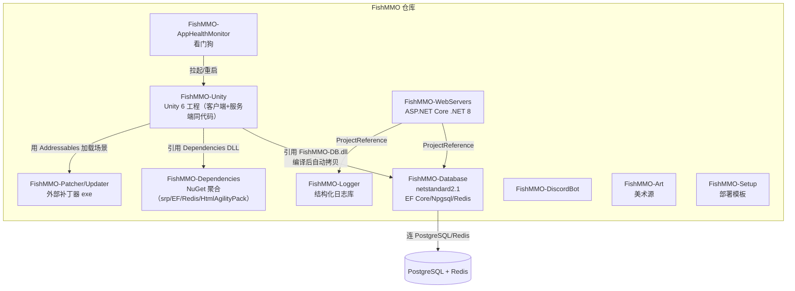
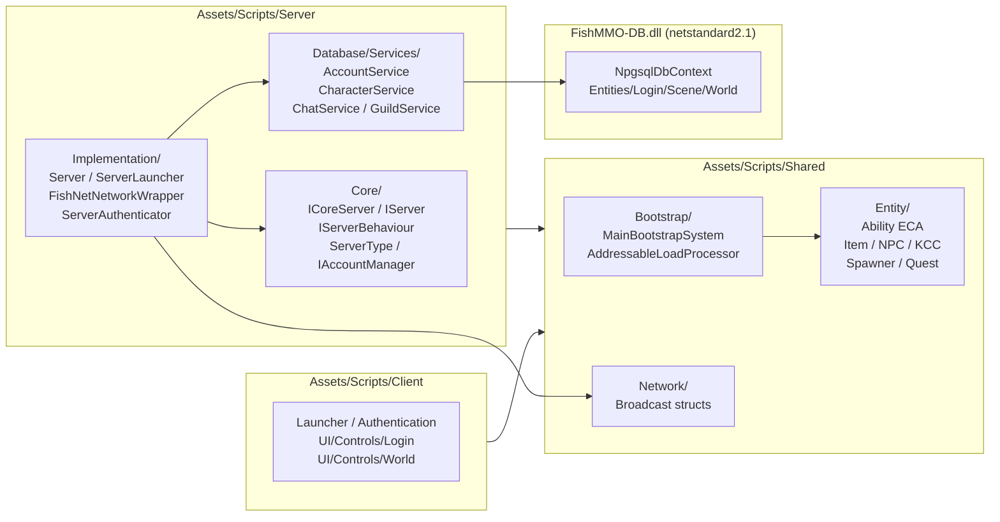
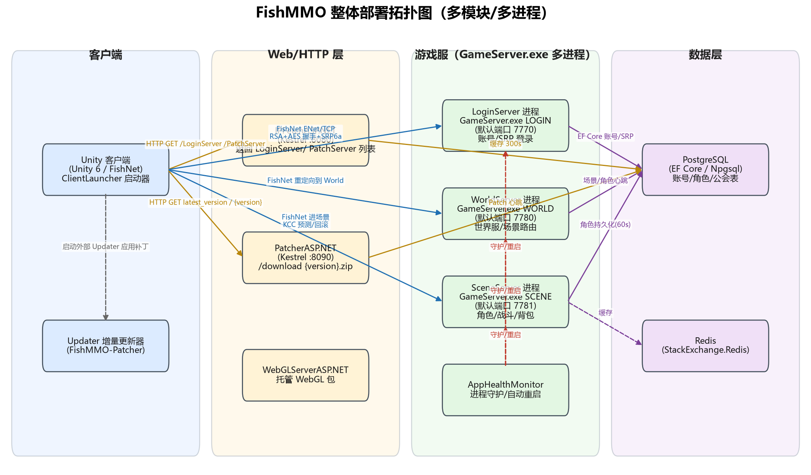
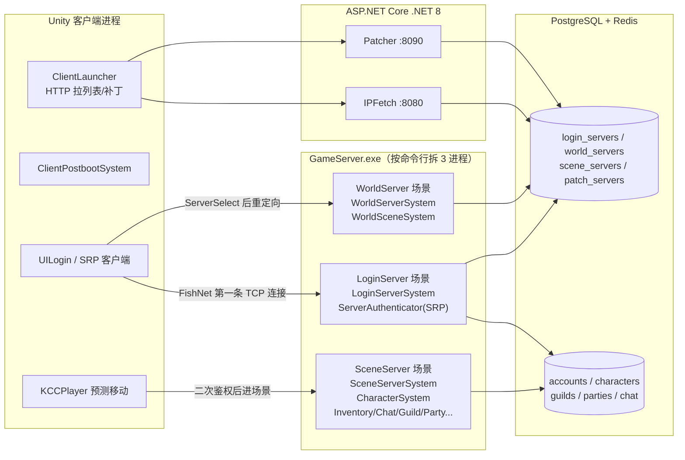
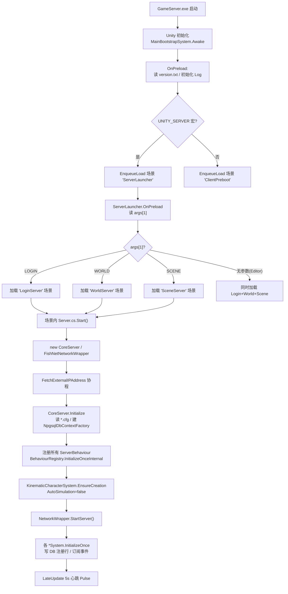
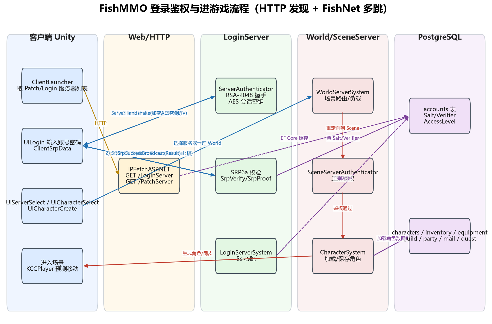
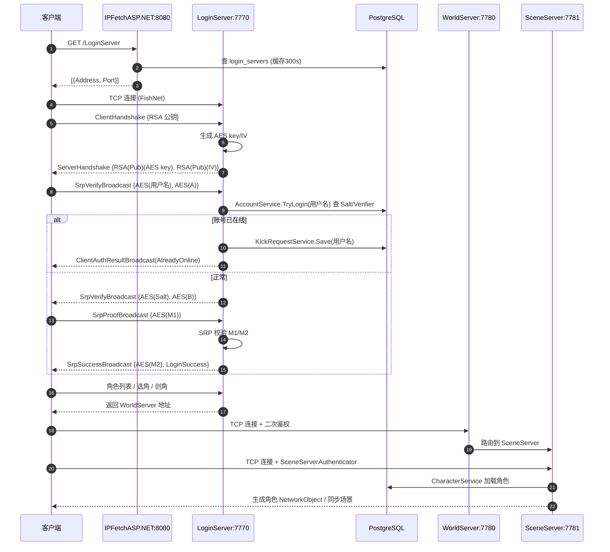
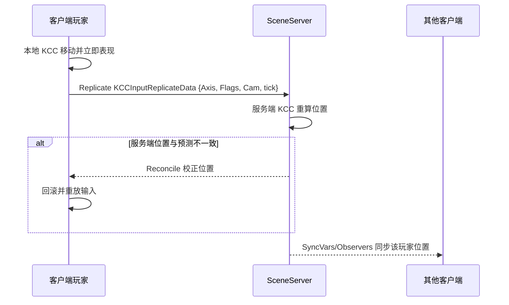
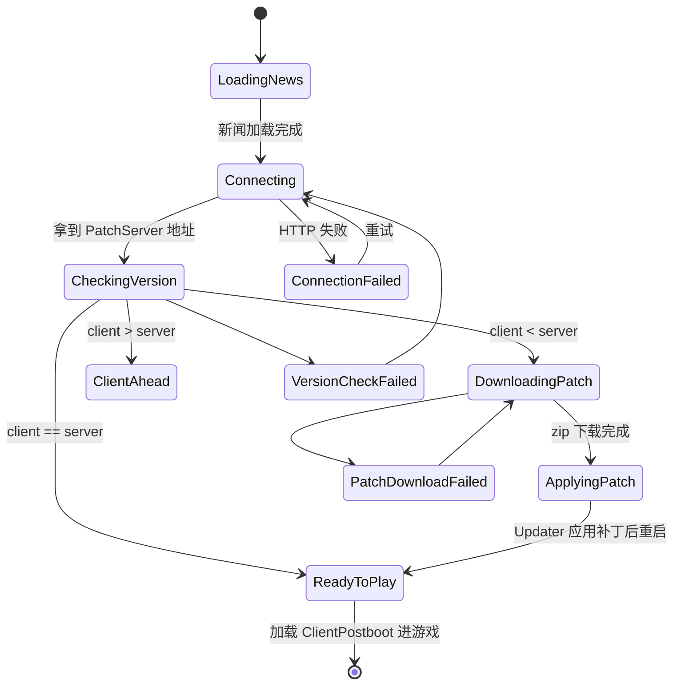
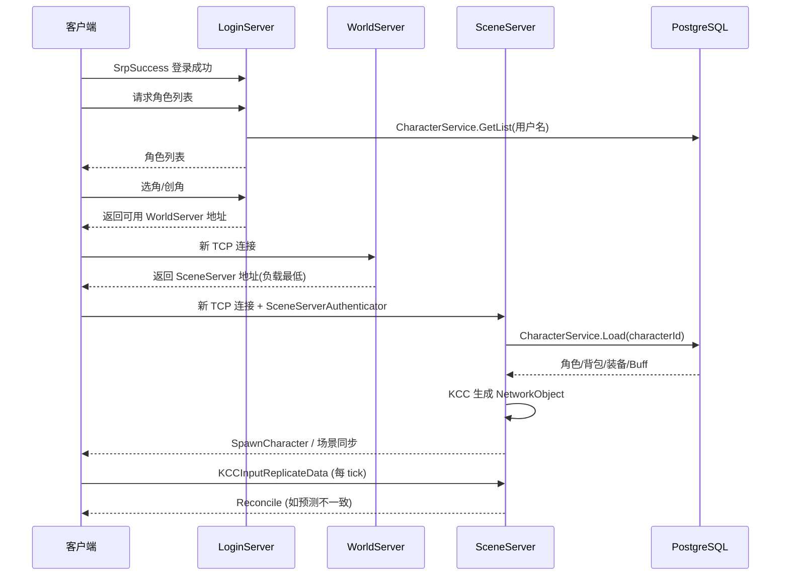

# FishMMO 源码解析

> **文档信息**
>
> - 项目名称：FishMMO
> - 仓库来源：`https://github.com/jimdroberts/FishMMO.git`（README.md 第 16 行）
> - 解析日期：2026-10-15
> - 解析方式：**仅静态源码走读，未实际编译/运行**（环境为 Windows + Python 3.13，未安装 Unity 6000.2.6f2、.NET 8 SDK、PostgreSQL，未启动任何 GameServer/ASP.NET 进程）
> - 许可证：MIT License（`F:\MMORPG_OpenSource\FishMMO\LICENSE`，Copyright (c) 2023 jimdroberts）
> - 一句话定位：由 FishNet 作者 jimdroberts 主导、基于 **Unity 6 + FishNet 网络库 + PostgreSQL/EF Core + Redis + ASP.NET Core** 的开源 3D MMORPG 参考工程，最大特色是“**同一个 Unity 工程按 `UNITY_SERVER` 宏编译出客户端和服务端，再用命令行参数 `LOGIN/WORLD/SCENE` 拆成三种独立进程**”，并配套独立的 IPFetch / Patcher / WebGL 三个 ASP.NET Web 服务。

---

## 1. 项目概览

FishMMO 是一套“**全栈开源 MMORPG 模板**”，不是单机 demo，也不是只给客户端的工程：它把 Unity 客户端、游戏服务端（Login/World/Scene 三类进程）、数据库访问层（EF Core + Npgsql + Redis）、HTTP 入口（IPFetch 发现服、Patcher 增量更新服、WebGL 静态服）、进程守护（AppHealthMonitor）、补丁打包器（PatchGenerator Editor 窗口）、外部 Updater 可执行文件、Discord Bot、日志库全部放在同一个 Git 仓库里，按子目录分模块组织。

- **目标人群**：想学习“现代 Unity 3D MMO 怎么从客户端一路拆到多进程服务端 + Web 鉴权 + 增量更新”的独立开发者/小团队。
- **与同类对比**：
  - 和 ET / QFramework 等“国产框架式 MMO 模板”相比，FishMMO 没有自研帧同步框架，直接复用 FishNet 的**状态同步 + 客户端预测/回滚（Prediction/Reconcile）**。
  - 和 ServUO / OpenCoreMMO 这种“经典 MMO 服务端模拟器”相比，FishMMO 是 **Unity 6 现代渲染管线 + Addressables 资源管理 + EFCore Code-First 迁移**，技术栈更新。
  - 和 LYFMMORGP 相比，FishMMO 把服务端也建在 Unity 工程里（`UNITY_SERVER` 宏 + `Dedicated Server Build`），而不是独立的 .NET Console；这是它最值得借鉴也最容易踩坑的差异点。

## 2. 技术栈与运行环境

| 维度 | 选型 | 证据 |
|---|---|---|
| 客户端引擎 | Unity **6000.2.6f2**（Unity 6） | `FishMMO-Unity/ProjectSettings/ProjectVersion.txt` |
| 渲染管线 | URP（Universal Render Pipeline） | `FishMMO-Unity/Assets/UniversalRenderPipelineGlobalSettings.asset` |
| 网络库 | **FishNet**（内嵌源码 `Assets/Plugins/FishNet`，带 CodeGen  Cecil 模块） | `FishMMO-Unity/Assets/Plugins/FishNet/package.json` |
| 传输层 | FishNet 自带 **Tugboat(TCP)** / **Multipass(LiteNetLib UDP)** / **Bayou SimpleWebTransport(WebSocket, WebGL)** | `Assets/Plugins/FishNet/Runtime/Transporting/Transports/`、`Assets/Plugins/FishNet/Plugins/Bayou/` |
| 角色控制 | **Kinematic Character Controller (KCC)** | `Assets/Plugins/KinematicCharacterController/`、`Shared/Entity/KCC/` |
| 资源管理 | **Unity Addressables**（不是 YooAsset/HybridCLR） | `Assets/AddressableAssetsData/`、`Bootstrap/AddressableLoadProcessor` |
| 服务端运行时 | 同 Unity 工程，`UNITY_SERVER` 宏 + Dedicated Server Build（README 要求装 Linux/Mac/Win Dedicated Server Build Support） | `MainBootstrapSystem.cs` 第 304-318 行 `#if UNITY_SERVER` |
| 数据库 ORM | **EF Core 5.0.17 + Npgsql 5.0.18**（PostgreSQL） | `FishMMO-Database/FishMMO-DB/FishMMO-DB.csproj` |
| 缓存 | **StackExchange.Redis 2.7.4**（已接线但当前无业务调用，属预留接口） | 同上 csproj；`RedisDbContextFactory.cs`、`CoreServer.cs` |
| Web 服务 | **ASP.NET Core .NET 8**（Kestrel） | `IPFetchServer.csproj`、`Patcher.csproj` 均 `net8.0` |
| 鉴权协议 | **SRP-6a**（NuGet `srp 1.0.7`）+ **RSA-2048 + AES** 会话加密 | `FishMMO-Dependencies.csproj` 第 40 行 `<PackageReference Include="srp" Version="1.0.7" />`；`ServerAuthenticator.cs` |
| 日志 | 自研 `FishMMO-Logger`（`logging.json` 配置） | `FishMMO-Logger/FishMMO-Logger.sln`、`MainBootstrapSystem.OnPreload` |
| 客户端 UI | uGUI + TextMeshPro + 自研 `CanvasCrawler` 运行时布局 | `Assets/Plugins/TextMesh Pro/`、`Client/UI/CanvasCrawler/` |

## 3. 许可证与商用/二次开发注意事项

- **许可证**：MIT（`LICENSE` 全文 21 行），允许商用、修改、分发、私有化，唯一要求是保留版权声明和免责声明。
- **FishNet 本身**：`Assets/Plugins/FishNet/LICENSE.txt` 是 FishNet 自己的许可证（独立 MIT，需保留）；`THIRD PARTY NOTICE.md` 列出了第三方组件。
- **美术资源**：`FishMMO-Art/`、`Assets/Cartoon_Texture_Pack/`、`Assets/Sprites/` 等美术包的具体许可需要单独确认（仓库未在 README 中统一声明），商用前要逐资源核对。
- **AI 生成资产**：`Assets/Plugins/Meshy/` 是 Meshy AI 模型生成插件，Meshy 生成的模型版权条款以 Meshy 官方为准。
- **没有 CLA（贡献者协议）**：仓库根目录无 CONTRIBUTING / CLA 文档。

## 4. 目录结构详解

### 4.1 真实扫描的目录树（两层，已裁剪 Assets/Plugins 第三方）

```text
FishMMO/
├── .github/
├── LICENSE
├── README.md
├── FishMMO-Unity/                     # Unity 客户端 + 服务端同工程
│   ├── Assets/
│   │   ├── Scripts/
│   │   │   ├── Bootstrap/              # MainBootstrapSystem / AddressableLoadProcessor
│   │   │   ├── Client/                # 客户端：Launcher / Authentication / UI / Input / WebGL
│   │   │   ├── Server/                # 服务端：Core / Implementation / DatabaseServices
│   │   │   └── Shared/                # 共享：Entity（Ability/Item/NPC/KCC/Spawner...）/ Constants / Network / Tools
│   │   ├── Plugins/FishNet/           # FishNet 网络库源码（内嵌）
│   │   ├── Plugins/KinematicCharacterController/
│   │   ├── Plugins/Bayou/SimpleWebTransport/   # WebGL WebSocket 传输
│   │   ├── AddressableAssetsData/     # Addressables 配置
│   │   ├── Scenes/  Prefabs/  Settings/  Resources/
│   │   ├── Cartoon_Texture_Pack/  Sprites/  Templates/
│   │   └── VersionConfig.asset
│   ├── Packages/  ProjectSettings/
├── FishMMO-Database/                  # EF Core + Npgsql + Redis 数据访问层（netstandard2.1）
│   ├── FishMMO-DB/                    # DbContext + Entities（Login/Scene/World 三组）
│   └── FishMMO-DB-Migrator/           # 命令行迁移工具
├── FishMMO-Dependencies/              # 类库占位（srp / EF Core / Redis / HtmlAgilityPack / OpenAI）
├── FishMMO-WebServers/                 # 三个 ASP.NET Core .NET 8 站点
│   ├── IPFetchASP.NET/IpFetchServer/ # :8080，返回可用 Login/Patch 服列表
│   ├── PatcherASP.NET/Patcher/        # :8090，下载 {old}-{new}.zip 增量补丁
│   └── WebGLServerASP.NET/WebGLServer/ # 托管 WebGL 构建包
├── FishMMO-Patcher/Updater/            # 外部 Updater 可执行文件（客户端启动后被拉起做补丁应用）
├── FishMMO-Logger/                     # 跨平台日志库（Net8 / netstandard）
├── FishMMO-AppHealthMonitor/          # 进程守护，按端口探活并自动重启 GameServer.exe
├── FishMMO-DiscordBot/                # 官方 Discord 机器人
├── FishMMO-Art/                        # 美术源文件
└── FishMMO-Setup/                     # Development / Release 配置模板
```

### 4.2 一级目录职责表

| 目录 | 职责 | 关键产物 |
|---|---|---|
| `FishMMO-Unity` | 客户端 + 服务端双形态 Unity 工程 | `GameServer.exe`（LOGIN/WORLD/SCENE）、客户端 exe/WebGL |
| `FishMMO-Database` | 数据访问层（被 Unity 和 Web 服务同时引用） | `FishMMO-DB.dll`、EF 迁移 |
| `FishMMO-Dependencies` | 第三方 NuGet 聚合类库，编译后 DLL 拷贝到 `Assets/Dependencies` | 自动拷 DLL 到 Unity |
| `FishMMO-WebServers` | 三个独立 ASP.NET Core 站点 | `IpFetchServer.exe` / `Patcher.exe` / `WebGLServer.exe` |
| `FishMMO-Patcher` | 客户端增量更新器（被 ClientLauncher 拉起） | `Updater.exe` |
| `FishMMO-Logger` | 自研结构化日志 | `FishMMO.Logging.dll` |
| `FishMMO-AppHealthMonitor` | 看门狗进程 | `AppHealthMonitor.exe` |
| `FishMMO-DiscordBot` | 独立社区 Discord 机器人，与游戏服**无运行时依赖**，二次开发可直接忽略 | Discord 命令处理 |
| `FishMMO-Art` | 美术源文件（PSD/Blender 等），**不直接进 Unity**；Unity 工程内的美术在 `Assets/Cartoon_Texture_Pack/`、`Assets/Sprites/` | 美术源 |
| `FishMMO-Setup` | 部署模板（Development/Release），含 `nginx.conf`（Web 层 IPFetch/Patcher/WebGL 的反向代理模板）、`*.cfg`、`appsettings.json` | 示例配置 |



图 1：FishMMO 多模块仓库结构与依赖关系。解读：Unity 工程和三个 ASP.NET Web 服务**共享同一份 EF Core 数据访问层**，这是它能把“账号注册在 Web 侧、登录校验在 LoginServer、角色数据在 SceneServer”打通的根本原因；`FishMMO-Dependencies` 是一个“NuGet 包聚合壳”，编译后自动把 DLL 拷到 `Assets/Dependencies` 供 Unity 引用。



图 1b：服务端/共享/客户端脚本分层与依赖。解读：Server 和 Client 都依赖 Shared；Server 内部 Core 是抽象，Implementation 是具体，Database/Services 是 EF Core 封装，三者通过 `ServerBehaviourRegistry` 组合。

## 5. 工程获取、创建与打开方式

按 `README.md`（2025 版）：

1. `git clone https://github.com/jimdroberts/FishMMO.git`，推荐 `dev` 分支。
2. 用 Visual Studio / `dotnet build` 依次编译：
   - `FishMMO-Dependencies/FishMMO-Dependencies.sln`
   - `FishMMO-Database/FishMMO-Database.sln`
   - `FishMMO-Logger/FishMMO-Logger.sln`
   - `FishMMO-WebServers/IPFetchASP.NET/IPFetchASP.sln`
3. Unity Hub 添加 `FishMMO-Unity/` 目录，使用 **Unity 6000.2.6f2**，并勾选 Linux/Mac/Win Dedicated Server Build Support、WebGL Build Support（`ProjectVersion.txt`、README 第 72-78 行）。
4. Unity 菜单 `FishMMO > Build > Operating System > Database Installer` 构建安装器；运行安装器会自动装 .NET 8 SDK、VS Build Tools、PostgreSQL、执行 EF Core 迁移（README 第 88-110 行）。

## 6. 编译与运行步骤（能验证到哪一步如实写）

> **未实际编译/运行，以下仅为 README + 源码推断。**

- 客户端：Unity Build → Windows / Mac / Linux / WebGL。
- 服务端：Unity Build → **Dedicated Server**，产物目录里同一个 `GameServer.exe`，通过命令行参数区分角色：
  - `GameServer.exe LOGIN`（默认端口 7770，`LoginServer.cfg`）
  - `GameServer.exe WORLD`（默认端口 7780，`WorldServer.cfg`）
  - `GameServer.exe SCENE`（默认端口 7781，`SceneServer.cfg`）
  （证据：`README.md` 第 196-267 行示例里写的是 `appsetting.json`，但实际仓库里真实文件名是 `appsettings.json`（见 `FishMMO-Setup/Development/appsettings.json`、`FishMMO-AppHealthMonitor/AppHealthMonitor/appsettings.json`），README 此处为拼写错误；`ServerLauncher.cs` 第 53-68 行 `switch (args[1].ToUpper())`）
- Web 服务：`dotnet run` 或发布后直接运行 `IpFetchServer.exe`（:8080）、`Patcher.exe`（:8090）。
- 进程守护：配置 `FishMMO-AppHealthMonitor/AppHealthMonitor/appsettings.json` 后运行 `AppHealthMonitor.exe`，它会按端口 TCP/UDP 探活，崩溃自动重启（README 第 196-271 行）。
- 配置文件：`LoginServer.cfg` / `WorldServer.cfg` / `SceneServer.cfg`（在 `FishMMO-Setup/Development|Release/`）/ `logging.json`（运行时由 `Log.Initialize` 自动生成/读取，`MainBootstrapSystem.cs` 第 28 行 `configFileName = "logging.json"`）/ `appsettings.json`（Web 服务与 AppHealthMonitor 使用）。
- **新增场景后必做**：在 Unity Editor 菜单执行 `FishMMO > Build > Rebuild World Scene Details`（README 第 115-119 行），它会把新场景的世界信息缓存到 Addressables 资源，否则 WorldServer 无法路由到新场景、SceneServer 无法加载它。

## 7. 整体架构



图 2：FishMMO 整体部署拓扑图。解读：

- **客户端**是一个 Unity 可执行，启动后先跑 `ClientLauncher`：HTTP 访问 IPFetch 拿到“当前可用的 LoginServer 地址/端口”和“可用 Patcher 地址”，再去 Patcher 比对 `version.txt`，必要时下载 `{old}-{new}.zip` 并拉起外部 `Updater.exe` 应用补丁，然后才进入 `ClientPostboot` → 连接 LoginServer。
- **游戏服是同一个 `GameServer.exe` 的三个进程形态**，不是三个独立工程。`ServerLauncher.cs` 读 `args[1]` 决定只加载 `LoginServer` / `WorldServer` / `SceneServer` 中的一个 Addressable 场景。
- **Web 层**只做两件事：① 给客户端返回当前存活的 LoginServer/Patcher 列表（IPFetch 内存缓存 300s）；② 给客户端下增量补丁包。**账号注册/鉴权不在 Web 层做**——Web 层只返回地址，真正的登录校验在 LoginServer 里完成。
- **数据层**是 PostgreSQL + Redis，三个游戏服进程和三个 Web 进程都连同一个库，靠表 `LoginServers` / `WorldServers` / `SceneServers` / `PatchServers` 的心跳字段做服务发现。



图 3：客户端与三类游戏服进程的关系。解读：客户端不是“一次连到底”，而是 **Login → World → Scene 三段 FishNet 连接**：先在 LoginServer 完成 SRP 登录，再在 ServerSelect 选一个 WorldServer，最后被 WorldServer 重定向到某个 SceneServer 进游戏世界。

## 8. 服务端模块与职责

服务端代码全部位于 `FishMMO-Unity/Assets/Scripts/Server/`：

- `Core/`：抽象层，定义 `ICoreServer`、`IServer`、`IServerBehaviour`、`IServerConfiguration`、`IServerEvents`、`ServerType{Login,World,Scene}`、`IAccountManager`、SRP 数据结构。
- `Implementation/`：具体实现。
  - `Server.cs`：组合根，`FindFirstObjectByType<NetworkManager>()` → new `CoreServer` → new `FishNetNetworkWrapper` → 注册所有 `ServerBehaviour` → `NetworkWrapper.StartServer()`。
  - `ServerLauncher.cs`：读命令行参数，加载对应场景。
  - `FishNetNetworkWrapper.cs`：封装 `NetworkManager`，提供 `RegisterBroadcast<T>()` / `Broadcast<T>()`。
  - `Authentication/ServerAuthenticator.cs`：RSA+AES 握手 + SRP 登录。
  - `LoginServer/`：`LoginServerSystem`（5s 心跳入库）、`AccountCreationSystem`、`CharacterCreateSystem`、`CharacterSelectSystem`、`ServerSelectSystem`。
  - `World/WorldServer/`：`WorldServerSystem`（心跳）、`WorldSceneSystem`（场景路由）。
  - `World/SceneServer/`：`SceneServerSystem`（场景实例管理）、`CharacterSystem`（角色加载/保存/断线）、`CharacterInventorySystem`、`ChatSystem`、`GuildSystem`、`PartySystem`、`FriendSystem`、`FactionSystem`、`PetSystem`、`HotkeySystem`、`NamingSystem`、`AchievementSystem`、`Interactable/`（Banker/Merchant/Teleporter/Bindstone/DungeonEntrance/AbilityCrafter/WorldItem 交互处理器）。
  - `Database/Services/`：每个系统对应的 EF Core Service（`AccountService`、`CharacterService`、`CharacterInventoryService`、`ChatService`、`GuildService`、`PartyService` 等）。

**注册方式**：不是“插件/反射/特性注册”，而是 Unity 场景里挂 `ServerBehaviour` 子类组件，`Server.OnFinalizeSetup` 里 `FindObjectsByType<ServerBehaviour>()` 全部注册到 `ServerBehaviourRegistry`（`Server.cs` 第 126-131 行）。

## 9. 客户端模块与职责

客户端代码在 `FishMMO-Unity/Assets/Scripts/Client/`：

- `Launcher/ClientLauncher.cs`：启动器 UI，状态机 `LoadingNews → Connecting → CheckingVersion → DownloadingPatch → ApplyingPatch → ReadyToPlay`（第 262-325 行 switch）。
- `Launcher/HttpPatchServerService.cs`、`VersionFetch.cs`：HTTP 拉版本/下补丁。
- `Launcher/SystemUpdaterLauncher.cs`：拉起外部 `Updater.exe`。
- `Authentication/ClientLoginAuthenticator.cs`、`ClientSrpData.cs`：SRP 客户端。
- `UI/Controls/Login/`：`UILogin`、`UICharacterSelect`、`UICharacterCreate`、`UIServerSelect`、`UILoadingScreen`、`UIReconnectDisplay`。
- `UI/Controls/World/`：`UIAbilities`、`UIInventory`、`UIChat`、`UIGuild`、`UIParty`、`UIAchievements`、`UIBank`、`UIMail` 等。
- `UI/CanvasCrawler/`：自研运行时 UI 布局（按类型自适应）。
- `Input/`：输入处理。
- `WebGL/`：WebGL 平台专用。

资源/热更：**没有 HybridCLR / ILRuntime 这种代码热更**，热更全部走 **Addressables 资源包 + 外部 Updater 下整包补丁 zip**。`version.txt` 记录当前版本，Patcher 按 `{old}-{new}.zip` 分发（`PatchController.cs` 第 60 行）。

## 10. 网络通信

### 10.1 传输层

FishNet 提供三种 Transport（`Assets/Plugins/FishNet/Runtime/Transporting/Transports/`）：

- **Tugboat**：TCP。
- **Multipass**：UDP，底层 LiteNetLib。
- **Bayou SimpleWebTransport**：WebSocket，仅 WebGL 客户端用。

具体场景用哪种 Transport，由 Unity 场景里挂的 `Transport` 组件决定（`NetworkManager` 物体上），本静态走读未打开场景 Prefab 确认默认 Transport，**未验证默认是 Tugboat 还是 Multipass**；但 `AppHealthMonitor` 配置里 `PortTypes: ["TCP","UDP"]` 同时监听两种端口（README 第 204 行），说明生产部署可能 TCP/UDP 双开。

### 10.2 连接与断线

- 连接：FishNet `NetworkManager.ClientManager` / `ServerManager.StartConnection()`，封装在 `FishNetNetworkWrapper.StartServer()`（第 42-52 行）。
- 鉴权前置：所有业务 Broadcast 必须 `requireAuthentication = true`（`FishNetNetworkWrapper.RegisterBroadcast` 默认参数，第 120 行）；未通过 SRP 的连接只能收 `ClientHandshake` / `SrpVerifyBroadcast` / `SrpProofBroadcast` 三条消息（`ServerAuthenticator.InitializeOnce` 第 55-57 行 `requireAuthentication: false`）。
- 断线清理：`ServerAuthenticator.ServerManager_OnRemoteConnectionState` 在 `Stopped` 时 `AccountManager.RemoveConnectionAccount(conn)`（第 296-302 行）。
- 同账号重复登录：`CharacterService.TryGetOnline(dbContext, username)` 为真时写 `KickRequestService.Save(dbContext, username)`，返回 `AlreadyOnline`（`ServerAuthenticator` 第 149-154 行）。

### 10.3 序列化与消息格式

- **没有 protobuf**。所有网络消息都是实现 `FishNet.Broadcast.IBroadcast` 的 **struct**，由 FishNet CodeGen（Cecil 模块）在编译时生成序列化代码。
- 典型消息（在 `ServerAuthenticator.cs` 中直接用到）：
  - `ClientHandshake { byte[] PublicKey }` —— 客户端 RSA 公钥。
  - `ServerHandshake { byte[] Key; byte[] IV }` —— 服务端用客户端公钥加密后的 AES 密钥/IV。
  - `SrpVerifyBroadcast { byte[] S; byte[] PublicEphemeral }` —— 加密后的用户名 + 客户端 SRP 公钥。
  - `SrpProofBroadcast { byte[] Proof }`。
  - `SrpSuccessBroadcast { byte[] Proof; ClientAuthenticationResult Result }`。
  - `ClientAuthResultBroadcast { ClientAuthenticationResult Result }`。
  - `ClientValidatedSceneBroadcast`、`ClientScenesUnloadedBroadcast`（在 `CharacterSystem.InitializeOnce` 第 118-119 行注册）。
- 传输加密：握手完成后，业务消息里的敏感字段（用户名、SRP 中间值、proof）都用 `CryptoHelper.EncryptAES/DecryptAES(symmetricKey, IV, ...)` 包一层 AES（见 `ServerAuthenticator` 第 136、173、220、236 行）。
- 通道：FishNet 的 `Channel.Reliable`（TCP 可靠）和 `Channel.Unreliable`（UDP 不可靠），登录全程用 Reliable，失败回包用 Unreliable（第 264 行）。

### 10.4 真实消息示例（登录前三条）

```text
C→S  ClientHandshake       { PublicKey = RSA-2048 公钥 (1024B) }
S→C  ServerHandshake       { Key = RSA(PubKey_C)(AES-256 key), IV = RSA(PubKey_C)(AES IV) }
C→S  SrpVerifyBroadcast    { S = AES(用户名), PublicEphemeral = AES(客户端 SRP 公钥 A) }
S→C  SrpVerifyBroadcast    { S = AES(salt), PublicEphemeral = AES(服务端 SRP 公钥 B) }
C→S  SrpProofBroadcast     { Proof = AES(客户端 M1) }
S→C  SrpSuccessBroadcast   { Proof = AES(服务端 M2), Result = LoginSuccess }
```

## 11. 数据存储

### 11.1 数据库类型

- **PostgreSQL**（不是 MySQL/SQLite），驱动 Npgsql 5.0.18，ORM EF Core 5.0.17，schema 名 `fish_mmo_postgresql`（`AccountEntity.cs` 第 7 行 `[Table("accounts", Schema = "fish_mmo_postgresql")]`）。
- **Redis**：`FishMMO-Database/FishMMO-DB/Redis/RedisDbContextFactory.cs` 完整实现了 `ConnectionMultiplexer` + `GetDatabase()`，`CoreServer.cs` 第 23 行也暴露了 `RedisDbContextFactory` 属性、`ICoreServer.cs` 接口声明了该属性。但**全仓库 grep `GetDatabase|RedisDbContextFactory|ConnectionMultiplexer` 的调用方，除了工厂自身和 CoreServer/ICoreServer 的属性声明外，没有任何 GameService/AccountService/CharacterService 调用 `GetDatabase()`**——即 Redis 工厂“已接线但当前无业务使用”，属于预留接口（大概率为未来做会话缓存/排行榜/跨服通信预留）。
- Code-First 迁移：`FishMMO-DB-Migrator/` 独立命令行工具；README 第 133 行“FishMMO uses EFCore for migrations”。

### 11.2 核心表（`NpgsqlDbContext.cs` 第 15-49 行 DbSet 清单）

| 表（DbSet） | 实体文件 | 用途 |
|---|---|---|
| `PatchServers` | `PatchServerEntity.cs` | Patcher 服注册/心跳 |
| `LoginServers` | `Login/LoginServerEntity.cs` | LoginServer 注册/心跳 |
| `WorldServers` | `World/WorldServerEntity.cs` | WorldServer 注册/心跳 |
| `SceneServers` | `Scene/SceneServerEntity.cs` | SceneServer 注册/心跳 |
| `Scenes` | `Scene/SceneEntity.cs` | 场景实例记录 |
| `Accounts` | `Login/AccountEntity.cs` | 账号（Name/Salt/Verifier/AccessLevel） |
| `KickRequests` | `World/KickRequestEntity.cs` | 同账号重复登录踢人 |
| `Characters` | `Scene/Character/CharacterEntity.cs` | 角色主表 |
| `CharacterAbilities/KnownAbilities` | CharacterAbility / CharacterKnownAbility | 技能 |
| `CharacterAttributes` | CharacterAttribute | 属性 |
| `CharacterAchievements` | CharacterAchievement | 成就 |
| `CharacterInventoryItems` | CharacterInventory | 背包 |
| `CharacterEquippedItems` | CharacterEquipment | 装备 |
| `CharacterBankItems` | CharacterBank | 银行 |
| `CharacterHotkeys` | CharacterHotkey | 快捷键 |
| `CharacterMail` | CharacterMail | 邮件 |
| `CharacterItemCooldowns` | CharacterItemCooldown | 物品冷却 |
| `CharacterSkills` / `CharacterBuffs` | CharacterSkill / CharacterBuff | 技能/Buff |
| `CharacterPets / PetAttributes / PetBuffs` | CharacterPet* | 宠物 |
| `CharacterFactions` | CharacterFaction | 阵营 |
| `CharacterQuests` | CharacterQuest | 任务 |
| `CharacterFriends` | CharacterFriend | 好友 |
| `CharacterGuilds` / `Guilds` / `GuildUpdates` | Guild* | 公会 |
| `CharacterParties` / `Parties` / `PartyUpdates` | Party* | 队伍 |
| `Chat` | `Scene/ChatEntity.cs` | 聊天记录 |

`AccountEntity` 字段（17 行实体类全文）：

```csharp
[Table("accounts", Schema = "fish_mmo_postgresql")]
public class AccountEntity
{
    [Key] public string Name { get; set; }
    public string Salt { get; set; }
    public string Verifier { get; set; }
    public byte AccessLevel { get; set; }
    public DateTime Created { get; set; }
    public DateTime Lastlogin { get; set; }
}
```

注意：**密码不以明文/哈希存储，而是 SRP 的 Salt + Verifier**——这是 SRP-6a 的标准做法，服务端连用户密码哈希都不持有。

### 11.3 配置表体系

- 没有 Luban/Excel 导出表；技能、物品、怪物等静态数据是 **Unity Addressables + ScriptableObject**（`Shared/Entity/Ability/Template/AbilityTemplate.cs`、`Shared/Entity/Item/Item.cs`、`Shared/Entity/Spawner/ObjectSpawner.cs`），打包成 Addressables group。
- `WorldSceneDetailsCache`（`SceneServerSystem.cs` 第 50 行）缓存场景最大人数等。

## 12. 启动流程



图 4：服务端启动流程图。解读：

- 入口是 Unity `Awake` → `MainBootstrapSystem.OnPreload`，按 `UNITY_SERVER` 宏决定加载 `ServerLauncher` 还是 `ClientPreboot` 场景（`MainBootstrapSystem.cs` 第 304-318 行）。
- `ServerLauncher.OnPreload` 读 `Environment.GetCommandLineArgs()[1]`，`LOGIN/WORLD/SCENE` 三选一加载对应 Addressables 场景（`ServerLauncher.cs` 第 53-68 行）。
- 场景里挂的 `Server.cs.Start()` 是组合根：建 `CoreServer`（读 cfg、建 DB 工厂）、建 `FishNetNetworkWrapper`、注册 `ServerBehaviour`、启动 FishNet。
- 每个 `*System.InitializeOnce` 再写一行 `LoginServers/WorldServers/SceneServers` 表记录自己的 IP/Port/角色数，之后 `LateUpdate` 每 5s `Pulse` 一次。

## 13. 登录与账号流程



图 5：FishMMO 登录鉴权与进游戏流程。解读：客户端先 HTTP 找 IPFetch 要地址，再用 FishNet 连 LoginServer 做 RSA+SRP，通过后跳 WorldServer，最后二次鉴权进 SceneServer。



图 6：登录时序图。关键证据：

- IPFetch 的 `LoginServerController.GetLoginServers()`（`LoginServerController.cs` 第 26-66 行）直接返回 `{Address, Port}` 列表，内存缓存 300 秒。
- `ServerAuthenticator.OnServerClientHandshakeReceived`（第 66-108 行）做 RSA-2048 握手。
- `OnServerSrpVerifyBroadcastReceived`（第 116-196 行）解密用户名、查库、返回 Salt+ServerEphemeral。
- `OnServerSrpProofBroadcastReceived`（第 204-267 行）校验 proof，成功后 `OnAuthentication(conn, true)` 让 FishNet 把连接标记为已鉴权。
- **账号注册不在 LoginServer 里**：`AccountCreationSystem.cs` 在 LoginServer 场景里，本走读未细读，但从命名看注册走的是同一套 SRP 流程（注册时在客户端生成 Salt/Verifier 上传）。

## 14. 角色创建与进入场景

- 选角/创角：`Server/Implementation/LoginServer/CharacterSelectSystem.cs`、`CharacterCreateSystem.cs`，客户端 UI 是 `UICharacterSelect` / `UICharacterCreate`。
- 进入场景：`CharacterSystem.cs`（`Server/Implementation/World/SceneServer/CharacterSystem.cs`）维护四张字典：
  - `CharactersByID`、`CharactersByLowerCaseName`、`CharactersByWorld`、`ConnectionCharacters`、`WaitingSceneLoadCharacters`（第 81-97 行）。
- 事件链：`OnBeforeLoadCharacter → OnAfterLoadCharacter → OnConnect → OnSpawnCharacter`（第 52-72 行 event）。
- FishNet 的 `SceneManager.OnLoadEnd/OnUnloadEnd/OnClientLoadedStartScenes` 用来做场景加载完成后的实体生成（`SceneServerSystem.InitializeOnce` 第 98-99 行）。
- AOI/视野：**没有自研九宫格/四叉树 AOI**，直接用 FishNet 自带的 `NetworkObserver`/场景可见性（本走读未找到 FishMMO 自研 AOI 代码，**未实现自研 AOI**）。

## 15. 移动同步

- 同步模型：**状态同步 + 客户端预测/回滚（Prediction & Reconcile）**，用 FishNet 的 `Prediction` 模块。
- 移动输入结构 `KCCInputReplicateData`（`Shared/Entity/KCC/KCCInputReplicateData.cs`）实现 `IReplicateData`：

```csharp
public struct KCCInputReplicateData : IReplicateData
{
    public float MoveAxisForward;
    public float MoveAxisRight;
    public int MoveFlags;          // 位掩码：跳/蹲/跑等
    public Vector3 CameraPosition;
    public Quaternion CameraRotation;
    private uint _tick;            // FishNet 预测 tick
    public uint GetTick() => _tick;
    public void SetTick(uint value) => _tick = value;
}
```

- 控制器：`KCCController.cs`、`KCCPlayer.cs`、`KCCPlatform.cs`、`KCCCamera.cs`（`Shared/Entity/KCC/`）。
- 物理：`KinematicCharacterMotor` 来自 KCC 插件；服务端 `Server.OnFinalizeSetup` 里显式 `KinematicCharacterSystem.Settings.AutoSimulation = false`（`Server.cs` 第 133-134 行），服务端用自定 tick 驱动。
- 服务器是否权威：**是**，客户端预测，服务端重算后 reconcile（FishNet Prediction 标准模式）。
- 广播范围：依赖 FishNet 的 `NetworkObject` 观察者机制，未在业务层做额外 AOI 裁剪。



图 7：移动同步时序。解读：FishNet Prediction 是“客户端每 tick 把输入发给服务端，服务端重放，冲突时回滚”，不是 LYFMMORGP 那种“收一包广播一次”的简单状态同步。



图 8：ClientLauncher 状态机。解读：启动器是一个典型状态机（`ClientLauncher.SetLauncherState` 第 252-335 行），任何状态失败都有重试路径；`ClientAhead` 允许客户端版本比服务器新时直接进游戏（开发期常用）。



图 9：选角→进场景→移动 完整消息流。解读：客户端在一次登录生命周期里要和 **3 个不同进程** 建立 TCP 连接（Login→World→Scene），每次切换都是一次新的 FishNet 连接和重新鉴权；这是 FishMMO 多进程架构对客户端协议层最大的约束。

## 16. 战斗、技能与属性

- 技能系统：**ECA（Event-Condition-Action）数据驱动**，位于 `Shared/Entity/Ability/ECA/`：
  - `Actions/Character/ApplyDamageAction.cs`、`ApplyHealAction.cs`、`ApplyBuffAction.cs`、`ApplyDispelAction.cs`、`InterruptAction.cs`、`KnockbackHitAction.cs`、`AbilityForkHitAction.cs`、`AbilityPierceHitAction.cs`、`AbilitySpawnMultiplyAction.cs`、`AbilityMoveTransformAction.cs`、`DisplayDialogueAction.cs`、`PlayFXAction.cs`。
  - `Conditions/Character/...`：`IsCharacterAliveCondition`、`IsImmortalCondition`、`HasBuffCondition`、`HasInventoryItemCondition`、`CanEquipItemCondition`、`IsCharacterInRegionCondition`、`RegionAllowsPVPCondition`、`HasPartyCondition`、`HasGuildCondition`、`IsRaceCondition`、`IsArchetypeCondition` 等几十个条件。
  - `Template/AbilityTemplate.cs`、`Events/AbilityOnHitEvent`、`AbilityOnTickEvent`、`AbilityOnSpawnEvent`、`AbilityOnDestroyEvent`。
- 技能对象：`AbilityController.cs`、`AbilityObject.cs`、`CooldownController.cs`、`CooldownInstance.cs`。
- 属性：`CharacterAttributeService.cs`、`CharacterAttributeEntity.cs`；Buff：`CharacterBuffService.cs`。
- **伤害公式（已读源码确认）**：
  - `ApplyDamageAction`（`Shared/Entity/Ability/ECA/Actions/Character/ApplyDamageAction.cs` 第 16 行）只是 ScriptableObject 上的一个 `public int DamageAmount` 字段 + 一个 `DamageAttributeTemplate`（物理/火/冰等元素抗性表），它本身不做任何公式计算：
    ```csharp
    public override void Execute(ICharacter initiator, EventData eventData)
    {
        if (eventData.TryGet(out CharacterHitEventData targetEventData))
        {
            if (targetEventData.Target.TryGet(out ICharacterDamageController defenderDamageController))
            {
                defenderDamageController.Damage(initiator, DamageAmount, DamageAttributeTemplate);
            }
        }
    }
    ```
  - 真正的减算在 `CharacterDamageController.Damage()`（`Shared/Entity/CharacterAttribute/CharacterDamageController.cs` 第 122-146 行）：先 `ApplyModifiers` 做**纯减算**——用伤害值减去目标对应元素的 `resistance.FinalValue`，再 Clamp 到 `[0, 999999]`，最后 `ResourceInstance.Consume(amount)` 扣血：
    ```csharp
    public int ApplyModifiers(ICharacter target, int amount, DamageAttributeTemplate damageAttribute)
    {
        const int MIN_DAMAGE = 0;
        const int MAX_DAMAGE = 999999;
        if (attributeController.TryGetAttribute(damageAttribute.Resistance.ID, out CharacterAttribute resistance))
            amount = (amount - resistance.FinalValue).Clamp(MIN_DAMAGE, MAX_DAMAGE);
        return amount;
    }
    // Damage():
    if (Immortal) return;
    if (ResourceInstance.CurrentValue <= 0f) return;   // 已死
    amount = ApplyModifiers(Character, amount, damageAttribute);
    if (amount < 1) return;
    ResourceInstance.Consume(amount);
    ```
  - 即 **FishMMO 的伤害模型是“固定伤害值 - 固定抗性 = 最终伤害”，没有攻防百分比、没有暴击、没有等级差系数**。这是典型的早期/教学级数值模型，二次开发时大概率要扩展。

## 17. AI 与怪物

- NPC 基类：`Shared/Entity/NPC/NPC.cs`，子目录 `AI/`、`Attribute/`、`NPCGuild/`、`Pet/`。
- 刷怪器：`Shared/Entity/Spawner/ObjectSpawner.cs`、`SpawnableSettings.cs`、`ISpawnable.cs`、`RespawnCondition/DeadNPCRespawnCondition.cs`。
- **怪物 AI（已读源码确认）= NavMeshAgent + 自研有限状态机（FSM）**，不是行为树：
  - 核心组件 `AIController`（`Shared/Entity/NPC/AI/AIController.cs` 第 12 行 `[RequireComponent(typeof(NavMeshAgent))]`，继承 `CharacterBehaviour`，**仅在服务端启用**：`OnStartNetwork` 第 184-188 行 `if (!base.IsServerStarted) { enabled = false; return; }`）。
  - 状态基类 `BaseAIState`（`AI/BaseAIState.cs`），定义 `Enter/Exit/UpdateState/GetUpdateRate/MinLeashRange/MaxLeashRange/LeashUpdateRate` 等接口。
  - 具体状态（`AI/States/` 目录共 9 个）：
    - `IdleState`（待机）
    - `WanderState`（在 `Home` 附近 `WanderRadius` 内随机游走）
    - `PatrolState`（沿 `Waypoints` 路点巡逻）
    - `OrbitState`（环绕目标走位）
    - `BaseAttackingState`（战斗基类，子类化具体攻击行为）
    - `GetBehindState`（绕到目标背后）
    - `RetreatState`（脱战后撤）
    - `ReturnHomeState`（脱战回家）
    - `PetIdleState`（宠物待机）
  - FSM 切换：`AIController.ChangeState(newState, targets)`（第 391-427 行）：`CurrentState.Exit(this)` → 赋值 `CurrentState` → 攻击状态切 `Agent.speed = RunSpeed`，其他状态切 `WalkSpeed` → `CurrentState.Enter(this)`。
  - 主循环 `Update()`（第 269-275 行）每帧做四件事：`SweepForEnemies()` → `CheckLeash()` → `UpdateCurrentState()` → `FaceLookTarget()`。
  - **仇恨扫描**：`SweepForEnemies()`（第 280-299 行）每 `EnemySweepRate = 1.5s`（第 23 行）调 `AttackingState.SweepForEnemies(this, out enemies)`，命中后 `ChangeState(AttackingState, enemies)`；正在 AttackingState 或 ReturnHomeState 时不再扫描。
  - **脱战 leash**：`CheckLeash()`（第 304-342 行）按平方距离判断：
    - 距 Home > `MaxLeashRange²`：直接 `Agent.Warp(Home)` 拉回出生点，并 `characterDamageController.CompleteHeal()` 满血；
    - 距 Home > `MinLeashRange²` 但未超最大：`ChangeState(ReturnHomeState)` 走回去。
  - **寻路**：Unity 自带 `NavMeshAgent`（`Agent.SetDestination`、`Agent.Warp`），避障优先级由 `AgentAvoidancePriority` 枚举控制。
- 这是一个非常经典、可读、可直接照搬的“巡逻怪/主动怪” FSM 实现。

## 18. 背包、物品、装备

- 物品模型：`Shared/Entity/Item/Item.cs`、`ItemStackable.cs`、`ItemEquippable.cs`、`ItemSlot.cs`、`ItemAttribute.cs`、`ItemGenerator.cs`、`Container/`。
- 服务端：`CharacterInventorySystem.cs`、`CharacterInventoryService.cs`；装备 `CharacterEquipmentService.cs`；银行 `CharacterBankService.cs`。
- 数据库表：`CharacterInventoryItems`、`CharacterEquippedItems`、`CharacterBankItems`、`CharacterItemCooldowns`。
- 交互：`Interactable/Handlers/BankerHandler.cs`、`MerchantHandler.cs`、`WorldItemHandler.cs`。

## 19. 任务、NPC、对话

- **任务系统（已读源码确认）**：数据驱动三层模型，位于 `Shared/Entity/Quest/`：
  - **模板层（ScriptableObject，编辑器配置）**：
    - `Template/QuestTemplate.cs`：一个任务定义，含 `Description`、`TimeToCompleteInSeconds`、`Icon`、`List<QuestAttributeRequirement> CharacterAttributeRequirements`（等级/属性门槛）、`List<QuestTemplate> CompletedQuestRequirements`（前置任务）、`List<QuestTemplate> AutoProgression`（完成后自动接后续）、`List<QuestObjective> Objectives`（子目标列表）；`CanAcceptQuest(IPlayerCharacter)` 方法在第 57 行做门槛校验。
    - `Template/QuestObjective.cs`：单个子目标（杀 N 个怪/收集 N 个物品/到达某区域等）。
    - `Template/QuestAttributeRequirement.cs`：属性门槛。
    - `Template/QuestDatabase.cs`：集中式任务表（Addressables 加载，相当于任务注册表）。
  - **运行时层（玩家持有）**：
    - `QuestController.cs`（`IQuestController`）：挂在玩家角色上，管理当前进行中/已完成任务集合。
    - `QuestInstance.cs`：玩家持有的任务实例，跟踪进度、状态。
    - `QuestObjectiveInstance.cs`：单个子目标的进度计数。
    - `QuestStatus.cs`：枚举（未接/进行中/可交/已完成）。
  - **世界表现层**：
    - `QuestGiverMarker.cs`：挂在 NPC 上，头顶显示可接/可交任务标记（`CanvasCrawler` 3D Label）。
    - `QuestMapMarker.cs`：地图上任务点标注。
  - **持久化**：服务端表 `CharacterQuests`（`Scene/Character/CharacterQuestEntity.cs`），按 `(character, name)` 主键。
- **对话系统（已读源码确认）**：节点式对话树，位于 `Shared/Entity/Dialogue/`：
  - `DialogueNode.cs`：一个对话节点，含 `Text`（NPC 台词）、`List<DialogueChoice> Choices`（玩家选项分支）、`List<Trigger> OnEnterTriggers`（进入节点触发的事件）、`List<BaseAction> OnEnterActions`（进入节点执行的动作，如给物品/更新任务）、`List<BaseCondition> Conditions`（节点可见条件）。
  - `DialogueChoice.cs`：玩家选项，包含文本 + 跳转到下一个 `DialogueNode`。
  - `NPCDialogueController.cs`：挂在 NPC 上，驱动对话树跳转、触发 Action。
  - 与任务系统配合：对话里 `OnEnterActions` 可以是 `AcceptQuestAction`/`TurnInQuestAction`，实现“对话接任务”。
- **任务脚本体系**：不是 Lua/Python，而是复用 ECA 体系——任务进度推进由 `Trigger` + `BaseCondition`/`BaseAction` 组合，和技能系统共用同一套组件模型。

## 20. 交易、经济、商城、社交

- 聊天：`ChatSystem.cs`、`ChatService.cs`、`Scene/ChatEntity.cs`。
- 公会：`GuildSystem.cs`、`GuildService.cs`、`GuildEntity.cs`、`GuildUpdateEntity.cs`。
- 队伍：`PartySystem.cs`、`PartyService.cs`、`PartyEntity.cs`。
- 好友：`FriendSystem.cs`、`CharacterFriendEntity.cs`。
- 邮件：`CharacterMailEntity.cs`。
- 阵营：`FactionSystem.cs`、`CharacterFactionEntity.cs`、`RegionAllowsPVPCondition`。
- 宠物：`PetSystem.cs`、`CharacterPetEntity.cs`。
- 成就：`AchievementSystem.cs`、`CharacterAchievementEntity.cs`。
- **交易行/商城**：本走读未找到独立交易行或商城系统（`MerchantHandler` 是 NPC 商店，不是玩家间交易行）。

## 21. 其他特色系统

1. **同工程双端编译**：一份 C# 代码，`UNITY_SERVER` 宏切客户端/服务端，命令行参数 `LOGIN/WORLD/SCENE` 拆三进程。
2. **SRP-6a 登录**：服务端不存密码哈希，只存 Salt+Verifier，配合 RSA-2048 做会话密钥协商。
3. **FishNet 内嵌**：FishNet 不是 NuGet 包，是源码内嵌（`Assets/Plugins/FishNet`），作者就是 FishNet 作者本人。
4. **ECA 技能编辑器**：技能 = Event + 若干 Condition + 若干 Action，纯数据驱动，配 `AbilityTemplate` ScriptableObject。
5. **AppHealthMonitor 看门狗**：按端口 TCP/UDP 探活，带熔断（`CircuitBreakerFailureThreshold`）、指数退避重启（`MaxRestartDelaySeconds: 60`）。
6. **PatchGenerator Editor 窗口**：Unity 编辑器里选新旧 build 目录，生成 `{old}-{new}.zip` 增量补丁（README 第 166-177 行）。
7. **外部 Updater 增量更新器**（`FishMMO-Patcher/Updater/`，.NET 8 控制台）：不是简单解压 zip，而是基于清单（Manifest）做文件级增量更新：
   - `Program.cs`：入口，命令行参数为旧版本/新版本。
   - `Patch/Patcher.cs`：核心流程。
   - `Patch/PatchManifest.cs` + `Patch/PatchMetadata.cs`：补丁清单元数据。
   - `Patch/NewFileEntry.cs` / `ModifiedFileEntry.cs` / `DeletedFileEntry.cs`：三类文件条目（新增/修改/删除）。
   - 客户端 `ClientLauncher.PlayButton_Update()` 在 zip 下载完成后拉起 `Updater.exe`，由它按清单比对本地文件并应用变更，完成后退出并让客户端重启。
8. **Addressables 场景链**：`MainBootstrap → ServerLauncher/ClientPreboot → LoginServer/WorldServer/SceneServer 或 ClientPostboot`，全部 Addressables 异步加载。

## 22. 关键核心代码走读

### 22.1 `Server.cs` —— 服务端组合根

路径：`FishMMO-Unity/Assets/Scripts/Server/Implementation/Server.cs`，第 69-139 行。

```csharp
void Start()
{
    NetworkManager networkManager = FindFirstObjectByType<NetworkManager>();
    if (networkManager == null)
        throw new UnityException("Server: NetworkManager could not be found!");

    Configuration = new FileServerConfiguration();
    ServerEvents = new ServerEvents();
    CoreServer = new CoreServer(Configuration, ServerEvents);
    NetworkWrapper = new FishNetNetworkWrapper(networkManager, Configuration, this);
    BehaviourRegistry = new ServerBehaviourRegistry();

    // ... 拉外网 IP ...
    StartCoroutine(NetHelper.FetchExternalIPAddress(OnFinalizeSetup));
}

private void OnFinalizeSetup(string remoteAddress)
{
    CoreServer.Initialize(remoteAddress, gameObject.scene.name);
    AddressProvider = new ServerAddressProvider(...);
    NetworkWrapper.ApplyTransportConfiguration();
    NetworkWrapper.AttachLoginAuthenticator(this);

    AccountManager = new AccountManager();
    ServerBehaviour[] allBehaviours = FindObjectsByType<ServerBehaviour>(FindObjectsSortMode.InstanceID);
    foreach (var behaviour in allBehaviours) BehaviourRegistry.Register(behaviour);
    BehaviourRegistry.InitializeOnceInternal(this);

    KinematicCharacterSystem.EnsureCreation();
    KinematicCharacterSystem.Settings.AutoSimulation = false;
    NetworkWrapper.StartServer();
}
```

解读：这是整个服务端的“上帝入口”，但它只做装配，不做业务。业务全在挂在场景里的 `ServerBehaviour` 子类里。

### 22.2 `ServerLauncher.cs` —— 命令行拆进程

路径：`FishMMO-Unity/Assets/Scripts/Server/Implementation/ServerLauncher.cs`，第 53-68 行。

```csharp
switch (args[1].ToUpper())
{
    case "LOGIN":  initialScenes.Add(new AddressableSceneLoadData("LoginServer")); break;
    case "WORLD":  initialScenes.Add(new AddressableSceneLoadData("WorldServer")); break;
    case "SCENE":  initialScenes.Add(new AddressableSceneLoadData("SceneServer")); break;
    default:       Close(); break;
}
```

解读：同一个 exe，传 `LOGIN` 就只加载 LoginServer 场景，传 `WORLD` 就只加载 WorldServer 场景。这是 FishMMO “多进程但不拆工程”的关键。

### 22.3 `CoreServer.cs` —— 配置与 DB 工厂

路径：`FishMMO-Unity/Assets/Scripts/Server/Core/CoreServer.cs`，第 62-90 行。

```csharp
public void Initialize(string remoteAddress, string serverTypeName)
{
    RemoteAddress = remoteAddress;
    serverType = GetServerType(serverTypeName);   // LOGIN/WORLD/SCENE
    config.SaveDefaultsIfMissing(serverTypeName, serverType.ToString(), workingDirectory);
    Address = config.GetString("Address", "127.0.0.1");
    Port = config.GetUShort("Port", 7777);
#if UNITY_EDITOR
    string dbConfigurationPath = Path.Combine(workingDirectory, "Setup/Development");
    NpgsqlDbContextFactory = new NpgsqlDbContextFactory(dbConfigurationPath, false);
#else
    NpgsqlDbContextFactory = new NpgsqlDbContextFactory(workingDirectory, false);
#endif
    RaiseLifecycleEvent();
}
```

### 22.4 `ServerAuthenticator.cs` —— RSA+AES 握手

路径：`FishMMO-Unity/Assets/Scripts/Server/Implementation/Authentication/ServerAuthenticator.cs`，第 84-100 行。

```csharp
using (var rsa = RSA.Create(2048))
{
    CryptoHelper.ImportPublicKey(rsa, msg.PublicKey);
    byte[] encryptedSymmetricKey = rsa.Encrypt(encryptionData.SymmetricKey, RSAEncryptionPadding.Pkcs1);
    byte[] encryptedIV           = rsa.Encrypt(encryptionData.IV,           RSAEncryptionPadding.Pkcs1);
    ServerHandshake handshake = new ServerHandshake { Key = encryptedSymmetricKey, IV = encryptedIV };
    NetworkManager.ServerManager.Broadcast(conn, handshake, false, Channel.Reliable);
}
```

解读：经典 RSA 协商 AES 会话密钥模式；之后所有 SRP 中间值都用 AES 加密传。

### 22.5 `LoginServerSystem.cs` —— 5s 心跳

路径：`FishMMO-Unity/Assets/Scripts/Server/Implementation/LoginServer/LoginServerSystem.cs`，第 38-97 行。

```csharp
public override void InitializeOnce()
{
    using var dbContext = Server.CoreServer.NpgsqlDbContextFactory.CreateDbContext();
    LoginServerService.Add(dbContext, name, server.Address, server.Port, out id);
}
void LateUpdate()
{
    if (serverState == LocalConnectionState.Started && nextPulse < 0)
    {
        nextPulse = pulseRate;   // 5s
        using var dbContext = Server.CoreServer.NpgsqlDbContextFactory.CreateDbContext();
        LoginServerService.Pulse(dbContext, id);
    }
    nextPulse -= Time.deltaTime;
}
```

解读：每个游戏服进程启动时往 `login_servers/world_servers/scene_servers` 表插一行，然后每 5s 更新 `LastPulse`。IPFetch 拉列表时只返回 `LastPulse >= now-5min` 的记录（`PatchServerController.cs` 第 41-44 行），这就是它的服务发现/负载均衡机制——**靠数据库心跳，不是 Redis 注册中心，不是 Consul**。

### 22.6 `CharacterSystem.cs` —— 角色加载/保存

路径：`FishMMO-Unity/Assets/Scripts/Server/Implementation/World/SceneServer/CharacterSystem.cs`，第 34-97 行。

```csharp
public float SaveRate = 60.0f;             // 每 60s 落盘
public float OutOfBoundsCheckRate = 2.5f;  // 每 2.5s 检越界
public Dictionary<long, IPlayerCharacter> CharactersByID { get; } = new();
public Dictionary<NetworkConnection, IPlayerCharacter> ConnectionCharacters { get; } = new();
// ...
public override void InitializeOnce()
{
    loginAuthenticator = FindFirstObjectByType<SceneServerAuthenticator>();
    loginAuthenticator.OnClientAuthenticationResult += Authenticator_OnClientAuthenticationResult;
    Server.NetworkWrapper.RegisterBroadcast<ClientValidatedSceneBroadcast>(OnClientValidatedSceneBroadcastReceived, true);
}
```

解读：SceneServer 是真正“跑游戏逻辑”的进程，CharacterSystem 是它的核心管理器；60s 周期落盘 + 2.5s 越界检查。

### 22.7 `ClientLauncher.cs` —— 启动器状态机

路径：`FishMMO-Unity/Assets/Scripts/Client/Launcher/ClientLauncher.cs`，第 356-373 行。

```csharp
public void PlayButton_Connect()
{
    StartCoroutine(PatchServerService.GetPatchServerAddress(
        Constants.Configuration.IPFetchHost,
        onComplete: (serverAddress) => {
            patcherHost = $"http://{serverAddress.Address}:{serverAddress.Port}/";
            StartCoroutine(GetLatestVersion());
        }, ...));
}
```

解读：客户端启动后第一件事是 HTTP 访问 IPFetch，拿到一个可用 Patcher 地址，再去查最新版本、必要时下补丁。

### 22.8 `PatchController.cs` —— 增量补丁下载

路径：`FishMMO-WebServers/PatcherASP.NET/Patcher/Controllers/PatchController.cs`，第 26-81 行。

```csharp
[HttpGet("{version}")]
public IActionResult GetPatch(string version)
{
    var clientVersionConfig = VersionConfig.Parse(version);
    if (clientVersionConfig >= versionService.LatestVersion)
        return Ok(new { status = "AlreadyUpdated" });
    var filePath = Path.Combine(baseDir, "Patches",
        $"{clientVersionConfig.FullVersion}-{latestVersionConfig.FullVersion}.zip");
    return new FileStreamResult(fileStream, "application/octet-stream");
}
```

解读：补丁包按“从哪个版本升到哪个版本”命名，zip 文件由 Unity Editor 的 `PatchGenerator` 预先生成。

### 22.9 `KCCInputReplicateData.cs` —— 预测移动输入

路径：`FishMMO-Unity/Assets/Scripts/Shared/Entity/KCC/KCCInputReplicateData.cs`，全文 73 行，见第 15 节。

### 22.10 `NpgsqlDbContext.cs` —— 数据层

路径：`FishMMO-Database/FishMMO-DB/Npgsql/NpgsqlDbContext.cs`，DbSet 清单见第 11.2 节。

## 23. 可借鉴到 LYFMMORGP 的设计

| # | FishMMO 做法 | LYFMMORGP 现状 | 借鉴点 | 接入成本 |
|---|---|---|---|---|
| 1 | **靠数据库心跳做服务发现**（`login_servers/world_servers/scene_servers` 表 + 5s Pulse + IPFetch 内存缓存 300s） | LYFMMORGP 四服 Center/Login/Gate/Game 是写死配置还是动态发现？ | 可在 CenterServer 里加一张 `server_registry` 表，GameServer 启动注册、5s 心跳，LoginServer 启动时从 Center 拉可用 GameServer 列表返回客户端，代替写死的 GameServer 地址 | 低，加表+心跳即可 |
| 2 | **RSA-2048 握手 + SRP-6a**，服务端不存密码哈希 | LYFMMORGP 登录协议未细查，可能是简单账号密码+MD5 | 中期可替换为 SRP，避免拖库即丢账号；短期至少先做 RSA 协商 AES 会话密钥 | 中，需引入 SRP 库 |
| 3 | **同工程双端 + 命令行拆进程**（`UNITY_SERVER` 宏 + `args[1]=LOGIN/WORLD/SCENE`） | LYFMMORGP 服务端是独立 .NET Console | 不建议照搬（Unity 服务端有 GC/启动慢问题），但“一个 exe 按参数跑不同角色”的思路可用于 Gate/Game 同进程调试 | 低，参考即可 |
| 4 | **ECA 数据驱动技能**（Event/Condition/Action 三段式 ScriptableObject） | LYFMMORGP 技能系统待建 | 可直接参考 `ApplyDamageAction`/`ApplyBuffAction`/`HasBuffCondition` 的类设计，做策划可视化技能编辑器 | 中 |
| 5 | **FishNet Prediction 预测回滚**（`IReplicateData` + tick） | LYFMMORGP 是“服务器权威 + 客户端预表现 + 20Hz tick + 收一包广播一次” | FishMMO 是按输入 tick 重放，LYFMMORGP 是按位置包广播；可借鉴的是“移动输入结构里塞 CameraPosition/Rotation 位掩码”这种紧凑序列化 | 低，结构参考 |
| 6 | **AppHealthMonitor 看门狗**（端口探活 + 熔断 + 指数退避） | LYFMMORGP 生产部署可能靠 systemd/Supervisor | Windows 环境下可参考它做一个轻量看门狗，代替手工重启 GameServer | 低 |
| 7 | **Addressables 场景链启动**（Main → Launcher → Login/World/Scene） | LYFMMORGP 用 YooAsset，思路一致 | 无需改，但可参考它“按 UNITY_SERVER 宏切初始场景”的写法 | 低 |
| 8 | **补丁 zip 按 `{old}-{new}.zip` 命名，HTTP 流式下载** | LYFMMORGP 用 YooAsset 内置更新 | 不需要照搬，YooAsset 已更成熟；但“启动器先 HTTP 查最新版本号再决定下不下”的状态机可参考 | 低 |
| 9 | **EF Core Code-First 迁移独立成 Migrator 工程** | LYFMMORGP 用 SqlSugar | 不换 ORM，但可借鉴“迁移工具独立 exe”的部署方式 | 低 |
| 10 | **没有自研 AOI，直接用 FishNet 观察者** | LYFMMORGP 自研 AOI 100 米广播 | FishMMO 这条路在千人同图会有性能问题；LYFMMORGP 的 AOI 是优势，不需要学 | — |
| 11 | **NavMeshAgent + FSM 怪物 AI**：`AIController` 持有 `CurrentState`，9 个状态（Idle/Wander/Patrol/Orbit/Attack/Retreat/ReturnHome/GetBehind/PetIdle），1.5s 仇恨扫描，双阈值 leash（MinLeashRange 走回去 / MaxLeashRange 直接 Warp 回家并满血），仅服务端启用 | LYFMMORGP GameServer 怪物 AI 待建 | 这套 FSM 结构清晰、职责单一，可直接套用到 GameServer 的怪物管理；leash 双阈值 + Warp 回 Home 是工业界常见做法，避免玩家把怪拉脱到不该去的地方 | 低 |

## 24. 局限、坑与二次开发注意

| # | 坑 | 说明 |
|---|---|---|
| 1 | **Unity 6 预览版** | `ProjectVersion.txt` 是 `6000.2.6f2`，Unity 6 仍是新主线，API 变动多，升级要小心 |
| 2 | **服务端跑在 Unity 里** | 优势是双端代码共享，劣势是 GC、启动时间、内存占用都比纯 .NET Console 重；不适合超大规模 |
| 3 | **没有自研 AOI** | 直接靠 FishNet NetworkObserver，同屏人数上不去 |
| 4 | **EF Core 5.0.17 是老版本** | csproj 写的是 EF Core 5（2020 年），但 `Microsoft.Extensions.*` 又引用 9.0.4，版本混搭，升级要测 |
| 5 | **依赖 PostgreSQL** | 不是 MySQL，国内团队换库成本不低；Npgsql 5 也老 |
| 6 | **Web 服务只做发现/补丁，不做账号注册 HTTP API** | 账号注册走 LoginServer 长连接 SRP，和很多“Web 注册 + Token 进游戏”的 MMO 不同，新手会找不到注册接口 |
| 7 | **FishNet 源码内嵌** | 升级 FishNet 要手动合并源码，不能 NuGet 升 |
| 8 | **Art 资源许可不清晰** | `Cartoon_Texture_Pack`、Meshy AI 模型商用前要单独确认 |
| 9 | **文档少** | 除了 README 安装指南，没有中文/英文架构文档，全靠读码 |
| 10 | **AI/任务系统未成熟** | `NPC/AI/` 目录本走读未确认是否完整，任务脚本体系需后续补查 |

## 25. 面试讲述话术

### 30 秒一句话

> FishMMO 是 FishNet 作者开源的 Unity 6 MMORPG 模板，一份 C# 代码按 `UNITY_SERVER` 宏和命令行参数编译/拆成 Login/World/Scene 三个进程，配 PostgreSQL+EF Core、Redis、ASP.NET 做服务发现和增量补丁，登录用 RSA+SRP-6a，移动用 FishNet Prediction 预测回滚。

### 2 分钟展开

FishMMO 的核心架构是“**同工程双端 + 多进程拆角色**”：同一个 Unity 6 工程，客户端 build 出玩家 exe，Dedicated Server build 出 `GameServer.exe`；运行时传 `LOGIN`/`WORLD`/`SCENE` 命令行参数，加载不同的 Addressables 场景，跑不同的 `ServerBehaviour` 组合。

它的服务发现很有意思：没有 Redis 注册中心，而是在 PostgreSQL 里建 `login_servers/world_servers/scene_servers` 表，每个进程启动插一行，每 5 秒 `Pulse` 更新 `LastPulse`；独立的 ASP.NET IPFetch 服务再缓存 300 秒返回给客户端，只返回 5 分钟内心跳过的节点。

登录流程是：客户端先 HTTP 找 IPFetch 要 LoginServer 地址，然后用 FishNet TCP 连上去，先做 RSA-2048 握手协商 AES 会话密钥，再走 SRP-6a 三轮验证（Salt/Verifier 存库，不存密码），通过后选角色、跳 WorldServer、再二次鉴权进 SceneServer 真正跑游戏逻辑。

移动同步用 FishNet 自带的 Prediction/Reconcile：客户端把 `KCCInputReplicateData`（前后轴、移动标志位、相机位置/旋转、tick）发给服务端，服务端重算，不一致就回滚。技能系统是数据驱动的 ECA 结构（Event + Condition + Action），伤害、Buff、位移、对话、播放特效都是可组合的 Action。

### 高频追问

1. **为什么要把服务端也跑在 Unity 里？** —— 双端共享代码（KCC、Skill、Item、NPC 模型），避免同步两份逻辑；代价是 GC 和启动时间。
2. **Login/World/Scene 为什么拆三个进程？** —— 职责分离：Login 只做鉴权（无状态可水平扩），World 做场景路由和全局管理，Scene 跑具体场景战斗；一个场景服崩了不影响其他。
3. **SRP 和传统账号密码+HTTPS 比有什么优势？** —— 服务端不存密码哈希，抗重放（带随机 salt/ephemeral），即使拖库也不能反推密码。
4. **FishNet Prediction 原理？** —— 客户端每 tick 发输入，本地立即表现；服务端用同一套输入重放，结果和客户端预测不一致时发 reconcile，客户端回滚到服务端状态再重放后续输入。
5. **服务发现为什么用数据库心跳不用 Redis/Consul？** —— 简单、不引入新组件；缺点是心跳粒度 5s，故障切换慢。
6. **怎么水平扩容？** —— 多起几个 `GameServer.exe SCENE`，它们都会往 `scene_servers` 表注册，WorldServer 按负载路由。
7. **AOI 怎么做？** —— 直接用 FishNet NetworkObserver，没自研九宫格，千人同图会吃力。
8. **补丁怎么做？** —— Unity Editor 里 PatchGenerator 对比新旧 build 目录生成 `{old}-{new}.zip`，PatcherASP.NET 按 URL `/{version}` 返回 zip，客户端下载后拉起外部 Updater.exe 应用。
9. **和 LYFMMORGP 的四服（Center/Login/Gate/Game）比？** —— FishMMO 没有独立 Gate，WorldServer 兼任路由；LYFMMORGP 的 GateServer 专门做接入/转发，职责更清晰。
10. **数据持久化频率？** —— CharacterSystem 默认 60s 周期落盘，越界检查 2.5s 一次。

## 26. 附录

### 26.1 关键文件清单（≥20 条）

1. `FishMMO/README.md` —— 官方安装/部署指南
2. `FishMMO/LICENSE` —— MIT 许可证
3. `FishMMO-Unity/ProjectSettings/ProjectVersion.txt` —— Unity 6000.2.6f2
4. `FishMMO-Unity/Assets/Scripts/Shared/Bootstrap/MainBootstrapSystem.cs` —— 双端入口，按 UNITY_SERVER 切场景
5. `FishMMO-Unity/Assets/Scripts/Shared/Bootstrap/BootstrapSystem.cs` —— Addressables 预加载/后加载流程
6. `FishMMO-Unity/Assets/Scripts/Server/Implementation/ServerLauncher.cs` —— 命令行 LOGIN/WORLD/SCENE 拆进程
7. `FishMMO-Unity/Assets/Scripts/Server/Implementation/Server.cs` —— 服务端组合根
8. `FishMMO-Unity/Assets/Scripts/Server/Core/CoreServer.cs` —— 配置读取 + DB 工厂
9. `FishMMO-Unity/Assets/Scripts/Server/Core/ServerType.cs` —— Login/World/Scene 枚举
10. `FishMMO-Unity/Assets/Scripts/Server/Implementation/FishNetNetworkWrapper.cs` —— FishNet 封装
11. `FishMMO-Unity/Assets/Scripts/Server/Implementation/Authentication/ServerAuthenticator.cs` —— RSA+AES+SRP 登录
12. `FishMMO-Unity/Assets/Scripts/Server/Implementation/LoginServer/LoginServerSystem.cs` —— LoginServer 5s 心跳
13. `FishMMO-Unity/Assets/Scripts/Server/Implementation/World/WorldServer/WorldServerSystem.cs` —— WorldServer 心跳
14. `FishMMO-Unity/Assets/Scripts/Server/Implementation/World/SceneServer/SceneServerSystem.cs` —— 场景实例管理
15. `FishMMO-Unity/Assets/Scripts/Server/Implementation/World/SceneServer/CharacterSystem.cs` —— 角色加载/保存/断线
16. `FishMMO-Unity/Assets/Scripts/Shared/Entity/KCC/KCCInputReplicateData.cs` —— 预测移动输入结构
17. `FishMMO-Unity/Assets/Scripts/Client/Launcher/ClientLauncher.cs` —— 启动器状态机
18. `FishMMO-Database/FishMMO-DB/Npgsql/NpgsqlDbContext.cs` —— EF Core DbSet 清单
19. `FishMMO-Database/FishMMO-DB/Npgsql/Entities/Login/AccountEntity.cs` —— 账号表（Salt/Verifier）
20. `FishMMO-WebServers/IPFetchASP.NET/IpFetchServer/Controllers/LoginServerController.cs` —— 返回 LoginServer 列表
21. `FishMMO-WebServers/PatcherASP.NET/Patcher/Controllers/PatchController.cs` —— 增量补丁下载
22. `FishMMO-Unity/Assets/Plugins/FishNet/Runtime/Transporting/Transports/` —— Tugboat/Multipass/Bayou 三种传输
23. `FishMMO-Unity/Assets/Scripts/Shared/Entity/Ability/ECA/` —— ECA 技能系统
24. `FishMMO-Unity/Assets/Scripts/Shared/Entity/Item/` —— 物品/堆叠/装备槽
25. `FishMMO-Unity/Assets/Scripts/Shared/Entity/Spawner/ObjectSpawner.cs` —— 刷怪器
26. `FishMMO-Unity/Assets/Scripts/Shared/Entity/NPC/AI/AIController.cs` —— 怪物 FSM 控制器（NavMeshAgent）
27. `FishMMO-Unity/Assets/Scripts/Shared/Entity/NPC/AI/BaseAIState.cs` + `States/`（9 个状态）—— FSM 状态基类与具体状态
28. `FishMMO-Unity/Assets/Scripts/Shared/Entity/CharacterAttribute/CharacterDamageController.cs` —— 伤害结算（减算抗性）
29. `FishMMO-Unity/Assets/Scripts/Shared/Entity/Quest/`（Template/QuestTemplate.cs、QuestInstance.cs、QuestObjectiveInstance.cs、QuestDatabase.cs）—— 任务数据模型
30. `FishMMO-Unity/Assets/Scripts/Shared/Entity/Dialogue/`（DialogueNode.cs、DialogueChoice.cs、NPCDialogueController.cs）—— 对话树
31. `FishMMO-Patcher/Updater/`（Program.cs、Patch/Patcher.cs、Patch/PatchManifest.cs、Patch/NewFileEntry.cs / ModifiedFileEntry.cs / DeletedFileEntry.cs）—— 外部增量补丁器
32. `FishMMO-Setup/nginx.conf` —— Web 层反向代理配置模板

### 26.2 官方链接

- 仓库：`https://github.com/jimdroberts/FishMMO.git`
- Discord：`https://discord.gg/9JQEYjkSNk`（README 第 2 行）
- 启动器新闻页默认拉 `https://www.fishmmo.com/docs/introduction.html`（`ClientLauncher.cs` 第 74 行）

### 26.3 术语表

- **SRP-6a**：Secure Remote Password 协议，零知识密码证明，服务端只存 Salt+Verifier。
- **ECA**：Event-Condition-Action，事件-条件-行动，数据驱动技能设计模式。
- **KCC**：Kinematic Character Controller，运动学角色控制器。
- **Addressables**：Unity 官方可寻址资源系统，替代旧 Resources/AssetBundle。
- **Dedicated Server Build**：Unity 无头服务端构建，不渲染画面。
- **Reconcile**：FishNet Prediction 中服务端校正客户端预测位置的过程。

---

> **未验证/未深入项清单**（如实记录）：
>
> 1. 未实际编译/运行，所有端口、.cfg 默认值、数据库表结构均来自 README 与源码静态阅读。
> 2. 未确认场景里默认挂的是 Tugboat(TCP) 还是 Multipass(UDP) Transport（需要打开 .unity 场景 YAML 才能确认 NetworkManager 物体上挂的 Transport 组件）。
> 3. ~~怪物 AI 是状态机还是行为树~~ —— **已确认**：NavMeshAgent + 自研 FSM（`AIController` + 9 个 State），详见第 17 节。
> 4. ~~任务脚本体系（Quest/Dialogue）未深入~~ —— **已确认**：QuestTemplate/QuestInstance/QuestObjectiveInstance 三层数据模型 + DialogueNode 节点树，详见第 19 节。
> 5. ~~Redis 在生产中的具体用途未确认~~ —— **已确认**：RedisDbContextFactory 已实现并挂载到 CoreServer，但全仓库无业务代码调用 `GetDatabase()`，属预留接口。
> 6. ~~`FishMMO-Patcher/Updater/` 外部补丁器具体文件未读~~ —— **已确认**：.NET 8 控制台程序，基于 `PatchManifest` + `NewFileEntry/ModifiedFileEntry/DeletedFileEntry` 做文件级增量更新。
> 7. ~~伤害公式未细读~~ —— **已确认**：`ApplyDamageAction.DamageAmount`(int) 固定值 → `CharacterDamageController.ApplyModifiers` 纯减算（伤害 - 抗性，Clamp 0~999999）→ `ResourceInstance.Consume`；无暴击/攻防百分比/等级差。
> 8. 客户端 WebGL 平台流程仅看到 `WebGL/` 目录与 Bayou WebSocket 传输，未跑通。
> 9. `NPC/AI/States/` 下 9 个状态文件的内部实现未逐行读（只核了 `AIController` 主循环与切换逻辑）。
> 10. `QuestController` 服务端同步协议（任务进度怎么从客户端上报到服务端、怎么落盘）未细读。
