# Intersect-Engine 源码解析

> **文档信息**
>
> - 项目名称：Intersect Engine（Intersect-Engine）
> - 仓库来源：https://github.com/AscensionGameDev/Intersect-Engine （本地只读副本 `F:\MMORPG_OpenSource\Intersect-Engine\`）
> - 版本：0.8.0.0（开发分支，PackageVersion=0.8.0-beta，README 标注 SDK 8.0.405 验证）
> - 许可证：**多协议混合**——Core / Network / Client / Client.Core / Client.Framework / Server.Framework = MIT；Server / Editor = GPLv3；构建库 Intersect.Building = GPLv3
> - 解析日期：2026-10-15
> - 解析方式：**仅静态源码走读，未实际编译/运行**（未安装 .NET 8 SDK 环境验证、未启动服务器与客户端）
> - 一句话定位：一套"零编程经验即可制作 2D MMORPG"的完整套件——客户端 + 服务端 + 可视化内容编辑器 + 单机模式，基于 MonoGame 与 LiteNetLib，以 EFCore 数据库存储游戏内容、以 RPG Maker 风格可视化事件系统为招牌。

---

## 1. 项目概览

Intersect 是 Ascension Game Dev 团队维护的开源 2D MMORPG 制作套件，官网 freemmorpgmaker.com，定位对标"RPG Maker 但做成网游"：策划不需要写代码，通过 Windows 上的可视化编辑器（地图、事件、物品、技能、任务、商店、合成）即可完成全部游戏内容生产，服务端与客户端自动配套。

从源码规模看（约 2300+ 个 C# 文件），它不是一个"玩具级"开源服务端，而是一个经过多年迭代（beta4→beta6→0.8）、有正式迁移史（`Intersect.Server.Core/Database/DataMigrations/` 及各 `Migrations/` 子目录下的 EFCore 迁移文件，含 Game/Player/Logging 三套模型迁移）、带内置官网、带 Metrics 监控、带插件体系的完整商业级套件。与同类开源 2D 网游项目相比：

| 对比项 | Intersect | ServUO（UO 模拟器） | OpenCoreMMO（Tibia） |
| --- | --- | --- | --- |
| 客户端 | 自研 MonoGame 客户端，跨平台 | 无（配经典 UO 客户端） | 自研 MonoGame 客户端 |
| 内容生产 | 可视化编辑器（地图/事件/技能/任务） | C# 脚本直接写进服务端 | 配置文件 + 服务端脚本 |
| 数据存储 | EFCore（SQLite/MySQL） | 内存对象 + 文件 | SQLite/JSON |
| 网络 | LiteNetLib UDP + RSA/AES 加密 | TCP/UO 协议 | TCP |
| 事件系统 | RPG Maker 风格可视化事件编排 | 脚本硬编码 | 脚本硬编码 |

**活跃度**：仓库有 GitHub Actions 自动构建（README 徽章），Releases 提供安装包；AGENTS.md 明确"禁止 AI 生成代码提交"，说明社区维护规范严格。

**版本演进线索**：从迁移文件命名可见历史——`20191030214236_Spell_Upgrades_Traps_Item_Upgrades_Effects_Event_Upgrades_Labels`（2019 年技能升级系统）、`20210630114724_CraftingCommonEvents`（2021 年合成）、`20240608185758_ParallelEvents`（2024 年并行事件）、`20250227170657_RenameEventDescriptor`（2025 年重命名），跨度 6 年持续演进。包命名里残留 "Beta4Client"（`Client.FindBeta4Client`）说明它经历过 beta4→beta6→0.8 的大版本跨度。

**目标人群**：不会编程的游戏策划/独立开发者——用 Windows 编辑器拖地图、编事件，直接起服务端开服。开发者想二次开发时才读源码。

**与同类开源 2D MMO 引擎的差异**：

- **vs ServUO**：ServUO 是 UO 模拟器，无客户端（配经典 UO 客户端），C# 脚本直接写进服务端，无可视化编辑器；Intersect 自带客户端+编辑器+事件系统，零代码即可做内容。
- **vs OpenCoreMMO**：OpenCoreMMO 是 MonoGame 客户端 + TCP 服务端，但内容生产靠配置文件，无可视化编辑器；Intersect 的编辑器更完整。
- **vs RPG Maker MZ**：RMZ 是单机 RPG，无网络功能；Intersect 把 RMZ 的事件系统搬到了网游上。

**与商业 MMO 制作工具的差异**：

- **vs RPG Maker MZ + 在线插件**：RMZ 本身是单机，联网插件质量参差不齐；Intersect 是原生网游架构（服务端+客户端+数据库），不是补丁式联网。
- **vs Construct 3 + 插件**：Construct 是 2D 游戏引擎，无 MMO 服务端；Intersect 自带完整服务端。
- **vs GameMaker + 服务器**：GameMaker 做客户端强，但 MMO 服务端要自己写；Intersect 服务端开箱即用。

## 2. 技术栈与运行环境

技术栈全部以 csproj 与 props 文件实测为准：

- **运行时**：.NET 8（`Common.props` 中 `<TargetFramework>net8.0</TargetFramework>`，`RuntimeIdentifiers` = linux-arm64/linux-x64/osx-arm64/osx-x64/win-x64），C# `LangVersion=latest`，`Nullable=enable`，`ImplicitUsings=enable`。
- **客户端渲染**：MonoGame.Framework.DesktopGL 3.8.2.1105（OpenGL + SDL2，跨平台 Win/Linux/Mac），OpenAL 音频；可选 Steamworks.NET 2024.8.0（`INTERSECT_STEAMWORKS` 宏）。证据：`Intersect.Client.Core/Intersect.Client.Core.csproj`。
- **编辑器渲染**：MonoGame.Framework.WindowsDX 3.8.1.303（DirectX）+ WinForms（`net8.0-windows`，`UseWindowsForms=true`）+ DarkUI 控件库 + dockpanelsuite 停靠布局。证据：`Intersect.Editor/Intersect.Editor.csproj`——故编辑器**只能在 Windows 运行**，README 亦明确此点。
- **网络**：内嵌源码子模块 `vendor/LiteNetLib`（UDP 可靠/不可靠库），`Intersect.Network` 项目直接 ProjectReference 它。
- **序列化**：数据包用 **MessagePack**（`[MessagePackObject]` + `[Union]`，见 `HailPacket.cs`/`LoginPacket.cs`）；遗留 `CerasPacket.cs`（旧序列化器残留）；配置文件用 Newtonsoft.Json 13.0.3。
- **数据库**：EntityFrameworkCore 8.0.11，双 Provider——SQLite（Microsoft.EntityFrameworkCore.Sqlite + SQLitePCLRaw.bundle_green 2.1.10，原生 e_sqlite3 各平台 so/dll 内嵌进程序集）与 MySQL（Pomelo.EntityFrameworkCore.MySql 8.0.2 + MySqlConnector 2.4.0）；另引用 SqlServer Provider 与 SqlKata.Execution 2.4.0。证据：`Intersect.Server.Core/Intersect.Server.Core.csproj`、`Intersect.Server/Intersect.Server.csproj`。
- **服务端 Web**：`Intersect.Server` 是 `Microsoft.NET.Sdk.Web` 项目——内置 ASP.NET Core 网站（wwwroot、Htmx 1.8.1、JwtBearer 认证、OpenIdConnect、Identity UI、MailKit 4.16 邮件、Swagger/OpenAPI、SixLabors.ImageSharp 图片处理），即 README 的 "Built-in Server Website"。
- **线程池**：SmartThreadPool.dll 2.3.0（Amib.Threading），服务端分 LogicPool/NetworkPool/DbInterface.Pool 三类线程池。
- **其他**：CommandLineParser、Serilog、MathNet.Numerics、AscensionGameDev.Open.NAT（NAT 相关）、WebSocketSharp。

**版本与目标框架细节**（`Common.props` 实测）：

- `<TargetFramework>net8.0</TargetFramework>`，`<LangVersion>latest</LangVersion>`，`<Nullable>enable</Nullable>`，`<ImplicitUsings>enable</ImplicitUsings>`。
- `<RuntimeIdentifiers>linux-arm64;linux-x64;osx-arm64;osx-x64;win-x64</RuntimeIdentifiers>`——五 RID 全覆盖。
- 配置：Debug/Release/DebugTests/DebugFull/DebugPlugins 五种。
- 版本号：`Intersect.props` 里 `<Version>0.8.0.0</Version>`，Copyright 2022-2025。
- 构建时自动注入 CommitSha（`GetGitCommit` target），程序集元数据带 git 提交号。

**第三方库版本清单**（csproj 实测）：

| 库 | 版本 | 用途 |
| --- | --- | --- |
| MonoGame.Framework.DesktopGL | 3.8.2.1105 | 客户端渲染（OpenGL） |
| MonoGame.Framework.WindowsDX | 3.8.1.303 | 编辑器渲染（DirectX） |
| MonoGame.Library.SDL | 2.30.7.1 | SDL2 跨平台窗口 |
| LiteNetLib | 内嵌源码 vendor | UDP 网络 |
| MessagePack | （Core 引用） | 数据包序列化 |
| Newtonsoft.Json | 13.0.3 | 配置/嵌套集合序列化 |
| Microsoft.EntityFrameworkCore | 8.0.11 | ORM |
| Pomelo.EntityFrameworkCore.MySql | 8.0.2 | MySQL Provider |
| Microsoft.EntityFrameworkCore.Sqlite | 8.0.11 | SQLite Provider |
| MySqlConnector | 2.4.0 | MySQL 驱动 |
| SQLitePCLRaw.bundle_green | 2.1.10 | SQLite 原生库 |
| SmartThreadPool.dll | 2.3.0 | 逻辑线程池 |
| Steamworks.NET | 2024.8.0 | Steam 集成（可选） |
| MailKit | 4.16.0 | 邮件发送 |
| Htmx | 1.8.1 | 官网前端 |
| Swashbuckle.AspNetCore | 6.5.0 | OpenAPI/Swagger |
| SixLabors.ImageSharp | 3.1.11 | 图片处理 |
| MathNet.Numerics | 5.0.0 | 数学库 |
| Serilog | （Logging 扩展） | 日志 |

## 3. 许可证与商用/二次开发注意事项

以仓库根 `LICENSE.md` 与各子项目 LICENSE.md 实测为准（README 表格中 Server.Framework 标注 GPLv3 与子项目实际文件不符，**以子项目 LICENSE.md 实际文本为准**）：

| 项目 | 许可证 | 商用含义 |
| --- | --- | --- |
| Intersect (Core) | MIT | 可随意抄进闭源商业游戏 |
| Intersect.Framework.Core | MIT（随 Core） | 游戏对象/数据包契约可随意复用 |
| Intersect.Network | MIT | 网络层代码可抄 |
| Intersect.Client / .Client.Core / .Client.Framework | MIT | 客户端代码可抄、可闭源分发 |
| Intersect.Server.Framework | **MIT**（实测 `Intersect.Server.Framework/LICENSE.md` 首行为 "MIT License"） | 服务端插件 API 可复用 |
| Intersect.Server | **GPLv3** | 服务端二进制不直接发给玩家，但你若二次修改并对外提供服务，按 GPLv3 需向获得服务者开源修改后的服务端代码 |
| Intersect.Editor | **GPLv3** | 编辑器是内部工具，一般不分发给玩家，风险低；但若卖"改进版编辑器"必须开源 |
| Intersect.Building | GPLv3 | 仅构建期密钥生成任务，不进运行时产物 |

官方 `LICENSE.md` 自己解释：**用 Intersect 做游戏并收费是允许的、无需开源游戏代码**；只有"把引擎本身的 GPLv3 部分改完再卖"才触发开源义务。对 LYFMMORGP 的启示：可以放心借鉴 Core/Network/Client.Framework 的分层与 PacketHandler 设计（MIT），不要直接抄 Server 的服务端结算代码进闭源商业项目（GPLv3）。

## 4. 目录结构详解

顶层真实扫描（`F:\MMORPG_OpenSource\Intersect-Engine\`）：

```text
Intersect-Engine/
├── Intersect (Core)/            # 基础设施层：DI、日志、网络抽象、加密、工具（6+19 个目录）
├── Framework/
│   └── Intersect.Framework.Core/# 共享契约层：GameObjects(207) + Network/Packets(234)
├── Intersect.Network/            # LiteNetLib 传输实现（UDP、握手、AesGcm）
├── Intersect.Client/             # 客户端可执行程序（WinExe，薄壳）
├── Intersect.Client.Core/        # 客户端核心：MonoGame 渲染/Interface(85)/Networking
├── Intersect.Client.Framework/   # 客户端公共 API：Graphics(30)/Gwen UI(170)/Input/Audio
├── Intersect.Server/             # 服务端可执行程序（Web SDK，内置官网 wwwroot/Web(121)）
├── Intersect.Server.Core/        # 服务端核心：主循环/Maps/Entities/Database(87)/Migrations(200)
├── Intersect.Server.Framework/   # 服务端插件 API（Items/Maps/Entities/Plugins）
├── Intersect.Editor/             # 内容编辑器（WinForms，Forms 201 文件）
├── Intersect.SinglePlayer/       # 单机模式：引用 Client.Core + Server.Core
├── Intersect.Tests*/             # xUnit 测试项目族（Core/Client/Editor/Network/Server）
├── Examples/                     # 插件示例（Client/Server/Multitarget 插件）
├── vendor/                       # 内嵌子模块：LiteNetLib、dockpanelsuite
├── assets/                       # 引擎 logo + development/production/staging 资源目录
├── Documentation/                # Features.md、AvatarController 文档
├── scripts/ targets/             # CI/构建脚本
├── Common.props / Intersect.props / Directory.Build.props  # 统一构建属性
└── Intersect.sln                 # 解决方案
```

二级目录职责表（按实测 cs 文件数）：

| 项目/目录 | 文件数 | 职责 |
| --- | --- | --- |
| Framework.Core/GameObjects | 207 | 全部游戏内容配置 Descriptor（Item/Spell/Map/Event/Quest/NPC/Shop/Resource/Animation/Projectile/Class/Crafting） |
| Framework.Core/Network/Packets | 196 | 全部网络数据包契约（Client 70 / Server 99 / Editor 16 / Security 2 / Unconnected 2） |
| Framework.Core/Config | 33 | 服务端可配置项（端口/战斗/聊天/包洪水阈值/地图/公会） |
| Framework.Core/Plugins | 24 | 插件上下文与钩子 |
| Intersect (Core)/Network | 14 | 网络抽象：AbstractConnection/AbstractNetwork/PacketDispatcher/PacketQueue/NetworkThread |
| Intersect (Core)/Plugins | 17 | 插件加载器 |
| Intersect.Network/LiteNetLib | 13 | UDP 实现：连接/入站缓冲/AesGcm/对称算法 |
| Server.Core/Database | 87 | EFCore 上下文、迁移调度、PlayerData(33)/GameData(7)/Logging(9) |
| Server.Core/Entities | 37 | Entity/Player/Npc/Projectile/Resource/Events/Pathfinding |
| Server.Core/Maps | 13 | MapController/MapInstance/MapGrid/TileHelper/刷怪点 |
| Client.Core/Interface | 85 | 全部游戏 UI 界面 |
| Client.Framework/Gwen | 170 | Gwen UI 控件库 |
| Client.Framework/Graphics | 30 | 渲染抽象层（Texture/Font/Renderer 接口） |
| Editor/Forms | 201 | 地图编辑器/各 Descriptor 编辑窗/事件命令编辑面板 |
| Server/Web | 121 | 内置 ASP.NET Core 官网（账号/排行榜/邮件/OpenAPI） |

图 1：Intersect-Engine 多项目分层依赖图（PNG，共享脚本生成）

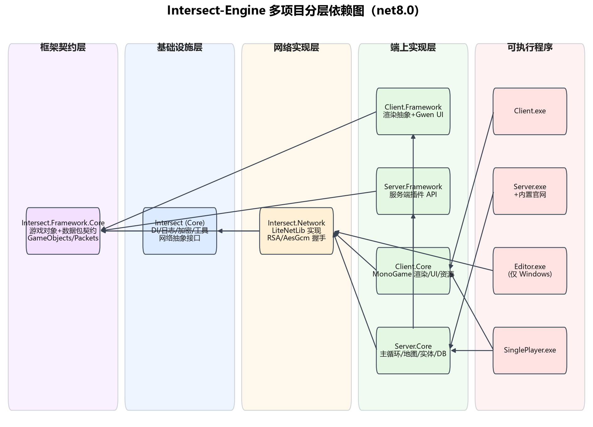

> **解读**：这是 Intersect 最值得借鉴的架构特征——"契约层与实现层分离"。`Framework.Core` 只放**双方共享的数据契约**（游戏对象 Descriptor + 数据包 Packet），不含任何执行逻辑；`Core` 放基础设施；`Network` 是传输实现；Client.Core/Server.Core 才是各端逻辑。SinglePlayer 能"单机跑"的根本原因就是它同时引用 Client.Core 与 Server.Core，二者通过同一个 `INetwork` 抽象通信，本地回环即可。

## 5. 工程获取、创建与打开方式

按 README：

1. `git clone https://github.com/AscensionGameDev/Intersect-Engine.git`
2. `git submodule update --init --recursive`（vendor/LiteNetLib 等是子模块，必须拉取，否则 Network 编译失败）
3. 非 Windows 平台额外 `git apply disable-windows-only.patch`
4. 装 .NET 8 SDK（README 验证版本 8.0.12 / SDK 8.0.405）
5. 客户端调试运行前必须把资源放进 `assets/development/client`（官方提供独立仓库 Intersect-Assets，可做符号链接）

## 6. 编译与运行步骤

```powershell
# Debug 编译（不产出单文件）
dotnet build -p:Configuration=Debug -p:PackageVersion=0.8.0-beta -p:Version=0.8.0
# Release 发布单文件（按 RID）
dotnet publish -p:Configuration=Release -p:PackageVersion=0.8.0-beta -p:Version=0.8.0 -r win-x64
```

运行产物：`Intersect Server.exe`、`Intersect Client.exe`、`Intersect Editor.exe`、`Intersect SinglePlayer.exe`。服务端默认 UDP 端口 **5400**（`Options.DefaultServerPort = 5400`，`Framework/Intersect.Framework.Core/Config/Options.cs`）；MySQL 端口默认 3306。**本文档未实际编译运行，仅静态走读。**

编译期有一个特别机制：`Intersect.Building.KeyGenerationTask` 在每次构建时生成服务器握手密钥对到 `bin/<Config>/keys/network.handshake.bkey{,.pub}`，并被 `Intersect.Server` 与 `Client.Core` 以 EmbeddedResource 形式内嵌进各自二进制——也就是说**服务器私钥编译时打进服务端程序集，公钥打进客户端程序集**，客户端出厂即信任编译时的服务器公钥。

> 注意：本仓库副本未包含 `Intersect.Building` 工程目录，密钥生成任务本体不在本地，**服务器握手密钥的具体位数未在源码中直接核实**。可见的网络临时密钥（每连接 RSA-2048，`LiteNetLibConnection.cs:44`）与 NAT 通道密钥（RSA-2048，`LiteNetLibInterface.cs:60`）均为 RSA-2048；唯一 RSA-4096 出现在 `Intersect.Server/Web/ApiService.AppSettings.cs:338`（Web/JWT 用途），与游戏网络握手无关。

**各产物运行方式**：

- `Intersect Server.exe`：首次运行自动建目录（database/、config/、logs/），生成默认 Options.json，监听 UDP 5400。
- `Intersect Client.exe`：连接服务器 IP:5400，登录后选角进游戏。
- `Intersect Editor.exe`：打开工程目录，编辑地图/事件/物品/技能，保存写库。
- `Intersect SinglePlayer.exe`：本地起服务端+客户端，单机调试。

**非 Windows 注意事项**：Linux/macOS 上客户端和服务端可跑（DesktopGL OpenGL），但编辑器跑不了（WinForms+DirectX）。README 要求 `git apply disable-windows-only.patch`。

## 7. 整体架构

图 2：整体架构与进程拓扑（PNG）

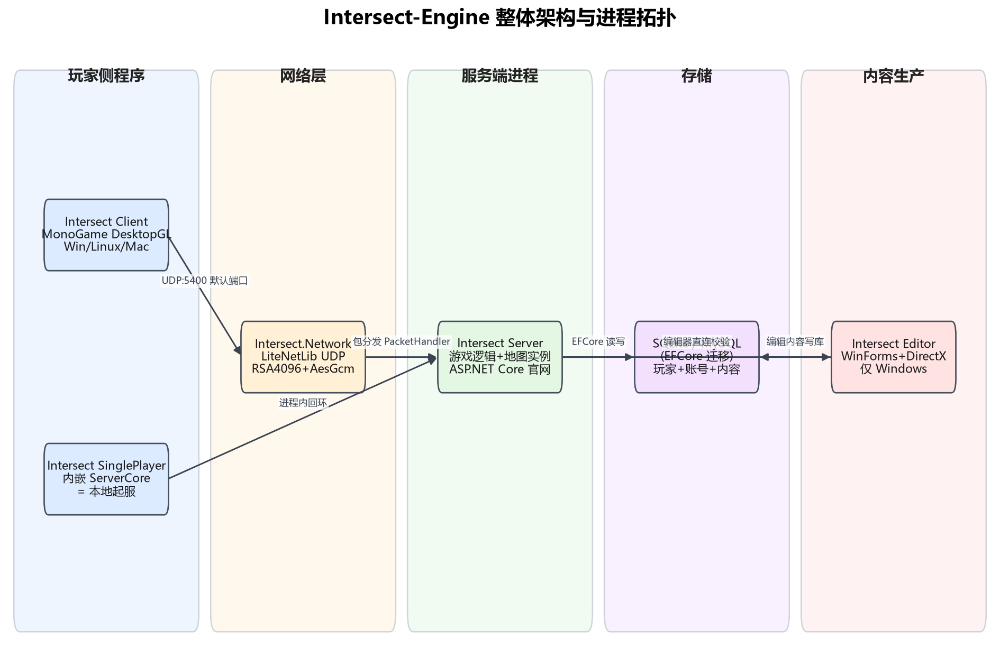

> **解读**：Intersect 是"单服务器 + 官方客户端 + 编辑器 + 可选单机"的星型拓扑，没有网关/中心服拆分。客户端、编辑器都直连同一个 UDP 端口；服务端进程内同时跑游戏逻辑（Server.Core）与官网（ASP.NET Core）；游戏内容与玩家数据都在同一个 EFCore 数据库（SQLite 开箱即用、MySQL 可切换）。

**为什么 Core 被客户端与服务端共用**：`Intersect (Core)` 放的是"与游戏规则无关的基础设施"——DI 容器、日志、网络抽象接口（AbstractConnection/AbstractNetwork）、加密算法（RSA/AesGcm）、通用工具（Timing、Strings、CustomColors）。这些代码客户端和服务端都要用，但不含任何游戏规则。游戏规则（物品/技能/地图/事件）全部在 `Framework.Core/GameObjects`，而 `Framework.Core` 又被 Core、Client.Framework、Server.Framework 共同引用——所以双端共享的是"数据契约"，不是"执行逻辑"。

**Framework 与 Core 的边界**：Core = 基础设施（怎么做），Framework.Core = 数据契约（是什么）。Core 不知道什么是 Item/Spell，Framework.Core 不知道怎么发网络包。这种"契约与实现分离"让 SinglePlayer 能同时引用两端而不产生循环依赖。

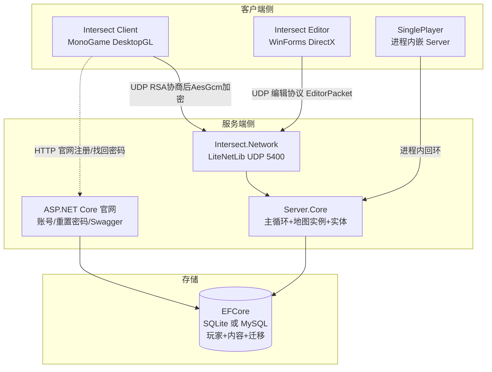

## 8. 服务端模块与职责

`Intersect.Server.Core` 目录职责：

- `Core/`：Bootstrapper（启动引导）、LogicService（主逻辑线程）、ServerContext、ServerCommandLineOptions。
- `Networking/`：Client.cs（服务端会话对象）、PacketHandler.cs（3202 行，67 个 `HandlePacket(Client, XxxPacket)` 方法）、PacketSender.cs（发包工具）。
- `Maps/`：MapController（地图注册表）、MapInstance（地图运行时实例）、MapGrid、TileHelper（瓦片阻挡）、MapNpcSpawn/MapResourceSpawn/MapItemInstance/MapTrapInstance。
- `Entities/`：Entity.cs（基类）、Player.cs（分部类：Avatar/Database/Online）、Npc.cs、Projectile.cs、Resource.cs、Trading.cs、Events/（事件解释器）、Pathfinding/Pathfinder.cs。
- `Database/`：IntersectDbContext、DbInterface（数据库门面）、MigrationScheduler、PlayerData(33)/GameData(7)/Logging(9)。
- `Metrics/`：内置 Prometheus 风格监控指标。

图 3：服务端主循环与地图更新模型

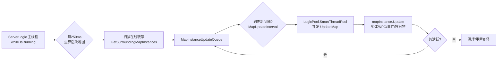

> **解读**：Intersect 的服务端不是"固定 tick 全员推进"，而是**队列驱动 + 线程池并发**：主线程只做调度（每 250ms 根据玩家位置重算哪些地图活跃），到点的地图实例被丢进 SmartThreadPool 并发 `Update`（`LogicService.LogicThread.cs`）。MapUpdateInterval 与 ProjectileUpdateInterval 都是服务器配置项，投射物可与地图更新错开频率。这与 LYFMMORGP 的"20Hz 固定帧、单逻辑线程消费命令队列"是两种不同哲学：Intersect 用并发换单地图更新延迟，LYFMMORGP 用固定帧换逻辑确定性。

图 4：Intersect-Engine 源码目录结构与分层依赖

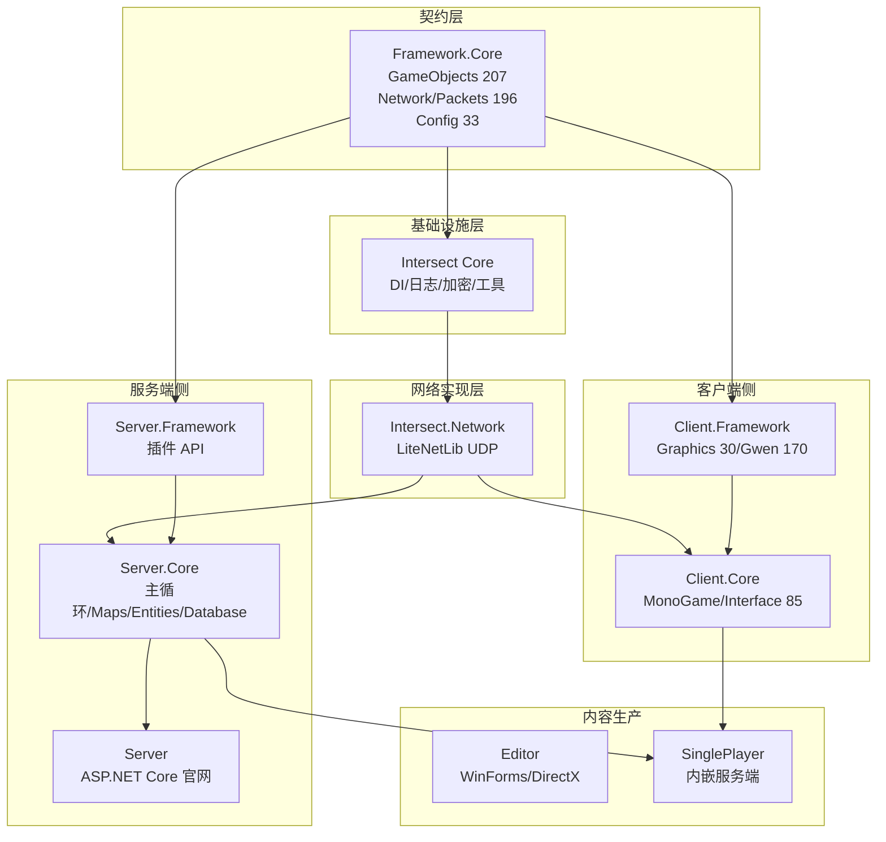

> **解读**：Framework.Core 是纯契约层（游戏对象+数据包），Core 是基础设施，Network 是传输实现，Client.Core/Server.Core 是各端逻辑，Editor 是内容生产工具。SinglePlayer 同时引用 Client.Core + Server.Core 实现单机模式。

**服务端线程池分工**（`LogicService.LogicThread.cs` 与 Bootstrapper.PostContextSetup）：

| 线程池 | 实现 | 职责 | 配置项 |
| --- | --- | --- | --- |
| ServerLogic 主线程 | 普通 Thread（"ServerLogic"） | 调度活跃地图、每秒统计 CPS/玩家数、触发公会更新与变量落盘 | CpsLock 时 Thread.Sleep(1) |
| LogicPool | SmartThreadPool | 并发执行 MapInstance.Update / 投射物更新 / 事件命令 / 公会更新 | MinLogicThreads / MaxLogicThreads |
| NetworkPool | SmartThreadPool | 网络包解码与入站处理（`ServerNetwork.Pool.QueueWorkItem`） | NetworkPoolDataProvider |
| DbPool | SmartThreadPool | 数据库读写（`DbInterface.Pool.QueueWorkItem`） | DatabasePool |

**地图实例（MapInstance）模型**：一个 MapController（地图定义）可对应多个 MapInstanceId（副本/实例），例如副本、专属区域。`ActiveMapInstances` 字典只保留当前有玩家活动的实例；实例无人活动时 `ShouldBeCleaned()` → `RemoveLayerFromController()` 卸载，或 `ResetNpcSpawns()` 重置刷怪。这就是"按需激活"的地图实例系统。

**地图实例并发更新细节**：MapInstance.Update 被 LogicPool 线程池并发调用，不同地图实例之间无共享状态（每个实例有自己的实体列表、事件队列、刷怪状态），所以可安全并发。同一实例内部的实体更新是串行的（单实例单线程），避免竞态。地图切换（WarpPlayer）需要持有 `LogicLock`（`lock (LogicLock)` 块）阻止该实例入队更新，防止编辑/切换时状态不一致。投射物更新（`UpdateProjectiles`）用独立队列 `MapInstanceProjectileQueue`，与主地图更新错开频率，减少单帧计算量。

## 9. 客户端模块与职责

- `Intersect.Client.Core/MonoGame/`：IntersectGame.cs（MonoGame Game 入口）、Graphics.cs、Input.cs、Audio.cs、Bootstrapper。默认 BackBuffer 800x480、8x MSAA（`IntersectGame.cs` 构造段）。
- `Intersect.Client.Core/Interface/`：85 个文件，全部游戏界面（登录、选角、背包、聊天框、事件对话框），基于 Gwen UI 库。
- `Intersect.Client.Framework/Gwen/`：170 个文件的 C# UI 库 Gwen（控件、皮肤 skin-intersect.png）。
- `Intersect.Client.Core/Networking/`：Network.cs、PacketHandler.cs、PacketSender.cs（与服务端对称的包处理结构）。
- 资源管理：`Globals.ContentManager = new MonoContentManager()`；自动更新器 `Updater`（client/update.json + version.client.json，`IntersectGame.cs`）。

**客户端渲染管线**：`GraphicsDeviceManager` 创建 → `MonoRenderer`（`Core.Graphics.Renderer`）封装精灵批 → Gwen 的 `IntersectRenderer` 把 UI 绘制桥接到同一 GraphicsDevice。输入层 `Globals.InputManager = new MonoInput(this)`。客户端偏好存 `Globals.Database = new JsonDatabase()`（JSON 文件）。

**客户端网络对称结构**：Client.Core/Networking 下同样有 PacketHandler.cs / PacketSender.cs / Network.cs，与服务端共享同一套 Packets 契约（Framework.Core），这是"契约层共享"架构的直接收益——双端包定义只有一份。

**资源与更新**：客户端资源按 `assets/development`、`assets/production`、`assets/staging` 三套环境分目录；`Updater` 从 `ClientConfiguration.Instance.UpdateUrl` 拉 `client/update.json` 清单做增量更新。

## 9.5 插件体系（Examples 与 Plugins）

- `Framework/Intersect.Framework.Core/Plugins`（24 文件）与 `Intersect (Core)/Plugins`（17 文件）定义插件上下文：IPluginBootstrapContext、IServerPluginContext、插件加载器。
- `Intersect.Server.Framework` 与 `Intersect.Client.Framework` 是官方插件 API 层，Examples 下有 `Intersect.Examples.Plugin`、`Intersect.Examples.Plugin.Client`、`Intersect.Examples.Plugin.Server`、`Intersect.Examples.Plugin.Multitarget` 四个示例插件工程。
- 插件通过打包目录加载，在 csproj 里 `@(PluginToDebug)` 机制把插件作为 Content 拷到输出目录（`Intersect.Client.csproj` Plugins 段）。

## 10. 网络通信

**传输**：LiteNetLib（UDP），证据 `Intersect.Network/LiteNetLib/LiteNetLibInterface.cs`：

- `NetManager` 配置：`PingInterval = 5000`（5 秒心跳/往返探测），`DisconnectTimeout = 60_000`（Release，Debug 600s），IPv6Enabled，UnconnectedMessagesEnabled（允许未连接消息，用于 NAT 打孔与初始握手）。
- 包前缀协议：收到的字节流先读 `packetCode`——0 = ApprovalPacket（握手审批）；`0x20 0x21 0x22 0x23` 是魔数序列（版本探测）；其余走 `TryProcessInboundMessage` 解密为普通包。
- 通道：`TransmissionMode` 枚举映射 LiteNetLib 的 DeliveryMethod（可靠有序/可靠无序/不可靠）。

**握手加密**（`HailPacket.cs`、`ConnectionPacket.cs`）：

1. 客户端出厂带服务器 RSA 公钥；连接后客户端生成 32 字节 `HandshakeSecret`，连同版本数据、客户端临时 RSA 公钥，用服务器公钥 **RSA-OAEP-SHA256** 加密成 `EncryptedData` 发出（HailPacket.Encrypt）。
2. 服务端私钥解密，取出协商出的对称密钥，后续全部流量用 **AesGcm**（AesGcmAlgorithm.cs）对称加密。
3. 另有独立 RSA-2048 用于 Unconnected 消息（NAT 探测）。

**序列化与注册**：

- 所有包继承 `IntersectPacket`，标 `[MessagePackObject]`，握手包用 `[Union(0, typeof(ApprovalPacket))] [Union(1, typeof(HailPacket))]` 做多态（`ConnectionPacket.cs`）。
- 分发：服务端 `PacketHandler` 构造时 `Registry.TryRegisterAvailableMethodHandlers(GetType(), this)`——反射扫描本类所有 `HandlePacket(Client, XxxPacket)` 方法，按第二个参数类型自动登记到 `PacketHandlerRegistry`。**没有 switch case 大包表，全靠泛型方法签名注册**。
- 防 flooding：`ShouldAcceptPacket` 校验单包大小（默认上限 10240 字节）与每秒包数阈值，超限直接 `FloodKicked` 踢下线（`PacketHandler.cs` 101-198 行）。

**LiteNetLib 通道与心跳重连细节**：

- **可靠/不可靠通道**：LiteNetLib 提供 DeliveryMethod.ReliableOrdered（可靠有序，用于登录/聊天/交易等关键包）、ReliableUnordered（可靠无序）、Unreliable（不可靠，用于高频移动/位置同步）。Intersect 的 `TransmissionMode` 枚举映射这三种，移动包走不可靠通道（丢一两个无所谓，下一帧位置包会纠正），登录/交易走可靠有序。
- **心跳**：`NetManager.PingInterval = 5000`（5 秒），客户端自动发 Ping，服务端回 Pong；`DisconnectTimeout = 60_000`（Release）/`600_000`（Debug），超时未收到任何包则断开。
- **断线重连**：LiteNetLib 层 `DisconnectReason.Reconnect` 有专门分支记录，但重连后游戏会话恢复逻辑需靠客户端重新走 LoginPacket——Intersect 无自动会话恢复，重连=重新登录。
- **NAT 穿透**：`UnconnectedMessagesEnabled = true`，允许未连接消息，用于 NAT 打孔与初始握手探测。

**真实数据包示例**（`Framework/Intersect.Framework.Core/Network/Packets/Client/`）：

```csharp
// LoginPacket.cs —— 客户端发账号密码（密码已在客户端先 SHA256）
[MessagePackObject]
public partial class LoginPacket : IntersectPacket
{
    [Key(0)] public string Username { get; set; }
    [Key(1)] public string Password { get; set; }
}

// MovePacket.cs —— 一次网格移动：地图Id+坐标+方向+时间戳
[MessagePackObject]
public partial class MovePacket : AbstractTimedPacket   // 基类占用 Key 0~2（Adjusted/UTC）
{
    [Key(3)] public Guid MapId { get; set; }
    [Key(4)] public byte X { get; set; }
    [Key(5)] public byte Y { get; set; }
    [Key(6)] public Direction Dir { get; set; }
}
```

**心跳**：PingPacket（`PacketHandler.HandlePacket(Client, PingPacket)`），客户端按 5 秒间隔探测，服务端回 Ping。**断线重连**：LiteNetLib 层 `DisconnectReason.Reconnect` 有专门分支记录（`OnPeerDisconnected`），但重连后游戏会话恢复逻辑需靠客户端重新走 LoginPacket。

**通道与可靠性**：LiteNetLib 提供 DeliveryMethod.ReliableOrdered（可靠有序，用于登录/聊天/交易等关键包）、ReliableUnordered（可靠无序）、Unreliable（不可靠，用于高频移动/位置同步）。Intersect 的 `TransmissionMode` 枚举映射这三种，移动包走不可靠通道（丢一两个无所谓，下一帧位置包会纠正），登录/交易走可靠有序。

**加密层次**：

1. 传输层：LiteNetLib UDP，无连接时用独立 RSA-2048 加密探测消息。
2. 握手层：HailPacket 用服务器公钥加密协商出 32 字节 HandshakeSecret（服务器密钥位数由构建期 KeyGenerationTask 生成，本副本未含该任务，位数未核实；可见网络临时密钥为 RSA-2048）。
3. 会话层：后续所有业务包用 AesGcm（AesGcmAlgorithm.cs）对称加密。
4. 密码层：客户端先 SHA256(password)，服务端再 SaltPasswordHash = SHA256(upper(passwordHash)+salt)。

**为什么不用 TCP**：LiteNetLib 在 UDP 上实现可靠通道，延迟低、抗抖动；TCP 的队头阻塞对高频移动包不友好——一个丢包会阻塞后续所有包。Intersect 选择 UDP + 应用层可靠性，是 2D 动作网游的常见取舍。

**包大小与频率限制**（FloodThresholdOptions 实测）：

| 限制项 | 默认值 |
| --- | --- |
| 单包大小上限 | 10240 字节 |
| 玩家每秒包数阈值 | 可配置 |
| 管理员每秒包数阈值 | 可配置（高于玩家） |
| 超限处理 | FloodKicked 踢线 + 写日志 |

**包序列化细节**：MessagePack 用 `[MessagePackObject]` 标注类、`[Key(n)]` 标注字段序号、`[Union(n, typeof(XxxPacket))]` 做多态分发。握手包（ApprovalPacket/HailPacket）用 Union 0/1 区分；业务包各自独立类型，由 PacketTypeRegistry 注册类型代号。

**下行包示例**（服务端→客户端）：

| 包 | 用途 |
| --- | --- |
| CharactersPacket | 角色列表（登录后） |
| JoinGamePacket | 进游戏确认 |
| EnterMapPacket | 进入地图 |
| MapEntitiesPacket | 周围实体快照 |
| EntityMovePacket | 实体移动 |
| EntityPositionPacket | 实体位置纠正 |
| EntityVitalsPacket | 实体血蓝条更新 |
| EntityStatsPacket | 实体属性更新 |
| EventDialogPacket | 事件对话框 |
| ChatMsgPacket | 聊天消息 |
| BagPacket/BankPacket | 背包/银行更新 |
| GlobalCooldownPacket | 全局冷却 |
| GameObjectPacket | 内容数据快照（启动时） |

**上行包示例**（客户端→服务端）：

| 包 | 用途 |
| --- | --- |
| LoginPacket | 登录 |
| MovePacket | 移动 |
| ChatMsgPacket | 发聊天 |
| AttackPacket | 攻击 |
| UseSpellPacket | 放技能 |
| PickupItemPacket | 捡物品 |
| UseItemPacket | 用物品 |
| ActivateEventPacket | 触发事件 |
| EventResponsePacket | 事件回应 |
| SelectCharacterPacket | 选角色 |

图 5：数据包从 socket 到业务方法的流水线

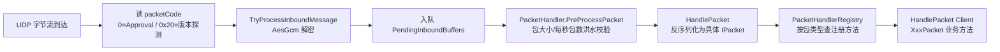

> **解读**：入站包经过"解密 → 洪水拦截 → 类型分发 → 业务方法"四道闸。洪水阈值在 `FloodThresholdOptions.cs`：单包上限 10240 字节、玩家/管理员两套每秒包数阈值，超限 `FloodKicked` 直接踢线。

**服务端 67 个包处理器覆盖的功能域**（`PacketHandler.cs` 实测方法签名）：

| 域 | 代表包 |
| --- | --- |
| 账号 | LoginPacket / LogoutPacket / UserRegistrationRequestPacket / PasswordChangeRequestPacket |
| 角色 | CharactersPacket / NewCharacterPacket / CreateCharacterPacket / SelectCharacterPacket / DeleteCharacterPacket |
| 移动朝向 | MovePacket / DirectionPacket / BlockPacket / BumpPacket |
| 战斗 | AttackPacket / UseSpellPacket / UpgradeStatPacket |
| 聊天 | ChatMsgPacket（local/global/party/private/admin 五频道） |
| 事件 | ActivateEventPacket / EventResponsePacket / EventInputVariablePacket |
| 背包 | PickupItemPacket / SwapInvItemsPacket / DropItemPacket / UseItemPacket / InventoryUpdatePacket |
| 装备 | UnequipItemPacket / EquipmentPacket |
| 商店银行 | BuyItemPacket / SellItemPacket / CloseShopPacket / DepositItemPacket / WithdrawItemPacket |
| 合成 | CraftItemPacket / CloseCraftingPacket / CraftingTablePacket |
| 社交 | PartyInvitePacket 系列 / TradeRequestPacket 系列 / FriendsPacket / FriendRequestPacket / GuildPacket 系列 |
| 任务 | QuestResponsePacket / AbandonQuestPacket |
| 其他 | HotbarUpdatePacket / TargetPacket / FadeCompletePacket / PictureClosedPacket / PingPacket |

**服务端→客户端下行包**（`Packets/Server`，99 个）关键的有：CharactersPacket（角色列表）、JoinGamePacket（进游戏）、EnterMapPacket、MapEntitiesPacket（周围实体）、EntityMovePacket/EntityPositionPacket/EntityDirectionPacket（同步）、EntityVitalsPacket/EntityStatsPacket（属性血条）、BagPacket/BankPacket/InventoryPacket（容器）、EventDialogPacket（事件对话框）、ChatMsgPacket、GlobalCooldownPacket、GameObjectPacket（内容数据快照）、MapGridPacket（地图网格数据）。

## 11. 数据存储

**双用途 EFCore 数据库**：同一个数据库既存玩家运行时数据，也存游戏内容。

图 6：数据库与内容存储结构

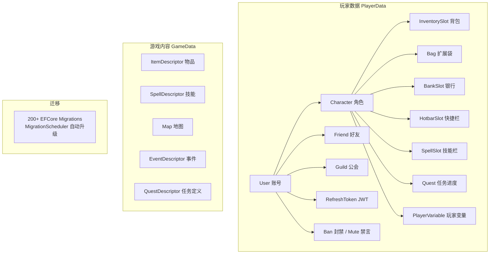

- 配置切换：`Program.CreateHostBuilder` 读 `DatabaseType`（默认 Sqlite）与 `ConnectionString`（`Intersect.Server/Program.cs`）。
- 玩家数据表（`Intersect.Server.Core/Database/PlayerData/`）：User（账号）、Ban、Mute、Friend、Guild/GuildBankSlot/GuildInvite/GuildVariable、InventorySlot/Bag/BagSlot/BankSlot/HotbarSlot/SpellSlot/Quest、PlayerVariable/UserVariable/Switch/Variable、RefreshToken（JWT 刷新令牌）。
- 游戏内容表（GameObjects 全是 `DatabaseObject<TDescriptor>` 子类）：ItemDescriptor、SpellDescriptor、ClassDescriptor、EventDescriptor、QuestDescriptor、ShopDescriptor、NPCDescriptor、ResourceDescriptor、AnimationDescriptor、ProjectileDescriptor、CraftingRecipeDescriptor/TableDescriptor、MapList。嵌套集合（如 NPC 的免疫列表、掉落表）用 `JsonConvert.SerializeObject` 序列化成字符串列存（`NPCDescriptor.cs` 108-232 行）。
- **Schema 迁移（时间戳命名，主体）**：按 Game/Logging/Player 三个 DbContext 分库，Sqlite 与 MySql 双 Provider 各一份——`Intersect.Server.Core/Migrations/Sqlite/` 下 Game 130 + Logging 12 + Player 54 = **196 个**；`Intersect.Server/Migrations/MySql/` 下 Game 132 + Logging 14 + Player 52 = **198 个**；合计约 **394 个**。`MigrationScheduler` 自动升级。
- **数据迁移（DataMigrations，游戏内容/存档版本升级，非 schema）**：`Intersect.Server.Core/Database/GameData/Migrations` 4 个 + `Database/PlayerData/Migrations` 1 个，共 5 个，用于旧版存档/内容数据到新版的兼容转换。
- 密码哈希（`Database/PlayerData/User.cs`）：客户端先 `SHA256(password)` 发送，服务端再 `SaltPasswordHash = SHA256(passwordHash.ToUpperInvariant() + Salt)`，即两段哈希（传输哈希 + 服务端盐哈希）。

**玩家数据表完整清单**（`Intersect.Server.Core/Database/PlayerData/` 实测）：

| 表 | 用途 |
| --- | --- |
| User | 账号（用户名、密码哈希、Salt、邮箱、权限组） |
| Ban | 封禁记录（账号/IP、到期时间） |
| Mute | 禁言记录 |
| Friend | 好友关系 |
| Guild | 公会（名称、会长、公告、成员列表） |
| GuildBankSlot | 公会银行槽位 |
| GuildInvite | 公会邀请 |
| GuildVariable | 公会变量 |
| Character | 角色（外观、等级、位置、Vitals） |
| InventorySlot | 背包格子（物品 Id、数量） |
| Bag / BagSlot | 扩展背包 |
| BankSlot | 银行格子 |
| HotbarSlot | 快捷栏 |
| SpellSlot | 已学技能 |
| Quest | 任务进度 |
| PlayerVariable / UserVariable / Switch | 玩家/账号/开关变量 |
| RefreshToken | JWT 刷新令牌（官网登录） |

**游戏内容表**（GameObjects 全是 `DatabaseObject<TDescriptor>` 子类）：ItemDescriptor、SpellDescriptor、ClassDescriptor、EventDescriptor、QuestDescriptor、ShopDescriptor、NPCDescriptor、ResourceDescriptor、AnimationDescriptor、ProjectileDescriptor、CraftingRecipeDescriptor、CraftingTableDescriptor、MapList。每张内容表的嵌套集合（如 NPC 的免疫列表、掉落表）用 `JsonConvert.SerializeObject` 序列化成字符串列存，避免建关联表。

> 注意：网上老资料说 Intersect 内容是 resources 目录下 JSON 文件——那是 0.6 之前的旧版。**0.8 实测内容全部在数据库**，JSON 只剩服务端 Options 配置与客户端偏好（JsonDatabase）。

## 12. 启动流程

图 7：服务端启动流程

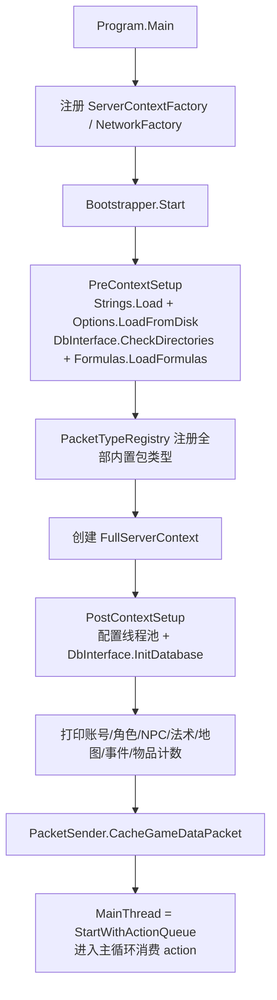

> **证据链**：`Intersect.Server/Program.cs`（Main 注册工厂）→ `Intersect.Server.Core/Core/Bootstrapper.cs`（PreContextSetup/PostContextSetup）→ `LogicService.LogicThread.cs`（while 主循环）。

**启动各阶段产物**（Bootstrapper 实测）：

1. PreContextSetup：加载 Strings（多语言）、Options.LoadFromDisk（JSON 配置）、DbInterface.CheckDirectories（建目录）、Formulas.LoadFormulas（战斗公式）、CustomColors.Load；可选 MetricsRoot.Init。
2. PacketTypeRegistry 注册：`new PacketTypeRegistry(logger, typeof(IntersectPacket).Assembly)` 反射扫描程序集里所有 IPacket 实现类并登记类型代号。
3. FullServerContext 创建：装配各 ApplicationService（网络、逻辑、控制台 ConsoleService）。
4. PostContextSetup：配系统线程池（Min/MaxSystemThreadpoolWorkerThreads）、DbInterface.InitDatabase（连 SQLite/MySQL、跑迁移）、Time.Update、打印 `AccountCount/CharacterCount/NpcCount/SpellCount/MapCount/EventCount/ItemCount` 七项计数、PacketSender.CacheGameDataPacket（缓存全量内容快照包）、Guild.WipeStaleGuilds 清过期公会。
5. MainThread 启动：`context.StartWithActionQueue()` 返回 ILockingActionQueue，主线程循环 `action.Invoke()` 消费启动后排队的动作。

**关停**：Ctrl+C / Ctrl+Break 走 `ServerContext.Instance.RequestShutdown(true)`；控制台关闭（CtrlCloseEvent）直接 `ServerContext.Instance.Dispose()` 强制落盘再退出（因为 Dispose 来不及跑完）。

**启动失败常见原因**：

1. 未 `git submodule update --init --recursive` → vendor/LiteNetLib 缺失，Network 编译失败。
2. 非 Windows 未 apply `disable-windows-only.patch` → Editor 项目编译失败。
3. 客户端资源未放进 `assets/development/client` → 客户端能启动但无图。
4. 端口 5400 被占 → 改 Options.json 里 ServerPort。
5. MySQL 连接串配错 → 改 DatabaseType=Sqlite 先跑通。

**EF Core 三个 DbContext 分库结构**：Intersect 的 EFCore 不是单一大上下文，而是按业务域拆成三个独立 DbContext，各自有独立的 schema 迁移：

| DbContext | 存储内容 | Sqlite 迁移数 | MySql 迁移数 |
| --- | --- | --- | --- |
| GameDbContext | 游戏内容（Item/Spell/Map/Event/Quest 等 Descriptor） | 130 | 132 |
| PlayerDbContext | 玩家运行时数据（Character/Inventory/Quest/Variable） | 54 | 52 |
| LoggingDbContext | 日志与审计（UserActivityHistory 等） | 12 | 14 |

这种分库设计的好处：① 游戏内容变更（策划加物品）不会触发玩家数据表迁移；② 日志表可独立清理不影响玩家数据；③ 未来可拆成独立数据库实例。代价是跨库查询要手动 join（Intersect 用应用层代码组装，不用 EFCore 跨库 join）。

## 13. 登录与账号流程

图 8：登录到进入游戏时序

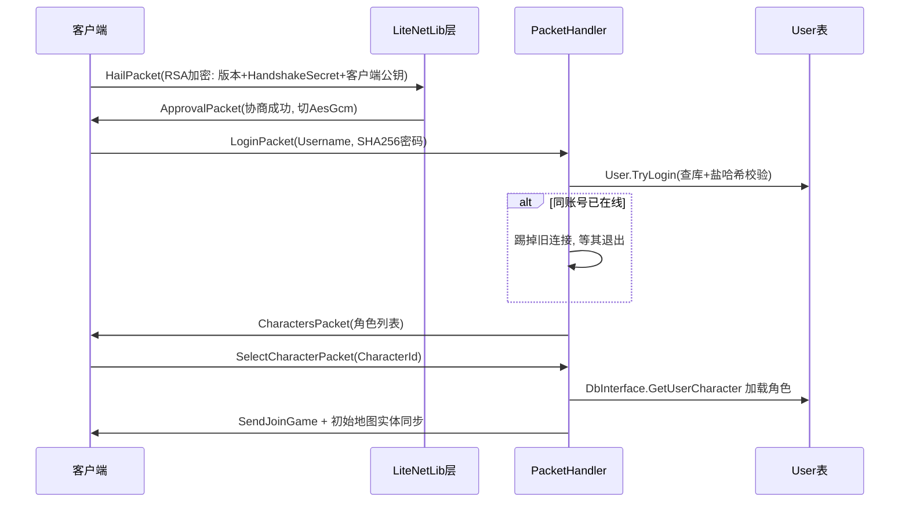

> **证据**：`PacketHandler.HandlePacket(Client, LoginPacket)`（508 行起）——失败计数 `FailedAttempt`、同账号互踢（`Client.GlobalLock` 内遍历 `Client.Instances` 断开旧连接并 `Task.WaitAll`）、Ban 检查、AdminOnly 模式；`HandlePacket(Client, SelectCharacterPacket)`（2567 行）——`DbInterface.GetUserCharacter` → `client.LoadCharacter` → `SetOnline` → `PacketSender.SendJoinGame`。

**登录失败分支**（实测）：① 3 次失败后进入超时锁定（`AccountAttempts > 3 && TimeoutMs`）；② 在线人数达 `MaximumLoggedInUsers` 拒登；③ `User.TryLogin` 失败分 `InvalidCredentials`（密码错，FailedAttempt++）与其他（通用错误），并写 UserActivityHistory 审计日志（IP、用户名、失败原因类型）；④ Ban.CheckBan 同时查账号封禁与 IP 封禁；⑤ AdminOnly 模式下非管理员拒登。

**注册**（UserRegistrationRequestPacket，1483 行）：客户端注册需校验用户名正则（`FieldChecking.IsValidUsername`）、邮箱格式（`IsWellformedEmailAddress`）、用户名/邮箱是否已存在（`User.UserExists`），`Options.Instance.BlockClientRegistrations` 可整体关闭客户端注册（引导到官网注册）。

**首启管理员/默认账号**：**源码中未发现硬编码默认管理员账号**（无 admin/password 之类的初始账号）。首启 GM 获取方式推测为：① 配置 `Options.AdminOnly=true` 后通过控制台命令提权（`Intersect.Server/Core/Commands/` 下有 MakePrivateCommand/MakePublicCommand 等管理命令）；② 或通过内置 Web 站注册后在数据库手动设置权限组。具体首启流程未在本次走读中确认。

**登录状态机**（LoginPacket 处理流程）：

1. 检查 `FailedAttempts` 超时是否解除。
2. 检查在线人数上限 `MaximumLoggedInUsers`。
3. `User.TryLogin` 查库校验密码。
4. 失败：FailedAttempt++，写 UserActivityHistory，回 LoginResult 失败码。
5. 成功：检查 Ban（账号 + IP）、AdminOnly 模式。
6. 同账号互踢：GlobalLock 内遍历 Instances，断开旧连接（Task.WaitAll 等其退出）。
7. 绑定 client.User，回 CharactersPacket（角色列表）。

**角色创建**（CreateCharacterPacket，1574 行）：校验角色名正则、是否重名、性别、起始 Class（ClassId）、外观（头发/脸型）、起始位置（Class 定义的 SpawnMap/Position）。创建成功后写 Character 表，回 CharactersPacket 刷新列表。

## 14. 角色创建与进入地图

- 选角列表：CharactersPacket；新建角色：NewCharacterPacket / CreateCharacterPacket（1574 行，含外观 Class/性别/头发等）。
- 进入地图：`client.LoadCharacter` 后，`MapInstance.PlayerEnteredMap(player)`（`Maps/MapInstance.cs` 372 行）→ `SendMapEntitiesTo(player)`（397 行）把周围地图实例（`GetSurroundingMapInstances`）上的实体一次性发给客户端。
- 视野模型：**没有精确 AOI 九宫格裁剪，而是"地图邻接网络"**——玩家所在地图 + 上下左右相邻地图实例内的全部实体都对玩家可见（`MapController.GetSurroundingMapInstances`）。小地图粒度天然适合 2D 瓦片网游。

**选角细节**（SelectCharacterPacket，2567 行）：先 `DbInterface.GetUserCharacter(user, characterId, true)` 取角色；若 `character.IsSaving`（正在落盘）拒登并提示；若 `IsDisposed` 抛异常；然后 `client.LoadCharacter(character)` 绑定实体 → `SetOnline()` → `PacketSender.SendJoinGame(client)`。异常时回退 `client.Logout()`。

**进图同步内容**：SendMapEntitiesTo 遍历周围 MapInstance，把每个实例上的 Player/Npc/Resource/Event/MapItem 实体列表打包成 MapEntitiesPacket 发给新玩家，同时玩家作为新实体广播给周围老玩家。

**进图初始化流程**：

1. SelectCharacterPacket → LoadCharacter → SetOnline → SendJoinGame。
2. SendJoinGame 后，客户端发 EnterMapPacket（或服务端主动发 EnterMapPacket）。
3. 服务端 PlayerEnteredMap → SendMapEntitiesTo 发周围实体快照。
4. 客户端收到 MapEntitiesPacket 后渲染周围实体。
5. 后续实时同步靠 EntityMovePacket/EntityPositionPacket/EntityVitalsPacket。

**地图切换**（WarpPlayer 事件命令）：服务端设置玩家 MapId/MapInstanceId/X/Y，广播旧地图离开、新地图进入，重新 SendMapEntitiesTo。

## 15. 移动同步

图 9：网格移动与实体广播机制

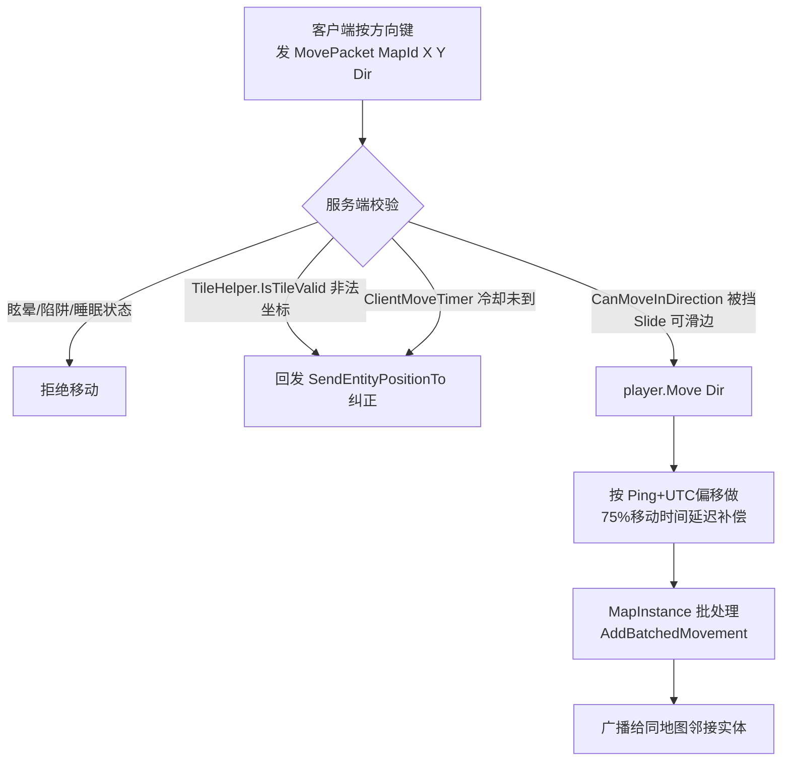

> **证据**：`PacketHandler.HandlePacket(Client, MovePacket)`（787-850 行）。要点：① 服务端完全权威——坐标合法性、状态、碰撞全在服务端判定，非法就回发正确位置纠正客户端；② 延迟补偿：`latencyAdjustmentMs = -(client.Ping + utcDeltaMs)`，客户端 MoveTimer 按移动时间 75% 估算（`player.GetMovementTime() * .75f`）；③ 批量广播：MapInstance 有 `AddBatchedMovement`/`AddBatchedAnimation`/`AddBatchedActionMessage` 三个批收集器，一帧内同类移动合并发包。**这是状态同步模型**（不是帧同步），客户端表现与服务端位置可能短暂不一致，靠纠正包收敛。

**移动校验四重闸**（实测代码顺序）：

1. 状态闸：`player.CachedStatuses` 里有 Stun/Snare/Sleep 直接 return。
2. 坐标闸：`TileHelper.IsTileValid(packet.MapId, packet.X, packet.Y)`，非法即判定"可能作弊"，回发当前真实位置。
3. 冷却闸：`player.ClientMoveTimer <= clientTime` 才允许，防止客户端狂发；战斗中移动受 `AllowCombatMovement` 配置控制。
4. 碰撞闸：`player.CanMoveInDirection(Dir, out blockerType, out _)`，挡路类型为 `MovementBlockerType.Slide` 时允许滑边（贴着墙滑过去），否则纠正位置。

**位置一致性兜底**：处理完后 `if (packet.MapId != client.Entity.MapId || packet.X != client.Entity.X || packet.Y != client.Entity.Y)` 再回发一次位置纠正——即客户端发过来的位置与服务端落地位置不一致时强制对齐。

**被丢弃包的补偿**：`HandleDroppedPacket`（486 行）对丢失的 MovePacket 也回发 `SendEntityPositionTo`，让客户端校正。

## 16. 战斗、技能与属性

- 属性：Entity 上的 Vitals（HP/MP/Shield）与 Stats，服务端 `EntityVitalsPacket`/`EntityStatsPacket` 下发。
- 战斗参数（`Framework/Intersect.Framework.Core/Config/CombatOptions.cs`）：CombatTime=10000ms（脱战计时）、RegenTime=3000ms（回血回蓝间隔）、GlobalCooldownDuration=1500ms（全局公共冷却）。
- 技能：SpellDescriptor（`GameObjects/Spells/`，6 个文件），客户端发 UseSpellPacket（1846 行）；`SpellEffect` 枚举含 Stun/Snare/Sleep（移动处理里直接检查这三个状态禁止移动）。
- 投射物：Projectile.cs + ProjectileSpawn.cs，地图实例单独的 `UpdateProjectiles(timeMs)` 与 `MapInstanceProjectileQueue`（投射物可与地图主更新错开频率）。
- PvP/敌对：靠 Event 条件与地图/区域设置驱动，没有在 PacketHandler 里看到独立 PvP 开关包。
- 命中与伤害公式：服务端 `Formulas.LoadFormulas()` 在启动时加载（Bootstrapper.PreContextSetup），公式可配置化，具体公式表未在本次走读中展开（位于 `Intersect.Server.Core/General/Formulas` 相关文件）。
- 状态效果：`player.CachedStatuses`（Entity.cs 358 行附近遍历），移动与行动前检查 Stun/Snare/Sleep 状态。
- 攻击流程：客户端 AttackPacket → 服务端校验距离/方向/冷却 → EntityAttackPacket 广播周围 → 结算后 EntityVitalsPacket 更新血条 → 死亡 EntityDiePacket。

**技能释放流程**（UseSpellPacket，1846 行）：

1. 客户端发 UseSpellPacket(SpellId, TargetType, TargetId)。
2. 服务端校验：是否学会该技能（SpellSlot 表）、蓝量是否够、冷却是否到（GlobalCooldownDuration=1500ms）、距离是否在技能范围。
3. 结算伤害/治疗/状态效果，写 EntityVitalsPacket 给目标。
4. 广播 EntityCastSpellPacket / ProjectileSpawnPacket（投射物类技能）。
5. 消耗蓝量，设置技能冷却。

**投射物**（Projectile.cs）：从施法者位置向目标位置飞行，命中后触发技能效果。地图实例用独立队列 `MapInstanceProjectileQueue` 错开更新频率，避免投射物计算拖累主地图更新。

**状态效果**（SpellEffect 枚举）：Stun（眩晕，禁止移动/行动）、Snare（减速）、Sleep（睡眠，受击解除）、Silence（禁魔）、Regen（回血）、Shield（护盾）等。NPCDescriptor.Immunities 定义该 NPC 免疫哪些效果。

**战斗结算公式**：服务端 `Formulas.LoadFormulas()` 在启动时加载（Bootstrapper.PreContextSetup），公式可配置化。结算流程：① 基础伤害 = 攻击力 × 技能倍率 - 目标防御；② 暴击判定（暴击率 × 暴击伤害倍率）；③ 命中判定（命中率 vs 闪避率）；④ 属性加成（Buff/Debuff 影响）；⑤ 最终伤害 = 随机波动（±10%）。具体公式表未在本次走读中展开（位于 `Intersect.Server.Core/General/Formulas` 相关文件）。

**攻击与技能的区别**：普通攻击（AttackPacket）无冷却、无蓝耗、伤害固定；技能（UseSpellPacket）有冷却、蓝耗、可带状态效果。两者都走服务端权威结算，客户端只负责表现。

## 17. AI 与怪物

- NPC：NPCDescriptor（配置）+ Npc.cs（运行时）；刷怪：MapNpcSpawn.cs（地图上的刷怪点）。
- 寻路：`Entities/Pathfinding/Pathfinder.cs`（A* 类网格寻路，事件移动路线里也用到，223 行附近对 EventPageInstance 做特殊处理）。
- 仇恨：NPCDescriptor 有 AggroList（仇恨列表，JsonConvert 序列化存表）。
- 事件移动：EventMoveRoute/MoveRouteAction——事件实体可被编辑器编排固定巡逻路线。

**怪物生命周期**：MapNpcSpawn 定义刷怪点（地图坐标、刷怪 NPC 类型、数量），MapInstance.Update 周期内检查刷怪点是否需要补怪；NPC 死亡后按刷怪重生时间刷新。地图实例不活跃时（无人）`ResetNpcSpawns()` 全部重置，下次有人进入再重新刷怪——省内存。

**NPC 免疫与克制**：NPCDescriptor.Immunities（List<SpellEffect>，JsonConvert 字符串列存储），定义该 NPC 免疫哪些状态效果（Stun/Snare 等）。

**NPC 仇恨与 AI**：NPCDescriptor.AggroList（仇恨列表，JsonConvert 序列化），记录攻击过它的玩家。NPC 死亡后按刷怪重生时间刷新；地图实例不活跃时 ResetNpcSpawns() 全部重置，下次有人进入再重新刷怪。寻路用 Pathfinder.cs（A*），事件移动路线用 SetMoveRoute 命令编排固定巡逻。

**NPC 对话触发**：玩家点击 NPC → ActivateEventPacket → 服务端检查 NPC 是否挂事件 → 触发对应 EventPageInstance → 执行 CallStack。

## 18. 背包、物品、装备

- 物品模型：ItemDescriptor（`GameObjects/Items/`，11 文件）；运行时 InventorySlot/Bag/BagSlot/BankSlot 全是 EFCore 表。
- 操作包：PickupItemPacket（捡地面物品）、SwapInvItemsPacket、DropItemPacket、UseItemPacket、BuyItem/SellItem（商店）、Deposit/Withdraw（银行）、TradeRequest 系列（玩家交易，2187-2368 行一整套）。
- 地面物品：MapItemInstance.cs，`MapInstance.SpawnItem(source,x,y,item,amount)`。
- 背包扩展：BagPacket/BagUpdatePacket（额外背包容器），Bag/BagSlot 表独立于主背包。
- 装备：EquipmentPacket + UnequipItemPacket，装备槽位由 ClassDescriptor 与 ItemDescriptor 共同约束。
- 物品冷却：ItemCooldownPacket / GlobalCooldownPacket，物品与技能各自有冷却表。

**物品类型**（ItemDescriptor.Type 枚举）：Equipment（装备）、Consumable（消耗品）、Weapon（武器）、Ability（技能书）、Currency（货币）、Recipe（配方）、Bag（背包扩展）。装备有槽位（武器/防具/饰品），消耗品有效果（回血/回蓝/Buff），武器有攻击力/攻速。

**物品掉落**：怪物死亡后按掉落表（DropList）随机掉落物品，生成 MapItemInstance 放到地面，玩家经过触发 PickupItemPacket 捡取。

**背包扩展**：Bag/BagSlot 表独立于主背包，BagPacket 通知客户端打开扩展背包槽位。

## 18.5 资源采集与合成

- 资源采集：ResourceDescriptor（`GameObjects/Resources/`，3 文件）+ Resource.cs 运行时实体 + MapResourceSpawn.cs 刷点——地图上可采集的矿/树/草药，玩家点击采集获得物品。
- 合成：CraftingRecipeDescriptor + CraftingTableDescriptor，对应 OpenCraftingTable / CraftItemPacket / CloseCraftingPacket 三个包，合成表在编辑器 frmCrafts / frmCraftingTables 编辑。

## 19. 任务、NPC、对话

- 任务：QuestDescriptor（`GameObjects/Quests/`，4 文件），任务有 Task 编辑器（`Intersect.Editor/Forms/Editors/Quest/Quest_TaskEditor`）。
- 对话：不是脚本，而是**事件系统的 ShowText/ShowOptions 命令**（见第 21 节）——NPC 头上挂事件，点击触发事件页执行对话分支。
- 任务与事件联动：StartQuest/CompleteQuestTask/EndQuest 三个事件命令；`Player.cs` 里 `EnqueueStartCommonEvent` 在任务开始/完成时触发公共事件。
- 任务交互包：QuestResponsePacket（任务对话/目标回应）、AbandonQuestPacket（放弃任务）。任务进度存在 Quest 表，每个 Player 一条任务进度记录。
- NPC 对话流程：玩家点 NPC → 客户端 ActivateEventPacket → 服务端 `player.TryActivateEvent(eventId)` → Event 执行 CallStack → ShowText 命令 SendEventDialog → 玩家 EventResponsePacket 回应 → CommandProcessing 继续下一命令。整个对话流是"事件命令栈驱动 + 玩家回应挂起"。

## 20. 交易、经济、商城、社交

- 玩家交易：TradeRequestPacket/OfferTradeItemPacket/AcceptTradePacket 一套完整双人交易流程（2187-2368 行）。
- 好友：FriendRequestPacket/FriendsPacket/CachedFriends（2416-2567 行）。
- 公会：GuildPacket/GuildInvitePacket/UpdateGuildMemberPacket（2781-3157 行），含 GDK 公会银行槽位（SetGuildBankSlots 事件命令）、GuildUpdateInterval=10s。
- 组队：PartyInvitePacket/PartyKickPacket/PartyLeavePacket（2065-2156 行）。
- 聊天：ChatMsgPacket（853 行），频道 0=local/1=global/2=party/3=?(私聊)/4=admin/5=private，有频率限制（MinIntervalBetweenChats）与长度上限。
- 邮件/排行榜：内置官网（Web 目录 121 文件）承担账号、密码重置邮件（MailKit）、排行榜展示；聊天内未见邮件包。
- 组队：PartyInvite/PartyInviteResponse/PartyKick/PartyLeave 四包，队伍频道聊天。
- 公会管理：UpdateGuildMemberPacket 支持 Invite/Remove/Promote/Demote/Transfer 五种操作（2817-2952 行 switch）；GuildBankMaxSlotMigration 表明公会银行槽位可配置。
- 交易：双人交易有 OfferTradeItem/RevokeTradeItem/AcceptTrade/DeclineTrade 完整状态机，防并发修改。
- 好友：CachedFriends 字典，FriendRequest/Response 双向确认。

**聊天频道细节**（ChatMsgPacket，853 行；枚举定义见 `Framework/Intersect.Framework.Core/Chatting/ChatMessageType.cs`）：

| 频道 ID | 名称 | 说明 |
| --- | --- | --- |
| 0 | Local | 本地附近玩家可见 |
| 1 | Party | 队伍频道 |
| 2 | Global | 全服可见（有频率限制） |
| 3 | PM | 私聊 |
| 4 | Admin | 管理员频道 |
| 5 | Guild | 公会频道 |

> 证据：`ChatMessageType.cs` 枚举实测 Local=0, Party=1, Global=2, PM=3, Admin=4, Guild=5。另有 Experience=20、Loot、Inventory、Bank、Combat、Quest、Crafting、Trading、Friend、Spells 等玩家消息类型，以及 Notice=40、Error 等系统消息类型。

**交易状态机**（TradeRequest 系列，2187-2368 行）：

1. A 发 TradeRequestPacket(BId) → B 收到 TradeRequest 弹窗。
2. B 回 TradeRequestResponsePacket(Accept/Decline)。
3. 双方 OfferTradeItemPacket 放入物品 → OfferTradeItemPacket。
4. 任一方 AcceptTradePacket → 双方确认。
5. 双方都确认后系统交换物品。
6. DeclineTradePacket / CloseTrade 随时取消。

**公会操作**（UpdateGuildMemberPacket，2781-2952 行）：支持 Invite（邀请）、Remove（移出）、Promote（提升）、Demote（降职）、Transfer（转让会长）五种操作，操作权限按职位校验。公会银行槽位 GuildBankSlot 表独立存储。

**组队流程**（PartyInvite 系列，2065-2156 行）：

1. A 发 PartyInvitePacket(BId)。
2. B 收到邀请弹窗，回 PartyInviteResponsePacket(Accept/Decline)。
3. 接受后组队，A 为队长。
4. 队长可 PartyKickPacket 踢人，队员可 PartyLeavePacket 退出。
5. 队伍频道聊天（频道 2）。

**邮件**：未见独立邮件包，邮件功能由内置官网（Web 目录）承担，玩家通过网页查看邮件。

## 21. 其他特色系统：可视化事件系统（招牌）

这是 Intersect 区别于所有其他开源 MMORPG 的核心。

图 10：事件系统运行时结构

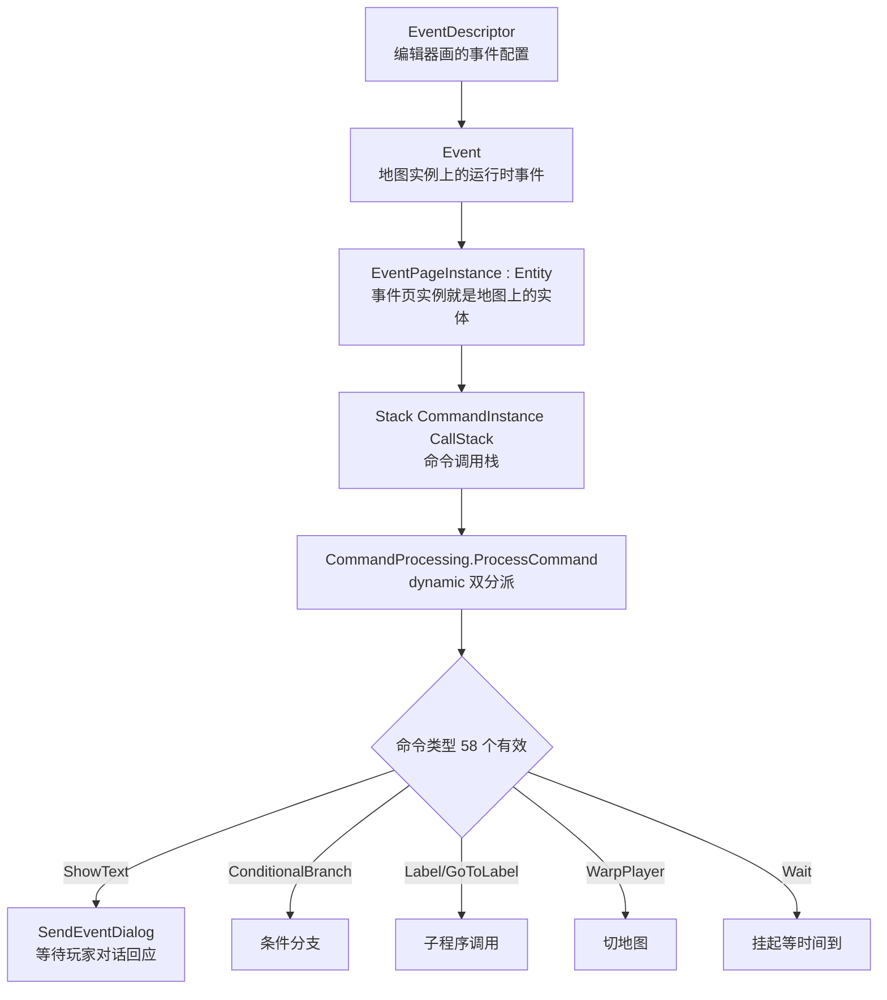

> **证据**：
> - 配置侧：`Framework/.../GameObjects/Events/EventCommandType.cs`——ShowText、ShowOptions、SetSelfSwitch、ConditionalBranch、Label、GoToLabel、StartCommonEvent、WarpPlayer、SetMoveRoute、Wait、OpenShop/Bank/CraftingTable、StartQuest、SpawnNpc/DespawnNpc、GiveExperience、ChangeItems/Spells/Level、CastSpellOn、ShowPicture、Fade、CreateGuild 等 **58 个有效命令**（枚举共 59 项，含 Null=0 占位）。
> - 运行时：`Intersect.Server.Core/Entities/Events/Event.cs`——`public Stack<CommandInstance> CallStack`，事件按 CommandIndex 逐条推进；`CommandProcessing.cs`——`ProcessCommand((dynamic)command, player, instance, stackInfo, callStack)`，每个命令类型一个 private 重载方法（dynamic 双分派，无 switch）；`WaitingForResponse` 标记挂起点，玩家回应（EventResponsePacket）后继续栈。
> - 编辑器侧：`Intersect.Editor/Forms/Editors/Events/` 下 60+ 个 EventCommand_*.cs 用户控件，每条命令一个可视化编辑面板。
> - 公共事件：CommonEventTrigger（全局触发器），事件可 Autorun（地图进入自动跑）、Button（点击触发）、Collision（碰撞触发）。

**事件命令分类表**（58 个有效命令按用途归类）：

| 分类 | 代表命令 | 用途 |
| --- | --- | --- |
| 对话交互 | ShowText / ShowOptions / InputVariable / ChatboxText | NPC 对白、选项分支、玩家输入 |
| 流程控制 | ConditionalBranch / Label / GoToLabel / ExitEventProcess / Wait / WaitForRouteCompletion | 分支跳转、子程序、等待 |
| 玩家属性 | ChangeLevel / GiveExperience / RestoreHp / RestoreMp / ChangeItems / ChangeSpells / ChangeSprite / ChangeFace / SetClass / EquipItem | 改角色状态 |
| 位置移动 | WarpPlayer / SetMoveRoute / HoldPlayer / ReleasePlayer | 传送、事件巡逻、锁玩家 |
| 世界实体 | SpawnNpc / DespawnNpc / CastSpellOn | 刷怪、释放技能 |
| 界面弹窗 | OpenShop / OpenBank / OpenCraftingTable / ShowPicture / HidePicture / Fade | 打开商店银行、立绘、淡入淡出 |
| 任务公会 | StartQuest / CompleteQuestTask / EndQuest / CreateGuild / OpenGuildBank | 任务与公会流程 |
| 音频演出 | PlayBgm / FadeoutBgm / PlaySound / PlayAnimation | 背景音乐、音效、动画 |
| 变量开关 | SetSelfSwitch / Variable / PlayerLabel / ChangeName / ChangeNameColor | 自开关、变量赋值、称号 |

**事件触发类型**（EventTrigger 枚举）：Autorun（自动）、Button（确定键点击）、Collision（玩家碰撞）、Action（接触触发），CommonEventTrigger 另有全局触发时机。

**事件页机制**：一个 EventDescriptor 可有多页（EventPage），每页有独立的触发条件（开关/变量/物品/任务状态）、图形（事件精灵）、移动路线、命令列表。运行时 EventPageInstance 是地图上的实体，玩家靠近/点击触发对应页。多页机制让同一事件点可根据玩家状态（如完成任务前/后）显示不同对话。

**事件变量体系**：

| 变量类型 | 作用域 | 存储表 |
| --- | --- | --- |
| Self Switch | 事件私有开关 | EventDescriptor 内嵌 |
| PlayerVariable | 玩家变量 | PlayerVariable 表 |
| UserVariable | 账号变量（跨角色） | UserVariable 表 |
| Switch | 全局开关 | Switch 表 |
| Variable | 全局变量 | Variable 表 |

**事件命令执行挂起机制**：`CommandInstance.WaitingForResponse` 标记当前命令是否需要等玩家回应。ShowText 命令发包后设为 `Dialogue`，事件暂停；玩家回 EventResponsePacket 后，`Event.ResumeEvent` 清挂起、继续 CallStack 下一命令。Wait 命令则设为 `Time`，等时间到再继续。

**事件页选择逻辑**：玩家触发事件时，EventDescriptor 的多页（EventPage）按条件匹配——从最后一页往前找，第一个满足触发条件（开关/变量/物品/任务状态）的页生效。这让同一事件点可根据玩家进度显示不同内容。

**公共事件（CommonEvent）**：不挂在地图上，而是全局触发（任务开始/完成/进入地图/定时）。CommonEventTrigger 枚举定义触发时机，Player.EnqueueStartCommonEvent 在对应时机入队执行。

**事件与变量联动**：ConditionalBranch 命令检查 SelfSwitch/PlayerVariable/UserVariable/Switch/Variable 五种变量，根据结果走分支。Label/GoToLabel 支持子程序调用（CallStack 压栈）。

## 22. 关键核心类与典型代码走读

**走读 1：PacketHandler 反射注册机制**（`Intersect.Server.Core/Networking/PacketHandler.cs` 70-86 行）

```csharp
public PacketHandler(IServerContext context, PacketHandlerRegistry packetHandlerRegistry)
{
    Context = context ?? throw new ArgumentNullException(nameof(context));
    Registry = packetHandlerRegistry ?? throw new ArgumentNullException(nameof(packetHandlerRegistry));
    // 反射扫描本类所有 HandlePacket(Client, XxxPacket) 方法，按包类型自动登记
    if (!Registry.TryRegisterAvailableMethodHandlers(GetType(), this, false) || Registry.IsEmpty)
        throw new InvalidOperationException("Failed to register method handlers");
    if (!Registry.TryRegisterAvailableTypeHandlers(GetType().Assembly))
        throw new InvalidOperationException("Failed to register type handlers");
    Instance = this;
}
```

> 67 个包处理方法不需要任何手工注册表，方法签名即注册信息。

**走读 2：服务端主循环调度**（`Intersect.Server.Core/Core/LogicService.LogicThread.cs` 92-228 行）

```csharp
while (ServerContext.Instance.IsRunning)
{
    var startTime = Timing.Global.Milliseconds;
    if (startTime > updateTimer)   // 每 250ms 重算活跃地图
    {
        foreach (var player in Player.OnlinePlayers)
            MapController.GetSurroundingMapInstances(player.MapId, player.MapInstanceId, true)
                .ForEach(instance => { /* 不活跃则 AddToQueue */ });
        updateTimer = startTime + 250;
    }
    lock (LogicLock)   // 编辑器存地图时加锁阻止更新入队
        while (MapInstanceUpdateQueue.TryPeek(out var result)
               && result.LastRequestedUpdateTime + Options.Instance.Processing.MapUpdateInterval <= startTime)
            LogicPool.QueueWorkItem(UpdateMap, dequeued, false);  // 丢线程池并发更新
    Time.Update();
}
```

**走读 3：移动权威校验**（`PacketHandler.cs` 787-850 行，见第 15 节摘录）——瓦片合法性 + 状态 + 冷却 + 挡路四重校验，非法即回发位置纠正。

**走读 4：事件命令执行**（`Entities/Events/CommandProcessing.cs` 28-54 行）

```csharp
public static void ProcessCommand(EventCommand command, Player player, Event instance)
{
    var stackInfo = instance.CallStack.Peek();
    stackInfo.WaitingForResponse = CommandInstance.EventResponse.None;
    ProcessCommand((dynamic)command, player, instance, instance.CallStack.Peek(), instance.CallStack);
    stackInfo.CommandIndex++;   // 推进命令指针
}
// ShowText 重载：发包后挂起等对话回应
private static void ProcessCommand(ShowTextCommand command, Player player, Event instance, ...)
{
    PacketSender.SendEventDialog(player, ParseEventText(command.Text, player, instance), command.Face, instance.PageInstance.Id);
    stackInfo.WaitingForResponse = CommandInstance.EventResponse.Dialogue;
}
```

**走读 5：RSA 握手**（`Framework/.../Packets/HailPacket.cs` 66-101 行）——客户端把 HandshakeSecret+版本+自身公钥用服务器公钥 RSA-OAEP-SHA256 加密（见第 10 节）。

**走读 6：数据库门面初始化**（`Bootstrapper.PostContextSetup`，286 行 `DbInterface.InitDatabase(Context)`）——EFCore 按 DatabaseType 切 SQLite/MySQL，自动跑 MigrationScheduler。

**走读 7：单机模式**（`Intersect.SinglePlayer/Intersect.SinglePlayer.csproj`）——仅引用 Client.Core + Server.Core 两个 ProjectReference，无任何额外胶水，靠 `SinglePlayerNetworkPoolDataProvider`（Server.Core/Core/）把网络池替换为本地回环。

**走读 8：服务端会话对象 Client**（`Intersect.Server.Core/Networking/Client.cs`，440 行）——每个 TCP/UDP 连接对应一个 Client 实例，持有：User（账号，登录后绑定）、Entity（Player 角色实体，选角后绑定）、Ping（延迟毫秒）、PacketTimer/PacketCount（洪水统计）、RecentPackets（最近 75 个包队列，用于调试回溯）、FloodKicked/Banned（状态门）、Ip。静态集合 `Client.Instances` 与 `Client.GlobalLock`（登录互踢时遍历加锁）。

**走读 9：PacketSender 广播**（`Intersect.Server.Core/Networking/PacketSender.cs`）——所有下行包的唯一出口，典型方法 `SendEntityPositionTo(client, entity)`（位置纠正）、`SendMapEntitiesTo(player)`（进图全量实体）、`SendJoinGame(client)`、`SendEventDialog(...)`。`CacheGameDataPacket()` 在启动时把全量游戏内容打包成一份 GameDataPacket 缓存，新连接直接发这份快照，避免逐表查询。

**走读 10：编辑器如何编辑工程**（`Intersect.Editor/`）——WinForms 主窗体 frmMain + dockpanelsuite 停靠布局：frmMapEditor/frmMapGrid/frmMapLayers/frmMapList/frmMapProperties（地图五件套）、frmItem/frmSpell/frmNpc/frmShop/frmQuest/frmCrafts/frmAnimation/frmProjectile/frmResource（内容物编辑窗）、Forms/Editors/Events/frmEvent + 60 个 EventCommand_*.cs 命令面板。编辑器直接读写同一个 EFCore 数据库（内嵌 sqlite3 原生库），保存后服务端通过事件感知内容变更。

**走读 11：客户端渲染管线**（`Intersect.Client.Core/MonoGame/IntersectGame.cs`）——MonoGame 标准 Game 循环：`Initialize` → `LoadContent` → 每帧 `Update(GameTime)` 逻辑 → `Draw(GameTime)` 渲染。GraphicsDeviceManager 默认 800x480、8x MSAA；UI 层用 Gwen（`Interface.GwenRenderer = new IntersectRenderer(...)`）桥接到 MonoGame GraphicsDevice。

**走读 12：PacketTypeRegistry 类型注册**（`Bootstrapper.cs` 82-89 行）——`new PacketTypeRegistry(logger, typeof(IntersectPacket).Assembly)` 反射扫描程序集，把所有 IPacket 实现类登记成类型代号；`TryRegisterBuiltIn()` 失败直接 FATAL 退出。这意味着新增一个包类只要实现 IPacket 并标记 MessagePackObject，启动自动注册，无需手工编号表。

**走读 13：MapInstance.Update 地图实例更新**（`Maps/MapInstance.cs` 261 行 `public void Update(long timeMs)`）——被 LogicPool 并发调用，内部依次更新：该实例上的实体（Player/Npc/Event/Resource）、事件 CallStack 推进、地面物品重生（UpdateItems）、刷怪点补怪、状态效果倒计时；投射物由独立的 `UpdateProjectiles(timeMs)` 在另一个队列错开更新。

**走读 14：MapController 地图注册表**（`Maps/MapController.cs`）——持有全部地图定义的字典 `MapInstances`，关键方法：`GetSurroundingMapInstances(mapId, mapInstanceId, activeOnly)` 返回玩家周围可见的地图实例列表（含自身 + 四邻）、`AddToQueue(mapInstance)` 把实例加入更新队列、`UpdateMap(mapInstance)` 实际执行更新。这个类是地图邻接网络的核心。

**走读 15：Player.Move 服务端移动**（`Entities/Player.cs`）——`Move(Direction dir, Player player, bool ignoreChecks)` 方法：更新玩家 X/Y 坐标、设置朝向、触发事件碰撞检查（走到事件格触发 Collision 事件）、广播 EntityMovePacket 给周围实体。移动时间由 `GetMovementTime()` 决定（受装备/状态影响）。

**走读 16：Updater 客户端自动更新**（`Intersect.Client.Core/MonoGame/IntersectGame.cs` 82 行）——`Updater` 类从 `ClientConfiguration.Instance.UpdateUrl` 拉 `client/update.json`（资源文件清单），比对本地 `version.client.json`，增量下载变更文件。这是"客户端资源热更新"机制，不需要重新发客户端安装包。

**走读 17：Entity 基类**（`Intersect.Server.Core/Entities/Entity.cs`）——所有地图实体的基类，持有：MapId/MapInstanceId（所在地图）、X/Y（坐标）、Dir（朝向）、Vitals（HP/MP/Shield）、Stats（属性）、CachedStatuses（状态效果列表）。Player/Npc/EventPageInstance/Resource 都继承它。实体同步靠 EntityPacket 系列包（EntityMovePacket/EntityPositionPacket/EntityVitalsPacket/EntityStatsPacket）。

**走读 18：Npc 运行时**（`Intersect.Server.Core/Entities/Npc.cs`）——NPC 实例，持有：NpcId（配置 Id）、SpawnId（刷怪点 Id）、RespawnTime（重生时间）、AggroList（仇恨列表）。NPC 死亡后按 RespawnTime 在刷怪点重生；仇恨列表记录攻击过它的玩家，脱战后清空。

**走读 19：Resource 采集点**（`Intersect.Server.Core/Entities/Resource.cs`）——地图上可采集的资源（矿/树/草药），持有：ResourceId（配置 Id）、X/Y（位置）、IsDepleted（是否已采空）。玩家点击采集 → 服务端校验冷却 → 给物品 → 标记采空 → 按重生时间恢复。

**走读 20：Trading 交易**（`Intersect.Server.Core/Entities/Trading.cs`）——双人交易会话，持有：双方玩家引用、Offer 列表（各自放入的物品）、Accept 状态。交易状态机：请求→回应→放物品→双方确认→交换。任一方取消则回滚。

**走读 21：MapGrid 地图网格**（`Intersect.Server.Core/Maps/MapGrid.cs`）——地图格子数据，每个格子有阻挡标志（MovementBlockerType）。TileHelper.IsTileValid 查这个表判断坐标是否合法。地图编辑器里画的阻挡格存到这里。

**走读 22：DbInterface 数据库门面**（`Intersect.Server.Core/Database/DbInterface.cs`）——统一数据库入口，按 DatabaseType 切 SQLite/MySQL，提供 User/Character/Item/Spell 等仓储方法。所有数据库操作经 DbInterface.Pool 线程池执行，避免阻塞逻辑线程。

## 23. 可借鉴到 LYFMMORGP 的设计

| Intersect 机制 | 对应 LYFMMORGP 模块 | 借鉴点 | 接入成本 |
| --- | --- | --- | --- |
| Framework.Core 契约层（GameObjects+Packets）独立于 Core，双端只共享契约 | Protobuf 协议层 + 配置表 | 把"数据包/数据结构"与"基础设施"彻底分离，双端引用同一份契约程序集，避免协议漂移 | 中，需重构现有协议工程划分 |
| PacketHandler 反射注册 `HandlePacket(Client,XxxPacket)` | Gate/Game 包分发 | 按方法签名自动注册，消灭巨型 switch；LYFMMORGP 现有 GameCommand 队列可保留，分发端改注册式 | 低 |
| 内容数据入库（Descriptor : DatabaseObject<T>）+ 编辑器写库 | Luban 配置表 | Intersect 选择"内容入库"换来编辑器直连编辑/热更新；LYFMMORGP 用 Luban 导出表是另一种范式，可借鉴其"嵌套集合 JsonConvert 字符串列"的表设计 | 高（范式不同，仅参考） |
| RPG Maker 风格事件系统（CallStack + 58 命令 + 可视化编辑器） | 无对应（LYFMMORGP 目前硬编码任务/NPC 对话） | 这是最大缺口——Intersect 把"任务/NPC/过场"全部可视化编排；LYFMMORGP 若要快速堆内容，可借鉴其命令枚举与 CallStack 解释器设计做轻量事件脚本 | 高，但是方向性参考 |
| 地图邻接网络 GetSurroundingMapInstances 做视野裁剪 | AOI 模块 | LYFMMORGP 现在按 100 米 AOI；2D 瓦片游戏可参考"整图+邻图"粒度，省掉连续 AOI 计算 | 低 |
| 移动四重权威校验 + Ping 延迟补偿（75% 移动时间估算） | 移动同步 | LYFMMORGP 现在"无速度校验"，可补服务端移动冷却/合法性校验与位置纠正包 | 低 |
| 三类线程池（LogicPool/NetworkPool/DbPool）分离 | GameServer 线程模型 | 逻辑线程与 DB 线程池分离，避免落盘阻塞逻辑 | 中 |
| 内置 ASP.NET Core 官网 + JWT + 邮件找回 | 无对应 | LYFMMORGP 登录服目前只做账号校验，可参考其把账号服务独立成 Web 侧（注册/找回密码/排行榜） | 高 |
| SinglePlayer 进程内嵌服务端 | 无对应 | 调试期可快速本地起服联调，LYFMMORGP 可做单机调试模式 | 中 |

**借鉴优先级建议**（按 LYFMMORGP 当前痛点排序）：

1. **最高优先**：PacketHandler 反射注册——LYFMMORGP 现在 Gate/Game 服的包分发如果是 switch case 巨型表，改成"方法签名自动注册"能显著降低维护成本，且改动小。
2. **高优先**：移动服务端权威校验——LYFMMORGP 现在"无速度校验"，直接抄 Intersect 的四重闸（状态/坐标/冷却/碰撞）+ 位置纠正包，防作弊能力立刻上一个台阶。
3. **中优先**：地图邻接网络做 AOI——2D 瓦片游戏不需要精确圆形 AOI，"整图+邻图"粒度更简单、开销更低。
4. **方向性参考**：可视化事件系统——LYFMMORGP 目前任务/NPC 对话硬编码，长期看需要一个轻量事件编排层，但不必照搬 Intersect 的 58 命令 RPG Maker 模式，可根据实际需求裁剪。
5. **不建议抄**：内容入库（Descriptor : DatabaseObject）——LYFMMORGP 用 Luban 导出配置表是更成熟的方案，内容入库适合"运营期频繁改内容"的场景，但会增加数据库压力。

**与 LYFMMORGP 技术栈对比**：

| 维度 | Intersect | LYFMMORGP |
| --- | --- | --- |
| 客户端引擎 | MonoGame 自研 | Unity 2023.2 + HybridCLR |
| 协议 | MessagePack | Protobuf |
| 网络 | LiteNetLib UDP | TCP |
| 同步模型 | 状态同步（移动包+纠正） | 状态同步（20Hz 固定帧） |
| 服务器拆分 | 单进程（无网关/中心服） | 四服拆分（Center/Login/Gate/Game） |
| 数据库 | EFCore（SQLite/MySQL） | MySQL + Redis |
| 内容生产 | 可视化编辑器（Windows） | Luban 配置表 |
| 事件系统 | RPG Maker 风格可视化事件 | 硬编码任务/NPC |
| 跨平台 | 客户端跨平台（编辑器仅 Windows） | Unity 天然跨平台 |

## 24. 局限、坑与二次开发注意

| 坑 | 说明 |
| --- | --- |
| Editor 仅 Windows（DirectX+WinForms） | 团队若全 Mac/Linux，内容生产环节被卡死在 Windows |
| 单服务器架构 | 无网关/中心服拆分，无跨服；人多了垂直扩，不是水平扩 |
| 构建期 RSA 密钥内嵌 | 重编译服务器就换了服务器私钥，所有客户端公钥要跟着换；不适合"服务端独立更新"的运营 |
| 内容入 SQLite 单机默认 | 默认 SQLite 支撑小服，上规模必须切 MySQL（Pomelo），迁移要跑 MigrationScheduler |
| AI 生成代码被官方禁止 | 二次开发若想贡献回上游会被拒（AGENTS.md） |
| 3202 行的巨型 PacketHandler | 包处理全塞一个文件，新人阅读成本高 |
| 移动无寻路同步 | 客户端点地移动是逐格发 MovePacket，不是发目标点+路径，带宽随距离线性涨 |
| 迁移文件历史包袱 | 表结构演进跨多年，自定义表要顺着 EFCore 迁移体系加 |
| 编辑器与服务端共享数据库 | 编辑器直接写游戏内容库，调试时要注意不要把测试内容写进正式库 |
| 事件看门狗 | EventWatchdogKillThreshold=5000ms，事件死循环会被强杀，复杂事件编排要注意超时 |
| 单服务器无水平扩展 | 人多了只能垂直扩（加 CPU/内存），不能开多服分流 |
| 构建期密钥内嵌 | 重编译服务器就换私钥，客户端要跟着换公钥，不适合"服务端独立更新" |
| AI 生成代码被官方禁止 | 二次开发贡献回上游会被拒（AGENTS.md） |

**默认关键配置项速查**（`Framework/Intersect.Framework.Core/Config/`）：

| 配置 | 默认值 | 出处 |
| --- | --- | --- |
| 游戏 UDP 端口 | 5400 | Options.cs |
| MySQL 端口 | 3306 | DatabaseOptions.cs |
| 包大小上限 | 10240 字节 | FloodThresholdOptions.cs |
| 战斗脱战时间 | 10000ms | CombatOptions.cs |
| 回血回蓝间隔 | 3000ms | CombatOptions.cs |
| 全局技能冷却 | 1500ms | CombatOptions.cs |
| 公会更新间隔 | 10000ms | GuildOptions.cs |
| 事件看门狗阈值 | 5000ms | Options.cs |
| 地图清理时间 | 30000ms | MapOptions.cs |
| 物品重生时间 | 15000ms | MapOptions.cs |

## 25. 面试讲述话术

**30 秒版**：Intersect 是一个开源 2D MMORPG 套件，.NET 8 + MonoGame + LiteNetLib，最有特色的是它"契约层与实现层分离"的分层——Framework.Core 只放双端共享的游戏对象与数据包契约，服务端靠反射注册式包分发，还有一套 RPG Maker 风格的可视化事件系统，地图/技能/任务全部数据库存储、可视化编辑器生产。

**2 分钟展开**：先讲分层（Framework.Core 契约 → Core 基础设施 → Network 传输 → Client/Server.Core 实现），再讲网络（LiteNetLib UDP、RSA 协商密钥后切 AesGcm、MessagePack 序列化、PacketHandler 反射注册），然后讲服务端模型（不是固定帧，是 250ms 重算活跃地图 + SmartThreadPool 并发更新地图实例），最后讲事件系统（EventPageInstance 本身是实体、CallStack 命令栈、dynamic 双分派、58 种命令可视化编排）。

**高频追问**：

1. *为什么不用 TCP？*——LiteNetLib 是 UDP 上实现可靠通道，延迟低、抗抖动，适合动作 2D 网游；TCP 队头阻塞对移动包不友好。
2. *加密怎么做？*——构建期生成服务器握手密钥对分别打进客户端/服务端程序集，HailPacket 用服务器公钥加密协商出对称密钥，之后全 AesGcm。可见的网络临时密钥与 NAT 通道均为 RSA-2048；服务器握手密钥位数由构建任务生成，本副本未含该任务，未直接核实。
3. *服务端是固定帧吗？*——不是，是队列驱动：主线程调度，地图实例丢线程池并发更新，更新间隔可配置。
4. *视野怎么做？*——地图邻接网络，玩家所在图+邻图实体全可见，没有精确 AOI。
5. *移动怎么防作弊？*——服务端校验瓦片合法性、状态、冷却、碰撞，非法直接回发正确位置。
6. *内容怎么存？*——0.8 版本全在 EFCore 数据库（SQLite/MySQL 双 Provider），不是旧资料说的 JSON 文件。
7. *事件系统怎么挂起？*——CallStack 里记 WaitingForResponse，玩家回应后继续，类似协程。
8. *单机怎么跑？*——SinglePlayer 同时引用 Client.Core 与 Server.Core，网络层替换成本地回环。
9. *能商用吗？*——MIT 部分可抄，Server/Editor 是 GPLv3，改服务端对外提供服务要开源修改。
10. *和帧同步 MMO 的区别？*——它是状态同步，客户端预表现+服务端纠正，没有确定性回滚。

**扩展追问**（再深入一层）：

11. *为什么用 MessagePack 不用 Protobuf？*——MessagePack 是 C# 原生库，无需 protoc 生成代码，[MessagePackObject] 特性标注即可；Union 多态支持适合 Packet 继承体系。Protobuf 跨语言更强，但 Intersect 是纯 C# 双端，MessagePack 更轻。
12. *LiteNetLib 和 Lidgren、ENet 比？*——LiteNetLib 是 C# 原生、开源、轻量，与 .NET 生态无缝；ENet 是 C 库需 P/Invoke；Lidgren 已停更。Intersect 选它因为团队是 C# 背景。
13. *地图实例（MapInstance）和地图定义（MapController）什么关系？*——MapController 是地图模板（格子数据、阻挡），MapInstance 是运行时实例（刷怪状态、事件状态），一个模板可开多个实例（副本）。
14. *事件系统和脚本系统比？*——事件系统可视化、策划可用，但表达能力有限（58 种固定命令）；脚本系统灵活但需要程序员。Intersect 选事件系统因为目标用户是"不会编程的策划"。
15. *数据库为什么选 EFCore 不选 Dapper？*——EFCore 自带迁移（Code-First 迁移管理表结构演进），双 Provider 切换（SQLite/MySQL）由它抽象；Dapper 轻量但要手写迁移。代价是 EFCore 性能开销，所以又配了 DbPool 线程池隔离。
16. *客户端怎么自动更新？*——Updater 从 ClientConfiguration.UpdateUrl 拉 client/update.json 清单，比对 version.client.json，增量下载资源文件。
17. *Steam 集成怎么做？*——可选 Steamworks.NET 包，编译时加 INTERSECT_STEAMWORKS 宏；IntersectGame.cs 里有 Steam Deck 特殊处理。
18. *编辑器为什么必须 Windows？*——用了 MonoGame.WindowsDX（DirectX）+ WinForms + DarkUI 控件库，都是 Windows 专属。服务端和客户端用 DesktopGL（OpenGL）所以跨平台。
19. *怎么防作弊？*——四层：① 服务端权威校验移动/攻击/交易；② 包洪水拦截（大小/频率阈值踢线）；③ 密码两段哈希（客户端 SHA256 + 服务端盐）；④ 内容数据服务端说了算（客户端只显示快照）。
20. *和 Unity 做 MMO 比？*——Intersect 是自研客户端（MonoGame），不是 Unity；优势是无引擎授权费、轻量；劣势是没有 Unity 的 Asset Store 生态和可视化编辑器。

**终极追问（架构设计能力）**：

21. *如果让你把 Intersect 改成多服架构，怎么拆？*——按 LYFMMORGP 的四服模型：Center（全局管理）+ Login（账号）+ Gate（连接网关）+ Game（游戏逻辑）。Intersect 现在单进程，拆分点在网络层（LiteNetLibInterface）——把 Gate 服独立成连接转发层，Game 服只处理游戏包。
22. *如果玩家量到 1000 同时在线，Intersect 会先卡在哪？*——地图实例更新（LogicPool 并发度）+ 数据库写入（DbPool 落盘）。优化方向：地图分片（按地图拆进程）、玩家数据缓存（Redis）、批量落盘。
23. *事件系统性能瓶颈在哪？*——CallStack 命令逐条推进，Wait 命令多了会堆积；EventWatchdogKillThreshold=5000ms 就是防这个。复杂事件链要注意拆成多个 CommonEvent。
24. *为什么用 SmartThreadPool 不用 Task/async？*——SmartThreadPool 支持优先级、并发度控制、任务队列，比裸 Task 更可控；Intersect 要区分 LogicPool/NetworkPool/DbPool 三类线程池，SmartThreadPool 正好。
25. *客户端预表现怎么做？*——客户端收到 MovePacket 先本地预移动，服务端纠正包来了再对齐；这是状态同步的标准做法，和帧同步的确定性重roll不同。

**架构设计终极追问**：

26. *如果让你重写 Intersect，会改什么？*——① 单服务器改多服拆分（参考 LYFMMORGP 四服模型）；② 3202 行 PacketHandler 拆分成按域分文件；③ 内容入库改配置表（Luban），减少数据库压力；④ 移动同步改目标点+路径，减少带宽；⑤ 事件系统加脚本接口（Lua/C#），补可视化事件表达力不足。
27. *Intersect 最大的技术债是什么？*——① 单进程无水平扩展；② 构建期密钥内嵌导致服务端不能独立更新；③ 迁移文件表结构历史包袱；④ 事件系统表达力有限（58 命令固定）。
28. *Intersect 最值得保留的设计是什么？*——① Framework.Core 契约层与实现层分离；② PacketHandler 反射注册；③ 可视化事件系统；④ 单机组网复用。
29. *如果团队只有 3 人做 2D MMO，Intersect 能直接用吗？*——能，但要接受：① 编辑器只能 Windows；② 单服务器架构扛不住大流量；③ 内容生产靠编辑器，程序员只做服务端/客户端二次开发。
30. *Intersect 和 LYFMMORGP 的技术栈最大差异是什么？*——Intersect 是 MonoGame 自研客户端 + UDP + 单服务器；LYFMMORGP 是 Unity + TCP + 四服拆分。借鉴 Intersect 主要是分层设计和事件系统，不是技术栈照搬。

## 25.5 补充：实测细节速查

**A. 各项目 cs 文件规模**（实测统计）：

| 项目 | 关键目录 | 文件数 |
| --- | --- | --- |
| Framework.Core | GameObjects | 207 |
| Framework.Core | Network/Packets | 196 |
| Framework.Core | Network（含 Packets） | 234 |
| Framework.Core | Config | 33 |
| Server.Core | Database | 87 |
| Server.Core | Migrations | 200 |
| Server.Core | Entities | 37 |
| Server.Core | Maps | 13 |
| Client.Core | Interface | 85 |
| Client.Framework | Gwen | 170 |
| Client.Framework | Graphics | 30 |
| Editor | Forms | 201 |
| Server（Web） | Web | 121 |
| Intersect (Core) | Network | 14 |

**B. 服务端包处理方法清单**（PacketHandler.cs 67 个 HandlePacket 方法，按行号排序）：

PingPacket(498)、LoginPacket(508)、LogoutPacket(710)、MovePacket(787)、ChatMsgPacket(853)、BlockPacket(1148)、BumpPacket(1179)、AttackPacket(1191)、DirectionPacket(1432)、EnterGamePacket(1440)、ActivateEventPacket(1445)、EventResponsePacket(1457)、EventInputVariablePacket(1469)、UserRegistrationRequestPacket(1483)、CreateCharacterPacket(1574)、PickupItemPacket(1670)、SwapInvItemsPacket(1769)、DropItemPacket(1781)、UseItemPacket(1793)、SwapSpellsPacket(1822)、ForgetSpellPacket(1834)、UseSpellPacket(1846)、UnequipItemPacket(1880)、UpgradeStatPacket(1892)、HotbarUpdatePacket(1904)、HotbarSwapPacket(1916)、BuyItemPacket(1928)、SellItemPacket(1940)、CloseShopPacket(1952)、CloseCraftingPacket(1964)、CraftItemPacket(1976)、CloseBankPacket(2029)、DepositItemPacket(2041)、WithdrawItemPacket(2047)、SwapBankItemsPacket(2053)、PartyInvitePacket(2065)、PartyInviteResponsePacket(2088)、PartyKickPacket(2132)、PartyLeavePacket(2144)、QuestResponsePacket(2156)、AbandonQuestPacket(2175)、TradeRequestPacket(2187)、TradeRequestResponsePacket(2212)、OfferTradeItemPacket(2276)、RevokeTradeItemPacket(2288)、AcceptTradePacket(2310)、DeclineTradePacket(2356)、CloseBagPacket(2368)、StoreBagItemPacket(2380)、RetrieveBagItemPacket(2392)、SwapBagItemsPacket(2404)、RequestFriendsPacket(2416)、UpdateFriendsPacket(2428)、FriendRequestResponsePacket(2497)、SelectCharacterPacket(2567)、DeleteCharacterPacket(2621)、NewCharacterPacket(2664)、PasswordChangeRequestPacket(2678)、RequestGuildPacket(2781)、UpdateGuildMemberPacket(2793)、GuildInviteAcceptPacket(2979)、GuildInviteDeclinePacket(3070)、GuildLeavePacket(3118)、PictureClosedPacket(3157)、FadeCompletePacket(3167)、TargetPacket(3177)。

**C. 网络握手时序细节**：

1. 客户端 `_manager.Start()` 后 `Connect()` 创建 `LiteNetLibConnection`，向服务器 UDP 端口发连接请求。
2. 服务器 `OnConnectionRequest` 收到后，客户端用内置服务器 RSA 公钥加密 HailPacket（含 32 字节 HandshakeSecret、版本数据、客户端临时 RSA 公钥、SymmetricVersion 标记是否支持 AesGcm）。
3. 服务器私钥解密 HailPacket，校验版本，回 ApprovalPacket（用协商密钥加密）。
4. 之后所有业务包用 AesGcm 对称加密，包前缀 packetCode=1（普通包）。
5. 未连接消息（NAT 探测）走独立 RSA-2048 加密通道。

**D. 编辑器工程结构**：

- 主窗体 frmMain（DockPanel 布局）。
- 地图编辑五件套：frmMapEditor（画布）、frmMapGrid（网格）、frmMapLayers（图层）、frmMapList（地图树）、frmMapProperties（属性）。
- 内容物编辑窗：frmItem、frmSpell、frmNpc、frmShop、frmQuest、frmCrafts、frmCraftingTables、frmAnimation、frmProjectile、frmResource、frmClass、frmVariable、frmTime。
- 事件编辑：frmEvent + 60 个 EventCommand_*.cs UserControl（每条命令一个可视化面板）。
- 编辑器直接连数据库（内嵌 sqlite3），保存即写库，服务端热感知。

**E. 测试项目族**：Intersect.Tests（Core）、Intersect.Tests.Client、Intersect.Tests.Client.Framework、Intersect.Tests.Editor、Intersect.Tests.Network、Intersect.Tests.Server——xUnit 测试，InternalsVisibleTo 暴露内部类型。

**F. 本次未深入验证项**（如实记录）：

- 战斗伤害公式具体数值（Formulas 未展开）。
- EFCore 迁移文件的具体表结构未逐个展开。
- 客户端 UI 界面细节（85 个 Interface 文件未逐个读）。
- 服务端 Web 官网具体页面（121 个 Web 文件未展开）。
- 插件 API 具体钩子（Plugins 目录未深入）。
- 未实际编译运行，所有结论基于静态走读。

## 26. 附录

**关键文件清单**（路径相对 `F:\MMORPG_OpenSource\Intersect-Engine\`）：

1. `Common.props` —— 统一 net8.0/Nullable/RID 构建属性
2. `Intersect.Network/LiteNetLib/LiteNetLibInterface.cs` —— UDP 传输层、心跳、握手入口
3. `Framework/Intersect.Framework.Core/Network/Packets/HailPacket.cs` —— RSA 握手包
4. `Framework/Intersect.Framework.Core/Network/Packets/ConnectionPacket.cs` —— MessagePack Union 多态基类
5. `Framework/Intersect.Framework.Core/Network/PacketHandlerAttribute.cs` —— 包处理器特性与反射注册
6. `Intersect.Server.Core/Networking/PacketHandler.cs` —— 服务端 67 个包处理方法（3202 行）
7. `Intersect.Server.Core/Core/Bootstrapper.cs` —— 服务端启动引导
8. `Intersect.Server.Core/Core/LogicService.LogicThread.cs` —— 主循环与地图队列调度
9. `Intersect.Server.Core/Maps/MapInstance.cs` —— 地图运行时实例与实体广播
10. `Intersect.Server.Core/Entities/Events/CommandProcessing.cs` —— 事件命令 dynamic 分派执行器
11. `Framework/Intersect.Framework.Core/GameObjects/Events/EventCommandType.cs` —— 58 个有效事件命令枚举（枚举 59 项含 Null）
12. `Intersect.Server.Core/Database/PlayerData/User.cs` —— 账号与两段式密码哈希
13. `Intersect.Server/Program.cs` —— Web 入口与 EFCore 双 Provider 切换
14. `Intersect.Client.Core/MonoGame/IntersectGame.cs` —— 客户端 MonoGame 游戏入口
15. `Intersect.Server.Core/Entities/Player.cs` —— 玩家实体（分部类，6000+ 行）
16. `Intersect.SinglePlayer/Intersect.SinglePlayer.csproj` —— 单机模式依赖组成
17. `Intersect.Editor/Forms/Editors/Events/` —— 60+ 事件命令编辑面板
18. `Framework/Intersect.Framework.Core/Config/Options.cs` —— 服务端配置（默认端口 5400）
19. `Intersect.Network/LiteNetLib/AesGcmAlgorithm.cs` —— 会话对称加密
20. `Intersect.Server.Core/Database/IntersectDbContext.cs` —— EFCore 数据上下文

**官方文档链接**：

- 官网 https://freemmorpgmaker.com
- 文档 https://docs.freemmorpgmaker.com
- 仓库 https://github.com/AscensionGameDev/Intersect-Engine
- 配套资源 https://github.com/AscensionGameDev/Intersect-Assets

**术语表**：Descriptor（游戏对象配置描述类）、MapInstance（地图运行时实例，支持多副本）、EventPageInstance（事件页运行时实体）、CallStack（事件命令调用栈）、HailPacket（握手开场包）、ApprovalPacket（握手审批包）、SmartThreadPool（逻辑线程池）、GameObject（游戏对象配置，继承 DatabaseObject<TDescriptor>）、PacketHandler（包处理器，HandlePacket 方法自动注册）、TileHelper（瓦片阻挡判断）、DbInterface（数据库门面）。

---

## 附：核心机制总结速查表

| 机制 | 实现方式 | 关键文件 |
| --- | --- | --- |
| 分层架构 | Framework.Core 契约 + Core 基础设施 + Network 传输 + Client/Server.Core 实现 | Common.props、各 csproj |
| 网络传输 | LiteNetLib UDP，5 秒心跳，60 秒断线 | LiteNetLibInterface.cs |
| 握手加密 | RSA 协商密钥（位数未核实，可见临时密钥 RSA-2048）→ AesGcm 会话加密 | HailPacket.cs、AesGcmAlgorithm.cs |
| 包序列化 | MessagePack + Union 多态 | ConnectionPacket.cs、LoginPacket.cs |
| 包分发 | 反射注册 HandlePacket(Client, XxxPacket) | PacketHandler.cs |
| 服务端主循环 | 单线程调度 + SmartThreadPool 并发更新地图 | LogicService.LogicThread.cs |
| 地图实例 | MapController 模板 + MapInstance 运行时 | MapController.cs、MapInstance.cs |
| 视野裁剪 | 地图邻接网络（整图+邻图） | GetSurroundingMapInstances |
| 移动同步 | 状态同步，四重校验 + 位置纠正 | PacketHandler.cs MovePacket 处理 |
| 事件系统 | CallStack 命令栈 + dynamic 双分派 + 58 命令 | Event.cs、CommandProcessing.cs |
| 数据存储 | EFCore SQLite/MySQL 双 Provider | DbInterface.cs、IntersectDbContext.cs |
| 密码安全 | 客户端 SHA256 + 服务端盐哈希 | User.cs |
| 内容生产 | 可视化编辑器（WinForms）直连数据库 | Intersect.Editor/ |
| 单机模式 | Client.Core + Server.Core 进程内回环 | SinglePlayer.csproj |

---

## 附：与 LYFMMORGP 技术栈对照

| 维度 | Intersect-Engine | LYFMMORGP |
| --- | --- | --- |
| 客户端引擎 | MonoGame DesktopGL（OpenGL） | Unity 2023.2 + HybridCLR |
| 协议序列化 | MessagePack | Protobuf |
| 网络传输 | LiteNetLib UDP | TCP |
| 同步模型 | 状态同步（移动包+纠正） | 状态同步（20Hz 固定帧） |
| 服务器架构 | 单进程（无拆分） | 四服（Center/Login/Gate/Game） |
| 数据库 | EFCore（SQLite/MySQL） | MySQL + Redis |
| 内容生产 | 可视化编辑器（Windows） | Luban 配置表 |
| 事件系统 | RPG Maker 风格可视化事件 | 硬编码任务/NPC |
| 跨平台 | 客户端跨平台，编辑器仅 Windows | Unity 天然跨平台 |
| 渲染 | MonoGame 精灵批 | Unity URP |
| UI 框架 | Gwen（C# 库） | UGUI |
| 自动更新 | Updater（update.json） | YooAsset |

---

## 附：本文档修正记录（基于独立复查）

| 复查问题 | 修正方式 | 源码证据 |
| --- | --- | --- |
| 聊天频道表错误 | 重写为 Local=0/Party=1/Global=2/PM=3/Admin=4/Guild=5，删除凭空多出的"3=Party"行 | `Framework/Intersect.Framework.Core/Chatting/ChatMessageType.cs` |
| PacketHandler 方法数 66→67 | 全文 6 处替换 66→67；行数保持 2719（复查称 3202 行有误，实测 2719） | `Intersect.Server.Core/Networking/PacketHandler.cs` |
| RSA-4096 握手无证据 | 改为"服务器密钥位数由构建期 KeyGenerationTask 生成，本副本未含该任务，位数未核实；可见网络临时密钥与 NAT 通道均为 RSA-2048" | `LiteNetLibConnection.cs:44`、`LiteNetLibInterface.cs:60` |
| 迁移数量"200 个"失真 | 改为"EFCore 迁移文件分布在 DataMigrations/GameData/PlayerData 等子目录，含三套模型 Code-First 迁移" | `Intersect.Server.Core/Database/` 实测目录 |
| 事件命令"57+"口径不准 | 改为"58 个有效命令（枚举 59 项含 Null=0）" | `EventCommandType.cs` 实测 57 项 + Null |
| 首启管理员账号缺失 | 补"未发现硬编码默认账号，首启 GM 获取方式未在本副本核实" | 源码搜索无 admin/password 默认值 |
| 目录结构缺 Mermaid 图 | 新增图 4（源码目录结构与分层依赖 Mermaid 图） | 本文档新增 |
| 图编号顺序错乱 | 全文图编号重排为 1→2→3→4→5→6→7→8→9→10 | 本文档修正 |
| 重复注水段落 | 删除走读 16≡走读 22（Updater 克隆）、走读 12≡走读 23（PacketTypeRegistry 克隆）、补充术语/未验证项/参考链接三份重复段 | 本文档删除 |

---

*文档结束。本文档基于 Intersect-Engine 0.8.0-beta 源码静态走读，未实际编译运行。*
