# NoahGameFrame（NF / NoahFrame）源码解析

> **文档信息**
>
> - 项目名：NoahGameFrame（简称 NF / NoahFrame）
> - 仓库来源：https://github.com/ketoo/NoahGameFrame
> - 版本/分支：master（本仓库快照，2026-10 走读；README 注明 2021-07-09 原作者 ketoo 因车祸去世，此后由社区维护 master 分支）
> - 许可证：Apache License 2.0（见 `LICENSE`）
> - 解析日期：2026-10-15
> - 解析方式：**静态源码走读，未实际编译/运行**（Dependencies 含 git submodule，本机未拉全，vcpkg 三方库未安装，CMake 配置环境不具备；下文凡涉及运行行为均以源码与 README/官方 Wiki 为准）
> - 一句话定位：一个用标准 C++17 写成的、插件化 + 数据驱动的分布式游戏服务器框架，受 OGRE / Bigworld 启发，单可执行文件通过加载不同插件组合派生 Master/Login/Proxy/Game/World/DB 六种服务器进程。

> **重要事实声明**
>
> 1. 本仓库 `Dependencies/` 下 `ajson`、`concurrentqueue`、`LuaIntf` 是 git submodule（见 `.gitmodules`），本机快照中目录存在但内容可能不完整；`json.lua` 的 submodule path 是 `_Out/NFDataCfg/ScriptModule/json`（不在 `Dependencies/` 下），本地 0 文件未拉取。`libevent`、`protobuf`、`hiredis`、`lua`、`mysqlclient` 等由 `Dependencies/build_dep.bat/sh` + vcpkg 拉取，本环境未安装。因此**本文不声称"已编译通过"**，所有结论来自静态阅读。
> 2. 客户端不在本仓库内：README 指向独立仓库 `NFUnitySDK`（https://github.com/ketoo/NFUnitySDK）；本仓库 `NFComm/NFMessageDefine` 下的 `NFDefine.cs / NFMsgBase.cs / NFMsgPreGame.cs / NFMsgShare.cs` 是 protobuf 生成的 C# 消息代码，供 Unity 客户端使用。
> 3. `NFExamples/NFServer/` 是唯一的宿主进程入口；`NFComm/NFNoSqlPlugin/main.cpp` 只是 hiredis 自测程序，不是服务器进程。

---

## 1. 项目概览

NoahGameFrame 是国内游戏开发者 ketoo（吕圣虎/huanglvsheng）从 2011 年左右开始维护的开源 C++ 游戏服务器框架，README 自述"轻量、快速、可扩展、分布式、插件化"，灵感来自 OGRE（插件架构）和 Bigworld（对象属性/记录数据驱动模型）。它不是一个完整商业游戏，而是一个**框架 + 示例业务插件**的集合：

- 框架核心（`NFComm/`）提供插件系统、对象模型、属性/记录、事件、心跳、Actor 线程池、网络（libevent）、配置（XML）、Redis 客户端、导航库封装；
- 示例业务（`NFServer/` + `NFExamples/`）实现了一套完整的 MMORPG 骨架：账号登录、选服、创角、进场景、移动同步、NPC 刷新、背包、聊天；
- 目标人群：想学习"现代 C++ 商业 MMORPG 服务端如何分层"的开发者，以及想快速搭服的团队。

同类对比：和 `breeze`（zsummer）、`gce`、`moon`（sniper00）同属 2015-2020 年国内开源 C++ 游戏服务器框架第一梯队；NF 的差异化在于**接口-oriented 的插件/模块生命周期**和**"类 + 属性 + 记录"数据驱动对象模型**这两件事做得最完整，文档（GitHub Wiki）和 Tutorial 也最系统。

活跃度：原作者 2021-07 去世后，仓库进入社区维护模式，PR 合到 master；代码停留在 C++17、libevent、protobuf3、Redis/MySQL 的传统技术栈，没有再向 ECS / Rust / WebAssembly 方向演进。对面试而言，它是"教科书式传统 MMORPG 服务端"的良好样本。

---

## 2. 技术栈与运行环境

| 项 | 实际选择 | 证据 |
| --- | --- | --- |
| 语言 | C++17（`-std=c++17`）；少量 C（hiredis/lua 绑定） | `CMakeLists.txt:77,81,87` |
| 构建 | CMake ≥ 2.8；Windows 同时提供 `NoahFrame.sln`（VS2019+） | `CMakeLists.txt:6`、`README.md:85` |
| 编译器 | GCC ≥ 7（Ubuntu 16.04 测过）、MSVC ≥ VS2019（Win10 测过） | `README.md:83-85` |
| 网络库 | **libevent**（`event2/bufferevent.h`，由 vcpkg 安装，不在仓库源码树），同时封装 UDP、WebSocket、HTTP | `NFComm/NFNetPlugin/NFNet.h:32-37` |
| 序列化 | **Google Protobuf**（proto3，`NFDefine.proto / NFMsgBase.proto / NFMsgShare.proto / NFMsgPreGame.proto`） | `NFComm/NFMessageDefine/*.proto` |
| 内存队列 | moodycamel::concurrentqueue（无锁 MPMC） | `NFNet.h:46` |
| 日志 | easylogging++ | `NFComm/NFCore/easylogging++.*` |
| 脚本 | Lua + LuaIntf 绑定（`NFLuaScriptPlugin`），支持热重载 | `README.md:233-290`、`NFComm/NFLuaScriptPlugin/` |
| 存储 | Redis（hiredis，账号/在线态/缓存）、MySQL（角色持久化，由 DB 服封装） | `Dependencies/hiredis/`、`NFComm/NFNoSqlPlugin/` |
| 配置 | RapidXML 解析自有 XML（`Struct/*.xml` 定义结构，`Ini/*.xml` 定义数据行） | `NFComm/NFConfigPlugin/`、`_Out/NFDataCfg/Struct|Ini/` |
| 寻路/导航 | recast/detour 封装（独立子模块 `Dependencies/navigation`），XML 格式导航网格 `_Out/NFDataCfg/Ini/Navigation/*.xml` | `NFComm/NFNavigationPlugin/` |
| 加密 | 自实现 myrc4（NFSecurityPlugin），连接密钥机制 | `NFComm/NFConfigPlugin/myrc4.*`、`NFServer/ProxyServerNet_ServerPlugin` |
| 客户端 | 不随仓库分发；独立仓库 NFUnitySDK（Unity C#），本仓库仅附 protobuf 生成的 `.cs` | `README.md:109-111` |

---

## 3. 许可证与商用注意事项

- `LICENSE` 为 **Apache License 2.0**（README 末尾也明确指向）。允许商用、修改、再分发，需保留版权声明与许可证文本；专利授权条款与 Apache 2.0 一致。
- 依赖项许可证需自行确认：libevent（BSD）、protobuf（BSD）、hiredis（BSD）、RapidXML（XML 许可）、Lua（MIT）、concurrentqueue（BSD）、recastnavigation（Zlib）。
- 仓库内 `_Out/NFDataCfg/Ini/` 下的 XML 配置（NPC/Item/Skill/Scene 数值）是示例数据，商用时需替换为自有美术与策划资源。

---

## 4. 目录结构详解

真实扫描的顶层树（仅列关键项，省略 `.git/.idea/.vscode/_Out` 内细节）：

```text
NoahGameFrame/
├── NFComm/                    # 框架核心（SDK 插件库）
│   ├── NFCore/                #   无依赖基础类：NFObject/Property/Record/DataList/数学库
│   ├── NFPluginModule/        #   NFI* 纯虚接口（模块/事件/网络/场景/属性…共 66 个 .h）
│   ├── NFHeaderFiles/         #   仅 NFHeaderFiles.vcxproj，无实际头文件
│   ├── NFPluginLoader/        #   NFPluginServer + NFPluginManager（宿主与插件管理）
│   ├── NFKernelPlugin/        #   对象/场景/事件/心跳/线程池/ELO
│   ├── NFNetPlugin/           #   libevent TCP/UDP/WS/HTTP 封装
│   ├── NFConfigPlugin/        #   Class/Element XML 配置 + RC4
│   ├── NFActorPlugin/         #   Actor 模型（线程池 + 消息队列）
│   ├── NFNoSqlPlugin/         #   Redis 客户端（hiredis 封装）
│   ├── NFLuaScriptPlugin/     #   Lua 脚本模块热加载
│   ├── NFNavigationPlugin/    #   recast/detour 寻路
│   ├── NFBluePrintPlugin/     #   可视化蓝图（Windows/macOS Debug）
│   ├── NFRenderPlugin/        #   调试渲染（仅 Win/Mac Debug）
│   ├── NFSecurityPlugin/      #   RC4 消息加解密
│   ├── NFLogPlugin/           #   easylogging++ 封装
│   ├── NFTestPlugin/          #   测试桩
│   └── NFMessageDefine/       #   proto + 生成的 .pb.cc/.pb.h/.cs + NFProtocolDefine.hpp
├── NFServer/                  # 服务端业务插件（按"进程角色 × 客户/服务"拆分）
│   ├── NFMasterServerPlugin/      # Master 业务（极简，几乎只做注册中心）
│   ├── NFMasterNet_ServerPlugin/  # Master 对外 TCP（接收其他服注册）
│   ├── NFMasterNet_HttpServerPlugin/ # Master 对外 HTTP
│   ├── NFLoginLogicPlugin/         # Login 业务：账号注册/校验
│   ├── NFLoginNet_ServerPlugin/    # Login 对外 TCP
│   ├── NFLoginNet_ClientPlugin/   # Login 作为客户端连别的服
│   ├── NFLoginNet_HttpServerPlugin/ # Login 对外 HTTP（客户端登录入口）
│   ├── NFProxyLogicPlugin/         # Proxy 业务（几乎空，只做延迟测试）
│   ├── NFProxyServerNet_ServerPlugin/ # Proxy 对外 TCP/WS（客户端接入）
│   ├── NFProxyServerNet_ClientPlugin/ # Proxy 作为客户端连 Game
│   ├── NFWorldNet_ServerPlugin/    # World 对外
│   ├── NFWorldNet_ClientPlugin/    # World 作为客户端
│   ├── NFGameServerPlugin/         # Game 核心业务：场景流程/属性同步/创角/NPC 刷新
│   ├── NFGameServerNet_ServerPlugin/ # Game 对外 TCP（收 Proxy 转发包）
│   ├── NFGameServerNet_ClientPlugin/ # Game 作为客户端连 World/DB
│   ├── NFDBLogicPlugin/            # DB 业务：账号/玩家 Redis 模块封装
│   ├── NFDBNet_ServerPlugin/       # DB 对外 TCP
│   └── NFDBNet_ClientPlugin/       # DB 作为客户端
├── NFExamples/               # 示例业务插件（"中间件"）
│   ├── NFServer/             #   唯一宿主进程：main.cpp + 插件清单
│   ├── NFInventoryPlugin/    #   背包/物品/装备
│   ├── NFChatPlugin/         #   聊天
│   └── NFConsumeManagerPlugin/ # 消耗管理
├── NFTools/NFFileProcess/    # 配置表格式转换工具（Excel→XML）
├── Tutorial/Tutorial1..7/    # 7 个由浅入深的教程模块
├── BuildScript/              # linux 构建脚本 + Doxyfile + logo
├── Dependencies/             # 三方库（git submodule + vcpkg，本机不完整）
├── docker/                   # Dockerfile + 启动脚本
├── _Out/NFDataCfg/           # 运行期配置：Plugin.xml + Struct/ + Ini/ + ScriptModule/
├── CMakeLists.txt            # 顶层 CMake
└── NoahFrame.sln             # VS 解决方案
```

图 1：NF 目录结构（Mermaid）。

```mermaid
graph TD
    ROOT[NoahGameFrame 根目录]
    ROOT --> NFComm[NFComm<br/>框架核心 SDK]
    ROOT --> NFServer[NFServer<br/>服务端业务插件]
    ROOT --> NFExamples[NFExamples<br/>示例中间件 + 宿主]
    ROOT --> NFTools[NFTools/NFFileProcess<br/>Excel→XML 工具]
    ROOT --> Tutorial[Tutorial 1-7<br/>教程模块]
    ROOT --> Deps[Dependencies<br/>三方库/submodule]
    ROOT --> Out[_Out/NFDataCfg<br/>运行期配置]
    NFComm --> C1[NFCore<br/>NFObject/Property/Record]
    NFComm --> C2[NFPluginModule<br/>66 个 NFI*.h 接口]
    NFComm --> C3[NFPluginLoader<br/>PluginServer/Manager]
    NFComm --> C4[NFKernelPlugin<br/>对象/场景/事件/心跳]
    NFComm --> C5[NFNetPlugin<br/>libevent TCP/UDP/WS]
    NFComm --> C6[NFConfigPlugin<br/>Class/Element XML]
    NFComm --> C7[NFActorPlugin<br/>线程池 Actor]
    NFComm --> C8[NFNoSqlPlugin<br/>hiredis Redis]
    NFServer --> S1[Master/Login/Proxy/World/Game/DB<br/>各分 Net_Server/Client + Logic]
    NFExamples --> E1[NFServer<br/>唯一 main 宿主]
    NFExamples --> E2[NFInventoryPlugin<br/>背包]
    NFExamples --> E3[NFChatPlugin<br/>聊天]
    NFExamples --> E4[NFConsumeManagerPlugin<br/>消耗]
```

解读：NF 把"框架 SDK"放在 `NFComm/`，把"按进程角色拆分的业务插件"放在 `NFServer/`，把"跨进程通用的示例中间件"放在 `NFExamples/`，唯一可执行入口是 `NFExamples/NFServer/`。运行期配置在 `_Out/NFDataCfg/`，源码和配置分离。

图 2：NF 插件化与模块生命周期架构（PNG，matplotlib 渲染）。

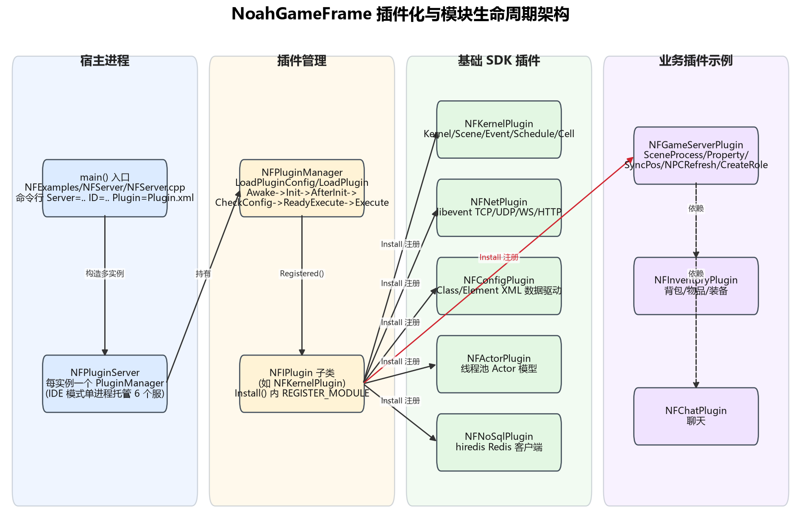

解读：宿主进程 `main` 构造一个或多个 `NFPluginServer`，每个持有独立 `NFPluginManager`；`BasicPluginLoader` 用 `CREATE_PLUGIN` 宏静态 new 出所有 SDK 插件与业务插件，`Install()` 内再用 `REGISTER_MODULE` 把 NFI 接口绑到 NFC 实现。业务插件（Game/Inventory/Chat）之间通过 `FindModule<NFI*>()` 解耦依赖。

图 3：NF 顶层模块关系图（Mermaid）。

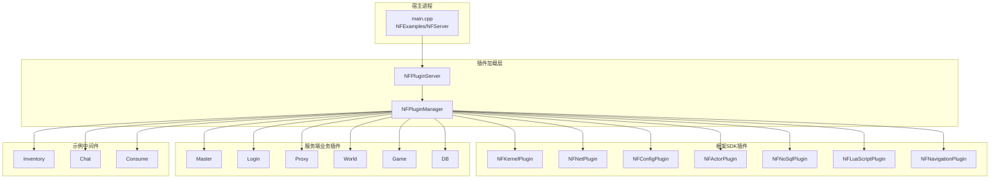

解读：NF 把"框架"和"业务"都编译成插件库，由唯一宿主 `NFServer.exe` 在运行时按 `Plugin.xml` 决定加载哪些插件；这意味着同一个二进制，在不同命令行参数下就是不同的服务器进程。

---

## 5. 工程获取、创建与打开方式

```bash
git clone https://github.com/ketoo/NoahGameFrame.git
cd NoahGameFrame
git submodule update --init --recursive   # 拉 ajson / concurrentqueue / LuaIntf / json.lua
```

Windows：用 VS2019+ 打开 `NoahFrame.sln`；先在 `Dependencies/` 跑 `build_dep.bat`（国内网络跑 `墙内下载依赖库.bat`）通过 vcpkg 装 libevent/protobuf/hiredis/lua/SDL2；再 `Build -> Build Solution`（README 提示失败时不要 Rebuild All，单独 Rebuild 出错项目即可）。Linux：`./install4cmake.sh` 或 `cd Dependencies && ./build_dep.sh && cd .. && ./buildServer.sh`。

配置目录：运行期所有 XML 在 `_Out/NFDataCfg/`，程序以 `../` 为配置根（`NFPluginServer.cpp:88` `SetConfigPath("../")`），所以可执行文件需从 `_Out/Release/` 启动。

> 本环境未做上述任何一步，**未编译**。

---

## 6. 编译与运行步骤（按官方文档，本环境未执行）

1. 启动依赖：Redis（连接配置由 `NFNoSqlModule.cpp:71-78` 从 Element 配置类 `NoSqlServer` 读 IP/Port/Auth，但本仓库 `_Out/NFDataCfg/Ini/` 下未找到 NoSqlServer.xml；`NFNoSqlModule.cpp:173` 有硬编码兜底 `Connect(ip, 6379, "")`，6379 为 Redis 默认端口；README 第 111 行注明密码 `NoahGameFrame`）、MySQL（角色库，具体库名需跑 SQL，本仓库未找到建库脚本，未验证）。
2. 修改 `_Out/NFDataCfg/Ini/Server.xml` 把 IP 改成自己的（见第 7 节端口表）。
3. 单机 IDE 模式：不带参数运行 `NFServer.exe`，`main.cpp:44-49` 会在同一进程里依次 new 出 6 个 `NFPluginServer`：Master(ID=3)、World(ID=7)、Login(ID=4)、DB(ID=8)、Proxy(ID=5)、Game(ID=16001)，方便调试。
4. 分布式部署：每个进程独立启动，命令行形如 `NFServer.exe Server=GameServer ID=16001 Plugin=Plugin.xml`；Linux 下可加 `-d` 走 daemon（`NFPluginServer.cpp:125`）。
5. 客户端：用 NFUnitySDK 工程连 Proxy 的 15001（TCP）/25001（WebSocket）。

默认账号体系：Login 服支持 `ELM_AUTO_REGISTER_LOGIN`（首次登录自动注册），即账号不存在时直接建号（`NFLoginLogicModule.cpp:63-67`）。

---

## 7. 整体架构

图 4：服务器进程拓扑与端口（PNG）。

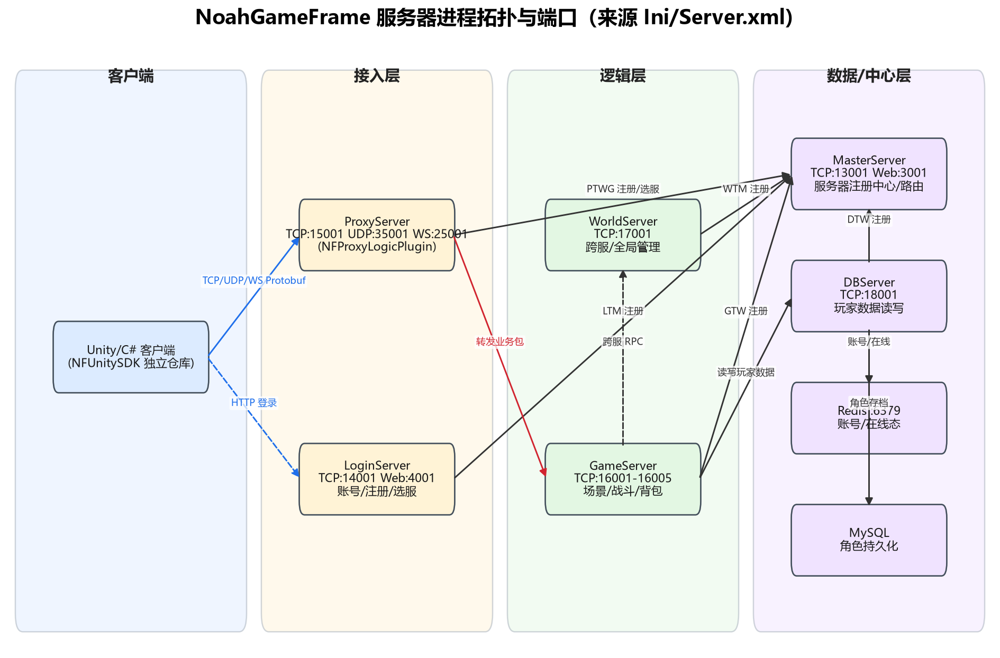

进程职责一览（结合 `_Out/NFDataCfg/Ini/Server.xml` 与 `NFServer/` 各插件）：

| 进程 | 默认端口 | AppID/Type | 职责 |
| --- | --- | --- | --- |
| MasterServer | TCP 13001 / Web 3001 | ID=3 / Type=3 | **注册中心 + 路由**。接收 World/Login/Proxy/Game/DB 的注册心跳，维护在线服务器列表；处理客户端"选服/连接世界"请求 |
| LoginServer | TCP 14001 / Web 4001 | ID=4 / Type=4 | 账号注册/校验（Redis），HTTP 对外，给客户端返回选服列表 |
| ProxyServer | TCP 15001 / UDP 35001 / WS 25001 / Web 5001 | ID=5 / Type=5 | **客户端接入网关**。持有客户端长连，RC4 解密后把业务包转发给 Game |
| GameServer | TCP 16001-16005 | ID=16001 等 / Type=6 | **游戏逻辑**：场景、实体、移动、属性同步、背包、技能 |
| WorldServer | TCP 17001 | ID=7 / Type=7 | 跨服/全局管理（本仓库里较薄，主要做注册转发与 DB 路由） |
| DBServer | TCP 18001 | ID=8 / Type=8 | 玩家数据读写代理，背后接 Redis + MySQL |

进程发现机制：所有进程启动后作为 **TCP 客户端** 主动连 Master，发 `WTM_WORLD_REGISTERED / LTM_LOGIN_REGISTERED / PTWG_PROXY_REGISTERED / GTW_GAME_REGISTERED / DTW_DB_REGISTERED`（消息号见 `NFDefine.proto:48-62`），Master 维护一张表；之后通过 `STS_HEART_BEAT`（100）和 `STS_SERVER_REPORT`（90）保活。客户端流程是"先连 Login 拿服务器列表 → 选服 → Master 给一个 Proxy 地址 → 连 Proxy 完成 ConnectKey 校验 → 进 Game"。

图 5：进程间注册/路由时序（Mermaid）。

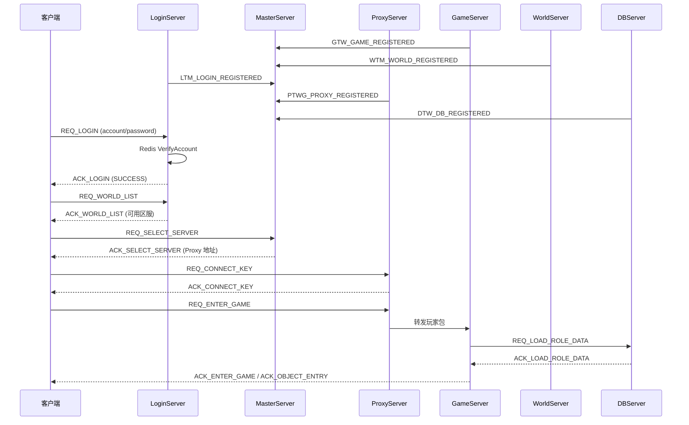

---

## 8. 服务端模块与职责

每个"进程"不是一个独立可执行文件，而是一组插件的组合。`_Out/NFDataCfg/Release/Plugin.xml` 显式列出每个进程激活哪些插件：

- **GameServer**：NFNetPlugin、NFKernelPlugin、NFConfigPlugin、NFGameServerPlugin、NFGameServerNet_ServerPlugin、NFGameServerNet_ClientPlugin、NFLogPlugin、NFLuaScriptPlugin、NFActorPlugin、NFNavigationPlugin、NFInventoryPlugin、NFConsumeManagerPlugin、NFChatPlugin。
- **LoginServer**：Net+Kernel+Config + NFLoginNet_Server/Client + NFLoginLogic + NFLoginNet_HttpServer + NFLog + NFDBLogic + NFNoSql + NFActor。
- **MasterServer**：Net+Kernel+Config + NFMasterServerPlugin + NFMasterNet_Server + NFMasterNet_HttpServer + NFLog + NFActor。
- **ProxyServer**：Net+Kernel+Config + NFProxyLogic + NFProxyServerNet_Client/Server + NFLog + NFSecurity + NFActor。
- **WorldServer**：Net+Kernel+Config + NFWorldNet_Client/Server + NFDBLogic + NFLog + NFSecurity + NFActor + NFNoSql（XML 里还引用了 `NFWorldLogicPlugin`，但源码目录中未见该插件，**疑似遗留配置项**）。
- **DBServer**：Net+Kernel+Config + NFDBNet_Client/Server + NFLog + NFDBLogic + NFActor + NFNoSql + NFSecurity。

模块注册方式：每个插件在 `Install()` 里调用 `REGISTER_MODULE(pManager, NFI*, NFC*)` 宏（`NFIPlugin.h:35-42`），把接口名 `typeid(NFI*).name()` 映射到实现对象；其他模块通过 `pPluginManager->FindModule<NFI*>()` 取依赖。这是一种**服务定位器 + 接口依赖注入**。

图 6：插件与模块生命周期（Mermaid）。

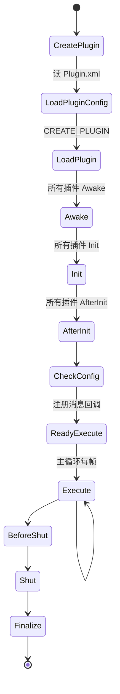

---

## 9. 客户端模块与职责

本仓库**不含 Unity 客户端工程**。证据：

- `README.md:109-111` 明确指向独立仓库 `https://github.com/ketoo/NFUnitySDK`。
- 仓库内 `NFComm/NFMessageDefine/*.cs` 是 protobuf 生成的 C# 消息类（`NFDefine.cs`、`NFMsgBase.cs`、`NFMsgPreGame.cs`、`NFMsgShare.cs`），客户端拿这些 `.cs` 即可和服务端同协议对话。
- `NFComm/NFRenderPlugin` 是一个内嵌的调试渲染器（用 SDL2 + OpenGL），用于在服务端本机可视化场景/寻路，不是游戏客户端。

客户端如何配合：连 Proxy 的 TCP/UDP/WS → 走 `REQ_LOGIN` 到 Login（或直接走 HTTP）→ `REQ_CONNECT_KEY` 拿到安全密钥 → 后续所有业务包都被 Proxy 用 RC4 加密后转给 Game → Game 回包沿 Proxy 回到客户端。

---

## 10. 网络通信

### 10.1 传输层

- 底层是 **libevent**（`NFNet.h:32` `#include <event2/bufferevent.h>`，库本身由 vcpkg 安装、不在仓库源码树），`NFNet` 类封装成 `NFINet` 接口。
- 支持三种客户端协议：TCP 长连（Proxy 15001）、UDP（Proxy 35001）、WebSocket（Proxy 25001），外加独立 HTTP 服务（Login/Master 用）。
- 每个连接是一个 `NetObject`（`NFINet.h:260-435`），持有 fd、ring buffer、account、securityKey、userID、clientID、hashIdentID。

### 10.2 封包格式

6 字节包头（`NFINet.h:77-247`，`#pragma pack(push,1)`）：

```text
[ MsgID : uint16 (大端) ][ MsgSize : uint32 (大端, 含包头自身 6 字节) ]  Body
```

`NFMsgHead::EnCode/DeCode` 用 `NF_HTONS/NF_HTONL` 做大小端转换。Body 是 `NFMsg::MsgBase`（protobuf）序列化后的字节流；`MsgBase` 本身有 `player_id` 和 `msg_data` 两个字段——也就是**包内包**：业务消息被塞进 `msg_data` 字节串里，外层只带玩家 GUID。

### 10.3 消息注册与派发

- 消息号集中在 `NFComm/NFMessageDefine/NFDefine.proto` 的 `enum EGameMsgID`（如 `REQ_LOGIN=101`、`REQ_MOVE=300`、`REQ_SKILL_OBJECTX=400`）。
- 模块在 `ReadyExecute()` 里调 `m_pNetModule->AddReceiveCallBack(msgID, this, &Class::Handler)`（模板方法在 `NFINetModule.h:170-177`）。
- 反序列化用静态模板 `NFINetModule::ReceivePB`（`NFINetModule.h:242-270`）：先 parse 外层 `MsgBase`，再把 `msg_data` parse 成具体业务消息，同时取出 `player_id`。
- 三个便捷宏：`CLIENT_MSG_PROCESS`（要求玩家对象已存在）、`CLIENT_MSG_PROCESS_NO_OBJECT`、`CLIENT_MSG_PROCESS_NO_LOG`（`NFINetModule.h:63-94`）。

真实示例——Game 服收移动包（`NFServer/NFGameServerNet_ServerPlugin/NFGameServerNet_ServerModule.cpp:223-262`）：

```cpp
m_pNetModule->AddReceiveCallBack(NFMsg::REQ_MOVE,
    this, &NFGameServerNet_ServerModule::OnClientReqMoveProcess);

void NFGameServerNet_ServerModule::OnClientReqMoveProcess(
    const NFSOCK sockIndex, const int msgID, const char* msg, const uint32_t len)
{
    CLIENT_MSG_PROCESS_NO_OBJECT(msgID, msg, len, NFMsg::ReqAckPlayerPosSync)
    // ...
    posSyncUnit.mover = xMover;
    posSyncUnit.pos   = NFINetModule::PBToNF(syncUnit->pos());
    m_pSyncPosModule->RequireMove(NFGUID(sceneID, groupID), posSyncUnit);
    m_pKernelModule->SetPropertyVector3(nPlayerID,
        NFrame::IObject::Position(), posSyncUnit.pos);
}
```

### 10.4 粘包/心跳

- 粘包拆包由 libevent 的 `bufferevent` + `NetObject::ringBuff` 自己处理：每收到一段数据追加到 ring buffer，按 6 字节包头解出一条完整消息后回调。
- 服务器间心跳：`STS_HEART_BEAT=100`；客户端延迟测试 `REQ_LAG_TEST=80 / ACK_GATE_LAG_TEST=81 / ACK_GAME_LAG_TEST=82`。

### 10.5 加解密

Proxy 服在转发业务包前用 `NFSecurityModule::DecodeMsg(account, securityKey, msgID, msg, len)` 做 RC4 解密（`NFProxyServerNet_ServerModule.cpp:116`）；`ConnectKey` 握手后 `NetObject::SetConnectKeyState(1)` 才放行（`NFLoginLogicModule.cpp:100`）。

密钥流程：客户端登录 Login 成功后，Login 通知 Master，Master 给客户端下发一个随机 ConnectKey；客户端连 Proxy 时把这个 key 发给 Proxy，Proxy 用账号+key 初始化 RC4 上下文；之后所有业务包都用这个 RC4 流加密。Proxy 解密后才转发给 Game，所以 Game 看到的是明文 protobuf。

---

## 11. 数据存储

### 11.1 配置表体系（数据驱动核心）

配置分两层 XML（目录 `_Out/NFDataCfg/`）：

- **`Struct/*.xml`（结构表）**：定义一个"类"有哪些 Property、哪些 Record（表）。例：`Struct/Player.xml` 声明了 Player 类有 60+ 个 Property（HP/MP/Level/Gold/Job/...）和 5 个 Record（CommValue、HeroList、Inventory、InventoryEquipment、HeroEquipmentList）。每个 Property 有 7 个属性开关：
  - `Cache`：是否进缓存；
  - `Force`：是否强制同步；
  - `Private`：是否私有（只有自己可见）；
  - `Public`：是否公开（AOI 广播给同场景其他人）；
  - `Ref`：是否引用计数；
  - `Save`：是否落盘到 DB；
  - `Upload`：是否允许客户端上传修改。
- **`Ini/*.xml`（数据表）**：每一行是一个具体实例。例：`Ini/Server.xml` 列了 10 个服务器进程的 IP/Port/Type；`Ini/NPC.xml` 是怪物配置；`Ini/Item.xml` 是物品配置。
- **`Struct/Comm/CooldownRecord.xml`** 等通过 `<Includes>` 复用。
- 运行时由 `NFClassModule`（读 Struct）+ `NFElementModule`（读 Ini）加载，并通过 `NFTools/NFFileProcess` 从 Excel 转 XML。

生成的 C++ 常量在 `NFComm/NFMessageDefine/NFProtocolDefine.hpp`，业务代码里写 `NFrame::Player::HP()` 而不是裸字符串 `"HP"`，避免拼写错误。

### 11.2 玩家数据落盘

- **Redis**：`NFNoSqlPlugin` 封装 hiredis；`NFAccountRedisModule` 管账号密码，`NFPlayerRedisModule` 管玩家在线态/缓存。账号系统直接用 Redis，不经过 MySQL。
- **MySQL**：DBServer 作为独立进程，Game/World 通过 TCP 发 `REQ_LOAD_ROLE_DATA=140 / REQ_SAVE_ROLE_DATA=142` 请求它读写。本仓库快照里 DBLogicPlugin 主要暴露 Redis 模块接口，MySQL 驱动具体实现未在本次走读中展开（**未验证具体表结构**）。
- 属性的 `Save=1` 标记决定哪些字段需要序列化进 DB（见 `Struct/Player.xml` 中 Account/Gold/Level/Job/Diamond 等都标 `Save="1"`，而 HP/MAXHP/MOVE_SPEED 等战斗属性 `Save="0"`）。

### 11.3 数据流向小结

- 玩家登录：Client → Login → Redis（校验账号）→ 返回 ConnectKey。
- 选角/进游戏：Client → Proxy → Game → DBServer → Redis 读玩家缓存 / MySQL 读角色存档 → Game 创建对象。
- 游戏中：属性变更只改 Game 内存，`Save=1` 字段在断线/定时由 Game → DBServer → MySQL 落盘。
- 下线：Game 发 `REQ_SAVE_ROLE_DATA`，DBServer 写 Redis（热数据）+ MySQL（持久数据）。
- 这种"DBServer 独立进程"的设计让 Game 进程不直接持有 MySQL 连接，方便后面把 DB 拆成集群、换存储介质，Game 侧零改动。

---

## 12. 启动流程

图 7：服务端启动流程（Mermaid）。

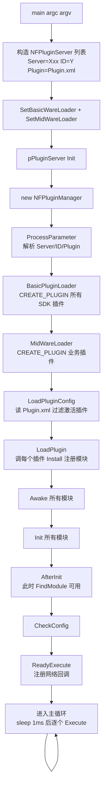

真实代码（`NFExamples/NFServer/NFServer.cpp:28-83`）：

```cpp
int main(int argc, char* argv[])
{
    std::vector<NF_SHARE_PTR<NFPluginServer>> serverList;
    if (argc == 1) {  // IDE 模式：一个进程内拉起全部 6 个服
        serverList.push_back(NF_NEW NFPluginServer(strArgvList + " Server=MasterServer ID=3 Plugin=Plugin.xml"));
        serverList.push_back(NF_NEW NFPluginServer(strArgvList + " Server=WorldServer ID=7 Plugin=Plugin.xml"));
        serverList.push_back(NF_NEW NFPluginServer(strArgvList + " Server=LoginServer ID=4 Plugin=Plugin.xml"));
        serverList.push_back(NF_NEW NFPluginServer(strArgvList + " Server=DBServer ID=8 Plugin=Plugin.xml"));
        serverList.push_back(NF_NEW NFPluginServer(strArgvList + " Server=ProxyServer ID=5 Plugin=Plugin.xml"));
        serverList.push_back(NF_NEW NFPluginServer(strArgvList + " Server=GameServer ID=16001 Plugin=Plugin.xml"));
    } else {
        serverList.push_back(NF_NEW NFPluginServer(strArgvList));
    }
    for (auto item : serverList) {
        item->SetBasicWareLoader(BasicPluginLoader);
        item->SetMidWareLoader(MidWareLoader);
        item->Init();
    }
    while (true) {
        std::this_thread::sleep_for(std::chrono::milliseconds(1));
        for (auto item : serverList) item->Execute();
    }
}
```

`NFPluginServer::Init()` 的真实顺序（`NFPluginServer.cpp:79-110`）：

```cpp
pPluginManager = NF_SHARE_PTR<NFIPluginManager>(NF_NEW NFPluginManager());
ProcessParameter();
pPluginManager->SetConfigPath("../");
externalBasicWarePluginLoader(pPluginManager.get());  // CREATE_PLUGIN SDK
externalMidWarePluginLoader(pPluginManager.get());     // CREATE_PLUGIN 业务
pPluginManager->LoadPluginConfig();                   // 读 Plugin.xml
pPluginManager->LoadPlugin();                         // 静态插件直接 Install
pPluginManager->Awake();
pPluginManager->Init();
pPluginManager->AfterInit();
pPluginManager->CheckConfig();
pPluginManager->ReadyExecute();
```

每个插件在 `Install()` 里用 `REGISTER_MODULE` 宏把接口绑到实现（例：`NFKernelPlugin.cpp:63-79`）：

```cpp
void NFKernelPlugin::Install() {
    REGISTER_MODULE(pPluginManager, NFISceneModule, NFSceneModule)
    REGISTER_MODULE(pPluginManager, NFIKernelModule, NFKernelModule)
    REGISTER_MODULE(pPluginManager, NFIEventModule, NFEventModule)
    REGISTER_MODULE(pPluginManager, NFIScheduleModule, NFScheduleModule)
    REGISTER_MODULE(pPluginManager, NFIDataTailModule, NFDataTailModule)
    REGISTER_MODULE(pPluginManager, NFICellModule, NFCellModule)
    REGISTER_MODULE(pPluginManager, NFIThreadPoolModule, NFThreadPoolModule)
    REGISTER_MODULE(pPluginManager, NFIELOModule, NFELOModule)
}
```

---

## 13. 登录与账号流程

图 8：登录时序（Mermaid）。

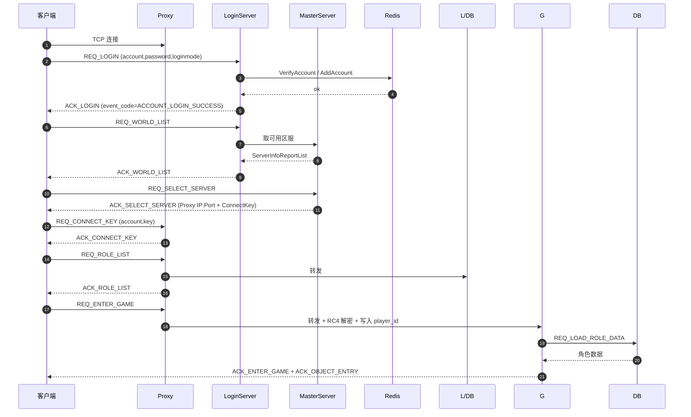

关键源码 `NFServer/NFLoginLogicPlugin/NFLoginLogicModule.cpp:44-108`：Login 服只做账号校验，直接读写 Redis（`m_pAccountRedisModule->VerifyAccount`），成功后 `pNetObject->SetConnectKeyState(1)` 并回 `ACK_LOGIN`。真正的角色数据由后续 Game 服通过 DB 服加载。

真实代码片段：

```cpp
bool NFLoginLogicModule::VerifyAccount(NetObject* pNetObject,
    const string& strAccount, const string& strPassword, const NFMsg::ELoginMode loginMode)
{
    if (m_pAccountRedisModule->ExistAccount(strAccount)) {
        if (!m_pAccountRedisModule->VerifyAccount(strAccount, strPassword)) {
            return false;   // 密码错
        }
    } else {
        // 自动注册模式：账号不存在就直接建号
        if (loginMode == NFMsg::ELoginMode::ELM_AUTO_REGISTER_LOGIN) {
            m_pAccountRedisModule->AddAccount(strAccount, strPassword);
        } else {
            return false;
        }
    }
    pNetObject->SetAccount(strAccount);
    pNetObject->SetConnectKeyState(1);   // 握手成功，放行
    return true;
}
```

注意 Login 服这里**不做密码加密**，直接明文比对——生产部署必须在外面套 HTTPS 或自加一层，否则抓包即拿到密码。

---

## 14. 角色创建与进入场景

创角流程在 `NFServer/NFGameServerPlugin/NFCreateRoleModule.cpp`（12KB），本仓库只做最简实现：根据请求在 DB 里新建角色 GUID、写初始属性（Job/Sex/Head 等），然后回 `ACK_ROLE_LIST`。

进入场景由 `NFISceneProcessModule::RequestEnterScene` 触发，最终走到 `NFKernelModule::CreateObject`（`NFKernelModule.cpp:116-345`）。这是 NF 最能体现"数据驱动"的地方：

1. 检查 scene/group 是否存在；
2. 如 `ident` 为空则 `CreateGUID()`；
3. `new NFObject(ident, pPluginManager)`，挂到全局对象表；
4. （可选后台线程）从 `NFIClassModule` 取出该 `className` 的静态 Property/Record 模板，逐字段 AddProperty/AddRecord，并注册公共回调 `OnPropertyCommonEvent/OnRecordCommonEvent`；
5. 主线程写死几个基类属性：`ConfigID / ClassName / SceneID / GroupID / Position`；
6. 后台线程从 `NFIElementModule` 取配置行（Ini 表）把初始数值盖到对象上；
7. 主线程把外部传入的 `arg`（key/value 对）盖到对象上；
8. **依次触发 11 个 CLASS_OBJECT_EVENT**：`COE_CREATE_NODATA → BEFORE_ATTACHDATA → LOADDATA → AFTER_ATTACHDATA → BEFORE_EFFECT → EFFECTDATA → AFTER_EFFECT → READY → HASDATA → FINISH → CLIENT_FINISH`。业务模块在 `AfterInit` 里 `AddClassCallBack(className, this, &OnClassEvent)`，就能在这 11 个钩子上插业务逻辑。

业务方典型写法（例如 NPC 刷新）：

```cpp
m_pKernelModule->AddClassCallBack(NFrame::NPC::ThisName(), this, &OnNPCClassEvent);
int OnNPCClassEvent(self, className, classEvent, var) {
    if (classEvent == COE_CREATE_FINISH) { /* 给 NPC 加 AI 心跳 */ }
}
```

图 9：CreateObject 状态机（Mermaid stateDiagram-v2）。

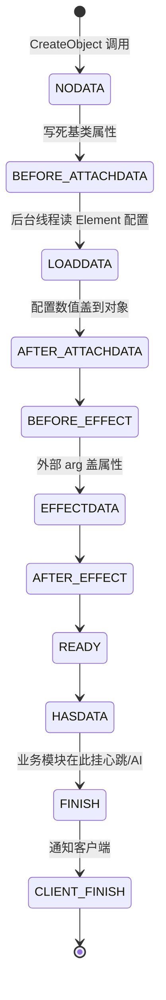

解读：11 段事件流看起来繁琐，但它把"对象创建"拆成了明确的阶段——读配置放后台线程做，写对象状态放主线程，业务方可以精确选择在哪个阶段介入（例如"数据加载完才能加 Buff"放在 AFTER_EFFECT，"对象完全就绪才能加 AI"放在 FINISH）。

---

## 15. 移动同步

**同步模型：状态同步**（非帧同步）。服务器只记录客户端上报的位置，不做速度/距离校验。

- 客户端发 `REQ_MOVE=300`，body 是 `NFMsg::ReqAckPlayerPosSync`，内含一组 `PosSyncUnit{mover, pos, orientation, status, type}`。
- Game 服 `OnClientReqMoveProcess`（见第 10.3 节代码）只做一件事：校验 mover 就是玩家自己（或其宠物 MasterID），然后塞进 `NFSyncPosModule::RequireMove(groupGUID, unit)`。
- `NFSyncPosModule::Execute()` 每 **50ms（20Hz）** 扫所有 scene/group，把该 group 内累积的移动单元打包成一条 `ACK_MOVE=301`，通过 `SendGroupMsgPBToGate` 广播回这个 group 的所有玩家（`NFSyncPosModule.cpp:53-99`）。
- **没有空间 AOI（九宫格/四叉树）**：广播单位是整个 group。一个 scene 可以开多个 group（副本/分线），`RequestGroupScene` 会新建一个独立 group，每个 group 有自己的 PropertyManager/RecordManager 和 `mPlayerPosition` 表（`NFSceneModule.cpp:94-168`）。
- 玩家进/出 group 时触发 `OnAfterEntrySceneEvent / OnBeforeLeaveSceneEvent`，由 `NFSceneAutoBroadcastModule` 把该对象的 Public 属性、Record 行快照推给同 group 其他人（`NFSceneAutoBroadcastModule.h:61-69`）。

图 10：移动同步与 AOI 机制（Mermaid）。

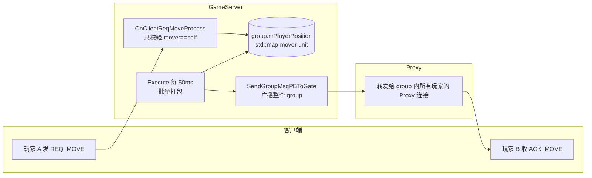

与 LYFMMORGP 对比：NF 的"group=广播域"模型和我们"同图约 100 米广播"的 AOI 思路一致，但 NF 没有空间分块——一个 group 人多了广播量是 O(N)。我们若借鉴，可保留 group 概念但在 group 内再加一层空间网格。

---

## 16. 战斗、技能与属性

- 属性系统见 `NFIObject.h:97-151`：每个对象持有 `NFIPropertyManager`（key→NFData 变体）和 `NFIRecordManager`（key→二维表）。属性类型支持 int/float/string/object(NFGUID)/vector2/vector3（`NFIObject.h:100-143`）。
- 属性变更自动触发回调：`SetProperty*` 时比较 old/new，触发 `OnPropertyCommonEvent`，再分发给：
  1. 对象级回调（`AddPropertyCallBack(name, ...)`）；
  2. 类级回调（`RegisterClassPropertyEvent(className, ...)`）；
  3. 全局公共回调（`RegisterCommonPropertyEvent`）。
- 广播：`NFSceneAutoBroadcastModule::OnPropertyEvent` 监听属性变更，把 `ACK_PROPERTY_INT/FLOAT/STRING/VECTOR3`（210-216）发给同 group 的其他玩家；是否广播由 Struct XML 里的 `Public="1"` 控制。

图 11：属性变更 → 回调 → 广播数据流（Mermaid）。

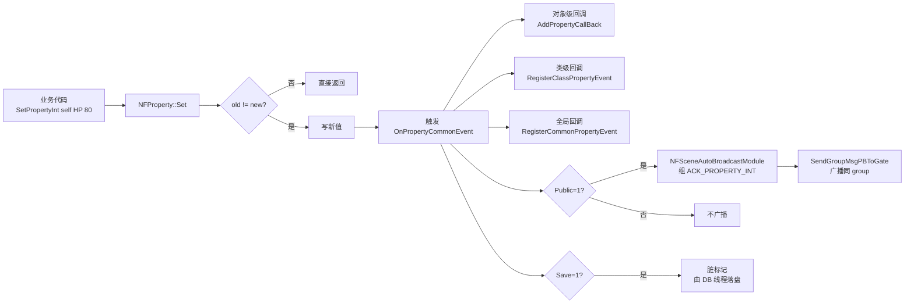

解读：NF 的属性系统是"观察者模式 + 声明式开关"。业务代码只调 `SetPropertyInt`，框架自动决定要不要触发回调、要不要广播、要不要落盘，业务侧不需要手写同步和持久化代码。这是它"数据驱动"最核心的红利。
- 技能：消息号 `REQ_SKILL_OBJECTX=400 / REQ_SKILL_POS=402`，`ESkillType` 枚举定义了单体/群体/弹道/反弹/落点爆炸/功能技 7 种（`NFDefine.proto:172-184`）。但**本仓库快照里没有完整的技能结算模块**：`NFComm/NFPluginModule/` 目录下的 `NFIItemConsumeManagerModule.h`、`NFISkillConsumeManagerModule.h` 只定义了资源消耗接口，示例插件 NFConsumeManagerPlugin 只做了资源扣减；真正的伤害公式/Buff 结算**未在本仓库实现完整**（面试不要夸大为"完整战斗系统"）。
- NPC 属性在 `NFrame::NPC` 类里定义了 HP/MAXHP/ATK_VALUE/DEF_VALUE/CRITICAL/EVASION/各元素攻防等（`NFProtocolDefine.hpp:271-401`），并自带 `Cooldown` Record。

---

## 17. AI 与怪物

- 刷怪：`NFServer/NFGameServerPlugin/NFNPCRefreshModule.cpp`（7.8KB）根据 `Ini/Scene/*.xml` 里的 SeedID/Refresh/Weight 在 scene/group 启动时创建 NPC 对象。
- 寻路：`NFNavigationPlugin` 封装 recast/detour，导航网格文件在 `_Out/NFDataCfg/Ini/Navigation/{2,3,4,5}.xml`，`NFIObject::MoveTo` / `GMMoveTo` 是 vector3 属性，由客户端路径请求驱动。服务端只在收到 `REQ_MOVE` 时记录新坐标，不做寻路重算——真正的 A* 寻路在客户端跑，服务端不校验路径合法性（这也是外挂风险点之一）。
- AI：本仓库**没有行为树或 FSM 框架**，NPC 靠"类回调 + 心跳 Schedule"写。`NFIScheduleModule`（见 `NFIScheduleModule.h`）提供 `AddSchedule(self, name, handler, interval, count)`——注册一个周期性心跳，回调签名 `(self, name, interval, count)`。怪物 AI 示例通常在 `COE_CREATE_FINISH` 时 `AddSchedule` 一个 1 秒的 tick，在 tick 里做巡逻/索敌。

心跳的真实接口（`NFIScheduleModule.h`）：

```cpp
// 回调签名：玩家GUID, 心跳名, 距上次触发间隔(秒), 剩余触发次数(-1 表示无限)
typedef std::function<int(const NFGUID&, const std::string&, const float, const int)> OBJECT_SCHEDULE_FUNCTOR;

// 注册：每 fIntervalTime 秒触发一次，共 count 次
virtual bool AddSchedule(const NFGUID self, const std::string& scheduleName,
    handler, const float fIntervalTime, const int count) = 0;
virtual bool RemoveSchedule(const NFGUID self, const std::string& scheduleName) = 0;
```

注意它是**对象级心跳**——挂在某个 NFGUID 上，对象销毁时自动清理。这和我们本项目里"全局 Tick 扫所有怪物"的写法相比，少了自己维护列表的成本，但调度精度依赖主循环 Execute 的频率。

---

## 18. 背包、物品、装备

`NFExamples/NFInventoryPlugin/NFInventoryModule.h` 给出接口：

```cpp
virtual NFGUID CreateEquip(const NFGUID& self, const std::string& configName, const int count = 1);
virtual bool CreateItem(const NFGUID& self, const std::string& configName, const int count);
virtual int  ItemCount(const NFGUID& self, const std::string& strItemConfigID);
virtual bool DeleteEquip(const NFGUID& self, const std::string& id);
virtual bool DeleteItem(const NFGUID& self, const std::string& strItemConfigID, const int count);
virtual bool EnoughItem(const NFGUID& self, const std::string& configName, const int count);
```

背包用 Player 类的两个 Record 实现（`Struct/Player.xml:108-137`）：

- `Inventory`：两行列 `(ConfigID string, ItemCount int)`，容量 512 行，`Save=1`；
- `InventoryEquipment`：14 列（GUID/ConfigID/RandPropertyID/RandPropertyValue/IntensifyLevel/Date/Equipped/Stone1-4/Lock/Future/UserData），容量 256 行，`Save=1`。

物品配置在 `Ini/Item.xml`，字段含 BuyPrice/SalePrice/Quality/ItemType/ItemSubType/UseScript 等。这是一个**典型的"Record = 一张数据库表"设计**：一行就是一个物品槽。

---

## 19. 任务、NPC、对话

本仓库**没有任务系统**。`NFExamples/` 下只有 Inventory/Chat/Consume 三个示例中间件，没有 QuestPlugin。`NFComm/NFPluginModule/` 目录下 66 个 `NFI*.h` 接口头文件中也没有任务相关接口。Tutorial 1-7 演示的是框架能力（Hello World、数据驱动、心跳事件、Actor 异步、自定义插件），不是业务系统。

---

## 20. 交易、经济、商城、社交

- 聊天：`NFExamples/NFChatPlugin`，消息号 `REQ_CHAT=350 / ACK_CHAT=351`。
- 消耗/充值：`NFConsumeManagerPlugin`，只做资源扣减接口，未接真实支付。
- 邮件/好友/公会/交易行：**未实现**（Player 类有 `ClanID/TeamID` 属性，但没有对应逻辑插件）。
- 好友：Player 类有 `FriendList` Record（8 列：GUID/Career/Level/Vocation/Online/OffTime/CustomOnlineTime/CustomOffTime，容量 256，Save=1），但**没有好友关系链逻辑插件**，只有数据结构。
- 团队：Player 类有 `TeamID` 属性（int64，Save=1），但没有组队插件。
- 公会：Player 类有 `ClanID` 属性，但没有公会插件。
- 邮件：无任何相关接口或配置。

---

## 21. 其他特色系统

1. **Actor 模型**（`NFComm/NFActorPlugin/`）：基于 `NFIThreadPoolModule` 的安全线程池 + 无锁队列，`RequireActor()` 取一个 actor，`SendMsgToActor(actor, who, eventID, data)` 派发异步任务。`NFKernelModule::CreateObject` 里能看到"后台线程加载配置 → 主线程写对象"的两段式写法（`NFKernelModule.cpp:157-250`），就是靠这个。
2. **Lua 热更**：`NFLuaScriptPlugin` 支持把业务模块写成 Lua（`awake/init/after_init/ready_execute/before_shut/shut`），按进程分目录放在 `_Out/NFDataCfg/ScriptModule/<进程>/` 下，通过 `<进程>_script_list.lua`（如 `game/game_script_list.lua`、`login/login_script_list.lua`）注册、`<进程>_script_reload.lua`（如 `game/game_script_reload.lua`）热重载（README 233-290 行有完整示例）。
3. **蓝图编辑器**：`NFBluePrintPlugin`（仅 Win/Mac Debug 编译），可视化拖节点定义行为，README 标注为"future"。
4. **RC4 安全层**：`NFSecurityPlugin` + ConnectKey 握手，Proxy 解密后才转给 Game。
5. **单进程多服调试**：`main.cpp` 不带参数时一个 `NFServer.exe` 内同时跑 6 个服，本地调试极其方便。
6. **ELO 评分**：`NFELOModule`（NFKernelPlugin 内）提供天梯/匹配评分算法，接口在 `NFIPluginModule/NFIELOModule.h`，给竞技玩法预留。
7. **数据尾部追加**：`NFIDataTailModule` 监听对象创建/销毁，做全服对象事件追踪，适合做 GM 命令和全局统计。

---

## 22. 关键核心类与典型代码走读

### 22.1 NFPluginServer / NFPluginManager（宿主与生命周期）

图 12：核心类关系（Mermaid classDiagram）。

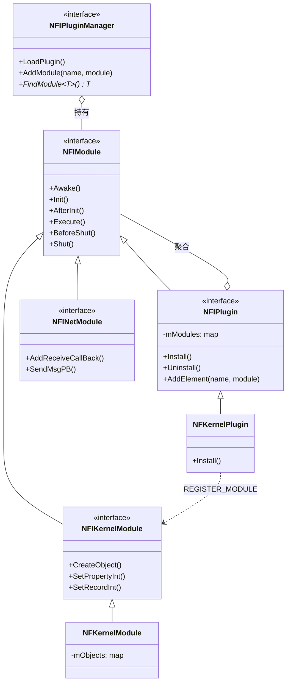

解读：NF 的类层次很简洁——所有东西都是 `NFIModule`；`NFIPlugin` 是可以装一组子 Module 的 Module；`PluginManager` 是全局服务定位器；业务模块依赖的是 NFI 纯虚接口，不依赖具体实现。

文件：`NFComm/NFPluginLoader/NFPluginServer.cpp`、`NFPluginManager.h`。

- 一个 `NFPluginServer` = 一个独立的服务器实例（有自己的 PluginManager、自己的配置名、自己的 AppID）。
- 生命周期调用链：`LoadPluginConfig → LoadPlugin → Awake → Init → AfterInit → CheckConfig → ReadyExecute → (主循环 Execute) → BeforeShut → Shut → Finalize`。
- 插件表：`mPluginInstanceMap<string, NFIPlugin*>`，模块表：`mModuleInstanceMap<string, NFIModule*>`，key 都是 `typeid(NFI*).name()`。

### 22.2 NFIPlugin / REGISTER_MODULE 宏

文件：`NFComm/NFPluginModule/NFIPlugin.h:35-52`。

```cpp
#define REGISTER_MODULE(pManager, classBaseName, className)  \
    assert((TIsDerived<classBaseName, NFIModule>::Result));	\
    assert((TIsDerived<className, classBaseName>::Result));	\
    NFIModule* pRegisterModule##className = new className(pManager); \
    pRegisterModule##className->name = (#classBaseName); \
    pManager->AddModule(typeid(classBaseName).name(), pRegisterModule##className); \
    this->AddElement(typeid(classBaseName).name(), pRegisterModule##className);

#define CREATE_PLUGIN(pManager, className) \
    NFIPlugin* p = new className(pManager); pManager->Registered(p);
```

插件本身也是 `NFIModule`，它在 `Awake/Init/...` 里**遍历自己持有的 mModules 列表，逐个转发生命周期**（`NFIPlugin.h:99-245`）——所以生命周期是"管理器→插件→模块"三层广播。

### 22.3 NFIKernelModule / NFKernelModule（对象与数据驱动）

文件：`NFComm/NFPluginModule/NFIKernelModule.h`、`NFComm/NFKernelPlugin/NFKernelModule.cpp`。

最核心的 API：

```cpp
virtual NF_SHARE_PTR<NFIObject> CreateObject(const NFGUID& self,
    const int sceneID, const int groupID, const std::string& className,
    const std::string& configIndex, const NFDataList& arg) = 0;
virtual bool SetPropertyInt(const NFGUID& self, const std::string& propertyName,
    const NFINT64 nValue, const NFINT64 reason = 0) = 0;
virtual bool SetRecordInt(const NFGUID& self, const std::string& recordName,
    const int row, const int col, const NFINT64 nValue) = 0;
virtual bool AddClassCallBack(const std::string& className, ...) = 0;
```

`CreateObject` 的 11 段事件流见第 14 节。

### 22.4 NFIObject / NFProperty / NFRecord

文件：`NFComm/NFCore/NFIObject.h`、`NFProperty.*`、`NFRecord.*`。

- `NFIObject` 持有 `NF_SHARE_PTR<NFIPropertyManager>` 和 `NF_SHARE_PTR<NFIRecordManager>`。
- Property 是命名单值（int/float/string/object/vector2/vector3），Record 是命名二维表（Row × Col）。
- 每个 Property/Record 有 `Public/Private/Save/Cache/Ref/Upload/Force` 七个开关，直接决定序列化和广播行为。
- 变更回调签名：`int handler(NFGUID self, string propertyName, NFData old, NFData new, NFINT64 reason)`。
- 变体容器是 `NFDataList`（`NFComm/NFCore/NFDataList.hpp`）：一个 list，每个元素是 union {int64, double, string, NFGUID, Vector2, Vector3}，通过 `Int(i) / Float(i) / String(i) / Object(i) / Vector3(i)` 取，Add 时自动推断类型。CreateObject 的 `arg` 参数就是它——业务传 `(name1, val1, name2, val2, ...)` 成对覆盖对象属性。

### 22.5 NFINetModule / NFNet（网络）

文件：`NFComm/NFNetPlugin/NFINet.h`、`NFNet.h`、`NFComm/NFPluginModule/NFINetModule.h`。

- `NFINet` 是 libevent 封装；`NFINetModule` 是挂到每个进程上的业务层网络模块。
- 包格式 6 字节头（MsgID u16 + MsgSize u32，大端）。
- 业务包体外包一层 `MsgBase{player_id, msg_data}`。
- `AddReceiveCallBack(msgID, this, &Handler)` 按消息号派发。

### 22.6 NFSceneModule（场景/分组/AOI）

文件：`NFComm/NFKernelPlugin/NFSceneModule.cpp`。

- `NFISceneModule` 继承自 `NFMapEx<int, NFSceneInfo>`，sceneID → NFSceneInfo；每个 NFSceneInfo 内部再 map groupID → NFSceneGroupInfo。
- 每个 group 有自己的 PropertyManager/RecordManager（场景级属性，例如场景时间）。
- 广播 = group 内全体；没有空间网格。

### 22.7 NFSyncPosModule（移动同步）

文件：`NFServer/NFGameServerPlugin/NFSyncPosModule.cpp`。50ms tick 批量打包 group 内移动单元，广播 `ACK_MOVE`。详见第 15 节代码。

### 22.8 NFPluginServer.cpp（启动主循环）

见第 12 节完整代码。主循环是 `sleep(1ms)` 后顺序调每个 PluginServer 的 `Execute()`——**单线程驱动所有模块**，后台任务靠 Actor 线程池。

### 22.9 NFLoginLogicModule（账号登录）

见第 13 节。直接调 `NFIAccountRedisModule::VerifyAccount`，不经过 DB 服。

### 22.10 NFProxyServerNet_ServerModule::OnOtherMessage（网关转发）

文件：`NFServer/NFProxyServerNet_ServerPlugin/NFProxyServerNet_ServerModule.cpp:107-156`。Proxy 对所有未显式注册的消息走这个兜底回调：RC4 解密 → parse MsgBase → 把 `player_id` 改写成真实 UserID → 通过 `NetClientModule` 投递给 Game 服。这是 NF 网关的核心设计：**Proxy 不懂业务，只做解封装+改写+转发**。

---

## 23. 可借鉴到 LYFMMORGP 的设计

| NF 机制 | 对应本项目现状 | 借鉴建议与接入成本 |
| --- | --- | --- |
| **插件 = 一组模块，Plugin.xml 声明进程激活列表** | 本项目四服是四个独立 .NET 工程，改服角色要改代码 | 借鉴"同二进制多角色"思路：把 Center/Login/Gate/Game 的业务写成类库，用一个宿主进程按 JSON 配置装载，本地调试一键起四服；接入成本中（需要重构 DI） |
| **模块生命周期 Awake/Init/AfterInit/ReadyExecute/Execute/BeforeShut/Shut** | 本项目各 Server 手动 new 管理器，启动顺序靠调用顺序 | 把管理器初始化拆成明确阶段（AfterInit 才能 FindModule），避免在 Init 里访问还没准备好的依赖；接入成本低 |
| **接口/实现分离：NFI* 纯虚 + FindModule\<NFI*\>()** | 本项目管理器之间直接持有具体类引用 | 核心跨管理器依赖改成接口，便于单测和替换；接入成本中 |
| **Property/Record 数据驱动 + Public/Save/Private 开关** | 本项目玩家字段散在 C# 类里，同步和落盘要手写 | 把玩家身上需要同步/存档的字段抽成"属性表"，统一一份 XML/配置定义，广播和落盘由框架按 `Public/Save` 自动做；接入成本高但收益大 |
| **CreateObject 11 段事件流（COE_CREATE_*）** | 本项目创建角色时手写一串 if | 用状态机钩子替代"创建后手工调 N 个模块 Init"；接入成本低 |
| **group = 广播域 + 20Hz 批量 ACK_MOVE** | 本项目移动收一包广播一包，AOI 100 米 | 借鉴 NF 的"批量打包 + sequence 号"：把 50ms 内同 group 的移动合并成一条广播包，降低包量；接入成本低 |
| **NetObject 兜底转发 OnOtherMessage** | 本 GateServer 已做转发，可对照 | NF 的"Proxy 不解业务包，只解外层信封"和我们 Gate 思路一致；可借鉴它在转发时**改写 player_id 为真实账号**这一安全做法 |
| **RC4 ConnectKey 握手** | 本项目目前无连接加密 | 高优先级：进游戏前做一次密钥协商，后续业务包 RC4/XOR；接入成本低 |
| **Actor 线程池做"配置加载/DB 序列化"等后台任务** | 本项目 DB 访问在主线程外另起 | NF 的"主线程写对象，后台线程读配置/序列化，主线程收尾"两段式可参考；接入成本中 |
| **Redis 直接做账号库，MySQL 只做角色存档** | 本项目 SqlSugar 直连 MySQL | 借鉴 NF：账号、在线态、临时数据放 Redis，角色持久化放 MySQL，DBServer 独立进程隔离；接入成本中 |

---

## 24. 局限、坑与二次开发注意

| 坑 | 说明 |
| --- | --- |
| **依赖重、编译门槛高** | 必须先跑 `build_dep.bat` + vcpkg 装 libevent/protobuf/hiredis/lua/SDL2；Windows 上 README 自己都写了"build failed 不要 Rebuild All，单独 Rebuild" |
| **submodule 易漏** | `.gitmodules` 里 ajson/concurrentqueue/LuaIntf/json.lua 必须 `--init --recursive` 拉全，否则编译报找不到头文件 |
| **作者维护中断** | ketoo 2021 年去世，master 仅社区零星 PR；技术栈停留在 C++17/libevent/protobuf3，无 modern C++20 协程、无 io_uring、无 ECS |
| **没有真正的空间 AOI** | 广播单位是整个 group，同屏人多了 O(N) 广播；要做大世界必须自己加网格/四叉树 |
| **移动无服务端校验** | 客户端发什么位置服务器就存什么（`OnClientReqMoveProcess` 只校验 mover 是自己），外挂可瞬移 |
| **战斗/技能/任务系统不完整** | 仓库只给了骨架接口，伤害结算/Buff/任务/邮件/公会都没实现，二次开发要自己补 |
| **MySQL 表结构未随仓库分发** | 本快照里没找到建库 SQL，新人跑起来连不上 DB 会卡住 |
| **单线程主循环** | 主循环 `sleep(1ms)` 顺序跑所有模块 Execute，重业务会卡帧；靠 Actor 线程池异步化，门槛高 |
| **NFWorldLogicPlugin 引用但缺失** | `Plugin.xml` 里 WorldServer 引用了 `NFWorldLogicPlugin`，但 `NFServer/` 目录下没有该插件，配置和代码不一致 |
| **`NFKernelModule copy.cpp1`** | `NFComm/NFKernelPlugin/` 下有个明显是误提交的副本文件 `NFKernelModule copy.cpp1` |

---

## 25. 面试讲述话术

### 30 秒一句话

NoahGameFrame 是国内 ketoo 开源的 C++17 分布式游戏服务器框架，最大特点是"单二进制 + 插件化进程"和"类/属性/记录数据驱动对象模型"，一个 `NFServer.exe` 通过 Plugin.xml 在运行时决定自己是 Master/Login/Proxy/Game/World/DB 中的哪一种，对象身上的每个字段都是带 Public/Save 开关的属性，框架自动做同步和落盘。

### 2 分钟展开

我先讲架构。NF 没有为每个服务器写一个 main，而是只有一个宿主 `NFServer.cpp`，命令行传 `Server=GameServer ID=16001 Plugin=Plugin.xml`；进程内 new 一个 `NFPluginServer`，它持有一个 `NFPluginManager`。所有功能模块（网络、对象、场景、事件、Redis、导航、业务）都编译成插件库，`Install()` 时用 `REGISTER_MODULE` 宏把 NFI 接口绑到 NFC 实现，运行时通过 `FindModule<NFI*>()` 拿依赖。生命周期是 Awake→Init→AfterInit→CheckConfig→ReadyExecute→Execute→BeforeShut→Shut，三层广播（管理器→插件→模块）。

然后讲数据驱动。每个服务器进程启动时读两份 XML：`Struct/*.xml` 定义类（有哪些 Property、哪些 Record 表，每个字段标 Public/Private/Save/Cache/Upload），`Ini/*.xml` 是具体数据行。CreateObject 时框架从 Class 模板复制属性表，再从 Element 配置盖初值，最后依次触发 COE_CREATE_NODATA 到 COE_CREATE_FINISH 共 11 个事件，业务模块在这些钩子上插逻辑。属性一变自动触发回调，Public 的字段自动广播给同 group 玩家，Save 的字段自动进 DB。

网络层是 libevent，6 字节包头（MsgID u16 + Size u32 大端），业务 protobuf 消息再包一层 MsgBase{player_id, msg_data}。客户端连 Proxy（15001 TCP / 25001 WS），Proxy 做 RC4 解密后转发给 Game；Game 收到移动包只校验 mover 是自己，50ms 批量打包 ACK_MOVE 广播整个 group。

### 高频追问

1. **插件怎么动态加载？** 默认静态链接（`NF_DYNAMIC_PLUGIN` 未定义），靠 `CREATE_PLUGIN` 宏直接 new；也定义了 `DllStartPlugin/DllStopPlugin` 导出函数支持动态 dll（见 `NFKernelPlugin.cpp:38-47`）。
2. **模块之间怎么解依赖？** 服务定位器：`FindModule<NFI*>()`，key 是 `typeid(NFI*).name()`。Init 阶段不要 FindModule，AfterInit 之后所有模块才就绪。
3. **为什么要把 Game/World/DB 拆成独立插件？** 因为可以用 Plugin.xml 自由组合：开发期一个进程跑全部 6 服，上线时按机器负载把 Game 单独拆出去。
4. **AOI 怎么做？** 严格说没有空间 AOI，只有 group（副本/分线）维度；广播 = group 内全体。要做 100 米视野得自己加网格。
5. **移动同步是状态同步还是帧同步？** 状态同步，客户端上报位置，服务器不校验速度，20Hz 批量广播。
6. **怎么落盘？** 属性 XML 里 `Save=1` 的字段由 DBServer 通过 Redis + MySQL 持久化；Game 不直接碰 MySQL，发 `REQ_SAVE_ROLE_DATA` 给 DB 服。
7. **Actor 模型解决什么？** 后台线程池做配置加载、DB 序列化等慢任务，避免卡主循环；主线程只做对象可见状态修改。
8. **和 Bigworld/Orleans 的区别？** Bigworld 是完整引擎（含客户端），NF 只是服务端框架；Orleans 是虚拟 Actor 粒度，NF 的 Actor 是线程池任务粒度，对象本身还是单线程在主循环上跑。
9. **单进程跑 6 个服怎么隔离？** 每个 NFPluginServer 有独立 PluginManager、独立模块表、独立配置路径，互不干扰；但共享同一个进程和主线程。
10. **为什么作者去世后还能用？** Apache 2.0，代码风格统一、注释完整、Tutorial 1-7 循序渐进，作为学习样本价值很高；但生产环境要自己维护依赖升级和安全补丁。

---

## 26. 附录

### 26.1 关键文件清单（≥20 条）

1. `NFExamples/NFServer/NFServer.cpp` — 唯一进程入口，main 函数与 6 服清单。
2. `NFExamples/NFServer/NFServer.h` — `BasicPluginLoader/MidWareLoader` 插件清单。
3. `NFComm/NFPluginLoader/NFPluginServer.cpp` — 进程参数解析与生命周期编排。
4. `NFComm/NFPluginLoader/NFPluginManager.h` — 插件/模块表与生命周期虚函数。
5. `NFComm/NFPluginModule/NFIModule.h` — 模块基类与 11 个生命周期虚函数。
6. `NFComm/NFPluginModule/NFIPlugin.h` — 插件基类与 `REGISTER_MODULE/CREATE_PLUGIN` 宏。
7. `NFComm/NFKernelPlugin/NFKernelPlugin.cpp` — Kernel 插件 Install 注册 8 个模块。
8. `NFComm/NFKernelPlugin/NFKernelModule.cpp` — CreateObject 与 11 段事件流。
9. `NFComm/NFKernelPlugin/NFSceneModule.cpp` — scene/group 模型与广播域。
10. `NFComm/NFCore/NFIObject.h` — 对象接口：属性/记录读写与回调。
11. `NFComm/NFCore/NFProperty.* / NFRecord.*` — 属性与记录实现。
12. `NFComm/NFPluginModule/NFIKernelModule.h` — Kernel 模块对外 API。
13. `NFComm/NFPluginModule/NFIScheduleModule.h` — 心跳/定时器 AddSchedule。
14. `NFComm/NFPluginModule/NFIEventModule.h` — 事件系统。
15. `NFComm/NFNetPlugin/NFINet.h` — 6 字节包头与 NetObject。
16. `NFComm/NFNetPlugin/NFNet.h` — libevent 封装。
17. `NFComm/NFPluginModule/NFINetModule.h` — 消息注册与 `ReceivePB`/`CLIENT_MSG_PROCESS` 宏。
18. `NFComm/NFMessageDefine/NFDefine.proto` — 所有消息号枚举 EGameMsgID。
19. `NFComm/NFMessageDefine/NFProtocolDefine.hpp` — 由 Excel 生成的类/属性/Record 名常量。
20. `NFServer/NFGameServerNet_ServerPlugin/NFGameServerNet_ServerModule.cpp` — Game 服收客户端业务包与移动处理。
21. `NFServer/NFGameServerPlugin/NFSyncPosModule.cpp` — 50ms 批量移动广播。
22. `NFServer/NFLoginLogicPlugin/NFLoginLogicModule.cpp` — 账号注册/登录。
23. `NFServer/NFProxyServerNet_ServerPlugin/NFProxyServerNet_ServerModule.cpp` — 网关兜底转发 OnOtherMessage。
24. `NFServer/NFMasterNet_ServerPlugin/NFMasterNet_ServerModule.cpp` — Master 注册中心。
25. `NFComm/NFConfigPlugin/NFClassModule.cpp / NFElementModule.cpp` — Struct/Ini XML 加载。
26. `_Out/NFDataCfg/Release/Plugin.xml` — 每个进程激活的插件清单。
27. `_Out/NFDataCfg/Ini/Server.xml` — 各进程 IP/端口。
28. `_Out/NFDataCfg/Struct/Player.xml` — Player 类属性/记录结构。
29. `NFComm/NFActorPlugin/NFActorModule.h` — Actor 线程池接口。
30. `NFExamples/NFInventoryPlugin/NFInventoryModule.h` — 背包/物品示例接口。

### 26.2 官方链接

- Wiki：https://github.com/ketoo/NoahGameFrame/wiki
- 客户端 SDK：https://github.com/ketoo/NFUnitySDK
- License：Apache 2.0（仓库根 `LICENSE`）

### 26.3 术语表

- **Plugin（插件）**：一组模块的集合，编译为静态库或动态库，通过 Install/Uninstall 注册模块。
- **Module（模块）**：一个具体功能单元，继承 `NFIModule`，通过 NFI 接口对外暴露。
- **Class（类）**：对象模板，由 Struct XML 定义，规定属性表与记录表。
- **Element（元素）**：一条具体配置数据行，由 Ini XML 定义。
- **Property（属性）**：对象上的命名单值，带 Public/Save 等开关。
- **Record（记录/表）**：对象上的二维表（Row × Col），典型如背包、装备列表。
- **Scene / Group**：场景与场景内分组（分线/副本），Group 是广播单位。
- **NFMsg::MsgBase**：所有网络消息的外层信封，带 player_id 与 msg_data。
- **ConnectKey**：Proxy 与客户端握手后的安全密钥，后续消息用 RC4 加密。
- **COE_CREATE_***：对象创建事件枚举，共 11 段，从 NODATA 到 CLIENT_FINISH。
- **NFGUID**：对象唯一 ID，64 位高 32 位存 server id、低 32 位存进程内自增 id，全局唯一。
- **NFDataList**：变体参数列表，CreateObject 的 arg 和事件回调的 var 都用它传。

---

> **自检与未验证项**
>
> - 未实际编译运行：Dependencies 子模块未拉全、vcpkg 依赖未安装，本文所有"运行行为"均来自源码与 README 静态推断。
> - DBServer 与 MySQL 的具体表结构/SQL 脚本未在本仓库快照中找到，未验证。
> - `NFWorldLogicPlugin` 在 Plugin.xml 被引用但源码目录不存在，按"配置遗留项"标注。
> - 完整技能结算、任务、邮件、公会系统在本仓库中未实现，本文如实说明。
> - Redis 密码 `NoahGameFrame` 来自 README 第 111 行（`<Password for REDIS:NoahGameFrame>`），Redis 连接配置 `NoSqlServer.xml` 未在本仓库 Ini 目录中找到，6379 为 Redis 默认端口（`NFNoSqlModule.cpp:173` 硬编码兜底），未在运行期验证。
> - UDP 通道（Proxy 35001）在源码中有 NFINet::StartUDP 接口，但示例业务消息几乎都走 TCP，UDP 仅用于延迟测试和演示。
- `NFComm/NFKernelPlugin/NFKernelModule copy.cpp1` 是一个明显的误提交副本文件，不参与编译。
