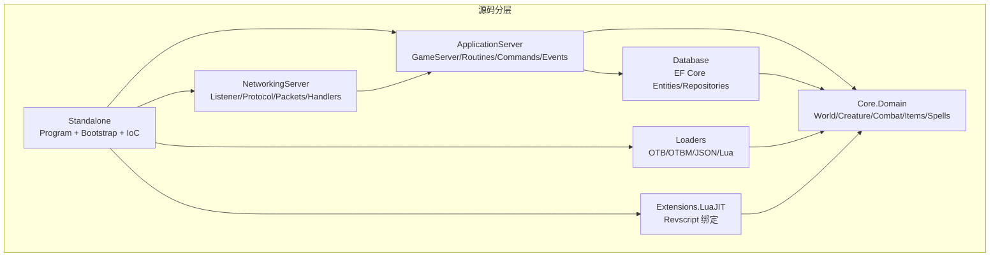
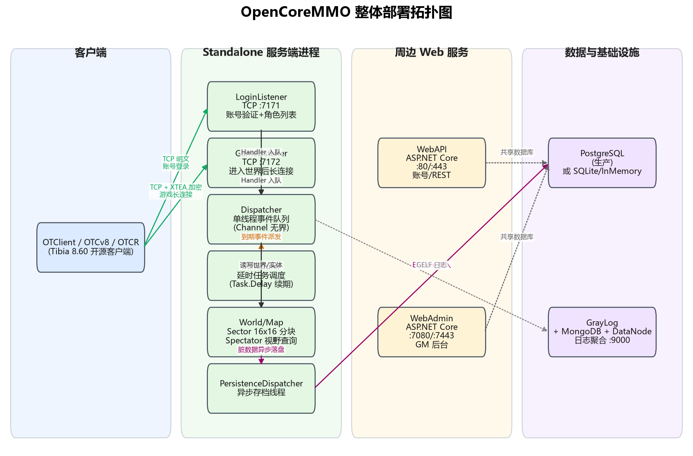
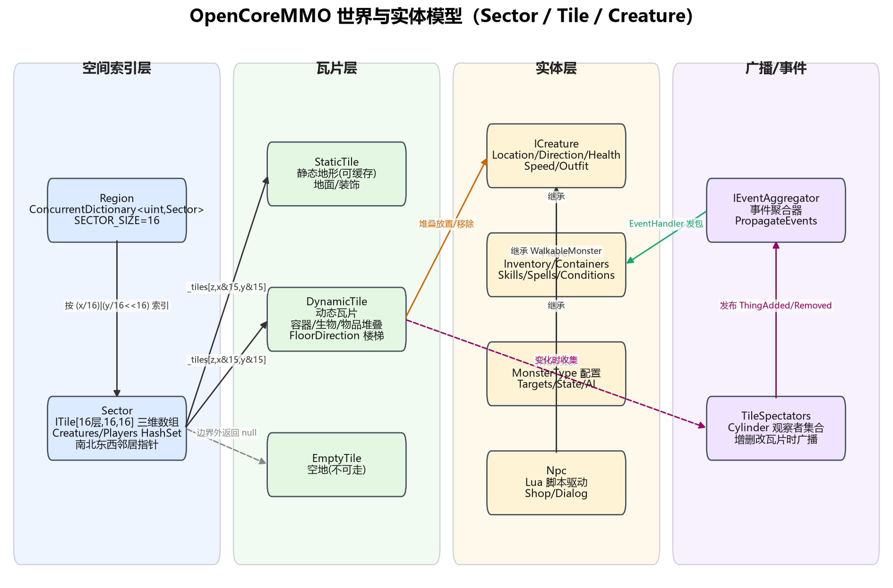
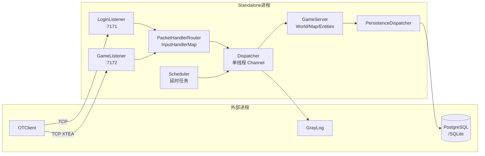
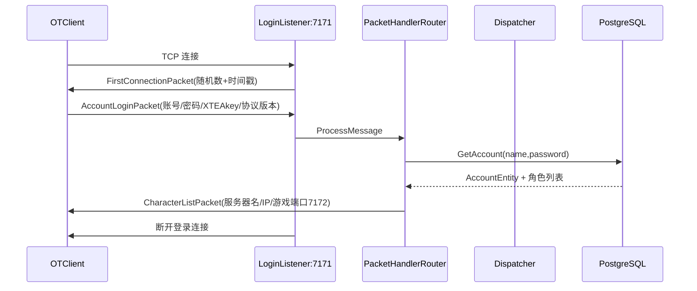
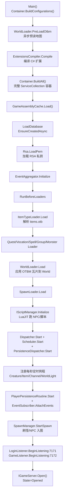
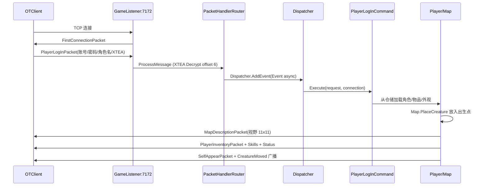
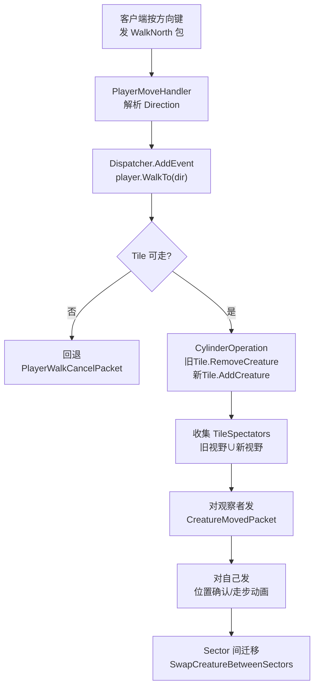
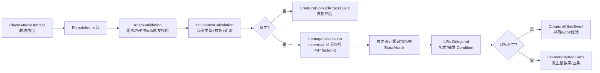
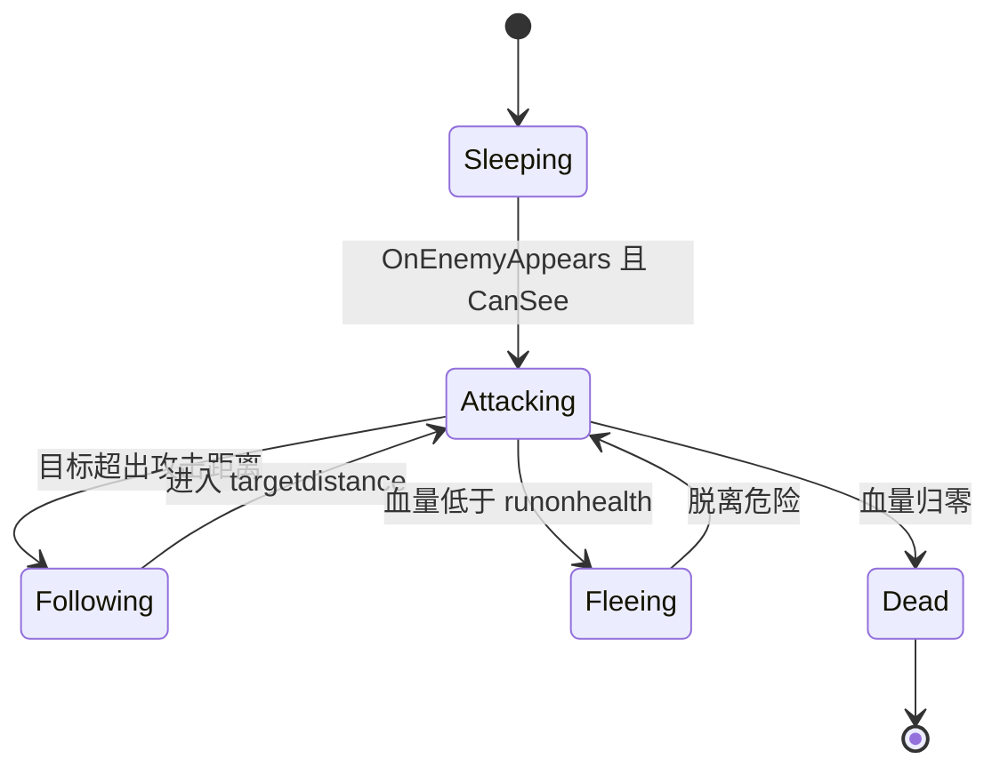

# OpenCoreMMO 源码解析

> **文档信息**
>
> - 项目名：OpenCoreMMO（解决方案内部代号 NeoServer）
> - 仓库来源：https://github.com/OpenCoreMMO/OpenCoreMMO （develop 分支）
> - 解析日期：2026-10-15
> - 解析方式：**仅静态源码走读，未实际编译/运行**（未拉起 Docker、未连数据库、未启动 OTClient）
> - 许可证：GPLv3（见根目录 LICENSE）
> - 一句话定位：用现代 .NET（C# / net10.0）从零重写的 Tibia 8.60 复古 2D 瓦片 MMORPG 服务端，配合开源 OTClient 客户端，主打清晰的 DI/Packet/事件分层与 Revscript(LuaJIT) 脚本化。

---

## 1. 项目概览

OpenCoreMMO 是巴西开发者 Caio Vidal（GitHub: @caioavidal）发起的开源 MMORPG 服务端模拟器，2020 年 1 月从零开始编写，目标是做一个"干净引擎"形态的 Tibia 服务端——datapack 尽量精简，方便二次开发与测试。它**不是现代 Unity 双端游戏**，而是 Tibia 8.60 协议的服务端模拟器，客户端必须使用社区已有的 OTClient / OTCv8 / OTCR 等开源 Tibia 客户端连接（README.md 明确指出这一点）。

- **定位**：Tibia 8.60 协议服务端模拟器 + 独立 WebAPI/WebAdmin。
- **技术代差**：相比老牌 C++ 的 TheOTX / Canaria / TFS（Tibia FreeServer），OpenCoreMMO 用 C# + .NET 10 + Microsoft DI(ServiceCollection) + EF Core 重写，工程化现代，但功能完成度仍在追赶 TFS。
- **活跃度**：README 列出大量功能进度（Combat PvM 完成、PvP 警告级、Lua Revscript 大量 `:arrows_counterclockwise:` 进行中），有 Discord 社区、Codecov/CodeFactor 徽章、GitHub Actions CI。
- **目标人群**：想学习现代 .NET 游戏服务端架构、Tibia 协议细节、或想基于 Tibia 玩法做二开的开发者。
- **与同类对比**：
  - vs TFS（C++）：语言更现代、DI/分层更清晰，但 Lua 脚本 API（Revscript）还在补全。
  - vs ServUO（C# / Ultima Online）：同样 C#，但 OpenCoreMMO 是 Tibia 走格子协议，ServUO 是 UO 自由移动。
  - vs 本项目 LYFMMORGP（Unity 3D + 四服分布式）：OpenCoreMMO 是单进程 2D 瓦片，无 Gate/Center 拆分，无 protobuf，走自研二进制 Tibia 协议。

## 2. 技术栈与运行环境

| 项 | 实际版本/选择 | 证据文件 |
|---|---|---|
| 语言 | C#（LangVersion=Latest） | `src/Directory.Build.props` |
| 目标框架 | **net10.0**（README 写 .NET 9，csproj 已升到 net10.0） | `src/Directory.Build.props` 第 7 行 |
| DI 容器 | **Microsoft.Extensions.DependencyInjection**（ServiceCollection + 扩展方法模块化注册；`Directory.Build.props` 虽声明了 Autofac 6.3.0 包，但 `src/Standalone/IoC/IoC.cs` 实际用 `new ServiceCollection()` + `BuildServiceProvider()`，未启用 Autofac 容器） | `src/Standalone/IoC/IoC.cs` 第 40/55 行 |
| 日志 | Serilog 2.10 + Console + GrayLog(GELF) | `src/Directory.Build.props` |
| JSON | Newtonsoft.Json 13.0.1 | 同上 |
| ORM | **EF Core 6.0.1**（SQLite / InMemory / PostgreSQL Provider）+ Dapper 2.0.123 | 同上 |
| 脚本 | **LuaJIT**（NeoServer.Scripts.LuaJIT 扩展项目） | `src/Extensions/NeoServer.Scripts.LuaJIT/` |
| 网络 | 原生 `System.Net.Sockets.TcpListener` + 自研二进制协议 + XTEA 加密 | `src/NetworkingServer/` |
| 测试 | xUnit + FluentAssertions | README |
| 基础设施 | Docker Compose（PostgreSQL / pgAdmin / MongoDB / GrayLog DataNode / GrayLog） | `compose.infrastructure.yml` |
| Web | ASP.NET Core（WebAPI、WebAdmin，独立 Dockerfile） | `compose.webapi.yml`、`compose.webadmin.yml` |

> 注意：任务提示里说的"MySQL/Redis"与实际不符——`Directory.Build.props` 里虽然声明了 Pomelo MySQL 包版本，但 `appsettings.json` 的 `database.connections` 只配了 INMEMORY / SQLITE / POSTGRESQL 三种，README 也写 "InMemory, PostgreSQL and SQLite"。Redis 在本仓库中**未出现**。

## 3. 许可证与商用/二次开发注意事项

- **许可证**：GPLv3（GNU General Public License v3，根目录 `LICENSE`，35149 字节）。
- **商用约束**：GPLv3 是强 copyleft——任何分发（包括 SaaS/网络服务若触发 AGPL 情形需谨慎）衍生作品必须同样以 GPLv3 开源。若 LYFMMORGP 是闭源商业项目，**不能直接抄代码链接进自家工程**，只能借鉴设计思路。
- **资源版权**：Tibia 的地图/物品/外观资源（.otbm/.otb/.spr/.dat）属于原公司 CipSoft，OpenCoreMMO 仓库自带的 `data/world/small.otbm` 是最小测试图；生产服使用正版 Tibia 8.60 客户资源仍有版权风险。
- **客户端**：OTClient/OTCv8/OTCR 均为第三方开源客户端，许可证各自独立，需另行确认。

## 4. 目录结构详解

### 4.1 真实目录树（扫描结果）

```text
OpenCoreMMO/
├── src/                          # 全部 C# 源码（NeoServer.sln）
│   ├── Standalone/               # ★ 入口项目：Program.cs + ServiceCollection 模块组装
│   │   ├── Hosting/ServerBootstrap.cs   # 启动编排
│   │   └── IoC/Modules/*.cs      # 15 个 DI 注册扩展方法
│   ├── ApplicationServer/        # 游戏业务核心
│   │   ├── NeoServer.Server/         # GameServer, Tasks(Dispatcher/Scheduler), Managers
│   │   ├── NeoServer.Server.Commands/# 玩家指令（登录/移动/攻击等命令对象）
│   │   ├── NeoServer.Server.Events/ # 事件订阅器
│   │   ├── NeoServer.Server.Routines/# 定时例程（生物/物品/频道/世界光/持久化）
│   │   ├── NeoServer.Server.Security/# RSA 密钥加载
│   │   └── NeoServer.Server.Compiler/# C# 扩展动态编译
│   ├── Core/NeoServer.Domain/    # 领域模型（World/Map/Creature/Combat/Items/Spells…）
│   ├── NetworkingServer/         # 网络层
│   │   ├── NeoServer.Networking/     # Listener/Protocol/Connection/EventHandlers
│   │   ├── NeoServer.Networking.Handlers/  # PacketHandlerRouter + 各 Handler
│   │   └── NeoServer.Networking.Packets/   # Incoming/Outgoing 包 + NetworkMessage
│   ├── Database/
│   │   ├── NeoServer.Data/           # EF Core DbContext/Entities/Repositories/配置
│   │   └── NeoServer.Data.InMemory.DataStores/ # 内存态数据存储（物品/怪物/NPC/Vocation…）
│   ├── Loaders/NeoServer.Loaders/# OTB/OTBM/怪物JSON/法术/职业/出生点加载器
│   ├── Extensions/NeoServer.Scripts.LuaJIT/  # LuaJIT 脚本绑定（Revscript API）
│   └── NeoServer.Aspire/         # .NET Aspire 编排 AppHost
├── data/                         # 游戏数据（非 C#）
│   ├── world/                    # .otbm 地图、房子、出生点
│   ├── items/                    # items.otb 物品定义
│   ├── monsters/                 # 怪物 JSON（Amazon/Annelids… 分类目录）
│   ├── npcs/ + npclib/           # NPC Lua 脚本
│   ├── spells/、scripts/         # 法术与 Revscript（actions/movements/talkactions…）
│   └── libs/                     # Lua 公共库
├── benchmarks/、tests/、docs/
├── compose.infrastructure.yml   # PG/pgAdmin/MongoDB/GrayLog
├── compose.server.yml            # Standalone 服务端
├── compose.webapi.yml / webadmin.yml
├── .env.example                  # 端口与数据库连接串
├── Directory.Build.props         # 包版本统一汇总
└── README.md / LICENSE / AGENTS.md
```

### 4.2 目录职责表

| 一级目录 | 职责 |
|---|---|
| `src/Standalone` | 进程入口、ServiceCollection DI 容器组装、启动顺序编排 |
| `src/ApplicationServer/NeoServer.Server` | GameServer 门面、Dispatcher/Scheduler、GameCreatureManager、DecayableItemManager |
| `src/ApplicationServer/NeoServer.Server.Routines` | 每秒/每分钟定时例程（Creature/Item/ChatChannel/WorldLight/PlayerPersistence） |
| `src/Core/NeoServer.Domain` | 纯领域：World/Map/Sector/Tile、Creature(Player/Monster/Npc)、Combat、Items、Spells、Party、Guild |
| `src/NetworkingServer` | TCP 监听、XTEA 加解密、Packet 路由、出入站包定义、网络事件→发包 |
| `src/Database/NeoServer.Data` | EF Core 实体与仓储（Account/Player/Guild/Death/Storage…） |
| `src/Loaders` | 启动期把 OTB/OTBM/JSON/Lua 解析进内存 DataStore |
| `src/Extensions/NeoServer.Scripts.LuaJIT` | LuaJIT 运行时与 Revscript 函数绑定（Game.createNpcType 等） |
| `data/monsters` | 怪物静态配置 JSON（属性/攻击/防御/掉落/语音） |
| `data/npcs` | NPC 对话 Lua（KeywordHandler/NpcHandler 模式） |



图 1：OpenCoreMMO 源码分层依赖。Standalone 是唯一入口，通过 ServiceCollection DI 把 ApplicationServer/Domain/Networking/Database/Loaders/Lua 全部组装起来；依赖方向单向向下，Domain 不依赖网络与数据库。

## 5. 工程获取、创建与打开方式

```sh
git clone https://github.com/OpenCoreMMO/OpenCoreMMO.git
cd src
dotnet run --project "Standalone"
```

- 解决方案文件：`src/NeoServer.sln`。
- 目标框架：net10.0，需安装 .NET 10 SDK（README Usage 段明确写 "download and install .NET 10"）。
- 无需 submodule；Lua 脚本与地图资源随仓库走。
- 连接开发服默认参数：IP `127.0.0.1`、Port `7171`、账号 `1`、密码 `1`（README）。

## 6. 编译与运行步骤

**仅静态走读，未实际编译运行。** 依据仓库可还原的步骤如下：

1. 装 .NET 10 SDK。
2. `cd src && dotnet build NeoServer.sln`。
3. 本地默认即可跑：`appsettings.json` 里 `database.active = "INMEMORY"`，开箱即用，无需起 PostgreSQL。
4. 若要持久化：复制 `.env.example` 为 `.env`，设 `ACTIVE_DATABASE=SQLITE`（生成 `neo.db`）或 `POSTGRESQL`（需 `docker compose -f compose.infrastructure.yml up`）。
5. 用 OTClient/OTCv8 连 `127.0.0.1:7171`，账号 1/密码 1。
6. 生产 Docker：`docker compose -f compose.infrastructure.yml up -d` 先起 PG/GrayLog，再 `docker compose -f compose.server.yml up`。
7. WebAPI（80/443）与 WebAdmin（7080/7443）是独立 compose 文件，需要 HTTPS 证书 `/app/Certificates/aspnetapp.pfx`。

**默认端口**：Login 7171、Game 7172（`.env.example`、`appsettings.json`）。

## 7. 整体架构

OpenCoreMMO 是**单进程游戏服务端**（Standalone），不是 LYFMMORGP 那种 Center/Login/Gate/Game 四服分布式。所有游戏逻辑跑在一个进程里，靠 **ServiceCollection DI 容器 + 单线程 Dispatcher 事件队列**组织。



图 2：整体部署拓扑。OTClient 通过两条 TCP 连接进服——7171 是登录短连接（明文，验账号后立刻断开并返回角色列表与游戏端口），7172 是进入世界后的长连接（XTEA 加密）。Standalone 进程内 Dispatcher 串行消费所有网络事件与定时器回调；PersistenceDispatcher 单独线程异步写库。WebAPI/WebAdmin 是独立 ASP.NET Core 进程，共享同一数据库。



图 2b：世界与实体模型。Region 用 `(x/16)|(y/16<<16)` 把地图切成 Sector，每个 Sector 持有 16 层×16×16 的瓦片三维数组与南北东西邻居指针；StaticTile 是可缓存地形，DynamicTile 是可堆叠生物/物品/容器；所有实体变更通过 CylinderOperation 收集 TileSpectators，再经 EventAggregator 派发到网络 EventHandler 发包。



图 3：进程内数据流。网络回调只做"读包→路由→入队"，真正的游戏逻辑全部在 Dispatcher 单线程里串行执行，避免了锁竞争；Scheduler 负责延时任务（冷却/重生/世界光），到期后投递给 Dispatcher。

## 8. 服务端模块与职责

服务端（`src/ApplicationServer/NeoServer.Server`）主要模块：

| 模块 | 文件 | 职责 |
|---|---|---|
| GameServer | `GameServer.cs` | 门面：持有 Map/Dispatcher/Scheduler/CreatureManager/DecayableItemManager/PersistenceDispatcher，单例 `Instance` |
| Dispatcher | `Tasks/Dispatcher.cs` | 单消费者 Channel，串行执行所有游戏事件 |
| Scheduler | `Tasks/Scheduler.cs` | 延时任务队列，`Task.Delay` 到期后投递到 Dispatcher |
| PersistenceDispatcher | `Tasks/PersistenceDispatcher.cs` | 玩家数据异步落盘 |
| GameCreatureManager | `Managers/GameCreatureManager.cs` | 全服在线 Creature/Player 注册表（按 CreatureId 索引） |
| DecayableItemManager | `Managers/DecayableItemManager.cs` |  decay 物品（如食物、箭矢）倒计时 |
| Routines | `Routines/` 下各 Routine | 每秒巡检：生物状态、物品 decay、聊天频道、世界光周期 |
| Commands | `NeoServer.Server.Commands/` | 用命令对象封装业务动作（如 PlayerLogInCommand） |
| Events | `NeoServer.Server.Events/` | EventAggregator 事件订阅，把领域事件转成网络包 |

**注册方式**：全部通过 `ServiceCollection` 扩展方法模块化注册，见 `src/Standalone/IoC/Modules/` 下 **15 个** `*Injection.cs`（NetworkInjection、ManagerInjection、LuaInjection、DatabaseInjection、EventInjection、CommandInjection、ConfigurationInjection、DataStoreInjection、FactoryInjection、GuildCommandInjection、JobInjection、LoaderInjection、LoggerInjection、RoutineInjection、ServiceInjection）。`src/Standalone/IoC/IoC.cs` 的 `Container.BuildAll()` 在链式调用中把这些扩展方法串起来，同时直接注册 PathFinder/Scheduler/Dispatcher/Map/World 等核心单例。

## 9. 客户端模块与职责

OpenCoreMMO **仓库内不包含自研客户端**。README 明确要求使用社区开源 Tibia 客户端：

- [OTClient](https://github.com/edubart/otclient)
- [OTCv8](https://github.com/OTCv8/otclientv8)
- [OTCR](https://github.com/mehah/otclient)

客户端技术栈是 **C++ / Lua（OTClient 框架）**，不是 MonoGame、不是 Unity。`appsettings.json` 的 `client.otcv8` 段声明了 OTCv8 扩展特性开关（GameExtendedOpcode/GameEnvironmentEffect/GameItemTooltip）。服务端通过 `MapDescriptionPacket` 把 2D 瓦片地图描述推给客户端，客户端负责渲染精灵、动画、UI。

> 任务提示里说"自研跨平台客户端，可能基于 MonoGame/.NET"——**与实际不符**，特此纠正。本项目是纯服务端模拟器。

## 10. 网络通信

### 10.1 传输层

- 协议：**TCP**，原生 `TcpListener`（`NeoServer.Networking.Listeners.Listener` 继承 `System.Net.Sockets.TcpListener`）。
- 两个独立监听端口：
  - `LoginListener :7171` —— 登录协议，`KeepConnectionOpen=false`，验完发角色列表即断。
  - `GameListener :7172` —— 游戏协议，`KeepConnectionOpen=true`，进入世界后长连接。
- 粘包/拆包：每个包前 2 字节小端 ushort 表示长度（`Connection.cs` 第 22-23 行 `HEADER_LENGTH = 2`）；出站再补 4 字节 Adler-32 校验和（`NetworkMessage.GetHeader`）。
- 加密：**XTEA**（32 轮，`src/NetworkingServer/NeoServer.Networking.Packets.Security.Xtea`）。登录阶段明文；客户端在账号包里带回 16 字节 XTEA key（4×uint32），服务器 `connection.SetXtea(account.Xtea)`；之后所有游戏包在偏移 6 处起 XTEA 解密（`GameProtocol.HandleMessage` 第 44 行 `Xtea.Decrypt(connection.InMessage, 6, connection.XteaKey)`）。
- 握手：GameProtocol 连接建立时先发 `FirstConnectionPacket`（随机数+时间戳，供客户端 RSA 挑战）。
- 心跳：`NetworkPingHandler` / `PlayerPingResponseHandler`，记录 `LastPingRequest/LastPingResponse`。

### 10.2 包体系

- 入站包首字节是 `GameIncomingPacketType` 枚举，`InputHandlerMap.Data` 字典把枚举映射到具体 Handler 类型（`InputHandlerMap.cs`，约 60 个映射）。
- `PacketHandlerRouter.Create(connection)` 读首字节 → 查字典 → 从 `IServiceProvider` 解析出 Handler 实例 → `HandleMessage`。
- 出站包都继承 `OutgoingPacket`，实现 `WriteToMessage(NetworkMessage)`，按 Tibia 8.60 二进制布局写字节。

真实协议示例（走格子）：客户端按方向键发 `0x65`~`0x6C`（WalkEast/West/South/North/NE/NW/SE/SW），服务器在 `PlayerMoveHandler` 里把首字节翻译成 `Direction`，然后投递 `Event(() => player.WalkTo(direction))` 到 Dispatcher。



图 4：登录阶段时序（7171 短连接）。登录连接本身不跑 XTEA，明文验账号；验完一次性下发角色列表与游戏服地址。

## 11. 数据存储

### 11.1 数据库

- ORM：**EF Core 6.0.1**，`NeoContext : DbContext`（`src/Database/NeoServer.Data/Contexts/NeoContext.cs`）。
- 支持三种 Provider（`appsettings.json` `database.connections`）：
  - `INMEMORY` —— EF InMemory，开箱即跑。
  - `SQLITE` —— `Data Source=neo.db`。
  - `POSTGRESQL` —— 连接串 `host=localhost;port=5432;...`。
- 启动时 `context.Database.EnsureCreatedAsync()` 自动建表（`ServerBootstrap.LoadDatabase`），`dropOnStartup=true` 时先删库。
- 表名自动转 snake_case（`NeoContext.OnModelCreating` 末尾循环）。
- 核心实体（DbSet）：Accounts、Players、PlayerItems、PlayerDepotItems、PlayerInventoryItems、Guilds/GuildMemberships/GuildRanks/GuildWars、PlayerDeaths/PlayerDeathKillers、PlayerStorages、Worlds/WorldRecords、IpBans、ReportBugs、Houses。
- 还有 Dapper 2.0.123 用于原生 SQL（`NeoContext.ExecuteQuery`）。
- **无 Redis**。无 MongoDB 业务库（MongoDB 仅 GrayLog 日志自用）。

### 11.2 内存态数据（DataStore）

物品类型、怪物类型、NPC、职业、频道、任务、外观等静态数据不进关系库，启动时由 Loader 解析后放进 `NeoServer.Data.InMemory.DataStores/` 下的内存字典（ItemTypeStore、MonsterTypeStore、NpcStore、VocationStore…）。

### 11.3 地图与世界

- 地图文件：`data/world/small.otbm`（Tibia 二进制地图格式），由 `Loaders/OTBM*.cs` 解析。
- 物品定义：`data/items/items.otb`，由 `OTB.cs`/`OTBNode.cs` 解析为 ItemType。
- 出生点：`data/world/` 下 spawn 配置，`SpawnLoader` 加载为 `ImmutableList<ISpawn>`。
- 世界坐标持久化：`WorldEntity` / `WorldRecordEntity` 存世界元数据与全局 record 变量。

## 12. 启动流程

入口 `src/Standalone/Program.cs` → `ServerBootstrap.StartAsync`：



图 5：服务端启动流程。注意它**不是固定步长主循环**——Dispatcher/Scheduler 是事件驱动，没有 `while(true) Thread.Sleep(50)` 这种 tick。

关键代码（`ServerBootstrap.cs` 第 76-107 行精简）：

```csharp
container.Resolve<ItemTypeLoader>().Load();
container.Resolve<QuestDataLoader>().Load();
container.Resolve<VocationLoader>().Load();
container.Resolve<SpellLoader>().Load();
container.Resolve<GroupLoader>().Load();
container.Resolve<MonsterLoader>().Load();
container.Resolve<WorldLoader>().Load(await otbmLoadTask);
container.Resolve<SpawnLoader>().Load();
// ...
dispatcher.Start(cancellationToken);
scheduler.Start(cancellationToken);
persistenceDispatcher.Start(cancellationToken);
// 每秒巡检
scheduler.AddEvent(new SchedulerEvent(1000, container.Resolve<GameCreatureRoutine>().StartChecking));
// ...
container.Resolve<SpawnManager>().StartSpawn();
container.Resolve<LoginListener>().BeginListening(cancellationToken);
container.Resolve<GameListener>().BeginListening(cancellationToken);
container.Resolve<IGameServer>().Open();
```

## 13. 登录与账号流程

两段式登录：

1. **7171 登录短连接**：`AccountLoginHandler` 读 `AccountLoginPacket`（账号名/密码/XTEA key/协议版本/挑战时间戳/挑战数），查 `IAccountRepository.GetAccount`，校验封禁，回 `CharacterListPacket`（含角色名、服务器名、游戏 IP、游戏端口 7172）。
2. **7172 游戏长连接**：客户端断开 7171，连 7172。`GameProtocol.OnAccept` 先发 FirstConnection；客户端发 `PlayerLogInPacket`（账号/密码/角色名/XTEA/OS/版本）。`PlayerLogInHandler` 把请求包成 `PlayerLogInRequest`，投递 `game.Dispatcher.AddEvent`，由 `PlayerLogInCommand.Execute` 在 Dispatcher 线程里真正加载角色、创建 Player 实体、放入地图、发地图描述与背包。



图 6：进入游戏世界时序。关键设计：网络线程只入队，真正的角色加载与地图构建在 Dispatcher 单线程里做，避免并发竞争。

## 14. 角色创建与进入场景

- 本仓库**未实现角色创建**——README 功能列表里没有 "Create Character"，开发服默认账号 1 已有预置角色（`src/Database/NeoServer.Data/Seeds/PlayerModelSeed.cs`）。
- 进入场景后：
  - `MapDescriptionBuilder` 按 `MapViewPort`（Tibia 经典 11×11 视野，多层 floor）把周围瓦片序列化成 `MapDescriptionPacket`。
  - 服务器发 `PlayerInventoryPacket`（装备槽）、`PlayerSkillsPacket`（sword/club/axe/shielding/distance/magic/fist/fishing）、`PlayerStatusPacket`（血量/ mana / 速）。
  - 通过 `Spectator` 机制把玩家周围已有的 Creature 以 `AddCreaturePacket` 推给新玩家，同时把新玩家以 `SelfAppearPacket` + `CreatureMoved` 推给周围观察者。

## 15. 移动同步

### 15.1 同步模型

OpenCoreMMO 是 **2D 瓦片走格子、服务器权威**模型。客户端每按一下方向键，发一个 WalkXxx 包；服务器在 Dispatcher 线程里执行 `player.WalkTo(direction)`：校验目标 Tile 可走性 → 从旧 Tile 移除、加到新 Tile → 通过 `CylinderOperation` 收集新旧 Tile 的 Spectators → 发 `CreatureMovedPacket`（对观察者）/ `PlayerWalkCancelPacket`（对自己校正）。

**没有客户端预测回滚、没有 AOI 兴趣管理对象**——视野就是 Tibia 固定的 11×11 + 多层 floor，由 `Region.GetSpectators` 按 Sector 链表遍历。



图 7：走格子移动与视野广播流程。注意"先在服务器改世界状态，再批量收集观察者发包"——这是 Tibia 类服务端的经典 cylinder 模式。

### 15.2 与 LYFMMORGP 3D 移动的差异

| 维度 | OpenCoreMMO | LYFMMORGP |
|---|---|---|
| 空间 | 2D 瓦片 X/Y/Z 整数格 | 3D 连续坐标 float |
| 移动协议 | 每方向键一个包（8 方向） | 移动事件驱动收一包广播一次 |
| 校验 | Tile.CanEnter + 碰撞推挤 | 无服务端物理/速度校验 |
| 视野 | 固定 11×11 + floor 偏移 | AOI 同图 ~100 米 |
| 插值 | 客户端本地走格动画 | 服务器权威+客户端预表现+校正 |

## 16. 战斗、技能与属性

### 16.1 伤害计算

`src/Core/NeoServer.Domain/Combat/Calculations/DamageCalculation.cs`：

```csharp
public static CalculatedAttackDamage Calculate(in AttackInput attackInput)
{
    var damage = new CalculatedAttackDamage();
    ushort factor = 1;
    // PvP 黑骷髅外伤害减半（Tibia 经典保护）
    if (attackInput.Aggressor is IPlayer && attackInput.Target is IPlayer targetPlayer
        && targetPlayer.Skull != Skull.Black)
        factor = 2;
    var mainDamage = Calculate(
        (ushort)(attackInput.Parameters.MinDamage / factor),
        (ushort)(attackInput.Parameters.MaxDamage / factor),
        attackInput.Parameters.DamageType);
    // ... 元素额外伤害
}
```

即：在 `[minDamage, maxDamage]` 区间随机，PvP 非黑骷髅目标除以 2。魔法武器命中固定 100%，远程武器走 `DistanceHitChanceCalculation`。

### 16.2 技能体系

- 近战：axe / club / sword；远程：distance；防御：shielding；魔法：magic level；徒手：fist；生活：fishing。
- `appsettings.json` `game.skillsRate` 可配各技能倍率（默认 1.2）。
- 武器：`IWeapon` 分 `MagicWeapon` / `IDistanceWeapon` / `ThrowableWeapon` / 近战。

### 16.3 Condition（状态/Buff）

`src/Core/NeoServer.Domain/Creatures/Conditions/Implementations/` 下：Poisoned（中毒）、Bleeding（流血）、Haste（加速）、Invisible（隐身）、Paralyze（定身）、Regeneration（回血回魔）、Outfit（幻化）等。Condition 通过 `Creature.AddCondition(ICondition)` 挂在生物上，由 Scheduler 周期 tick 调 `Condition.Update()`，到期或叠加后触发 `PlayerConditionChangedEventHandler` 发 `ConditionIconPacket`/`PlayerConditionsPacket` 刷新客户端 Buff 图标。Condition 列表持久化走 `src/Database/NeoServer.Data/Helpers/ConditionParsers/` 下的各 Parser（Poison/Haste/Regeneration/Outfit/Paralyze/Invisible）序列化到玩家表。

### 16.4 法术与 Rune

`src/Core/NeoServer.Domain/Spells/` 定义法术实体；`data/spells/` 与 `data/scripts/runes/` 配具体法术数据。范围法术走 `AreaAttackService`/`AreaCalculationService`，单体走 `SingleTargetAttackService`。

### 16.5 经验/等级

`appsettings.json` `game.experienceRate = 20000`（私服超高倍率）。怪物 `experience` 字段（如 Amazon=60）。组队共享经验由 Party 模块处理。



图 9：战斗伤害管线。攻击包经过校验→命中→伤害随机→扣血→事件广播，全程在 Dispatcher 单线程内完成。

## 17. AI 与怪物

### 17.1 怪物配置

怪物行为**不是写死在 C#**，而是数据驱动：`data/monsters/<分类>/<名字>.json`。例如 Amazon：

```json
{
  "name": "Amazon", "experience": 60, "speed": 210,
  "health": {"max": 110, "now": 110},
  "flags": {"hostile": 1, "attackable": 1, "targetdistance": 4,
            "staticattack": 90, "runonhealth": 10},
  "attacks": [
    {"name": "melee", "interval": "2000", "skill": "20", "attack": "30"},
    {"name": "physical", "interval": "1000", "chance": "10", "range": "7",
     "min": "-5", "max": "-40"}
  ],
  "defense": {"armor": 11, "defense": 11},
  "loot": [ {"id": 2148, "countmax": 10, "chance": 23000}, ... ],
  "voices": {"interval": 5000, "chance": 10,
             "sentences": [{"sentence": "Yeeee ha!"}]}
}
```

`MonsterLoader` 把 JSON 解析成 `MonsterType`，存入 `MonsterTypeStore`。

### 17.2 AI 状态机

`Monster` 继承 `WalkableMonster`，有 `MonsterState`（Sleeping → Attacking → Following → ...）。核心组件：

- `MonsterTargetingService.SelectTarget`：根据 `TargetChance.Chance` 与 `TargetDistance` 选最近/随机目标。
- `MonsterTargetSearch` + `TargetDetectorService`：在 Spectator 范围内找可攻击玩家。
- `MonsterStateService.UpdateState`：根据是否有目标、血量、距离切状态。
- 寻路：`src/Core/NeoServer.Domain/World/Algorithms/AStar/AStar.cs`，`FindPathParams` 控制 `FullPathSearch / MaxTargetDist / KeepDistance / PushMonsters / ClearSight`。
- `MonsterCooldownAttack`：攻击间隔与技能冷却。
- `MonsterYellService`：按 `voices.chance` 随机喊话。



图 8：怪物 AI 状态机简化。实际由 MonsterStateService 按帧巡检驱动，目标来自 Spectator 检测。

### 17.3 刷怪

`SpawnManager.StartSpawn` 启动时把所有 SpawnPoint 的怪物一次性 `Born` 到地图；死后 `Respawn` 按 `Spawn.SpawnTime` 秒后重生，且重生点周围不能有玩家（`Map.ArePlayersAround`）。

## 18. 背包、物品、装备

- `IItem` 体系：`Cumulative`（可堆叠）、`Container`（容器）、`Weapons`（武器）、`UsableItems/Runes`（可使用/符文）。
- `Player.Inventory[slot]` 是 11 个装备槽（头/甲/腿/脚/武器/盾/戒指/项链/背/身/配饰）。
- `Player.Containers[containerId]` 打开的背包列表，每个容器是 `Container` 类型物品。
- 物品元数据来自 `items.otb`（`ItemTypeLoader` → `ItemTypeStore`）。
- 掉落：怪物 JSON 的 `loot` 数组，按 chance/100000 概率 roll，支持嵌套子物品（如尸体里再出物品）。
- Depot（仓库/银行储物）：`PlayerDepotItemEntity` 持久化。

## 19. 任务、NPC、对话

### 19.1 NPC 脚本

NPC 行为用 **Lua（Revscript）**写，范式是 KeywordHandler + NpcHandler。例：`data/npcs/opencore.lua`：

```lua
local npcType = Game.createNpcType("OpenCore")
local keywordHandler = KeywordHandler:new()
local npcHandler = NpcHandler:new(keywordHandler)

npcType.onSay = function(npc, creature, type, message)
    npcHandler:onSay(npc, creature, type, message)
end

local function creatureSayCallback(npc, player, type, msg)
    if not npcHandler:checkInteraction(npc, player) then return false end
    if MsgContains(msg, "opencore") then
        npcHandler:say("The goal is ...", npc, player, 3000)
    end
    return true
end

npcHandler:setCallback(CALLBACK_MESSAGE_DEFAULT, creatureSayCallback)
npcType:register(npcConfig)
```

`Game.createNpcType`、`NpcHandler:new()` 等都是 `NeoServer.Scripts.LuaJIT` 通过 LuaJIT FFI / 绑定注册到 Lua 全局表的 C# 函数。

### 19.2 任务

`QuestDataLoader` 加载任务数据；`PlayerQuestLogHandler` / `PlayerQuestLineHandler` 处理玩家任务查询。任务进度存 `PlayerStorageEntity`（key-value）。

## 20. 交易、经济、商城、社交

- **商店**：NPC shop 表（`npcConfig.shop`），`OpenShopPacket`/`PlayerPurchaseHandler`/`PlayerSaleHandler`。
- **玩家交易**：SafeTrade（`TradeRequestHandler`/`TradeAcceptHandler`/`TradeCancelHandler`）。
- **公会**：GuildEntity/GuildMembership/GuildRank/GuildWar，完整 EF 表。
- **聊天**：PublicChannels（默认频道）、PrivateChannels（私聊）、NpcChannel、PartyChannel、Loot/Death 频道；VIP 列表。
- **组队 Party**：邀请/加入/离开/转让队长/共享经验/共享掉落。
- **邮件 Royal Mail**：`PlayerMailItemEntity`。
- **银行 Depot**：仓库存取。
- **PvP**：OptionalPvP（`appsettings.json` `pvp.pvpType`），Skull 系统（白/红/黑/橙头骨，按日/周/月击杀数）。
- **无商城**（私服时代无内购概念）。

## 21. 其他特色系统

- **Revscript(LuaJIT) 脚本系统**：对标 TFS 的 Revscript，把怪物攻击、条件、移动事件、talkaction、行动脚本都做成 Lua 可热重载（`appsettings.json` `autoReloadScripts`）。
- **C# Scripting**：`ExtensionsCompiler.Compile` 支持把 `extensions/` 目录下的 C# 扩展动态编译进进程。
- **Aspire 编排**：`src/NeoServer.Aspire/` 用 .NET Aspire AppHost 做开发期服务编排。
- **GrayLog 日志聚合**：生产环境日志走 GELF 到 GrayLog，本地默认关。
- **Sector 链表式 AOI**：Sector 之间南北东西指针互连，遍历视野时沿链表走，避免每次全图扫描。
- **Cylinder 模式**：`CylinderOperation` 在瓦片增删物品/生物时，一次性收集"哪些观察者需要收哪些包"，是 Tibia 服务端经典设计。

## 22. 关键核心代码走读（8 个）

### 22.1 Connection.ReadMessageAsync —— TCP 拆包

`src/NetworkingServer/NeoServer.Networking.Packets/Connection/Connection.cs` 第 219-257 行：

```csharp
private async Task ReadMessageAsync()
{
    // 先读 2 字节包头
    var headerBuffer = new byte[HEADER_LENGTH];
    await ReadExactAsync(headerBuffer, 0, HEADER_LENGTH);
    var messageSize = BitConverter.ToUInt16(headerBuffer, 0) + 2;
    if (messageSize >= NETWORK_MESSAGE_MAXSIZE) { Close(true); return; }
    Array.Copy(headerBuffer, InMessage.Buffer, HEADER_LENGTH);
    if (messageSize > HEADER_LENGTH)
    {
        var remainingSize = Math.Min(messageSize - HEADER_LENGTH, BUFFER_SIZE - HEADER_LENGTH);
        await ReadExactAsync(InMessage.Buffer, HEADER_LENGTH, remainingSize);
    }
    InMessage.Resize(messageSize);
    OnProcessEvent?.Invoke(this, new ConnectionEventArgs(this));
}
```

要点：2 字节小端长度、最大包 24574 字节、读完直接触发 `OnProcessEvent`（即 Protocol.ProcessMessage）。

### 22.2 PacketHandlerRouter —— 协议号分发

`src/NetworkingServer/NeoServer.Networking.Handlers/PacketHandlerRouter.cs`：

```csharp
public IPacketHandler Create(IConnection connection)
{
    var packet = GameIncomingPacketType.PlayerLogOut;
    if (!connection.Disconnected)
        packet = connection.InMessage.GetIncomingPacketType(connection.IsAuthenticated);
    if (!connection.IsAuthenticated && RequireAuthentication(packet))
    { HandleNotAllowedPacket(packet); return null; }
    if (!InputHandlerMap.Data.TryGetValue(packet, out var handlerType))
    { HandleNotImplementedPacket(packet); return null; }
    var packetHandler = _serviceProvider.GetService(handlerType);
    return (IPacketHandler)packetHandler;
}
```

要点：首字节即枚举、字典查表、`IServiceProvider` 按类型解析出 Handler、未登录态门禁。

### 22.3 Dispatcher —— 单线程事件队列

`src/ApplicationServer/NeoServer.Server/Tasks/Dispatcher.cs`：

```csharp
var channel = Channel.CreateUnbounded<IEvent>(new UnboundedChannelOptions { SingleReader = true });
// ...
await foreach (var evt in _reader.ReadAllAsync(combinedCts.Token))
{
    GlobalTime = DateTimeOffset.UtcNow.ToUnixTimeMilliseconds();
    if (!evt.HasExpired || evt.HasNoTimeout)
    {
        evt.Action.Invoke();
        _eventAggregator.PropagateEvents();
    }
}
```

要点：`SingleReader = true` 保证单线程串行；网络回调与定时器都 `AddEvent` 进来；`PropagateEvents` 在每个事件后统一派发领域事件。

### 22.4 Region.GetSpectators —— 视野查询

`src/Core/NeoServer.Domain/World/Models/Region.cs` 第 45-127 行：按 16×16 Sector 分块，视野查询时沿 Sector 的 East/South 指针逐 Sector 扫，收集每个 Sector 里 `Creatures`/`Players` HashSet 中坐标落在范围内的生物。Z 轴考虑 floor 偏移（`GetOffSetZ`）。

### 22.5 Sector —— 瓦片三维数组

`src/Core/NeoServer.Domain/World/Models/Sector.cs`：

```csharp
private readonly ITile[,,] _tiles = new ITile[MAP_MAX_LAYERS, 16, 16];
// z 层 16，x/y 各 16；用 x & 0xF, y & 0xF 做局部索引
public ITile GetTile(Location location) =>
    _tiles[location.Z, location.X & SECTOR_MASK, location.Y & SECTOR_MASK];
```

### 22.6 AccountLoginHandler —— 登录命令

见第 13 节。要点：从包读 XTEA key 立刻 `SetXtea`，校验协议版本、账号密码、封禁，回 `CharacterListPacket`。

### 22.7 PlayerMoveHandler —— 走格

```csharp
public override void HandleMessage(IReadOnlyNetworkMessage message, IConnection connection)
{
    var direction = ParseMovementPacket(message.IncomingPacket);
    if (_game.CreatureManager.TryGetPlayer(connection.CreatureId, out var player))
        _game.Dispatcher.AddEvent(new Event(() => player.WalkTo(direction)));
}
```

要点：Handler 本身不做游戏逻辑，只把动作包成 `Event` 丢进 Dispatcher。

### 22.8 DamageCalculation —— 伤害

见第 16 节。要点：区间随机 + PvP 减半因子。

## 23. 可借鉴到 LYFMMORGP 的设计

| # | OpenCoreMMO 机制 | 对应 LYFMMORGP 模块 | 借鉴建议 |
|---|---|---|---|
| 1 | **单线程 Dispatcher Channel**（网络回调只入队，主线程串行消费） | GameServer 网络回调→GameCommand 队列 | LYFMMORGP 已是这个思路，可借鉴其 `SingleReader=true` Channel 替代自锁队列，用 `ReadAllAsync` 简化消费循环；注意 OpenCoreMMO 的 Dispatcher 虽创建了 30s CancellationTokenSource 但未把 token 传给 Action（调试占位），实际防卡靠 try/catch 记录异常后继续下一个事件 |
| 2 | **PacketHandlerRouter + InputHandlerMap 字典**（协议号→Handler 类型，DI Resolve） | 自研 Network.dll 协议分发 | 可用枚举+字典替代 switch case，Handler 走 DI 注册，新增协议只加一行映射 |
| 3 | **Sector 16×16 分块 + 链表式 Spectator 查询** | AOI（当前同图 100 米广播） | LYFMMORGP 3D 可用同样思路把地图按格分块、记录每格玩家集合，移动时只查相邻格，避免全图遍历；Tibia 的 Z 轴 floor 偏移可改成 3D 高度层 |
| 4 | **CylinderOperation 一次性收集观察者再批量发包** | 移动/技能广播 | 改世界状态前先收集"哪些观察者要收哪些包"，再统一发，避免边改边发导致的包序错乱 |
| 5 | **Condition 系统独立实现 + Scheduler tick** | Buff/技能 | 把中毒/加速/定身做成独立 Condition 对象，挂在 Creature 上，Scheduler 周期 tick，到期自动移除并发 ConditionIcon 包；比硬编码在 Player 属性里易扩展 |
| 6 | **数据驱动怪物 JSON + MonsterTypeStore** | 怪物配置 | 怪物属性/攻击/掉落/语音全走 JSON，C# 只留行为框架；LYFMMORGP 可考虑 Luban 表 + 行为类分离 |
| 7 | **XTEA 包加密 + Adler32 校验** | Gate 接入 | LYFMMORGP 当前 TCP 裸包可借鉴：登录后协商密钥，之后业务包对称加密；包头加长度+校验 |
| 8 | **PersistenceDispatcher 异步存档 + PlayerPersistenceRoutine 定时存** | CenterServer 持久化 | 游戏线程只标记脏数据，独立线程批量写库，避免落盘阻塞主循环；默认 60 秒存一次 |
| 9 | **Microsoft DI 扩展方法模块化注册（15 个 Injection 模块）** | LYF_Server 四服启动 | 按业务域拆分 DI 扩展方法（Network/Manager/Event/Lua/Database），启动顺序链式调用清晰，比手工 new 容易测试替换 |
| 10 | **Routines 每秒巡检（Creature/Item/Channel/WorldLight）** | GameServer 管理器 | 把"每秒要做的事"从主 tick 里拆出来，用 Scheduler 1000ms 周期事件驱动，主 tick 只做帧同步 |
| 11 | **EF Core 三 Provider 切换（InMemory/SQLite/PostgreSQL）** | LYF_Server 数据库层 | 本地开发用 InMemory 零依赖跑测试，CI 用 SQLite 文件，生产用 PostgreSQL；LYFMMORGP 当前 SqlSugar+MySQL 固定，可借鉴这种"开发/测试/生产"Provider 分离思路，降低新人起服门槛 |

## 24. 局限、坑与二次开发注意

| 坑 | 说明 |
|---|---|
| 功能未完成 | README 大量 Lua Revscript 子项标 `:arrows_counterclockwise:`（进行中），PvP/Skull/War/House 仅警告级；WebAPI/WebAdmin 不在本 sln（独立 Dockerfile，本仓库 checkout 里无 src/WebAPI 目录） |
| 无角色创建 | 开箱即用账号 1 是 Seed 出来的，正式服需自己写创角 |
| 客户端不在仓库 | 必须另下 OTClient/OTCv8，且要匹配 Tibia 8.60 资源 |
| 固定步长主循环不存在 | 事件驱动，没有 20Hz tick；要做帧同步类玩法需自行加 |
| EF Core 6 + .NET 10 | 包版本是 2021 年的 EFCore 6，跑在 net10.0 上可能有警告，但能跑 |
| SQLite/PostgreSQL 分支 | `ForSqLite/` 下有一套独立 EntityConfiguration，改表结构要同时维护两套 |
| LuaJIT 绑定不全 | 很多 Revscript 函数还是 TODO，写复杂脚本会撞墙 |
| GPLv3 | 商业闭源项目不能直接抄代码 |
| 无 Redis/无 MQ | 单机内存态，横向扩展需要自己加 |
| 地图是 small.otbm | 最小测试图，正式内容需自己导 Tibia 地图 |

## 25. 面试讲述话术

**30 秒一句话**：OpenCoreMMO 是用 .NET 10 + Microsoft DI(ServiceCollection) 从零写的 Tibia 8.60 服务端模拟器，单进程内用 Dispatcher 单线程事件队列串行处理所有网络包与定时器，世界按 16×16 Sector 分块做视野查询，怪物行为 JSON 数据驱动，NPC/脚本用 LuaJIT Revscript 绑定。

**2 分钟展开**：
- 它不是 Unity 游戏，是 Tibia 协议服务端，配 OTClient 客户端。
- 网络是两条 TCP：7171 登录短连接验账号，7172 游戏长连接 XTEA 加密；包前 2 字节长度 + 4 字节 Adler32 校验。
- 启动时 ServiceCollection 链式组装 15 个扩展方法模块，按顺序加载 OTB 物品表、OTBM 地图、怪物 JSON、法术、职业、出生点，再开 Dispatcher/Scheduler/PersistenceDispatcher 三个线程。
- 所有网络 Handler 收到包后不直接干活，只 `Dispatcher.AddEvent`，单线程串行执行，天然无锁。
- 世界按 Sector(16×16) 切分，Sector 之间南北东西指针互连，视野查询沿链表扫，Z 轴按 floor 偏移。
- 移动是走格子：服务器权威，改 Tile 状态后用 Cylinder 模式一次性收集观察者批量广播。
- 战斗伤害在 min~max 区间随机，PvP 非黑骷髅目标减半；Condition 系统独立 tick。
- 持久化走 EF Core（PostgreSQL/SQLite/InMemory 三选一），异步存档线程 60 秒一次。

**高频追问**：
1. *Dispatcher 单线程会不会卡？* —— 每个事件 try/catch 记录异常后继续下一个（注意：`Dispatcher.cs` 第 90 行虽创建了 30s `CancellationTokenSource`，但 `evt.Action.Invoke()` 并未传 token，实际是调试占位，不能真正中断卡死的 Action）；真正重的操作（DB）丢给 PersistenceDispatcher。
2. *Sector 视野查询复杂度？* —— 每次查只扫覆盖到的几个 Sector（约 3×3），每个 Sector 里 HashSet 迭代，O(视野内生物数)。
3. *XTEA 密钥怎么协商？* —— 登录包明文带回 16 字节 key，服务器 SetXtea，之后 Game 包 offset 6 起加密。
4. *为什么不用固定 tick？* —— Tibia 玩法是事件驱动（走一步算一步），没有同步帧；定时器用 Scheduler 的 Task.Delay 续期。
5. *Cylinder 模式解决什么？* —— 增删瓦片物品时，要把"旧观察者该收到移除包、新观察者该收到出现包"算清楚再发，避免漏发/重发。
6. *和 TFS(C++) 比优势？* —— 现代 DI、EF Core、强类型 Handler、可测试；劣势是功能完成度。
7. *怪物 AI 怎么决策？* —— Spectator 探测目标 → MonsterTargetingService 按 chance 选目标 → A* 寻路 → 按 attacks 配置间隔攻击。
8. *Lua 脚本怎么挂到 C#？* —— LuaJIT 运行时，C# 侧把 Game.createNpcType 等函数注册到 Lua 全局表，NPC Lua 调这些函数注册类型与回调。
9. *怎么横向扩展？* —— 当前单进程，要做跨服需自己拆；架构上 World/Creature 都是内存态，没有分布式痕迹。
10. *AOI 和 LYFMMORGP 100 米广播差异？* —— Tibia 视野固定 11×11 + floor，LYFMMORGP 是 3D 球形范围；分块思路可复用，广播范围要改。

## 26. 附录

### 26.1 关键文件清单（≥20 条）

1. `OpenCoreMMO/README.md` —— 项目介绍、功能清单、技术栈
2. `OpenCoreMMO/LICENSE` —— GPLv3 全文
3. `OpenCoreMMO/src/Directory.Build.props` —— TargetFramework=net10.0、包版本汇总
4. `OpenCoreMMO/.env.example` —— 端口与数据库连接串
5. `OpenCoreMMO/src/Standalone/Program.cs` —— 进程入口
6. `OpenCoreMMO/src/Standalone/Hosting/ServerBootstrap.cs` —— 启动编排顺序
7. `OpenCoreMMO/src/Standalone/appsettings.json` —— 服务器/游戏/数据库配置
8. `OpenCoreMMO/src/Standalone/IoC/Modules/NetworkInjection.cs` —— 网络 DI 注册
9. `OpenCoreMMO/src/NetworkingServer/NeoServer.Networking/Listeners/Listener.cs` —— TcpListener 抽象
10. `OpenCoreMMO/src/NetworkingServer/NeoServer.Networking/Listeners/LoginListener.cs` —— 7171
11. `OpenCoreMMO/src/NetworkingServer/NeoServer.Networking/Listeners/GameListener.cs` —— 7172
12. `OpenCoreMMO/src/NetworkingServer/NeoServer.Networking.Packets/Connection/Connection.cs` —— Socket 读写/拆包/发送队列
13. `OpenCoreMMO/src/NetworkingServer/NeoServer.Networking.Packets/Security/Xtea.cs` —— XTEA 加解密
14. `OpenCoreMMO/src/NetworkingServer/NeoServer.Networking.Packets/Messages/NetworkMessage.cs` —— 二进制读写
15. `OpenCoreMMO/src/NetworkingServer/NeoServer.Networking.Handlers/InputHandlerMap.cs` —— 协议号→Handler 字典
16. `OpenCoreMMO/src/NetworkingServer/NeoServer.Networking.Handlers/PacketHandlerRouter.cs` —— 路由
17. `OpenCoreMMO/src/NetworkingServer/NeoServer.Networking.Handlers/LogIn/AccountLoginHandler.cs` —— 账号登录
18. `OpenCoreMMO/src/NetworkingServer/NeoServer.Networking.Handlers/LogIn/PlayerLogInHandler.cs` —— 进游戏
19. `OpenCoreMMO/src/NetworkingServer/NeoServer.Networking.Handlers/Player/Movement/PlayerMoveHandler.cs` —— 走格
20. `OpenCoreMMO/src/ApplicationServer/NeoServer.Server/Tasks/Dispatcher.cs` —— 单线程事件队列
21. `OpenCoreMMO/src/ApplicationServer/NeoServer.Server/Tasks/Scheduler.cs` —— 延时调度
22. `OpenCoreMMO/src/ApplicationServer/NeoServer.Server/GameServer.cs` —— 门面
23. `OpenCoreMMO/src/Core/NeoServer.Domain/World/Map/Map.cs` —— 地图门面/Spectator
24. `OpenCoreMMO/src/Core/NeoServer.Domain/World/Models/Region.cs` —— Sector 索引
25. `OpenCoreMMO/src/Core/NeoServer.Domain/World/Models/Sector.cs` —— 瓦片三维数组
26. `OpenCoreMMO/src/Core/NeoServer.Domain/World/Models/Tiles/DynamicTile.cs` —— 动态瓦片
27. `OpenCoreMMO/src/Core/NeoServer.Domain/World/Models/Spawns/SpawnManager.cs` —— 刷怪
28. `OpenCoreMMO/src/Core/NeoServer.Domain/Combat/Calculations/DamageCalculation.cs` —— 伤害公式
29. `OpenCoreMMO/src/Core/NeoServer.Domain/Creatures/Monster/Monster.cs` —— 怪物实体
30. `OpenCoreMMO/src/Core/NeoServer.Domain/Creatures/Monster/Services/MonsterTargetingService.cs` —— 选目标
31. `OpenCoreMMO/src/Core/NeoServer.Domain/World/Algorithms/AStar/AStar.cs` —— 寻路
32. `OpenCoreMMO/src/Database/NeoServer.Data/Contexts/NeoContext.cs` —— EF Core DbContext
33. `OpenCoreMMO/data/monsters/Amazons/amazon.json` —— 怪物数据示例
34. `OpenCoreMMO/data/npcs/opencore.lua` —— NPC Lua 示例
35. `OpenCoreMMO/compose.infrastructure.yml` —— PG/GrayLog Docker
36. `OpenCoreMMO/src/Extensions/NeoServer.Scripts.LuaJIT/` —— Lua 绑定目录
37. `OpenCoreMMO/tests/` —— xUnit 测试项目，覆盖 Core.Domain 部分逻辑与网络包
38. `OpenCoreMMO/benchmarks/` —— 性能基准测试项目

### 26.2 官方文档链接

- 文档站：https://opencoremmo.gitbook.io/opencoremmo/
- GitHub：https://github.com/OpenCoreMMO/OpenCoreMMO
- Discord：https://discord.gg/Kazq9z2
- Lua Revscript API README：https://github.com/OpenCoreMMO/OpenCoreMMO/tree/develop/data#readme

### 26.3 术语表

| 术语 | 含义 |
|---|---|
| Tibia | 1997 年 CipSoft 出品的 2D 瓦片 MMORPG，本项目模拟其 8.60 协议 |
| OTBM | OpenTibia Binary Map，Tibia 二进制地图格式 |
| OTB | OpenTibia Binary，物品类型定义文件 |
| XTEA | eXtended Tiny Encryption Algorithm，Tibia 客户端服务端约定的对称加密 |
| Cylinder | Tibia 服务端经典模式：改瓦片时一次性收集观察者增量包 |
| Sector | 16×16 瓦片分块，AOI 索引单元 |
| Spectator | 视野内能看到某 Tile/事件的所有生物集合 |
| Revscript | OpenCoreMMO 对标 TFS 的 Lua 脚本系统 |
| Dispatcher | 单线程事件队列，所有游戏逻辑串行执行 |
| Scheduler | 延时任务调度，到期投递到 Dispatcher |
| PvM / PvP | Player vs Monster / Player vs Player |
| Skull | 玩家 PK 头骨标记（白/红/黑/橙） |

---

> **解析声明**：本文档全部基于 `F:\MMORPG_OpenSource\OpenCoreMMO\` 静态源码走读，未执行 `dotnet build`、未启动 Docker、未连接 OTClient。WebAPI/WebAdmin 子项目源码不在本 checkout（仅 compose 文件引用），未深入分析。Mermaid 图 9 张，PNG 图 2 张。
