# ServUO 源码超详细解析

> **文档信息**
>
> - 项目名：ServUO（Ultima Online Server Emulator）
> - 仓库来源：https://github.com/ServUO/ServUO ，本地只读副本 `F:\MMORPG_OpenSource\ServUO\`
> - 许可证：GPL v2（`ServUO/LICENSE`）
> - 解析日期：2026-10-15
> - 解析方式：**仅静态源码走读，未编译、未运行、未连接 UO 客户端**（ServUO 必须配合正版/经典 UO 客户端才能进入世界，本环境无客户端、无 mul 数据、无运行验证）
> - 一句话定位：C# 编写的开源 Ultima Online 服务端模拟器，单进程、单线程主循环、固定二进制 Packet 协议、"C# 类即游戏脚本"的经典 MMORPG 架构活化石。

---

## 1. 项目概览

ServUO 是社区驱动的 Ultima Online（UO）服务端模拟器，用 C# 写成。UO 是 1997 年 Origin Systems 推出的现代 MMORPG 鼻祖之一，ServUO 复刻的是 UO 服务端协议与游戏规则，**配合经典 UO 客户端（7.0.x / Mondain's Legacy 时代）连接**，本身不提供现代 Unity/自研客户端。

- **历史脉络**：UO 官方服务端关停后，社区从 RunUO（C# 移植自早期 Run-U 系列）分叉出 ServUO，持续维护至今，支持从 T2A 到 Enhanced Journal（EJ）几乎全部资料片的协议与内容。
- **代码规模**：约 6323 个 `.cs` 文件，但其中 **Server/ 核心引擎递归共 143 个 .cs**（根目录 54 个 + Network/Gumps/Persistence/Targeting 等子目录 89 个），其余 6100+ 全部位于 `Scripts/`，是用 C# 类直接编写的游戏内容（物品、怪物、技能、魔法、房屋、NPC、命令、Gump……）。
- **目标人群**：想搭私人 UO 私服、学习"老派 MMORPG 单线程权威服务端"、研究固定二进制协议与序列化存档的开发者。
- **与同类对比**：和 Modern 服务器（本批解析的 ET / OpenCoreMMO / NGF 等）相比，ServUO 没有 Actor、没有分布式、没有 Protobuf、没有 AOI 网格，靠"主线程串行 + Sector 分块 + 固定 Packet"扛住几千人在线，是研究"早期 MMO 怎么把复杂度压在一个进程里"的最佳样本。
- **学习价值**：对 LYFMMORGP 开发者而言，ServUO 的价值不在于"抄架构"（太老），而在于看清楚"一个 MMO 服务端最小完整集需要哪些模块"——Serial 分配、Timer、Packet 分发、世界存档、登录状态机、Sector 可见性、Gump UI、GM 命令，这些模块在任何 MMO 里都存在，只是现代项目用更复杂的框架包了一层。ServUO 把这些模块裸写出来了，适合读源码理解本质。

---

## 2. 技术栈与运行环境

| 项 | 实际值 | 证据 |
|---|---|---|
| 语言 | C# | `ServUO.sln` |
| 目标框架 | **.NET Framework 4.8**（`net48`） | `Server/Server.csproj` `<TargetFramework>net48</TargetFramework>` |
| SDK | 现代 SDK 风格 csproj（`Microsoft.NET.Sdk`），Windows 用 VS2022 / `dotnet build`，Linux 用 mono 运行 | `Server/Server.csproj`、`makefile` |
| 输出 | `ServUO.exe`，x64，单文件，`Server.Core.Main` 入口 | `Server/Server.csproj` `<StartupObject>Server.Core</StartupObject>` |
| 关键第三方库 | `zlibwapi32.dll` / `zlibwapi64.dll`（Packet 压缩） | 仓库根目录 dll |
| 脚本编译 | 启动时 `dotnet build Scripts/Scripts.csproj` 产出 `Scripts.dll`，再反射加载 | `Server/ScriptCompiler.cs` |
| 客户端 | 经典 UO 客户端（非本仓库），走 TCP 2593 固定字节协议 | `Config/Server.cfg` `Port=2593` |
| 数据库 | **无**。世界状态全部序列化为二进制 `.bin/.idx/.tdb` 文件 | `Server/World.cs` |

`makefile` 显示 Linux 下用 `dotnet build -c release` 编译，然后 `mono ServUO.exe -release` 运行——即目标框架是 net48，但用现代 dotnet SDK 编译、用 mono 在非 Windows 跑。

### 2.1 为什么选 net48 而不是 .NET Core

虽然 csproj 是 SDK 风格（能用 dotnet build），但 `TargetFramework=net48` 意味着 ServUO 仍然依赖 .NET Framework 运行时（Windows）或 mono（Linux）。这是历史包袱——RunUO 时代就是 .NET Framework，ServUO 延续下来。好处是老代码不用改，坏处是无法享受 .NET Core 的性能和跨平台优化。新版 ServUO 社区有计划迁移到 .NET 8，但截至本快照仍在 net48。

### 2.2 第三方库 zlib

`zlibwapi32.dll` / `zlibwapi64.dll` 是 zlib 的 Windows 编译版本，用于压缩大 Gump 包和地图补丁包。`Server/Network/Compression.cs` P/Invoke 调用它。Linux 下用系统 `zlib1g`。

---

## 3. 许可证与商用注意事项

- **GPL v2**（`ServUO/LICENSE` 第 1 行 `GNU GENERAL PUBLIC LICENSE Version 2`）。
- 这意味着：**基于 ServUO 二次开发对外提供服务（哪怕是私服），必须开源你的修改**；商用闭源私服在法律上有 GPL 传染风险，很多私人私服实际上处于灰色地带。
- **UO 客户端资源（art/mul/uop 文件）版权仍属 EA/Broderbund**，ServUO 只给服务端代码，不包含客户端资源；你必须自备合法 UO 客户端安装包。
- 对 LYFMMORGP 的启示：参考其设计思想可以，**不要直接把代码拷进闭源商业项目**。

---

## 4. 目录结构详解

```text
ServUO/
├── Server/                 # 核心引擎（递归 143 个 .cs，本分析重点）
│   ├── Main.cs             # Core 静态类：Main 入口、主循环、全局状态
│   ├── World.cs            # 世界静态类：Serial 字典、Load/Save
│   ├── Timer.cs            # Timer + TimerThread（8 级优先级时间桶）
│   ├── Serial.cs           # Serial 结构（Mobile 1..0x3FFFFFFF，Item 0x40000000+）
│   ├── Serialization.cs    # GenericWriter/Reader 抽象 + BinaryFile 实现
│   ├── Item.cs             # 物品基类（6477 行）
│   ├── Mobile.cs           # 生物/玩家基类（12821 行）
│   ├── Map.cs / Sector.cs / Region.cs
│   ├── Network/            # NetState/PacketHandlers/MessagePump/SendQueue/Compression
│   ├── Gumps/              # 服务端下发 UI 控件
│   ├── Items/ Menus/ Targeting/ ContextMenus/
│   └── Persistence/        # SaveStrategy（Standard/Parallel/Dynamic/Dual）
├── Scripts/                # 6000+ 游戏内容 C# 脚本（编译成 Scripts.dll）
│   ├── Accounting/         # Account.cs 账号系统
│   ├── Commands/           # GM 命令 [Go [Move [Save ...]
│   ├── Items/              # 所有物品（Consumables/Equipment/Containers/...）
│   ├── Mobiles/            # 所有怪物/NPC/玩家（AI/宠物/Boss）
│   ├── Spells/             # Magery/Bushido/Necro/Mysticism 八系魔法
│   ├── Skills/             # 50+ 技能 Handler
│   ├── Regions/ Services/ Quests/ Gumps/ Multis/
├── Config/                 # *.cfg 文本配置（Server/AutoSave/General/...）
├── Data/                   # 地图 mul/uop 静态资源（外部提供）
├── Spawns/ SpawnsOld/ RevampedSpawns/   # XML 刷怪定义
├── Ultima/                 # 独立 csproj：读 mul/uop 文件
├── ServUO.sln              # 3 个项目：Ultima / Server / Scripts
├── makefile / _windebug.bat / _winrelease.bat
├── zlibwapi32.dll / zlibwapi64.dll
└── LICENSE / README.md
```

图 1：ServUO 目录结构（Server 核心 vs Scripts 内容）

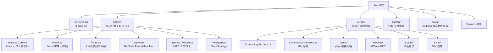

**解读**：ServUO 的工程边界非常清晰——`Server/` 是"不知道 UO 内容的引擎"，`Scripts/` 是"不知道引擎怎么调度、只懂游戏规则的内容"。两边通过反射 + 基类虚函数对接。这种"引擎与内容同语言、但物理分程序集"的做法，和 Unity 用 DLL 热更一个思路，但 ServUO 是**启动时现场 dotnet build 出 Scripts.dll 再 LoadFrom**，不做运行时热更。

### 4.1 Scripts 子目录职责

| 子目录 | 职责 | 典型文件 |
|---|---|---|
| `Scripts/Accounting/` | 账号系统、IP 限流、防火墙（9 个 .cs） | Account.cs, IPLimiter.cs |
| `Scripts/Commands/` | GM 命令注册（64 个 .cs） | Handlers.cs, Add.cs, Properties.cs |
| `Scripts/Items/` | 所有物品，按类型分子目录（2714 个 .cs） | Consumables/, Equipment/, Containers/ |
| `Scripts/Mobiles/` | 所有生物，按 AI 难度分（977 个 .cs） | Normal/, AI/, Bosses/, Summons/ |
| `Scripts/Spells/` | 八系法术，按环级分（213 个 .cs） | First/, Second/, ..., Eighth/ |
| `Scripts/Skills/` | 50+ 技能的 Handler（24 个 .cs） | Mining.cs, Blacksmithy.cs, Fishing.cs |
| `Scripts/Regions/` | 自定义区域、Guard（15 个 .cs） | HouseRegion.cs, DungeonRegion.cs |
| `Scripts/Services/` | 服务级系统（1623 个 .cs） | Spawner/, BulletinBoard/, Email/, CleanUpBritannia/ |
| `Scripts/Quests/` | 任务系统（136 个 .cs） | Quest.cs, Objective.cs |
| `Scripts/Gumps/` | 业务 Gump（引擎 Gump 在 Server/Gumps/，108 个 .cs） | HouseGump, VendorBuyGump |
| `Scripts/Multis/` | 房屋/船/帐篷等多格物件（41 个 .cs） | BaseHouse.cs, Boat.cs |
| `Scripts/Abilities/` | 武器特殊能力 WeaponAbility（44 个 .cs） | WhirlwindAttack.cs, ArmorIgnore.cs |
| `Scripts/VendorInfo/` | NPC 商品表/进货配置（95 个 .cs） | 各 Vendor 的 BuyInfo/SellInfo |
| `Scripts/Misc/` | 杂项系统（69 个 .cs） | Loot.cs, Weather.cs, Map.cs |
| `Scripts/Targets/` | 业务侧目标选择（3 个 .cs） | 配合 Server/Targeting/ 使用 |
| `Scripts/Context Menus/` | 业务右键菜单（7 个 .cs） | 配合 Server/ContextMenus/ 使用 |
| `Scripts/Deprecated/` | 废弃脚本（2 个 .cs） | 兼容老 shard 用 |

---

## 5. 工程获取、创建与打开方式

```powershell
# Windows
git clone https://github.com/ServUO/ServUO.git
cd ServUO
# 用 Visual Studio 2022 打开 ServUO.sln（x64 Debug/Release）
# 或命令行
dotnet build ServUO.sln -c Release
# 产出 ServUO.exe 在仓库根目录
_winrelease.bat
```

- 解决方案里只有 3 个 csproj：`Ultima`（地图数据读取）、`Server`（引擎，OutputType=Exe）、`Scripts`（依赖 Server，类库）。
- **必须自备 UO 客户端资源**（`.mul`/`.uop` 文件）放进 `Data/`，否则 `World.Load()` 阶段就会因找不到地图文件退出。
- Linux 下参考 README：`sudo apt install dotnet-sdk-10.0 mono-complete`，然后 `make`。

---

## 6. 编译与运行步骤

按 README（`ServUO/README.md`）：

1. 编辑 `Config/Server.cfg`（`Listen=0.0.0.0`、`Port=2593`、`Address=公网 IP`）。
2. 过一遍 `Config/*.cfg`。
3. Windows 跑 `_winrelease.bat` 产出 `ServUO.exe`；Linux/macOS 跑 `make`。
4. 把合法 UO 客户端的 mul/uop 文件放进 `Data/`。
5. 启动 `ServUO.exe`，用 UO 客户端连 `127.0.0.1:2593`。

**本环境未执行以上任何一步**：无 UO 客户端、无 mul 数据、无 dotnet SDK 验证。下文所有"运行时行为"结论均来自静态读码，不代表已实测。

### 6.1 启动参数

`Core.Main` 解析以下命令行参数（`Server/Main.cs` 行 338-384）：

| 参数 | 作用 |
|---|---|
| `-debug` | Debug 模式，打印更多日志 |
| `-service` | Windows 服务模式，无控制台交互 |
| `-profile` | 开启性能分析（Packet/Timer 耗时统计） |
| `-nocache` | 不缓存脚本编译结果 |
| `-haltonwarning` | 脚本编译警告时直接退出 |
| `-vb` | 编译 VB.NET 脚本（默认跳过） |
| `-noconsole` | 无控制台交互 |
| `-usehrt` | Windows 高分辨率定时器 |

---

## 7. 整体架构

ServUO 是**单进程、双线程、串行主循环**模型。没有 Center/Login/Gate/Game 四服拆分，账号、登录、进世界、游戏逻辑、网络收发全在一个 `ServUO.exe` 里。

### 7.1 线程模型

ServUO 进程内有三类线程：

1. **Core 主线程**（1 个）：跑所有游戏逻辑，主 while 循环驱动。
2. **TimerThread**（1 个）：扫描 8 级时间桶，把到期 Timer 扔到队列。
3. **IO 线程池**（N 个，.NET 线程池）：异步 Socket Accept/Receive/Send，只负责字节搬移，不碰游戏状态。

关键约束：**所有游戏状态只能在 Core 主线程读写**。IO 线程收到字节后只塞进 `NetState.Buffer`，然后 `Core.Set()` 唤醒主线程；TimerThread 到期后只把 Timer 入队，不直接调 OnTick。这种"IO 线程只做数据搬运、逻辑线程做所有决策"的模型，避免了大量锁竞争，也是 ServUO 6000+ 脚本不用考虑线程安全的根本原因。

### 7.2 进程拓扑

图 2：ServUO 整体进程拓扑（PNG，见 `assets/servuo-architecture-01.png`）

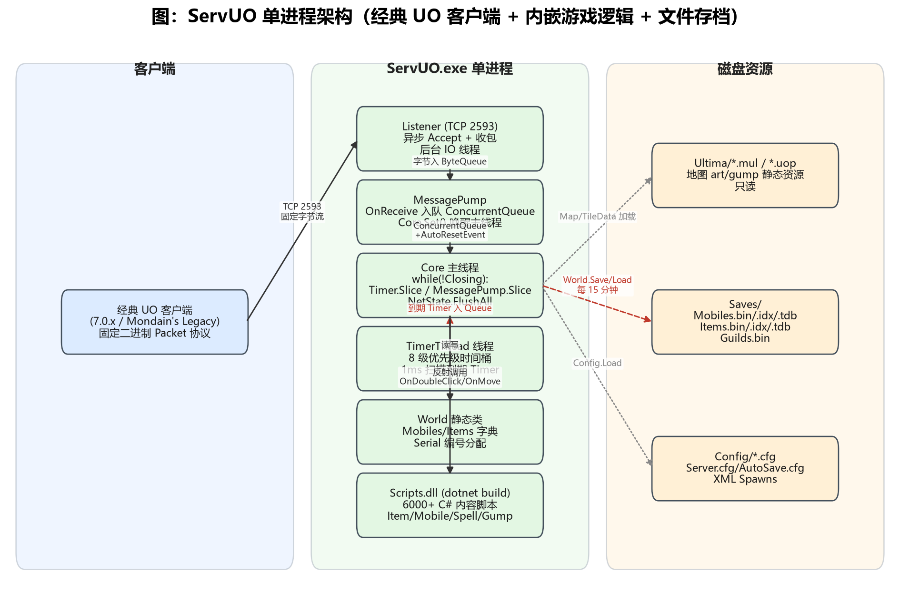

**解读**：
- 客户端是独立的经典 UO exe，通过 TCP 连 2593。
- `Listener` 在后台 IO 线程上 Accept + BeginReceive，字节塞进 `NetState.Buffer`（`ByteQueue`），然后 `MessagePump.OnReceive` 把 NetState 入队并 `Core.Set()` 唤醒主线程。
- **所有游戏逻辑都在 Core 主线程串行执行**——这是 ServUO 性能模型的核心：单线程避免了锁竞争，6000+ 脚本不用考虑线程安全。
- `TimerThread` 是唯一的第二个工作线程，它只负责"扫时间桶、把到期 Timer 扔进队列"，真正的 `OnTick()` 回调仍然在主线程 `Timer.Slice()` 里跑。
- 世界状态持久化是**二进制文件**（`Saves/Mobiles/*.bin` + `.idx` + `.tdb`），不是 MySQL。
- **没有 Center/Login/Gate/Game 四服拆分**：账号验证、登录、选角、进世界、游戏逻辑、网络收发全在一个进程里。客户端连上来一个端口，按 packet 号走状态机。这和 LYFMMORGP 的四服拆分形成鲜明对比——ServUO 是"老派单进程"，LYFMMORGP 是"现代分布式"。

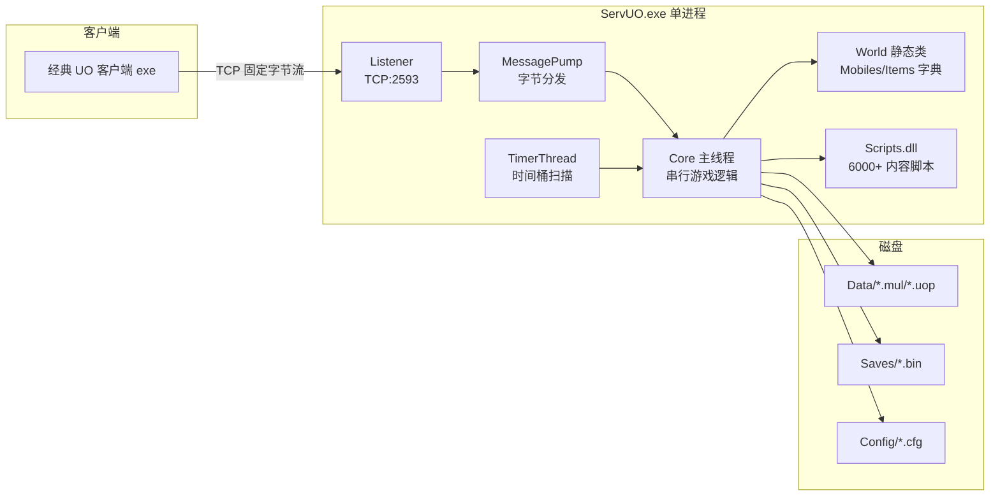

---

## 8. 服务端模块与职责

| 模块 | 文件 | 职责 |
|---|---|---|
| 入口/主循环 | `Server/Main.cs`（`Core` 静态类） | 命令行参数、启动 Config、ScriptCompiler、World.Load、主 while 循环 |
| 世界根 | `Server/World.cs` | `Dictionary<Serial,Mobile>` / `Dictionary<Serial,Item>`、Load/Save、广播 |
| 时间 | `Server/Timer.cs` | `Timer` 基类 + `TimerThread` + 8 级优先级桶 |
| 编号 | `Server/Serial.cs` | `Serial` 结构，Mobile/Item 分段 |
| 序列化 | `Server/Serialization.cs` | `GenericReader/Writer` 抽象 + `BinaryFileWriter/Reader` |
| 网络 | `Server/Network/*` | NetState/PacketHandlers/MessagePump/SendQueue/Compression |
| 对象基类 | `Server/Item.cs` `Server/Mobile.cs` | 所有物品/生物的基类，虚函数 OnDoubleClick/OnMove/OnThink |
| 地图 | `Server/Map.cs` `Server/Sector.cs` `Server/Region.cs` | Facet 概念、Sector 分块、区域规则 |
| 脚本编译 | `Server/ScriptCompiler.cs` | `dotnet build Scripts.csproj` -> LoadFrom Scripts.dll |
| 存档策略 | `Server/Persistence/*` | Standard/Parallel/Dynamic/Dual 四种 SaveStrategy |
| 命令 | `Scripts/Commands/Handlers.cs` | `[xxx` GM 命令注册 |
| 账号 | `Scripts/Accounting/Account.cs` | 账号、密码哈希、角色槽 |
| Gump | `Server/Gumps/Gump.cs` | 服务端下发 UI 基类 |
| 目标选择 | `Server/Targeting/*` | Target/LandTarget/MultiTarget/StaticTarget，施法/技能目标选择机制 |
| 组队 | `Server/Party.cs` | PartyCommands 抽象基类，组队回调接口 |
| 性能诊断 | `Server/Diagnostics/*` | Profiler/Stats 采样，对应 `-profile` 启动参数 |

注册方式主要有三种：
1. **静态构造函数 / `[CallPriority]`**：`ScriptCompiler.Invoke("Configure")` 和 `Invoke("Initialize")` 反射调用所有程序集中静态方法名匹配的方法，按 `CallPriority` 排序。
2. **特性标注**：`[Constructable]` 标注物品构造函数（GM 用 `[add xxx` 时反射调它），`[CommandProperty]` 标注属性可被 GM 命令读写。
3. **PacketHandlers 静态构造函数**：启动时在 `static PacketHandlers()` 里 `Register(packetID, length, ingame, handler)` 把 0x00-0xFF 全部填进 256 槽位数组。

### 8.1 启动时机的两个关键 Invoke

`ScriptCompiler.Invoke("Configure")` 在 `World.Load()` **之前**调用，脚本此时可以注册命令、初始化全局状态；`ScriptCompiler.Invoke("Initialize")` 在 `World.Load()` **之后**调用，脚本此时可以访问已加载的世界实体。这个时机拆分很重要：Configure 做"注册"，Initialize 做"基于世界的初始化"。

---

## 9. 客户端模块与职责

ServUO **没有自研客户端**。它对接的是 1997-2012 年的经典 UO 客户端：

- 客户端自带所有 art/gump/music/动画资源（`.mul`/`.uop`），服务端只下发"在哪个坐标出现哪个 Serial、画什么 body、说什么话、开哪个 Gump"。
- UI（Gump）是**服务端构造、客户端渲染**：服务端拼一个 `GumpPacked` 二进制包（按钮/文字/图片坐标），客户端按 UO 的 Gump 协议画窗口。
- 客户端版本从 4.0.0a 到 7.0.61.0 都兼容，`NetState.Version` setter 里枚举了 16 个版本节点（`Server/Network/NetState.cs` 行 177-192），每个版本启用一组 `ProtocolChanges` 标志（新魔法书包、伤害包、unpack 等）。
- 因此 LYFMMORGP 里"Unity 客户端 + UGUI + 热更"这一整层，在 ServUO 里**不存在对应物**。

---

## 10. 网络通信

### 10.1 传输与连接

- **TCP**，默认端口 **2593**（`Config/Server.cfg`）。
- `Server/Network/Listener.cs` 负责 `TcpListener` + 异步 Accept；每个连接对应一个 `NetState`。
- 后台 IO 线程只做"收字节到 `NetState.Buffer`（`ByteQueue`）"，收满一个 NetState 就 `MessagePump.OnReceive(ns)` 入 `ConcurrentQueue<NetState>`，然后 `Core.Set()` 唤醒主线程。
- **主线程 `MessagePump.Slice()` 才真正解析 Packet**——这是关键的"IO 与逻辑解耦"，类似 LYFMMORGP 的"网络回调只入队 GameCommand、主线程消费"。
- 每个 NetState 对应一个 `Mobile`（玩家进世界后）和一个 `IAccount`（登录后）。NetState 是"连接"和"玩家身份"的桥梁。

### 10.2 固定二进制 Packet

UO 协议是**固定字节布局**的二进制包，第 1 字节是 packetID。`Server/Network/PacketHandlers.cs` 静态构造函数注册了 256 个槽位（节选）：

| packetID | 长度 | ingame | 含义 |
|---|---|---|---|
| 0xEF | 21 | 否 | LoginServerSeed（初始握手种子） |
| 0x80 / 0xCF | 62/0 | 否 | AccountLogin（账号密码登录） |
| 0x91 | 65 | 否 | GameLogin（拉角色列表） |
| 0x00 / 0xF8 | 104/106 | 否 | CreateCharacter（建角） |
| 0x5D | 73 | 否 | PlayCharacter（选角进世界） |
| 0x02 | 7 | 是 | MovementReq（走格子） |
| 0x05 | 5 | 是 | AttackReq（请求攻击目标） |
| 0x06 | 5 | 是 | UseReq（双击使用） |
| 0x07 / 0x08 | 7/14 | 是 | LiftReq / DropReq（拾取/丢弃） |
| 0x0A | 11 | 是 | Edit（编辑标牌/文本） |
| 0x13 | 10 | 是 | EquipReq（穿戴装备到 Layer 槽） |
| 0x73 | 2 | 否 | PingReq（登录前后均可 ping） |
| 0x9D | 51 | 是 | GMSingle（GM 命令） |
| 0xBF | 扩展 | 是 | ExtendedCommand（子命令 0x05-0x32） |
| 0xD7 | 编码 | 是 | EncodedCommand（加密子命令） |

动态包长度 = 第 2-3 字节大端 int；固定包长度在注册表里写死（见 `MessagePump.HandleReceive` 行 247-265）。

### 10.3 加密与压缩

- 握手：客户端连上后先发 4 字节 seed（`MessagePump.HandleSeed` 行 139-175），或 6.0.5+ 发 0xEF 种子包。
- 出站包用 `IPacketEncoder` / `IPacketEncryptor` 接口加密（NetState 属性，行 23-33）。
- 大块数据（地图补丁、大 Gump）走 zlib 压缩：`Server/Network/Compression.cs` + 仓库根 `zlibwapi32/64.dll`。
- IP 限流：`Scripts/Accounting/IPLimiter.cs` + `Firewall.cs`。
- **Ping**：0x73 PingReq，客户端每几秒发一次，服务端立刻回 PingPong，用于测延迟和保活。
- **TripTime**：0xC9/0xCA 包，客户端发时间戳，服务端回声，客户端自己算 RTT。

### 10.4 真实协议示例：移动包 0x02

```csharp
// Server/Network/PacketHandlers.cs 行 1780
public static void MovementReq(NetState state, PacketReader pvSrc)
{
    Direction dir = (Direction)pvSrc.ReadByte();   // 1 字节方向（8 方向 + 朝向位）
    int seq = pvSrc.ReadByte();                    // 1 字节序号（客户端预测用）
    int key = pvSrc.ReadInt32();                   // 4 字节 fastwalk key
    Mobile m = state.Mobile;
    if ((state.Sequence == 0 && seq != 0) || !m.Move(dir))
    {
        state.Send(new MovementRej(seq, m));       // 拒绝：客户端回滚
        state.Sequence = 0;
        m.ClearFastwalkStack();
    }
    else
    {
        state.Sequence = (seq + 1) & 0xFF;
    }
}
```

**这是 UO 的"客户端预测 + 服务端权威回滚"模型**：客户端先动，发包；服务端 `m.Move(dir)` 检测碰撞/瘫痪/区域规则，失败就回 `MovementRej`，客户端把人拉回。和 LYFMMORGP 的"服务器权威、客户端预表现+权威校正"思想一致，但 ServUO 是逐格走、没有浮点坐标。

### 10.5 SendQueue 与出站包

每个 `NetState` 持有一个 `SendQueue`（`Server/Network/SendQueue.cs`）。业务代码写 `ns.Send(packet)` 时：
- Packet 对象有引用计数（`Acquire/Release`），同一个包可以广播给多个 NetState 而不拷贝字节。
- `NetState.FlushAll()` 在主循环尾部统一 `Socket.BeginSend`，把队列里的字节一次性推出去。
- 这种"业务线程只入队、IO 线程批量发"的模型和 LYFMMORGP 的 Gate 转发思路一致，但 ServUO 没有独立 Gate——它就是一个进程。

### 10.6 IP 限流与防刷

- `Server/Network/PacketThrottles.cs` 给高频包（移动、说话）加了令牌桶限流。
- `Scripts/Accounting/IPLimiter.cs` 限制单 IP 同时在线账号数，防多开。
- `Scripts/Accounting/Firewall.cs` 可以在配置里拉黑 IP 段。

### 10.7 客户端版本协商

`NetState.Version` setter（`Server/Network/NetState.cs` 行 103-175）维护了 16 个客户端版本节点：4.0.0a / 4.0.7a / 5.0.0a / 5.0.2b / 6.0.0.0 / 6.0.1.7 / 6.0.14.2 / 7.0.0.0 / 7.0.9.0 / 7.0.13.0 / 7.0.16.0 / 7.0.30.0 / 7.0.33.1 / 7.0.45.65 / 7.0.50.0 / 7.0.61.0。每个版本启用一组 `ProtocolChanges` 标志位（新魔法书包、新伤害包、unpack 等）。新客户端连上来时先发 0xBD ClientVersion 包告诉服务端版本号，服务端再决定后续用哪种包格式。

---

## 11. 数据存储

### 11.1 没有数据库

ServUO **不使用 MySQL/Mongo/Redis**。世界状态全部序列化为自定义二进制文件，放在 `Saves/` 目录：

| 文件 | 内容 |
|---|---|
| `Saves/Mobiles/Mobiles.idx` | 索引：每条目 (typeID, serial, pos, length) |
| `Saves/Mobiles/Mobiles.tdb` | 类型表：typeID -> 类型全名（`ScriptCompiler.FindTypeByFullName`） |
| `Saves/Mobiles/Mobiles.bin` | 所有 Mobile 序列化字节流 |
| `Saves/Items/Items.{idx,tdb,bin}` | 同上，物品 |
| `Saves/Guilds/Guilds.{idx,bin}` | 公会 |
| `Saves/Customs/SaveData.{idx,tdb,bin}` | 自定义存档（CustomsFramework） |

### 11.2 序列化格式

`Server/Serialization.cs` 定义抽象基类 `GenericWriter` / `GenericReader`，每个 Item/Mobile 子类实现：

```csharp
public override void Serialize(GenericWriter writer)
{
    base.Serialize(writer);
    writer.Write((int)0); // version 号，用于向后兼容
}
public override void Deserialize(GenericReader reader)
{
    base.Deserialize(reader);
    int version = reader.ReadInt();
}
```

- 每个类型自己写一个 `int version`，加载时按 version 分支读旧字段——这是 ServUO 升级时不丢档的关键。
- `World.Load()`（`Server/World.cs` 行 348）流程：读 `.tdb` 拿到 typeID->ConstructorInfo 映射 -> 读 `.idx` 拿到每条记录的 typeID/serial/pos -> Seek 到 `.bin` 对应 pos -> 调 `ctor(serial)` 再 `Deserialize(reader)`。
- **找不到类型**（脚本删了某物品）会交互式问"Delete all of those types? (y/n)"，非常老派。

### 11.3 配置

- `Config/*.cfg` 是简单 `Key=Value` 文本，`Server/Config.cs` 静态读取。
- `Config/AutoSave.cfg`：`Frequency=00:00:15:00`（15 分钟自动存档）、`WarningTime=00:00:00:15`（存档前 15 秒广播）。
- `Data/SpawnDefinitions.xml`、`Data/Regions.xml`、`Spawns/*.xml` 是刷怪和区域定义。
- 其他重要 cfg：`General.cfg`（全局设置）、`Expansion.cfg`（资料片）、`Client.cfg`（客户端兼容）、`Loot.cfg`（掉落表）、`Housing.cfg`（房屋）、`Staff.cfg`（GM 名单）。

### 11.4 存档策略四种

`Server/Persistence/` 目录下有四种 `SaveStrategy` 实现：

| 策略 | 文件 | 特点 |
|---|---|---|
| StandardSaveStrategy | `StandardSaveStrategy.cs` | 单线程顺序写，最稳但最慢 |
| ParallelSaveStrategy | `ParallelSaveStrategy.cs` | 用 `Parallel.ForEach` 并行序列化所有实体，写盘仍串行 |
| DynamicSaveStrategy | `DynamicSaveStrategy.cs` | 动态决定并行度，适合中等规模 shard |
| DualSaveStrategy | `DualSaveStrategy.cs` | 双缓冲，写完一份切到另一份，崩溃不丢档 |

`World.Save()` 调 `SaveStrategy.Acquire()` 根据 `Config/General.cfg` 里的 `SaveStrategy=` 配置选一种。存档时先 `NetState.Pause()` 暂停收包，写完 `NetState.Resume()`。

图 8：世界存档三段式文件布局

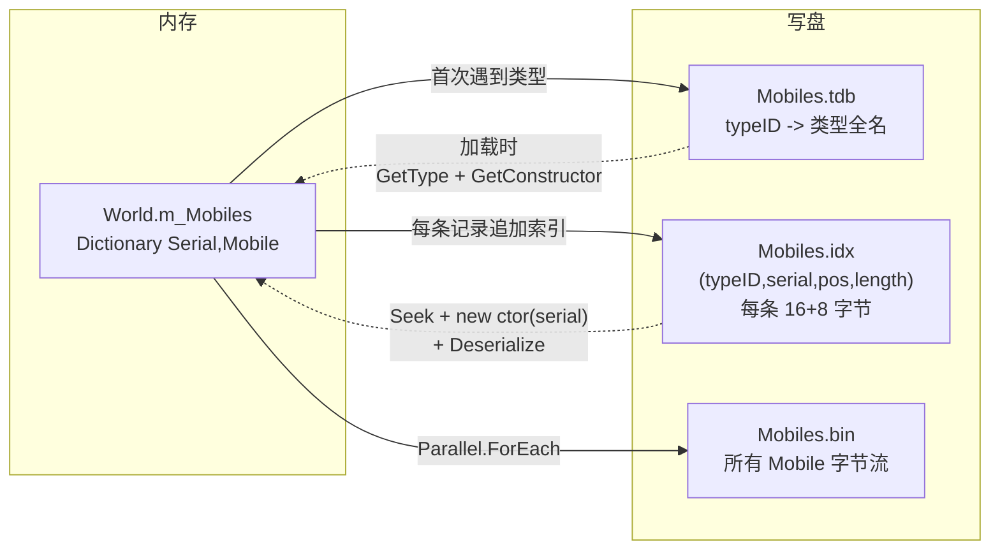

**解读**：`.tdb` 是"类型表"，`.idx` 是"索引表"，`.bin` 是"数据流"。加载时先读 `.tdb` 把 typeID 映射到 `ConstructorInfo`，再读 `.idx` 知道每条记录在 `.bin` 的哪个字节偏移，Seek 过去调 `ctor(serial)` + `Deserialize(reader)`。这种分离的好处是：单条记录坏了可以跳过而不影响其他记录；新增字段只要在 `Serialize` 末尾追加 version 分支，老存档按旧版本读。

---

## 12. 启动流程

图 3：ServUO 启动与世界加载流程（Mermaid）

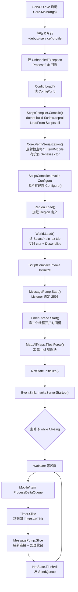

**关键代码**（`Server/Main.cs` 行 544-599）：

```csharp
ScriptCompiler.Invoke("Configure");
Region.Load();
World.Load();
ScriptCompiler.Invoke("Initialize");
MessagePump.Start();
_timerThread.Start();
foreach (Map m in Map.AllMaps) m.Tiles.Force();
NetState.Initialize();
EventSink.InvokeServerStarted();

long now, last = TickCount;
while (!Closing)
{
    _Signal.WaitOne();
    Mobile.ProcessDeltaQueue();
    Item.ProcessDeltaQueue();
    Timer.Slice();
    MessagePump.Slice();
    NetState.FlushAll();
    NetState.ProcessDisposedQueue();
    Slice?.Invoke();
}
```

**解读**：主循环是**事件驱动 + 定时切片**混合体——`_Signal` 是 AutoResetEvent，IO 收包或 Timer 到期都会 `Core.Set()` 唤醒；没事件时主线程睡在 WaitOne 上，不空转。每个 slice 固定顺序：先刷新可见对象 delta、再跑 Timer、再处理网络包、再 flush 发送队列。这和 LYFMMORGP 的 20Hz 固定 tick 思路接近，但 ServUO 是"有事件才醒"，不是固定 50ms 醒一次。

### 12.1 启动失败处理

- 如果 `ScriptCompiler.Compile` 失败（脚本编译错误），主线程打印错误并等用户按键，按 R 重试，否则退出。
- 如果 `World.Load` 遇到坏档（某条记录反序列化失败），交互式问"Delete the object? (y/n)"，选 y 后删除该记录继续加载，选 n 则抛异常退出。
- 这种"交互式恢复"设计在现代服务器上不可想象（没有控制台），但在 90 年代单机调试场景下很实用。

图 4：双线程模型（PNG，见 `assets/servuo-mainloop-02.png`）

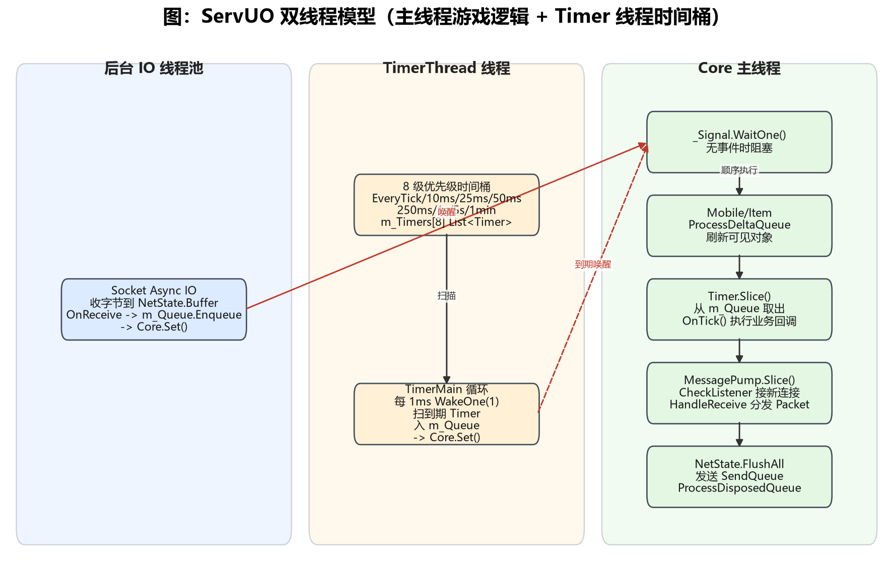

---

## 13. 登录与账号流程

ServUO 没有独立 LoginServer——**登录服和游戏服是同一个进程、同一个端口**。客户端连上来之后按 packet 号走状态机。

图 5：登录 + 进入世界时序

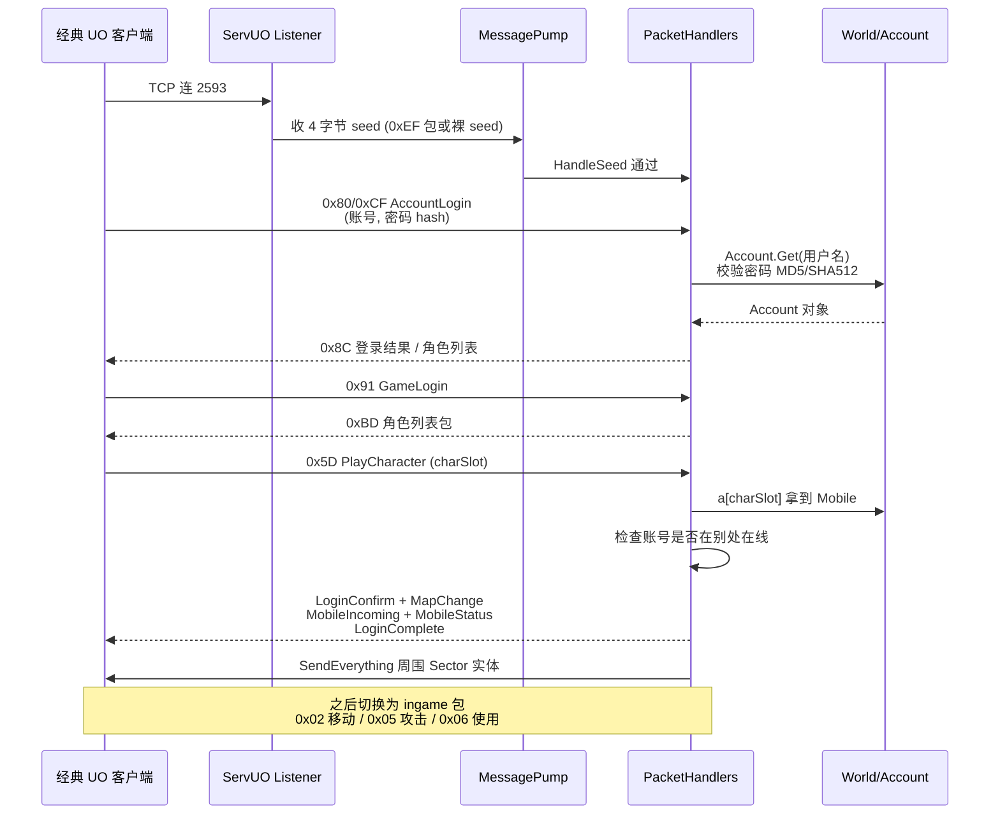

**关键代码**（`Server/Network/PacketHandlers.cs` 行 2530 `DoLogin`）：

```csharp
public static void DoLogin(NetState state)
{
    var m = state.Mobile;
    state.Send(new LoginConfirm(m));
    if (m.Map != null) state.Send(new MapChange(m));
    state.Send(new MapPatches());
    state.Send(SupportedFeatures.Instantiate(state));
    state.Send(MobileIncoming.Create(state, m, m));
    state.Send(new MobileUpdate(m));
    m.SendEverything();           // 广播周围所有可见实体
    m.CheckLightLevels(true);
    state.Send(LoginComplete.Instance);
    state.Send(MobileStatus(m, m));
    state.Send(SetWarMode.Instantiate(m.Warmode));
    state.Send(new CurrentTime());
    EventSink.InvokeLogin(new LoginEventArgs(m));
    m.SendEverything();
}
```

**账号存储**：`Scripts/Accounting/Account.cs`，账号也是 `SaveData` 子类，和世界一起序列化进 `Saves/`。密码用 `MD5CryptoServiceProvider` / `SHA1CryptoServiceProvider` / `SHA512CryptoServiceProvider` 三套哈希兼容老客户端。`IAccount` 接口暴露 `Mobile[int slot]` 索引器，角色槽数量由服务器配置。

### 13.1 账号状态机

一个 NetState 在登录过程中有几个阶段：
1. **未 seed**：连上但没收到 seed，只能收 0xEF/0x80 等少数包。
2. **已 seed 未登录**：发了账号密码，等服务端校验。
3. **已登录未选角**：账号验证通过，收到角色列表，等 0x91 GameLogin。
4. **已选角未进世界**：收到 0x5D PlayCharacter，等 DoLogin 完成。
5. **ingame**：`state.Mobile != null`，所有 ingame 包开放。

`PacketHandler.ingame` 标志位就是这个状态机的门禁——`HandleReceive` 里检查 `if (handler.Ingame && ns.Mobile == null) Dispose`。

---

## 14. 角色创建与进入场景

- 0x00 / 0xF8 包是 CreateCharacter，`PacketHandlers.CreateCharacter`（行 2588）解析性别/种族/属性/技能，然后 `Account.AddMobile(mobile)` 塞进账号槽。
- 新角色出生点由 `Config/General.cfg` 的 `StartLocation` 决定，通常是各城市银行门口。
- 进世界时 `state.Mobile = m; m.NetState = state;`，然后 `DoLogin` 把玩家出生点周围 Sector 里的所有 Mobile/Item 通过 `MobileIncoming` / `ItemIncoming` 包下发。
- **没有现代意义上的 AOI**：ServUO 用 `Sector`（地图按 8x8 或类似块切分），每个 Sector 维护 `List<Mobile>` 和 `List<Item>`。玩家移动跨 Sector 时，`Mobile.Move` 里比较 oldSector/newSector，离开/进入时通过 `OnMoveOver/OnMoveOff` 触发可见性广播（见 `Server/Mobile.cs` 行 3186-3264）。
- 视野距离：`Core.GlobalUpdateRange = 18`、`GlobalMaxUpdateRange = 24`、`GlobalRadarRange = 40`（`Server/Main.cs` 行 652-654）。
- 玩家出生后，服务端还会发：`LoginComplete`、`MobileStatus`（HP/Mana/Stam）、`SetWarMode`、`SeasonChange`（季节）、`CurrentTime`（服务器时间）、`MapChange`（所在 Facet）。

---

## 15. 移动同步

### 15.1 模型

- **同步模型：状态同步 + 客户端预测 + 服务端回滚**（UO 经典 walk 模型）。
- 坐标是**整数格**（`Point3D`，x/y/z 都是 int），8 方向走格子（N/NE/E/SE/S/SW/W/NW）。
- 服务端权威：`Mobile.Move(Direction d)`（`Server/Mobile.cs` 行 3103）检查：
  1. 是否 Paralyzed/Frozen
  2. `CheckMovement` 查地图 tile 是否可走
  3. 跨 Sector 时遍历 oldSector/newSector 的 Mobiles/Items，调用 `OnMoveOff/OnMoveOver` 处理碰撞
  4. `Region.CanMove` 区域规则（房屋里不能随便走、监狱等）
  5. `InternalOnMove` 更新位置、换 Sector、广播移动包
- 失败则 `MovementReq` 里回 `MovementRej`，客户端把人拉回。

图 6：走格子移动与 Sector 阻挡

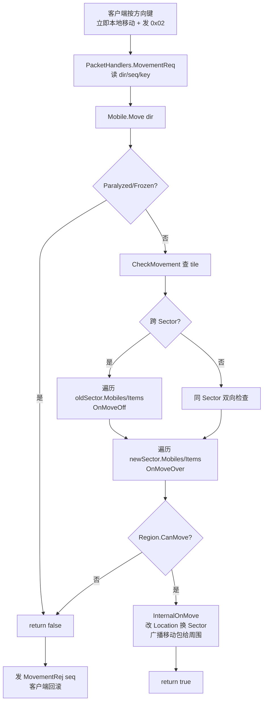

图 6b：Sector 可见性差量

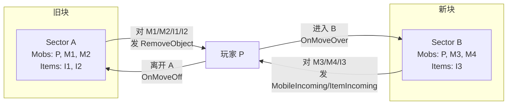

**解读**：ServUO 的可见性同步就是"跨块时做差量"——离开旧块时通知旧块里的实体"你看不见我了"，进入新块时通知新块里的实体"你看见我了"。没有每帧广播，只有移动时才做差量。这和 LYFMMORGP 的"移动事件驱动收一包广播一次"思路一致。

**解读**：和 LYFMMORGP 的"事件驱动收一包广播一次"几乎是同一个思路，区别是 ServUO 逐格广播、没有插值、没有浮点速度。它的碰撞检测是**O(Sector 实体数)** 的暴力遍历，因为 Sector 切得小，每格通常只有几个实体。

### 15.2 快速行走与防作弊

UO 有著名的 "fastwalk" 作弊——客户端一次发多个移动包，服务端如果不校验就会被瞬移。ServUO 的做法：
- `MovementReq` 包里有个 `seq` 序号，服务端维护 `state.Sequence`，客户端必须按序发。
- 如果序号不连续，服务端回 `MovementRej` 并 `ClearFastwalkStack`。
- 这是客户端预测模型下的标准防作弊手段：服务端只接受符合预期序号的移动，否则回滚。

### 15.3 负重与速度

- 玩家携带物品总重量影响 `Stam` 恢复和移动速度。
- `Mobile.Stam` 满时才能跑步，跑步比走路快一倍。
- 骑坐骑时移动速度由坐骑类型决定。
- 这些都在 `Mobile.Move` 里计算，服务端权威。

---

## 16. 战斗、技能与属性

### 16.1 属性

`Mobile` 基类维护：
- `Hits/Mana/Stam`（三条血条）
- `Str/Dex/Int`（三围，上限随资料片变化，AOS 后玩家上限 225/225/225）
- `Skills` 字典（`SkillName` 枚举 50+ 技能，每个 0-1000，即 0.0-100.0，可锁定/锁定上升/锁定下降三态）
- `Resistances`（物理/火焰/寒冷/能量/毒素 5 系抗性，AOS 资料片后引入）
- `Layer`（装备槽：1 头/2 颈/3 腰/4 脚/5 腿/6 手/7 躯干/8 项链/9 指环/10 手镯/…）
- `Notoriety`（声望：innocent/ally/neutral/enemy/murderer/criminal/invulnerable，决定名字颜色和 guard 是否攻击）
- `Karma` / `Fame`（善恶值/声望值，影响能否穿某些装备、能否进某些城）
- `AccessLevel`（玩家/Counselor/GM/Seer/Admin/Owner，GM 命令权限）

### 16.2 近战

- 0x05 `AttackReq`：客户端右键点目标。
- `Mobile.DoAttack` 处理命中判定、武器速度（`BaseWeapon.WeaponSpeed`，取决于 Dex 和武器本身）、武器伤害区间（`BaseWeapon.MinDamage/MaxDamage`）、护甲 AR、暴击。
- 战斗是 Timer 驱动：攻击后启动一个延迟 Timer，到时再结算下一次出手。武器速度由 `Dex` 和 `Weapon.Speed` 共同决定，Dex 越高出手越快。
- `AttackMessage` / `Animation` 包同步播放攻击动画；对方命中后 `Mobile.Damage` 扣血并广播 `MobileStatus`。
- `Warmode` 状态：0x72 SetWarMode 包，拔刀后攻击不用每次点目标。

### 16.3 武器能力与护甲

- `BaseWeapon` 子类：Sword/Mace/Bow/Fencing/Macing 等，每类有自己的 `SkillName` 依赖（Swords/Macing/Fencing/Archery）。
- `BaseArmor` 子类：头盔/胸甲/腿甲，每件带 `BaseArmor.BaseArmorRating`，决定减伤。
- AOS 后引入 `WeaponAbility`（暴击、击破、失血等特殊能力）和 `ArmorAttr`（属性加成）。

### 16.4 魔法系统

- 八系：Magery（基础八环）、Necromancy、Chivalry、Bushido、Ninjitsu、Spellweaving、Mysticism、Skill Masteries。
- 每个法术是一个类，例如 `Scripts/Spells/First/MagicArrow.cs`：

```csharp
public class MagicArrowSpell : MagerySpell
{
    private static readonly SpellInfo m_Info = new SpellInfo(
        "Magic Arrow", "In Por Ylem",   // 咒语文字
        212,                              // 动画 ID
        9041,                             // 音效 ID
        Reagent.SulfurousAsh);           // 所需药材
    public override SpellCircle Circle => SpellCircle.First;
    public override void OnCast()
    {
        Caster.Target = new InternalTarget(this);   // 进入目标选择
    }
    public void Target(IDamageable d)
    {
        if (!Caster.CanSee(d)) { ... }
        else if (CheckHSequence(d))
        {
            double damage = Core.AOS ? GetNewAosDamage(10,1,4,d) : Utility.Random(4,4);
            Caster.MovingParticles(d, 0x36E4, 5, 0, false, false, 3006, 0, 0);
            Caster.PlaySound(0x1E5);
            SpellHelper.Damage(this, target, damage, 0, 100, 0, 0, 0);
        }
        FinishSequence();
    }
}
```

- 施法流程：`OnCast` -> `Caster.Target = new InternalTarget(...)` -> 玩家点地面/目标 -> `OnTarget` -> 校验视线/反射/抗性 -> 播特效 -> `SpellHelper.Damage` 结算。
- Mana 消耗、Reagent（药材）消耗、咒语吟唱时间都在 `MagerySpell` 基类里。

### 16.5 Buff / Poison / 宠物

- Buff/Debuff 走 `Mobile.AddBuff` + 0xBF 扩展包，客户端右上角显示图标和剩余时间。
- Poison 是 `Poison` 子类（Lesser/Regular/Greater/Deadly/Lethal），挂在 Mobile 上，用 Timer 周期性跳血；`Cure` 法术或 `CurePotion` 可解。
- 宠物/跟随者：`Mobile.Followers` 字典，`BaseCreature` 子类有简单状态机（Wander/Follow/Attack/Guard）。驯服用 `AnimalTaming` 技能，喂食物恢复忠诚。

### 16.5 Targeting 目标选择系统

施法、使用物品、技能（比如采矿、开锁）都需要玩家"先选一个目标"。ServUO 把这个模式抽成了独立子系统 `Server/Targeting/`（6 个 .cs）：

| 文件 | 职责 |
|---|---|
| `Target.cs` | 抽象基类，持有 Range/CheckLOS/AllowGround/TimeoutTimer；`BeginTimeout` 启 Timer，超时自动 Cancel |
| `LandTarget.cs` | 目标必须是地面坐标（如地震术、传送） |
| `MultiTarget.cs` | 可点多个目标（如群体法术） |
| `StaticTarget.cs` | 目标必须是具体 Static/Item |
| `TargetCancelType.cs` | 取消原因枚举（Canceled/Finished/Timeout） |
| `TargetFlags.cs` | 标记（Harmful/Beneficial/Ground/DisallowMulti） |

**流程**：
1. 业务代码设 `from.Target = new InternalTarget(this)`（`Target.cs` 行 25 构造函数分配唯一 `m_TargetID`）。
2. 服务端下发 0x6C TargetCursor 包，客户端变"瞄准镜"光标。
3. 玩家点地面或点某个 Mobile/Item，客户端回 0x6C TargetResponse 包（`PacketHandlers.cs` 行 90 注册）。
4. 服务端 `MessagePump` 解出 targetID + 目标 Serial/坐标，找到 `from.Target`，调用 `targ.Invoke(from, serial, point)`，最终落到子类的 `OnTarget(Mobile from, object targeted)` 虚方法。
5. `OnTarget` 里业务自己校验距离、LOS、目标类型，然后执行效果；执行完 `from.Target = null`。
6. 超时：`BeginTimeout` 启动 Timer，到点自动 `OnTargetCancel(m, TargetCancelType.Timeout)`。

这就是为什么所有法术/技能/物品使用都长一个样——它们都复用了这套 Target 基类。

### 16.6 技能系统

`SkillName` 枚举列出 50+ 技能：Swords/Macing/Fencing/Archery/Tailoring/Blacksmithy/Mining/Fishing/Camping/Hiding/Stealing/Snooping/DetectHidden/SpiritSpeak/Peacemaking/Provocation/Discordance/Necromancy/Bushido/Ninjitsu/Chivalry/Spellweaving/Mysticism 等等。

每个技能有 0-1000 的值（显示为 0.0-100.0），三态锁：`SkillLock.Up`（涨）/`Down`（跌）/`Locked`（锁死）。玩家死亡会损失经验值，这是 UO 著名的"死亡掉技能"机制。

技能触发分两类：
- **被动**：武器命中时自动按 `SkillName` 判定。
- **主动**：玩家从 Gump 菜单选技能 -> 客户端发 0xBF.0x2E TargetedSkillUse 包 -> 服务端 `Skill.OnUse` 进入目标选择。

代表性 `SkillHandlers`：
- Mining：玩家拿锄头点山/洞 -> `BaseHarvestTool` 触发 -> Timer 读条 -> 产出矿石 Item。
- Blacksmithy：在铁砧旁用工具 -> `CraftSystem` 弹出制作菜单 -> 选配方 -> 消耗材料 -> 产出装备。
- Hiding/Stealth：Timer 周期性判定是否被看见。
- Fishing：点水 -> 读条 -> 随机产出鱼/宝箱。

### 16.7 制造与资源采集

`Scripts/Skills/` 下的 `CraftSystem` 是一个完整的制造框架：
- 每个配方是 `CraftEntry`，定义所需材料、产出、难度。
- `CraftMenu` 是服务端下发的 Gump，分类展示所有可做物品。
- BOD（Bulk Order Deed）：NPC 给批量订单，做完交差换奖励。
- 资源点：`Data/HarvestLocs/` 定义矿点/鱼塘位置。

- Buff/Debuff 走 `Mobile.AddBuff` + 0xBF 扩展包。
- Poison 是 `Poison` 子类（Lesser/Regular/Greater/Deadly/Lethal），挂在 Mobile 上，用 Timer 周期性跳血。
- 宠物/跟随者：`Mobile.Followers` 字典，`BaseCreature` 子类有简单状态机（Wander/Follow/Attack/Guard）。

---

## 17. AI 与怪物

- 怪物全部继承 `Scripts/Mobiles/Normal/BaseCreature.cs` 或其子类，AI 是**写在 C# 类里的状态机**，不是行为树编辑器。
- `BaseCreature` 有 `AI` 枚举（AI.Human/Animal/Archer/Mage 等），在 `Think` 虚函数里每 tick 决策：是否追目标、是否逃跑、是否施法。
- **Spawner 刷怪器**：`Scripts/Services/Spawner/Spawner.cs` 本身就是一个 `Item`（Graphic 0x1f13，看不见），挂在地图上，内部 `InternalTimer` 周期性检查 `SpawnCount < MaxCount` 就反射 `Activator.CreateInstance(Type.GetType(spawnName))` 生成怪物。

```csharp
// Spawner 是 Item 子类，用 [Constructable] 暴露给 GM
[Constructable]
public Spawner(int amount, int minDelay, int maxDelay, int team, int spawnRange, string spawnName)
    : base(0x1f13)
{
    InitSpawner(amount, TimeSpan.FromMinutes(minDelay),
                TimeSpan.FromMinutes(maxDelay), team, spawnRange, objects);
}
```

- 刷怪配置：`Spawns/`、`SpawnsOld/`、`RevampedSpawns/` 下的 XML 文件，或地图上直接放 Spawner Item。
- 仇恨/寻路：**没有寻路**。UO 老派做法是怪物直接直线朝玩家走，被墙挡住就卡着或换方向；不做 A*。
- 怪物的 AI 循环在 `BaseCreature.Think()` 里，由 `Timer` 周期调用。每帧决策：追目标 / 逃跑 / 施法 / 巡逻。
- `AggressorInfo` 记录怪物对谁有敌意，被打后反咬。
- 宠物：玩家用 `AnimalTaming` 驯服用，`Followers` 字典管理跟随者数量上限。

---

## 18. 背包、物品、装备

- `Server/Item.cs`（6477 行）是所有物品基类，核心字段：`Serial`、`ItemID`（art 图 ID）、`Hue`（颜色）、`Amount`（堆叠数）、`Layer`（装备槽）、`Parent`（容器/穿戴者）、`Location`、`Movable`、`LootType`。
- 容器：`Container : Item`，内部维护 `List<Item>`。
- 装备：`BaseArmor` / `BaseWeapon` / `BaseClothing` 都是 Item 子类，通过 `Layer` 字段决定穿在哪。
- 堆叠：`Item.Stackable` + `Amount`，金币 `Gold : Item` 可堆到任意数量。
- 序列化用**位标志压缩**：`Item.Serialize`（方法在行 2617，version=14 的 `writer.Write(14)` 在行 2619）先写版本号，然后用 `SaveFlag` 位掩码只写"非默认值"的字段（位置非 0 才写、hue 非 0 才写），节省磁盘空间。
- 装备槽 `Layer`：UO 有 ~20 个装备位，从 1（头）到 20（披风）。武器占 Layer.OneHanded 或 TwoHanded。
- 容器 `Container` 继承 `Item`，内部 `List<Item>` 维护子物品。银行 `BankBox` 是特殊容器，每个玩家一个，跨角色共享。
- 掉落：怪物死亡后 `LootType` 决定掉什么，`Scripts/Misc/Loot.cs` 控制全局掉落表。

图 7：核心对象模型关系

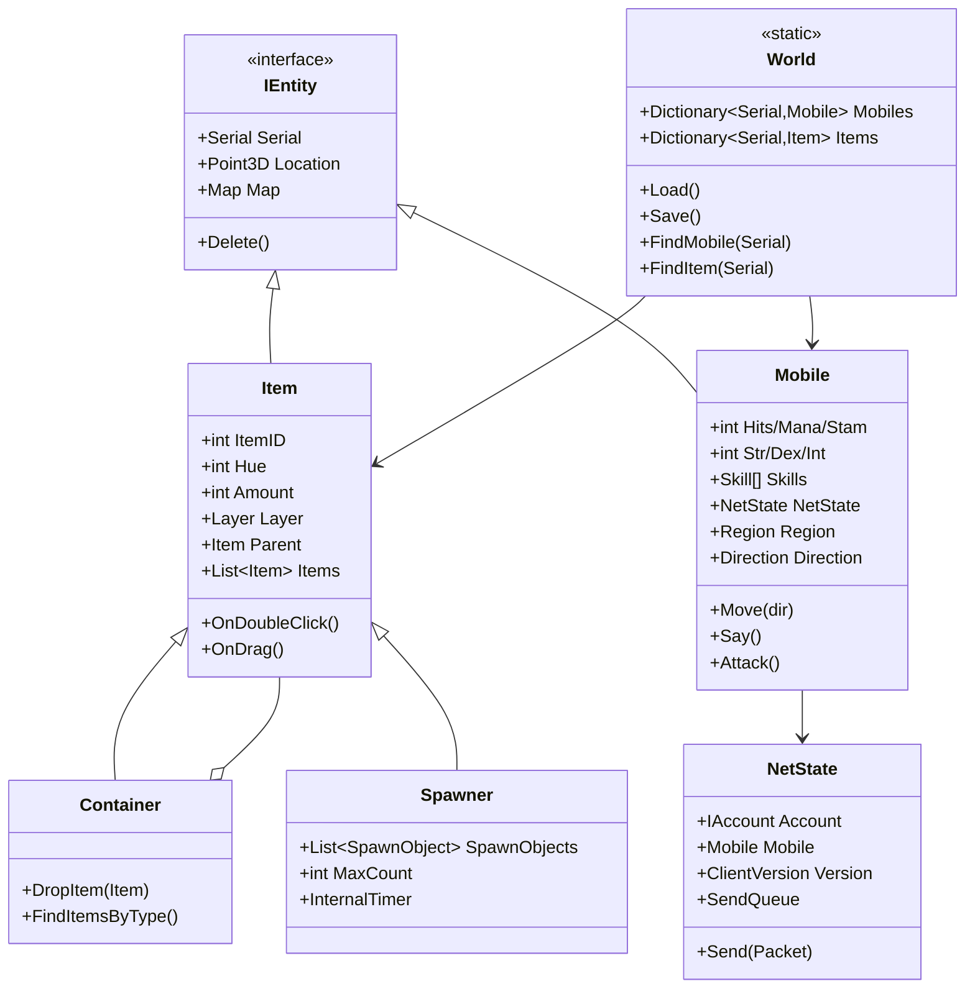

---

## 19. 任务、NPC、对话

- UO 老派任务系统非常弱：`Scripts/Quests/` 里有少量 Quest 类，但绝大多数"任务"是 NPC 对话 + `BaseVendor` 卖东西 + BOD（Bulk Order Deed，批量订单）。
- 对话：玩家双击 NPC -> `OnSpeech` 虚函数 -> NPC 说欢迎词；`ContextMenus` 提供右键菜单。
- 没有现代 MMORPG 的任务追踪器/自动寻路/任务日志 UI，全靠玩家自己记。
- NPC AI：`BaseVendor` 子类会巡逻、说话、交易；`PlayerVendor` 是玩家写的摆摊 NPC。
- 聊天：附近玩家说话通过 0x03/0xAD 包广播给周围 Sector；公会聊天走 0xBF 扩展包；全员广播用 `World.Broadcast`。

---

## 20. 交易、经济、商城、社交

- **金币**：`Gold : Item`，可堆叠，银行 `BankBox` 是每个玩家一个特殊容器。
- **交易**：`SecureTrade`（双方双击对方 -> 互相放物品 -> 双确认），服务端保证不骗。
- **玩家商店**：`PlayerVendor`（NPC 看店），玩家写摆摊，NPC 替你卖。
- **银行**：`Banker` NPC + `BankBox` 容器，跨行通存通取。
- **邮件/好友/公会/组队**：`Server/Guild.cs` 有完整公会系统；邮件是 `Scripts/Services/CleanUpBritannia/Items/Mailbox.cs`；好友列表在客户端本地；组队见下文 Party 段。
- **聊天**：0x03 AsciiSpeech / 0xAD UnicodeSpeech 包，按"说的距离"广播给周围 Mobile。
- **保险**：AOS 资料片后引入 `Insurance`，死了不掉装备。
- **没有商城/付费墙**——私服时代全靠玩家自发捐献。
- **邮件**：`Scripts/Services/CleanUpBritannia/Items/Mailbox.cs`，邮箱是一个 Item，玩家写信塞进邮箱，离线时信件保存在 `SaveData` 里。
- **好友**：客户端本地维护，服务端不管；但 `Mobile.Friends` 列表服务端也存，用于判断"好友可见名"。
- **公会**：`Server/Guild.cs` 完整实现，有公会名、前缀/后缀、公会聊天、公会战。
- **组队（Party）**：`Server/Party.cs` 定义了 `PartyCommands` 抽象基类，声明 `OnAdd/OnRemove/OnPrivateMessage/OnPublicMessage/OnSetCanLoot/OnAccept/OnDecline` 等回调。组队后队友在小地图上可见、伤害共享、可开队伍 loot 权限、队伍聊天走 0xBF 扩展包。具体组队逻辑由 Scripts 里的 `PartyCommands.Handler` 实例实现（`Scripts/Services/Party/` 下），引擎只定义接口。

---

## 21. 其他特色系统

### 21.1 "C# 类即脚本"

这是 ServUO 最大的特色：**游戏内容不是 Lua/Python/DSL，就是 C# 类本身**。

- 写一个新药水 = 写一个 `AgilityPotion : BaseAgilityPotion` 类，加 `[Constructable]` 构造函数。
- 重启服务器时 `ScriptCompiler.Compile()` 跑 `dotnet build Scripts.csproj`，产出新的 `Scripts.dll`，`Assembly.LoadFrom` 加载。
- GM 在游戏里打 `[add agilitypotion`，服务器反射找 `[Constructable]` 构造函数 new 一个出来。
- 改代码必须**重启服务器**（没有运行时热更；老 RunUO 有 CodeDom 热编译，这个 modern 版改成了外部 dotnet build）。

### 21.2 Gump 服务端 UI

- 所有窗口都是服务端构造：`Server/Gumps/Gump.cs` 基类，派生类在 `OnBeforeSend` 里 `AddButton/AddLabel/AddImage/AddHtml`。
- 客户端只负责按 UO 协议画按钮和文字；玩家点按钮，客户端回 0xB1 DisplayGumpResponse 包，服务端 `OnResponse` 处理。
- 这是真正的"瘦客户端 UI"——逻辑全在服务端，客户端只是个位图渲染器。

### 21.3 GM 命令体系

- `[` 前缀（`CommandSystem.Prefix = "["`，`Scripts/Commands/Handlers.cs` 行 22）。
- `[Go [Move [Save [BCast [Bank [Stats` 等几百个命令，每个用 `CommandSystem.Register(name, AccessLevel, handler)` 注册。
- `AccessLevel` 枚举：Player / Counselor / GameMaster / Seer / Administrator / Owner。
- `[props` 命令打开属性编辑器 Gump，直接改任何实体的 `[CommandProperty]` 标注的字段——这就是 UO 私服 GM 的"上帝模式"。
- 命令参数通过 `CommandEventArgs` 传入，支持 `GetInt32/GetDouble/GetString` 解析。

### 21.3 GM 命令体系

- `[` 前缀（`CommandSystem.Prefix = "["`，`Scripts/Commands/Handlers.cs` 行 22）。
- `[Go [Move [Save [BCast [Bank [Stats` 等几百个命令，每个用 `CommandSystem.Register(name, AccessLevel, handler)` 注册。
- `AccessLevel` 枚举：Player / Counselor / GameMaster / Seer / Administrator / Owner。
- `[props` 命令打开属性编辑器 Gump，直接改任何实体的 `[CommandProperty]` 标注的字段——这就是 UO 私服 GM 的"上帝模式"。

### 21.4 EventSink 事件总线

`Server/EventSink.cs` 是一个静态事件总线，所有关键生命周期点都有对应事件：
- `WorldLoad` / `BeforeWorldSave` / `WorldSave` / `AfterWorldSave`
- `Login` / `Logout`
- `MobileCreated` / `MobileDeleted`
- `CastSpellRequest`
- `PlayerAboutToDie` / `PlayerDeath`
- `RegionEntered` / `RegionChanged`

脚本可以用 `[CallPriority]` 静态方法订阅，引擎在对应时机 `EventSink.InvokeXxx(args)` 触发。这是 ServUO 让第三方脚本 hook 引擎行为的主要方式，类似 Unity 的 `OnEnable`/`Awake` 但集中在一个静态类。

### 21.5 Expansion 资料片开关

`Core.Expansion` 是一个枚举，从 T2A/UOR/UOTD/LBR/AOS/SE/ML/SA/HS/TOL/EJ 一路排到最新。`Config/Expansion.cfg` 选当前 shard 用哪个资料片。所有脚本里写 `if (Core.AOS) { ... } else { ... }` 来切换新旧规则——这是为什么 ServUO 一个代码库能兼容 20 年的客户端。

图 10：Gump 服务端 UI 交互流程

```mermaid
sequenceDiagram
    participant P as 玩家客户端
    participant N as NetState
    participant G as Gump 派生类
    participant B as 业务逻辑

    B->>G: new MyGump(x, y); gump.SendTo(ns)
    G->>N: 拼 GumpPacked 字节包
    N->>P: 0x70 GumpPacked
    P->>P: 客户端画窗口<br/>（按钮/文字/图片）
    P->>N: 玩家点按钮<br/>0xB1 DisplayGumpResponse
    N->>G: new RelayInfo(buttonID, switches, entries)
    G->>G: OnResponse(sender, info)
    G->>B: 根据 buttonID 执行业务
    B->>N: 发新包（关窗口/发物品/开下一个 Gump）
```

---

## 22. 关键核心类与典型代码走读

### 22.1 `Server/Main.cs` —— Core 静态类与主循环

职责：进程入口、命令行解析、启动顺序、主 while 循环。

```csharp
// 行 573-599 核心主循环
while (!Closing)
{
    _Signal.WaitOne();                       // 无事件阻塞
    Mobile.ProcessDeltaQueue();              // 刷新可见对象
    Item.ProcessDeltaQueue();
    Timer.Slice();                           // 跑到期 Timer
    MessagePump.Slice();                     // 接新连接 + 处理收包
    NetState.FlushAll();                     // 发 SendQueue
    NetState.ProcessDisposedQueue();         // 清理断线
    Slice?.Invoke();
}
```

借鉴点：**事件驱动 + 固定顺序切片**。主线程不空转，靠 AutoResetEvent 唤醒；每片处理顺序固定，避免一帧内多阶段状态不一致。

### 22.2 `Server/Timer.cs` —— 8 级优先级时间桶

```csharp
// 行 136-142
private static readonly long[] m_PriorityDelays = { 0, 10, 25, 50, 250, 1000, 5000, 60000 };
private static readonly List<Timer>[] m_Timers = {
    new List<Timer>(), new List<Timer>(), /* ... 共 8 个 */
};
```

图 9：Timer 双线程协作

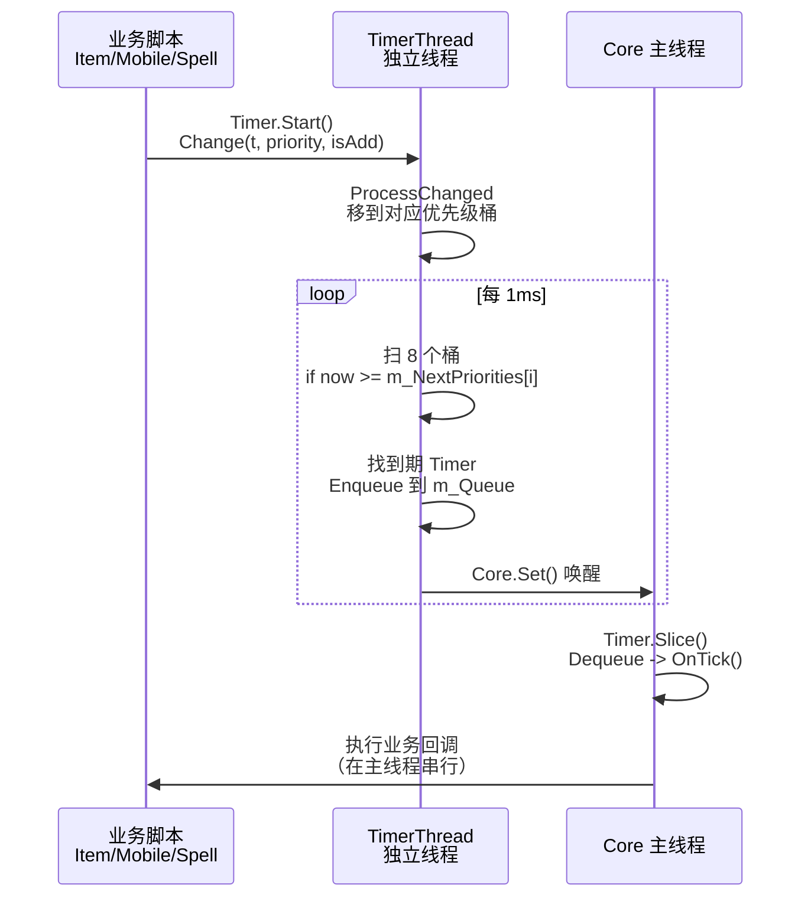

- TimerThread 每 1ms 醒一次，按优先级桶扫到期 Timer，塞进 `m_Queue`，`Core.Set()` 唤醒主线程。
- 主线程 `Timer.Slice()` 从 `m_Queue` Dequeue，调 `t.OnTick()`。
- **好处**：不需要维护一个全局有序优先队列；1 分钟级 Timer 不被频繁检查；20000 个 Timer 也只扫 8 个桶。
- `Timer.DelayCall(TimeSpan, callback)` 是最常用的延迟回调 API，泛型重载支持 0-4 个 state 参数。
- 新增 Timer 时 `ComputePriority(interval)` 自动按间隔归类：>=10 分钟进 OneMinute 桶，>=5 秒进 TwoFiftyMS 桶，<500ms 进 EveryTick 桶。

### 22.3 `Server/Serial.cs` —— 32 位自增编号

```csharp
private static Serial m_LastMobile = Zero;          // 从 1 开始
private static Serial m_LastItem = 0x40000000;      // 从 10 亿开始
public bool IsMobile => (m_Serial > 0 && m_Serial < 0x40000000);
public bool IsItem   => (m_Serial >= 0x40000000 && m_Serial <= 0x7FFFFFFF);
public static Serial NewMobile {
    get { while (World.FindMobile(m_LastMobile = (m_LastMobile + 1)) != null) ;
          return m_LastMobile; }
}
```

- 用一位"段"区分 Mobile/Item，不用两张表；客户端 packet 里看到 serial 就知道是怪物还是物品。
- 32 位有符号 int，最高位不用。

### 22.4 `Server/World.cs` —— 世界根与存档

- `m_Mobiles` / `m_Items` 是 `Dictionary<Serial, T>`，O(1) 查找。
- `Load()` 走 `.idx` -> `.tdb` -> `.bin` 三段式（索引/类型表/数据体），失败时交互式问要不要删坏档。
- `Save()` 先 `NetState.Pause()` 暂停收包，再 `SaveStrategy.Acquire()` 选存档策略（Standard/Parallel/Dynamic/Dual），写完 `NetState.Resume()`。

### 22.5 `Server/Network/MessagePump.cs` —— 收包分发

```csharp
// 行 206-345 HandleReceive 核心循环
while (length > 0 && ns.Running)
{
    int packetID = buffer.GetPacketID();
    PacketHandler handler = ns.GetHandler(packetID);
    int packetLength = handler.Length;
    if (packetLength <= 0) packetLength = buffer.GetPacketLength(); // 动态包
    if (length < packetLength) return;                              // 粘包：等下一片
    if (handler.Ingame && ns.Mobile == null) { ns.Dispose(); return; }
    packetLength = buffer.Dequeue(packetBuffer, 0, packetLength);
    PacketReader r = new PacketReader(packetBuffer, packetLength, handler.Length != 0);
    handler.OnReceive(ns, r);
}
```

**粘包处理**：循环从 ByteQueue 取包，不够长就 return 等下次。固定长度包用注册表长度，动态包读字节 2-3。

### 22.6 `Server/Serialization.cs` —— GenericWriter/Reader

抽象出 `Write(int)/Write(string)/Write(Item)/WriteMobileList` 等 100+ 重载，具体实现 `BinaryFileWriter` 走 64KB 缓冲写文件。所有 Item/Mobile 的 `Serialize` 都调它，**存档格式是自带版本号的二进制流**，不是 .NET BinaryFormatter。

### 22.7 `Scripts/Items/Consumables/AgilityPotion.cs` —— 典型物品脚本

```csharp
public class AgilityPotion : BaseAgilityPotion
{
    [Constructable]
    public AgilityPotion() : base(PotionEffect.Agility) { }
    public AgilityPotion(Serial serial) : base(serial) { }
    public override int DexOffset => 10;
    public override TimeSpan Duration => TimeSpan.FromMinutes(2.0);
    public override void Serialize(GenericWriter writer) {
        base.Serialize(writer);
        writer.Write((int)0);   // version
    }
    public override void Deserialize(GenericReader reader) {
        base.Deserialize(reader);
        int version = reader.ReadInt();
    }
}
```

**模式**：双构造（公开无参 + Serial）+ 版本化 Serialize/Deserialize。GM `[add agilitypotion` 走 `[Constructable]` ctor；加载存档走 `(Serial)` ctor。

### 22.8 `Scripts/Spells/First/MagicArrow.cs` —— 典型法术

见第 16.3 节。模式：`SpellInfo` 静态元数据 + `OnCast` 进入 Target + `Target(IDamageable)` 结算。

### 22.9 `Scripts/Services/Spawner/Spawner.cs` —— 刷怪器

`Item` 子类 + `InternalTimer` 周期检查 + 反射 `Type.GetType(name)` new 怪物。`[Constructable]` 让 GM 能直接 `[add spawner_timed "Orc,3,5,10" 5 10 0 5` 刷一组。

### 22.10 `Scripts/Accounting/Account.cs` —— 账号

`IAccount` 实现，`Mobile[m_Slot]` 索引器，密码 MD5/SHA1/SHA512 三套兼容，`YoungDuration = 40 小时` 新手保护期。

### 22.11 `Server/Sector.cs` —— 地图分块与可见性

Map 按固定大小切成 `Sector` 网格，每个 Sector 维护两个列表：`List<Mobile>` 和 `List<Item>`。玩家或怪物移动跨 Sector 时：

```csharp
// Server/Mobile.cs 行 3186-3190 节选
Sector oldSector = map.GetSector(oldX, oldY);
Sector newSector = map.GetSector(x, y);
if (oldSector != newSector)
{
    // 离开旧块：遍历 oldSector，对每个实体调 OnMoveOff
    // 进入新块：遍历 newSector，对每个实体调 OnMoveOver
}
```

`OnMoveOver` 内部做两件事：
1. 如果对方是玩家且自己在视野范围内，发 `MobileIncoming` 包让客户端看到自己。
2. 如果自己是玩家且对方在视野范围内，发 `MobileIncoming` 包让自己看到对方。

视野距离 `Core.GlobalUpdateRange = 18` 格。这就是 ServUO 的"AOI"——没有圆形距离判定，只靠 Sector 差量。

### 22.12 `Server/Gumps/Gump.cs` —— 服务端 UI

```csharp
public abstract class Gump
{
    public Gump(int x, int y) { ... }
    public Gump(int x, int y, int typeID) { ... }
    protected void AddPage(int page) { ... }
    protected void AddButton(int x, int y, int idle, int active, int retval, int buttonID, int param) { ... }
    protected void AddLabel(int x, int y, int hue, string text) { ... }
    protected void AddImage(int x, int y, int gumpID) { ... }
    public override void OnResponse(NetState sender, RelayInfo info) { ... }
}
```

派生类在构造函数里 Add 各种控件，`SendTo(ns)` 把整个 Gump 打包发给客户端；玩家点按钮后客户端回 0xB1 包，服务端构造 `RelayInfo` 调 `OnResponse`。一个典型的"确认对话框"Gump 不到 50 行代码。

### 22.13 `Scripts/Commands/Handlers.cs` —— GM 命令

```csharp
// 行 22-45
CommandSystem.Prefix = "[";
Register("Go", AccessLevel.Counselor, Go_OnCommand);
Register("Save", AccessLevel.Administrator, Save_OnCommand);
Register("BCast", AccessLevel.GameMaster, BroadcastMessage_OnCommand);
Register("Props", AccessLevel.GameMaster, Properties_OnCommand);
```

玩家在游戏里打 `[Go 1000 1000 0` 就飞到坐标；`[props` 打开属性编辑器 Gump 直接改任何实体字段。命令系统是 UO 私服运营的核心工具，比任何后台管理都直接。

### 22.14 `Ultima/` 独立项目 —— mul/uop 资源读取

解决方案里第一个项目 `Ultima/Ultima.csproj` 是个纯类库，负责读 UO 客户端的静态资源文件：
- `map0.mul` / `map1.mul`：地图高度和瓦片
- `staidx0.mul` / `statics0.mul`：静态物件（树/墙/山）
- `art.mul` / `art.uop`：美术图
- `gump.mul` / `gump.uop`：UI 图
- `tiledata.mul`：瓦片属性（可走/高度/名称）
- `hues.mul`：调色板

`Server/Map.cs` 启动时 `Map.AllMaps.Tiles.Force()` 把这些文件按需加载进内存。这部分代码和游戏逻辑完全解耦，只负责"给坐标返回 tile 数据"。

### 22.15 `Server/Region.cs` —— 区域与 Guard

Region 是地图上的一个矩形/多边形区域，有自己的规则：
- `CanMove`：能不能走（房屋里不能随便进）
- `OnEnter` / `OnExit`：玩家进出时触发
- `Guard`：是否有守卫，犯罪玩家进了会被守卫攻击
- `Region.House`：房屋区域，房主可以设锁

`Mobile.UpdateRegion()` 在移动后重新计算自己在哪个 Region，广播区域变更包。`Data/Regions.xml` 定义了 Felucca/Trammel 等大区域，脚本里可以自定义小区域（如副本、PvP 竞技场）。

### 22.16 `Server/Network/ByteQueue.cs` —— 粘包缓冲

每个 NetState 持有一个 `ByteQueue`，是一个可扩容的环形字节缓冲。`MessagePump.HandleReceive` 循环：
1. `buffer.GetPacketID()` 偷看第一个字节。
2. 查 `PacketHandler.Length`：固定包直接取长度；动态包 `buffer.GetPacketLength()` 读第 2-3 字节。
3. `if (length < packetLength) return;` —— 不够长就等下次 IO。
4. `buffer.Dequeue(packetBuffer, 0, packetLength)` 取出完整包。
5. 调 `handler.OnReceive(ns, reader)`。

这种"偷看包头 + 长度表 + 不够就等"的模式是 TCP 粘包处理的经典写法，和 LYFMMORGP 的 GameCommand 队列思路一致，但 ServUO 是按字节流处理，不是按帧。

### 22.17 `Server/Customs Framework/` —— 自定义存档扩展

`SaveData` 基类允许脚本定义自己的存档对象（不和 Item/Mobile 绑定），比如全局排行榜、系统配置、活动状态。它们走 `Saves/Customs/SaveData.{idx,tdb,bin}` 三段式，和 Mobiles/Items 完全独立。

### 22.18 AccessLevel 权限等级

`AccessLevel` 枚举从低到高：Player / Counselor / GameMaster / Seer / Administrator / Owner。每个 `[CommandProperty]` 标注的属性都有读写权限等级，`[Constructable]` 构造函数也有最低权限。GM 打 `[props` 时，权限不够的字段灰显或隐藏。这是 UO 私服 staff 分层管理的核心。

### 22.19 `Server/Network/Listener.cs` —— TCP 监听

`Listener` 类封装 `TcpListener`，在 `MessagePump.Start()` 里按 `Listener.EndPoints` 创建多个。每个 Listener 跑异步 Accept：有新连接时 `Socket.BeginAccept` 回调，创建 `NetState` 并 `ns.Start()` 开始异步收包。Listener.Slice() 在主线程里被调，把新连接交给 MessagePump。

### 22.20 `Server/Network/SendQueue.cs` —— 发送队列

每个 NetState 有一个 `SendQueue`。业务代码 `ns.Send(packet)` 把 packet 字节追加到队列；主线程尾部 `NetState.FlushAll()` 统一 `Socket.BeginSend`。这种"批量发送"减少了系统调用次数，是高性能网络服务器的标配。

### 22.21 `Server/Network/Compression.cs` —— zlib 压缩

UO 客户端在传输大 Gump 和地图补丁时启用 zlib 压缩。`Compression` 类 P/Invoke `zlibwapi64.dll` 的 `zlibCompress` / `zlibDecompress`。出站包如果大于阈值，自动压缩；客户端连上来时协商是否启用。这是 90 年代末 56k 拨号网络的产物，但保留至今。

### 22.22 `Server/EventSink.cs` —— 静态事件总线

EventSink 是一个静态类，里面挂了几百个 `event EventHandler<TArgs>`。引擎在关键时机 `EventSink.InvokeXxx(args)` 触发，脚本可以用 `[CallPriority]` 静态方法订阅。典型事件：
- `WorldLoad` / `BeforeWorldSave` / `WorldSave` / `AfterWorldSave`
- `Login` / `Logout`
- `MobileCreated` / `MobileDeleted`
- `PlayerDeath` / `PlayerResurrected`
- `CastSpellRequest`
- `RegionEntered` / `RegionChanged`
- `Speech`（NPC 听玩家说话）

这种设计的好处是脚本不用继承任何基类就能 hook 引擎行为；坏处是事件太多后调试困难（不知道谁改了行为）。

---

## 23. 可借鉴到 LYFMMORGP 的设计

| ServUO 机制 | LYFMMORGP 现状 | 借鉴点 | 接入成本 |
|---|---|---|---|
| **8 级优先级 Timer 桶 + TimerThread 独立扫** | 20Hz 固定 tick 里跑所有 Timer | 把"高频短 Timer"（战斗冷却）和"低频长 Timer"（每日重置）分桶扫描，主循环每片只处理到期队列；不要每 tick 遍历所有 Timer | 中。GameServer 加 `TimerBucket` 静态类，按 10/50/250/1000ms 分桶 |
| **World.Save 三段式 .idx/.tdb/.bin** | 用 SqlSugar 写 MySQL | 对"高频读、全量写"的世界实体（地图物件、刷怪点），可借鉴"内存字典 + 定期批量落盘 + 索引分离"思路；但 LYFMMORGP 玩家数据仍走 MySQL | 高。需权衡，不要全改 |
| **PacketHandlers 静态注册表 0x100 槽 + ingame 门禁** | Protobuf + proto 生成 | ServUO 用"包号+固定长度"做极致快分发；LYFMMORGP 用 protobuf 已更现代，不需要学分发。但"按 ingame/非 ingame 状态门禁"（没进世界就拒绝游戏包）值得在 Gate 加：未登录连接只放行 Login/Gate 握手包，其余直接 Dispose | 低。GateServer 加 packetID->needLogin 标志位 |
| **双构造（运行时 ctor + Serial ctor）+ version 号 Serialize** | 配置走 Luban 表，逻辑在 Hotfix dll | GM 动态生成实体走 `[Constructable]` ctor，加载存档走 `(Serial)` ctor，职责分离；每个类 `int version` 字段保证热更后老存档仍能读 | 中。HybridCLR 热更 dll 实体类统一加 version 字段 |
| **Sector 分块 + 跨块 OnMoveOver/OnMoveOff** | AOI 同图 100 米广播 | 可借鉴"Sector 变更时才做可见性差量计算"，避免每帧全量广播；现有圆形 AOI 已够用，不必重写 | 中 |
| **存档前 NetState.Pause() + 存档后 Resume** | 存档时直接写 MySQL | 大存档前 Gate 先暂停该服新包、做完再 resume，避免存档过程中状态变化导致半成功；GameServer 加"存档中"标志位丢弃移动/战斗包 | 低 |
| **World.OnDelete 安全队列** | 无 | 存档期间如果脚本删实体，不直接删而是入 `_deleteQueue`，存档结束后再处理；避免正在写的数据被改 | 中 |
| **PacketThrottles 高频包限流** | 未见 | ServUO 对移动等高频包有令牌桶限流，防客户端刷包；LYFMMORGP Gate 可加每秒包数阈值 | 低 |
| **EventSink 静态事件总线** | 现有逻辑散在各 Manager | 用一个静态类集中所有生命周期事件（登录/登出/升级/死亡/存档前后），脚本一行订阅；避免各 Manager 互相引用 | 中 |
| **AutoResetEvent 网络包即时唤醒主循环** | 固定 20Hz tick | 固定 tick 对同步友好，不要改成事件驱动；但"Gate 收到包立刻唤醒 GameServer、不等下一个 tick"可降低移动延迟 | 低 |
| **Core.VerifySerialization 启动时自检** | 无 | 启动时反射检查每个实体子类有没有 Serialize ctor + Serialize/Deserialize 方法，缺了就警告；避免热更后某个类漏了序列化方法 | 低 |
| **NetState 跟踪 Gump/Menu/HuePicker 列表** | 无 | 服务端跟踪每个玩家开了哪些 UI，登出/关服时统一关闭；LYFMMORGP 玩家登出时应清理所有打开的弹窗 | 低 |
| **Expansion 开关 + `if (Core.AOS)`** | 无 | 用枚举+全局开关切新旧规则，比 `#if` 编译期开关灵活；多版本兼容时可借鉴 | 低 |

### 23.1 不建议借鉴的点

- **单线程模型**：LYFMMORGP 已经是多服分布式，不要倒退到单进程。
- **私有二进制存档**：MySQL + SqlSugar 已经够用，不要换成文件存档。
- **服务端 Gump**：Unity UGUI 表现力强得多，不要把 UI 逻辑搬服务端。
- **无寻路**：现代 MMO 怪物必须有寻路，不要学 UO 的直线撞墙。
- **MD5 密码哈希**：老客户端协议限制，现代系统必须用 bcrypt/argon2。

---

## 24. 局限、坑与二次开发注意

| 坑 | 说明 |
|---|---|
| **GPL v2 传染** | 二次开发闭源商用有法律风险，私服玩家基本无视但公司项目不能直接抄 |
| **无现代客户端** | 所有 UI/表现都绑死在 UO 客户端协议上，想换 Unity 客户端必须重写整个 packet 层 |
| **单线程瓶颈** | 所有游戏逻辑在 Core 主线程，几千人在线时一个慢脚本（比如复杂 Spawner）就能卡全服；不能靠多核扩展 |
| **无寻路** | 怪物卡墙是常态，大型副本体验差 |
| **存档格式私有** | `.bin/.idx/.tdb` 没有官方文档，升级版本时字段加错就崩档；version 号管理是生命线 |
| **脚本编译改回外部 dotnet build** | 老 RunUO 是进程内 CodeDom 编译，现代 ServUO 改成启动时 `dotnet build Scripts.csproj`，**服务器上必须装 dotnet SDK**，不能只装 Runtime |
| **必须有 UO 客户端资源** | mul/uop 文件版权在 EA，私服普遍靠玩家自带，商用即侵权 |
| **6323 个文件里 95% 是内容脚本** | 想读引擎只看 `Server/`，别被 Scripts 吓到 |
| **Serial 32 位上限** | Mobile Serial 上限 ~10 亿，Item 也是 ~10 亿，老服长期运行后 Serial 会耗尽（虽然实际很少见） |
| **默认端口 2593** | 老 UO 私服圈都知道这个端口，扫端口的机器人会立刻来 |
| **脚本与引擎同程序集边界** | Scripts.dll 引用 Server.dll，但脚本里可以直接 new 任何引擎类，没有模块隔离；一个 bug 脚本就能搞崩整个进程 |
| **存档期间禁止新实体** | `World.OnDelete` 在 Saving/Loading 时把删除请求入队 `_deleteQueue`，避免存档中途实体被删导致索引错位；这是个细节但很关键 |
| **MD5 密码哈希** | 老客户端协议用 MD5，虽然有 SHA512 升级路径，但默认仍兼容 MD5，安全性弱 |
| **无热更** | 改任何脚本都要重启服务器；6000+ 文件改一个也要全量 dotnet build |
| **Serial 递增不回收** | 删除实体后 Serial 不复用，长期运行后 Serial 会逼近上限（虽然实际要很多年） |
| **单进程无水平扩展** | 不能像现代 MMO 那样开多个 GameServer 分片；一个 shard 就是一个进程 |
| **无 Web 后台** | 所有管理都靠游戏内 GM 命令，没有 Web UI；运营私服要靠 `[props` 和日志 |
| **存档全量写** | 每 15 分钟全量序列化所有 Mobiles/Items，在线人数多时存档会卡几秒；DynamicSaveStrategy 缓解但不解决 |
| **脚本与引擎紧耦合** | Scripts 直接引用 Server 程序集，改引擎基类会 break 无数脚本；版本升级痛苦 |

---

## 25. 面试讲述话术

### 30 秒一句话

"ServUO 是 C# 写的 Ultima Online 服务端模拟器，单进程双线程：主线程串行跑所有游戏逻辑，TimerThread 独立扫 8 级优先级时间桶；网络用 TCP 2593 固定二进制包，IO 线程只收字节、主线程分发包；世界状态全序列化成 `.bin/.idx/.tdb` 三段式文件，不用数据库；6000+ 游戏内容就是 6000 个 C# 类，启动时 dotnet build 成 Scripts.dll 反射加载。"

### 2 分钟展开

"我读的是 Server/ 核心引擎，大概 70 个文件。它的主循环很老派但很精妙：主线程 WaitOne 在 AutoResetEvent 上，IO 线程收到包就 Set 唤醒，醒了之后固定顺序跑 ProcessDeltaQueue -> Timer.Slice -> MessagePump.Slice -> NetState.FlushAll。Timer 系统不是用一个全局优先队列，而是按间隔分了 8 个桶——10ms、25ms、50ms、250ms、1s、5s、1min——TimerThread 每 1ms 扫一次，把到期的扔到队列里让主线程跑，这样一万个 1 分钟级 Timer 也不会拖累 10ms 级的战斗 Timer。

网络方面，UO 协议是固定字节布局的二进制包，0x00 到 0xFF 注册了一个 handler 表，动态包读第 2-3 字节长度。登录流是 0xEF seed -> 0x80 账号密码 -> 0x91 角色列表 -> 0x5D 进世界，全在一个进程一个端口里，没有独立 LoginServer。移动是客户端预测 + 服务端回滚，客户端先动，服务端 `Mobile.Move(dir)` 查 tile 碰撞和 Sector 实体，失败就回 MovementRej。

存档是它最特别的：没有 MySQL，世界全在内存 `Dictionary<Serial, Mobile>` 里，每 15 分钟全量序列化到 `Saves/Mobiles/*.bin`。每个实体自己写 `int version` 到流开头，老存档升级时按版本分支读。脚本体系是'C# 类即内容'——写个新药水就是写个 `AgilityPotion : BaseAgilityPotion` 类，加 `[Constructable]` 特性，GM 打 `[add agilitypotion` 就反射 new 一个出来。"

### 高频追问

1. **Q：为什么单线程能撑住？** A：因为 IO 异步化了，网络收发不阻塞主线程；逻辑本身是内存操作，几微秒级别；UO 老服同时在线也就一两千。
2. **Q：Timer 为什么分 8 个桶？** A：避免用 SortedSet 每次 O(log n) 插入；粗粒度 Timer 少扫、细粒度 Timer 高频跑，整体 O(1)。
3. **Q：存档为什么用三段式 .idx/.tdb/.bin？** A：`.tdb` 存类型名，`.idx` 存每条记录的位置和长度，`.bin` 是纯数据；加载时先读索引建字典，需要哪条 Seek 哪条；写时追加写，崩溃了索引还在就能恢复。
4. **Q：Serial 为什么分 Mobile/Item 两段？** A：一个 int 同时当 ID 和类型 tag，packet 里不用额外传类型；查找时 `World.FindMobile(serial)` vs `FindItem(serial)` 直接根据范围分流。
5. **Q：和现代 Protobuf 方案比有什么优劣？** A：固定字节省带宽、解析零拷贝；但不灵活、版本兼容差。现代项目用 protobuf 更安全，ServUO 是历史包袱也是极致性能。
6. **Q：Gump 为什么服务端构造？** A：90 年代客户端能力弱，服务端算好坐标客户端只画；坏处是延迟高，现在没人这么做。
7. **Q：脚本热更怎么做？** A：现代 ServUO 是启动时 dotnet build Scripts.dll，改脚本要重启；老 RunUO 是进程内 CodeDom。本质都是 C# 编译，不是解释型。
8. **Q：怪物 AI 怎么做？** A：就是写在 BaseCreature 子类里的状态机，每 tick Think 一次，没有行为树、没有寻路。
9. **Q：AOI 怎么做？** A：Sector 分块，跨块时遍历周围实体做可见性差量；视野范围 18 格、最大 24 格。
10. **Q：这套设计对我们项目有什么用？** A：Timer 分桶、存档前暂停收包、packet 表按状态门禁、version 化序列化这四点可以直接搬。
11. **Q：为什么 ServUO 不用数据库？** A：因为 UO 时代没有成熟的开源 MySQL ORM，而且世界是"全量小数据"——一个 shard 所有玩家+怪物+物品加起来也就几百 MB，全量序列化到文件比数据库事务快。现代 MMO 在线人数多、数据量大，必须用数据库。
12. **Q：存档崩溃了怎么办？** A：`.bin` 写一半断电的话，`.idx` 还是旧的，下次加载会读到半截数据；ServUO 有 DualSaveStrategy 双缓冲写两份，配合 `Backups/Archived` 自动归档。
13. **Q：怎么加一个新物品？** A：在 Scripts/Items 下新建一个 .cs，继承合适的基类（比如 `Item` 或 `BaseWeapon`），加 `[Constructable]` 构造函数，实现 Serialize/Deserialize，重启服务器，GM 打 `[add 类名` 就能刷出来。
14. **Q：怎么加一个新 GM 命令？** A：在 `Scripts/Commands/` 下写一个静态方法，在某个 `Initialize()` 里 `CommandSystem.Register("MyCmd", AccessLevel.GameMaster, MyCmd_OnCommand)`，玩家打 `[MyCmd xxx` 就触发。
15. **Q：和 RunUO 是什么关系？** A：ServUO 是 RunUO 的社区分叉，RunUO 官方已经停更，ServUO 继续维护到现在并支持最新客户端版本。
16. **Q：如果让你设计一个新 MMO 服务端，ServUO 哪些设计你会保留？** A：保留 Timer 分桶（性能好）、事件驱动主循环（不空转）、Packet 注册表（零查找分发）、version 化序列化（向前兼容）。不要保留：单线程（限制扩展）、私有二进制存档（可维护性差）、服务端 Gump（延迟高）、无寻路（体验差）。
17. **Q：ServUO 怎么处理粘包？** A：每个 NetState 有一个 ByteQueue，HandleReceive 循环取包：先偷看 packetID，查 handler.Length 知道整包多长，不够长就 return 等下次 IO，够长就 Dequeue 出来交给 handler。固定包和动态包（0xBF 扩展、0xD7 编码）分开处理。
18. **Q：ServUO 的 Timer 和 .NET 自带的 System.Threading.Timer 有什么区别？** A：System.Threading.Timer 在线程池线程上回调，需要加锁保护游戏状态；ServUO 的 TimerThread 只负责"标记到期"，真正的 OnTick 在主线程跑，完全不需要锁。这是为单线程游戏模型量身定制的。
19. **Q：ServUO 怎么做断线重连？** A：客户端断线后，`NetState.ProcessDisposedQueue` 清理；玩家再连上来时，`PlayCharacter` 检查 `m.NetState != null` 就 Dispose 旧连接，把 Mobile 绑到新 NetState。这就是"同账号顶号"逻辑。
20. **Q：ServUO 的 Gump 怎么防作弊？** A：Gump 按钮的 retval 是服务端定义的，客户端回什么 retval 服务端都校验；但 Gump 本身的逻辑全在服务端，客户端只是渲染，所以客户端改 UI 也没用。这是瘦客户端的好处。

---

## 26. 附录

### 26.1 关键文件清单（≥20 条）

| 路径 | 职责 |
|---|---|
| `ServUO/README.md` | 项目简介、Windows/Linux 编译运行说明 |
| `ServUO/LICENSE` | GPL v2 全文 |
| `ServUO/ServUO.sln` | 3 个项目：Ultima / Server / Scripts |
| `ServUO/Server/Server.csproj` | net48、x64、StartupObject=Server.Core |
| `ServUO/makefile` | Linux dotnet build + mono run |
| `ServUO/Server/Main.cs` | Core 静态类、Main 入口、主循环、命令行参数 |
| `ServUO/Server/World.cs` | 世界根、Serial 字典、Load/Save、广播 |
| `ServUO/Server/Timer.cs` | Timer 基类、TimerThread、8 级优先级桶、DelayCall |
| `ServUO/Server/Serial.cs` | Serial 结构、Mobile/Item 分段编号 |
| `ServUO/Server/Serialization.cs` | GenericWriter/Reader 抽象、BinaryFileWriter/Reader |
| `ServUO/Server/Item.cs` | 物品基类（6477 行）、双构造、版本化 Serialize |
| `ServUO/Server/Mobile.cs` | 生物/玩家基类（12821 行）、Move、属性、战斗 |
| `ServUO/Server/Map.cs` | Map/Facet 概念、Tiles 加载 |
| `ServUO/Server/Sector.cs` | 地图分块、实体列表 |
| `ServUO/Server/Region.cs` | 区域规则、CanMove、Guard |
| `ServUO/Server/ScriptCompiler.cs` | dotnet build Scripts.dll、反射 Invoke Configure/Initialize |
| `ServUO/Server/Attributes.cs` | Constructable/CommandProperty/CallPriority 特性 |
| `ServUO/Server/Network/NetState.cs` | 每个连接的状态、版本协商、加密接口 |
| `ServUO/Server/Network/MessagePump.cs` | 收包分发、HandleSeed、HandleReceive |
| `ServUO/Server/Network/PacketHandlers.cs` | 0x100 包号注册、所有 packet handler 实现 |
| `ServUO/Server/Network/Packets.cs` | 出站 Packet 类（LoginConfirm/MobileIncoming 等） |
| `ServUO/Server/Network/SendQueue.cs` | 每连接发送队列 |
| `ServUO/Server/Network/Compression.cs` | zlib 压缩 |
| `ServUO/Server/Persistence/SaveStrategy.cs` | 存档策略抽象 |
| `ServUO/Scripts/Accounting/Account.cs` | 账号、密码哈希、角色槽 |
| `ServUO/Scripts/Commands/Handlers.cs` | GM 命令 [Go [Save [BCast 等注册 |
| `ServUO/Scripts/Items/Consumables/AgilityPotion.cs` | 典型物品脚本样本 |
| `ServUO/Scripts/Spells/First/MagicArrow.cs` | 典型法术脚本样本 |
| `ServUO/Scripts/Services/Spawner/Spawner.cs` | 刷怪器 Item |
| `ServUO/Config/Server.cfg` | 监听 IP/端口 2593 |
| `ServUO/Config/AutoSave.cfg` | 15 分钟自动存档配置 |

### 26.2 官方链接

- 仓库：https://github.com/ServUO/ServUO
- 官网：https://www.servuo.dev
- Discord：https://discord.gg/0cQjvnFUN26nRt7y

### 26.3 术语表

| 术语 | 含义 |
|---|---|
| Facet | UO 的"地图位面"，即不同世界（Felucca/Trammel 等） |
| Serial | 32 位实体唯一编号，Mobile 1~0x3FFFFFFF，Item 0x40000000+ |
| Gump | 服务端下发的 UI 窗口 |
| Facet / Mul / UOP | UO 经典地图/资源文件格式 |
| BOD | Bulk Order Deed，批量订单任务 |
| Reagent | 施法药材 |
| Warmode | 战斗模式（拔刀状态） |
| Sector | 地图分块，可见性广播的最小单位 |
| Hue | 颜色 ID（0-3000+，客户端调色板索引） |
| ItemID | 美术图 ID（art.mul 里的帧号） |
| Body | 生物模型 ID（女性人类=400，男性=401） |
| Notoriety | 声望等级，决定名字颜色和 guard 敌对 |
| Karma / Fame | 善恶值 / 声望值 |
| BSO / Best Skill | 最高技能用于经验分配 |
| Spellbook | 魔法书，记载已学咒语 |
| Ankh | 复活点 |

### 26.4 与 LYFMMORGP 架构对比速查

| 维度 | ServUO | LYFMMORGP |
|---|---|---|
| 进程模型 | 单进程 | 四服 Center/Login/Gate/Game |
| 主线程 | 1 个 Core 线程 + 1 个 TimerThread | GameServer 1 个主线程 |
| 网络协议 | 固定二进制 Packet | Protobuf |
| 数据库 | 无（二进制文件存档） | MySQL + Redis |
| 同步模型 | 状态同步 + 客户端预测 | 状态同步 + 客户端预测 |
| 帧驱动 | 事件驱动（WaitOne 唤醒） | 固定 20Hz Tick |
| 脚本体系 | C# 类即内容，启动时编译 Scripts.dll | Unity HybridCLR 热更 DLL |
| UI | 服务端 Gump 下发 | Unity UGUI 本地渲染 |
| AOI | Sector 分块差量 | 圆形 100 米广播 |
| 寻路 | 无 | 待实现 |

### 26.5 ServUO 关键设计决策回顾

读完整套代码后，可以总结出 ServUO 在 2000 年代初做出的几个关键设计权衡：

1. **单线程 vs 多线程**：选单线程，因为 90 年代锁很贵、脚本没人写线程安全代码。代价是无法利用多核。
2. **文件存档 vs 数据库**：选文件存档，因为 UO 时代没有成熟开源 ORM，且世界状态全量小。代价是无法做 SQL 查询。
3. **C# 类即脚本 vs 嵌入式 Lua**：选 C# 类即脚本，因为 C# 有类型安全和反射，且 RunUO 团队是 .NET 爱好者。代价是改代码要重启。
4. **服务端 UI vs 客户端 UI**：选服务端 Gump，因为 90 年代客户端能力弱。代价是表现力差、延迟高。
5. **固定 Packet vs Protobuf**：选固定 Packet，因为 90 年代带宽贵、要极致紧凑。代价是版本兼容痛苦。

这些决策在当时都是合理的，但放到今天大多成了"历史包袱"。理解每个决策背后的权衡，比直接背代码更重要。

### 26.6 阅读本源码的推荐路径

如果你想快速吃透 ServUO，建议按这个顺序读：

1. `Server/Main.cs` 的 `Main` 函数（30 行启动顺序 + 30 行主循环）——先建立全局观。
2. `Server/Timer.cs` 的 `TimerThread.TimerMain` 和 `Timer.Slice`——理解双线程协作。
3. `Server/Network/MessagePump.cs` 的 `HandleReceive`——理解收包分发。
4. `Server/Network/PacketHandlers.cs` 静态构造函数——看 256 个包怎么注册。
5. `Server/World.cs` 的 `Load` 和 `Save`——理解三段式存档。
6. `Server/Item.cs` 的 `Serialize`/`Deserialize`——看版本化二进制怎么写。
7. `Scripts/Items/Consumables/AgilityPotion.cs`——看一个最小内容脚本长什么样。
8. `Scripts/Spells/First/MagicArrow.cs`——看法术怎么写。
9. `Scripts/Services/Spawner/Spawner.cs`——看刷怪器怎么写。
10. `Scripts/Accounting/Account.cs`——看账号系统。

前 6 步是引擎，后 4 步是内容，读完就能自己改 ServUO。

---

> **未验证项**：本环境未安装 dotnet SDK、未准备 UO 客户端与 mul 资源，**未实际编译或运行 ServUO**；所有运行时行为结论来自静态走读 `F:\MMORPG_OpenSource\ServUO\` 源码。Packet 字节布局、客户端版本协商细节、存档二进制具体格式未做运行时 dump 验证。
