# UnityMMO 源码解析（Lua 热更客户端 + skynet 后端）

> **文档信息**
>
> | 项目 | 内容 |
> | --- | --- |
> | 项目名 | UnityMMO |
> | 仓库来源 | https://github.com/liuhaopen/UnityMMO  |
> | 版本/分支 | 本地静态快照（README 最后更新约 2020-10，GIF 记录截至 21.06.28） |
> | 许可证 | MIT License（Copyright (c) 2018 大鹏） |
> | 解析日期 | 2026-10-15 |
> | 解析方式 | **纯静态源码走读，未编译、未运行**（Windows 环境无法编译 Linux skynet，且未拉取美术资源仓库） |
> | 一句话定位 | 个人业余项目：Unity 2019.4 + XLua 热更 3D MMO 客户端，后端跑在 cloudwu/skynet 上，协议用 sproto，服务端业务全部用自研 Lua ECS 实现 |

> **重要前置说明（必须先读）**
>
> 1. 本解析仅基于本地 `F:\MMORPG_OpenSource\UnityMMO\` 静态源码，**没有编译、没有连库、没有跑过一次**，所有"运行行为"描述均来自代码推演。
> 2. `.gitmodules` 声明了两个子模块 `Server/skynet`（cloudwu/skynet）与 `Server/lsocket`，**本地快照中这两个目录是空的**（`Server/skynet/skynet.exe`、`Server/skynet/lualib/skynet.lua` 均不存在），因此 skynet C 层源码本仓库看不到，只能从 `Server/config`、`Server/run.sh` 与业务 Lua 代码反推其用法。
> 3. 美术与资源不在本仓库（README 指向独立仓库 `UnityMMO-Resource`），`Assets/AssetBundleRes` 在本快照中不存在，**客户端场景资源无法验证**。
> 4. README 写明 2020.03.08 起"把服务器代码分隔到另外的 git 项目"（`SkynetMMO`），但本快照的 `Server/` 下仍保留了一份完整服务端 Lua 业务代码，以本快照实际文件为准。

---

## 1. 项目概览

UnityMMO 是作者"大鹏（liuhaopen）"2018 年起步的个人 3D MMO 教学/练手项目。作者在 README 里开宗明义："很多东西不好在工作项目上尝试（比如 ECS），所以就有了本项目……前端主要用 lua 开发，后端用 skynet"。

它的技术选型在 2019~2021 年的中文独立游戏圈非常有代表性：

- 客户端：Unity 2019.4 LTS + 腾讯 **XLua** 做业务热更，资源走 AssetBundle，资源清单/热更走自建 HTTP 文件服务器。
- 后端：直接拿开源 actor 框架 **cloudwu/skynet** 当底座，登录复用 `snax.loginserver`、网关复用 `snax.msgserver`，业务全 Lua。
- 协议：skynet 官方的 **sproto**（不是 protobuf），客户端侧还有一份 C# 版 sproto 实现，由 `Tools/sprotodump` 从同一份 `.lua` 协议文本生成 C# 协议类。

发展脉络（README "Recent GIF" 时间线）：

- 2019.07：自动寻路找 NPC 对话/打怪、副本切场景。
- 2019.08：背包、GM、基于 action 组件的技能系统。
- 2019.09：Buff（火/毒/冰冻/晕眩/吸血/扣属性/沉默）、安卓资源压缩（ETC2/ASTC）。
- 2020.03：服务器代码拆到独立仓库 `SkynetMMO`。
- 2021.06.28：作者宣布**放弃 Unity 官方 Entities（DOTS）**，因为不好热更也不好用，转而用 Lua 自己实现了一套 ECS（独立仓库 `liuhaopen/ecs`，作为子目录 `Server/lualib/ECS` 与 `Lua/ecs` 存在）。

**与同类对比**：相比 ET（C# 全热更 + 自研 actor）、ServUO（脚本化 UO 服务端），UnityMMO 的特色是"客户端热更用 XLua、服务端热更几乎免费（skynet 本来就是 Lua）、协议层直接复用 skynet 全家桶"，是研究**skynet MMO 标准套路**（logind/gated/msgagent/dbserver/world/scene 五段式）最干净的中文样本。

---

## 2. 技术栈与运行环境

| 维度 | 实际情况 | 证据 |
| --- | --- | --- |
| Unity 编辑器版本 | **2019.4.28f1c1** | `ProjectSettings/ProjectVersion.txt` |
| 客户端语言 | C#（少量原生）+ Lua（业务主体） | `Assets/Scripts/**/*.cs`、`Lua/**/*.lua` |
| Lua 虚拟机 | XLua（腾讯），源码整体内嵌在仓库 | `Assets/XLuaFramework/XLua/Src/LuaEnv.cs` |
| 服务端语言 | Lua 5.x（skynet 内嵌 LuaJIT/Lua），C 层为 skynet | `Server/config` |
| 服务端框架 | **cloudwu/skynet**（actor 消息模型，8 条 worker 线程） | `.gitmodules`、`Server/config` `thread = 8` |
| 序列化 | **sproto**（不是 protobuf） | `Lua/Proto/*.lua`、`Server/common/sprotoloader.lua`、`Assets/Scripts/Net/Sproto/*` |
| 数据库 | MySQL（`skynet.db.mysql`），**无 Redis** | `Server/service/dbserver.lua`、`Server/service/main.lua` |
| 网络 | TCP（客户端 `TcpClient`，服务端 skynet gate） | `NetworkManager.cs`、`Server/service/gated.lua` |
| 客户端 ECS | 早期 Unity DOTS Entities 0.1.1-preview，**后期业务迁到自研 Lua ECS** | `Packages/manifest.json`（`com.unity.entities: 0.1.1-preview`）、`Server/lualib/ECS/ECS.lua` |
| 资源 | AssetBundle（非 YooAsset/Addressables，尽管 manifest 里有 addressables 包，实际热更走自建 AB 清单） | `Assets/XLuaFramework/Scripts/Manager/AssetsHotFixManager.cs`、`ResourceManager.cs` |
| 第三方资源包 | Unity `com.unity.cinemachine 2.3.4`、`com.unity.timeline 1.2.18`、TextMeshPro 2.1.4 | `Packages/manifest.json` |

文件规模（任务给定口径）：约 227 个 C#、396 个 Lua、29 个 C/C++。本快照内 `Server/skynet` 子模块为空，C/C++ 文件应主要落在 skynet 与 lsocket 子模块中。

---

## 3. 许可证与商用/二次开发注意事项

`LICENSE` 全文是标准 **MIT License**，Copyright (c) 2018 大鹏：

- 允许商用、修改、分发、私有化，唯一义务是在副本中保留版权声明与免责声明。
- 代码层面无贡献者协议（CLA）要求。
- **美术资源除外**：README 明确说资源放在另一个仓库 `UnityMMO-Resource`，且"有些插件因为版权问题就没上传了，从其中的 download-page 见购买链接"——即**本仓库只给代码，美术资源是单独的商业/免费素材包**，二次发行时不能默认随代码一起分发美术资源。
- 依赖项各自有 license：XLua 本身 MIT、skynet 也是 MIT、MySQL 驱动等按各自声明。

结论：代码可放心抄可商用；美术资源需自行替换。

---

## 4. 目录结构详解

### 4.1 真实扫描的目录树

```text
UnityMMO/
├── Assets/                     # Unity 客户端工程
│   ├── Scripts/
│   │   ├── Game/               # 业务 C#：ECS 系统/角色/怪物/场景/UI/网络
│   │   │   ├── Net/            #   网络层：NetMsgDispatcher、Sproto/*、SynchFromNet
│   │   │   ├── Modules/        #   Role/Monster/NPC/Fight/Looks 等客户端业务模块
│   │   │   ├── Scene/          #   场景管理、相机、八叉树式 SceneSeparateFrameWork
│   │   │   ├── Systems/       #   客户端 DOTS ECS 系统（移动/伤害/特效/名字板）
│   │   │   ├── Timeline/      #   技能 Timeline Clip/Behaviour
│   │   │   └── Config/        #   GameConst/ConfigGame/ResPath 等
│   │   └── Editor/            #   编辑器扩展（打包/纹理格式/场景导出服务器）
│   ├── XLuaFramework/
│   │   ├── XLua/Src/          #   XLua 运行时源码
│   │   └── Scripts/            #   Main.cs 启动状态机、NetworkManager、XLuaManager、热更
│   ├── Plugins/  Resources/  Terrain To Mesh/  TextMesh Pro/ ...
├── Lua/                        # XLua 业务脚本（热更主体）
│   ├── LuaMain.lua NetDispatcher.lua global.lua BaseRequire.lua
│   ├── Proto/                  # sproto 协议文本（6 个文件）
│   ├── Common/                 # UI 组件、事件、定时器、sproto 实现
│   ├── ecs/                    # 客户端 Lua ECS（与服务端同源）
│   └── Game/                  # 业务：Login / Scene / Bag / Task / Chat / GM / MainUI / UI
├── Server/                     # skynet 后端（业务 Lua 部分）
│   ├── config run.sh stop.sh   # skynet 启动配置与脚本
│   ├── service/               #   main/logind/gated/msgagent/dbserver/protoloader
│   ├── game/
│   │   ├── service/            #   world/scene/chat/id_service
│   │   ├── scene/              #   SceneMgr/RoleMgr/MonsterMgr/aoi.lua/FightMgr/...
│   │   │   ├── system/         #   ECS System：MovementUpdate/Damage/Skill/AI/Action
│   │   │   ├── fight/          #   Buff/Hurt/Ability/PickTarget/SkillActions...
│   │   │   ├── ai/             #   MonsterFSM + state/Patrol/Fight/Dead
│   │   │   └── com/            #   组件数据（SpeedData 等）
│   │   ├── account/ bag/ chat/ task/ gm/
│   │   ├── config/scene/       #   场景/怪物/NPC/掉落/技能 配置
│   │   └── service/            #   见上
│   ├── lualib/
│   │   ├── ECS/                #   自研 Lua ECS（Archetype/Chunk/World/...）
│   │   ├── Action/             #   行为节点库（Sequence/Parallel/Condition/...）
│   │   └── Blueprint/          #   FSM / 行为蓝图框架
│   ├── common/                 #   skynet 共用：sprotoloader、helper、BOD
│   ├── data/ log/              # 运行期数据与日志
│   ├── skynet/  lsocket/       # ★ 子模块，本快照为空
├── Tools/                      # LuaEncoder（luajit 字节码）、sprotodump（协议→C#）
├── Packages/ ProjectSettings/  # Unity 工程
├── config_unitymmo.json        # 运行时文件服务器地址（FileServerURL=http://192.168.43.130）
└── README.md LICENSE .gitmodules
```

### 4.2 一级目录职责表

| 目录 | 职责 |
| --- | --- |
| `Assets/` | Unity 工程根。放引擎侧不可热更的 C# 骨架（网络、启动、表现层 ECS 残留、相机、Timeline） |
| `Lua/` | **热更业务主体**：登录、选角、场景表现、角色/怪物 actor、UI、背包、任务、聊天、GM |
| `Server/` | skynet 后端。`service/` 是 skynet 启动入口与网关/登录/agent，`game/` 是业务，`lualib/` 是自研 ECS/Action/Blueprint 框架 |
| `Tools/` | 协议→C# 代码生成（sprotodump）、LuaJIT 字节码编码器 |
| `Build/` | Unity 出包产物（快照里未细看） |
| `config_unitymmo.json` | 运行期热更文件服务器 URL |

### 4.3 目录结构图（Mermaid）

```mermaid
graph TD
    Root["UnityMMO 仓库根"]
    Root --> Assets["Assets 客户端工程"]
    Root --> LuaDir["Lua 热更业务"]
    Root --> ServerDir["Server skynet 后端"]
    Root --> Tools["Tools 协议/字节码工具"]

    Assets --> Scripts["Scripts Game C#"]
    Assets --> XLuaFW["XLuaFramework"]
    Scripts --> Net["Net Sproto 网络层"]
    Scripts --> Modules["Modules 角色/怪物/战斗"]
    Scripts --> Scene["Scene 场景与八叉树"]
    XLuaFW --> MainCs["Main.cs 启动状态机"]
    XLuaFW --> NM["NetworkManager TCP"]

    LuaDir --> Proto["Proto sproto 协议文本"]
    LuaDir --> Game["Game 业务 Controller"]
    LuaDir --> EcsLua["ecs Lua ECS"]
    Game --> Login["Login 登录选角"]
    Game --> SceneLua["Scene actor_mgr"]
    Game --> Others["Bag Task Chat GM"]

    ServerDir --> Svc["service 启动入口"]
    ServerDir --> GameSrv["game 业务"]
    ServerDir --> Lib["lualib 框架"]
    Svc --> SMain["main.lua"]
    Svc --> SLogin["logind"]
    Svc --> SGate["gated"]
    Svc --> SAgent["msgagent"]
    Svc --> SDB["dbserver"]
    GameSrv --> World["world"]
    GameSrv --> SceneSrv["scene 服务"]
    GameSrv --> SceneLogic["scene SceneMgr+aoi+FightMgr"]
    Lib --> EcsSrv["ECS"]
    Lib --> Action["Action 行为树"]
    Lib --> BP["Blueprint FSM"]
```

> **图 1：UnityMMO 三块结构（Assets 客户端骨架 / Lua 热更业务 / Server skynet 后端）。**
>
> 解读：仓库刻意把"引擎侧不可动的 C# 骨架"和"业务层 Lua"切开。C# 只负责：TCP 收发、AssetBundle 加载、启动流程、XLua 虚拟机驱动、以及少量仍残留的表现层 DOTS System；业务流程、UI、协议分发、场景表现全部在 `Lua/Game`。服务端则是标准 skynet 工程：`service/` 是 actor 入口，`game/` 是业务，`lualib/` 是跨业务复用框架。

---

## 5. 工程获取、创建与打开方式

README 给出的获取步骤：

```bash
git clone https://github.com/liuhaopen/UnityMMO.git --recurse
```

`--recurse` 必须加，因为 `.gitmodules` 引用了两个子模块：

```ini
[submodule "Server/skynet"]
	path = Server/skynet
	url = https://github.com/cloudwu/skynet.git
[submodule "Server/lsocket"]
	path = Server/lsocket
	url = https://github.com/cloudwu/lsocket.git
```

**本快照两个子模块目录为空**，意味着即使拿到仓库也跑不起来服务端，需要自己 `git submodule update --init` 拉 skynet，并在 Linux 下编译 skynet。

打开方式（README）：

- 前端：整个目录就是 Unity 工程，用 **Unity 2019.4.28f1** 打开，运行 `main.unity` 进入登录界面。
- 资源：从 `UnityMMO-Resource` 仓库下载 `Assets/AssetBundleRes` 整个目录连同 `.meta` 拷回本工程——本快照没有这部分资源。
- 后端：参考作者另一个仓库 `SkynetMMO`，在 Linux 下编译 skynet 后执行 `Server/run.sh`。

---

## 6. 编译与运行步骤

### 6.1 客户端

- Unity 2019.4.28f1 打开工程，等 XLua 生成 Wrap 代码（菜单 `XLua > Generate Code`，配置见 `Assets/Scripts/Editor/XLuaGenConfig.cs`）。
- 编辑器下 `AppConfig.DebugMode = true`（见 `AppConfig.cs`），直接读本地 `Assets/Lua/`，不打包不下载。
- 打包走 `Assets/XLuaFramework/Editor/Packager.cs`，出包后把 `Lua/` 目录打成 AssetBundle，配合 `AssetsHotFixManager` 从 `config_unitymmo.json` 里的 `FileServerURL` 下载更新。

### 6.2 服务端

```bash
cd Server
./run.sh      # 内部执行 $ROOT/skynet/skynet $ROOT/config
```

`Server/config` 关键项：

```lua
root = "$ROOT/"
thread = 8                    -- 8 个 worker 线程
harbor = 1
address = "127.0.0.1:2526"    -- harbor 内部总线
master = "127.0.0.1:2013"
standalone = "0.0.0.0:2013"
start = "main"                -- 入口服务
```

启动后监听端口（从代码里读出）：

| 端口 | 服务 | 证据 |
| --- | --- | --- |
| 8001 | logind 账号认证（行协议） | `Server/service/logind.lua` `port = 8001` |
| 8888 | gated 游戏网关（长度头+sproto） | `Server/service/main.lua` `port = 8888` |
| 8000 | skynet debug_console | `Server/service/main.lua` |
| 3306 | MySQL（外部依赖） | `main.lua` `dbserver open` |

数据库初始化：`main.lua` 里硬编码了两个 MySQL 库：

- `UnityMMOAccount`（账号表）
- `UnityMMOGame`（角色/属性/外观/任务/背包等游戏数据）

账号 `root / 123456`，开发服 `logind` 会**首次登录自动建号**（`logind.lua` `server == "DevelopServer"` 分支）。

> **未验证项**：本机未装 Linux、未编译 skynet、未起 MySQL，本节全部为代码静态推导，**实际连一次客户端都没成功过**。

---

## 7. 整体架构

### 7.1 进程与职责

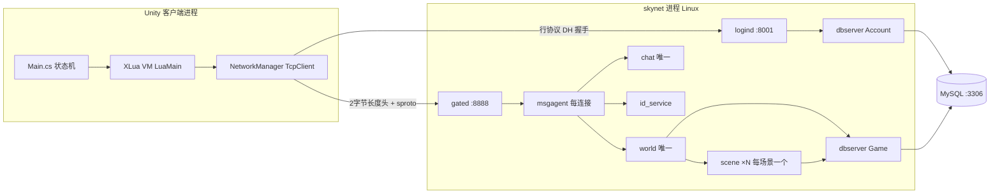

> **图 2：UnityMMO 整体进程拓扑。**
>
> 解读：客户端是单 Unity 进程；服务端是单 skynet 进程（`thread=8`），靠 actor 切分逻辑。`logind` 只做账号认证；`gated` 只做 TCP 接入与会话映射；每个连接对应一个 `msgagent` 负责协议解析与业务派发；`world` 是全局唯一路由表（角色在线表 + 场景服务路由）；`scene` 是每场景一个独立 actor，承载 SceneMgr + AOI + ECS；两个 `dbserver` 分别对应账号库与游戏库；`chat`、`id_service` 为公共唯一服务。

### 7.2 PNG：后端服务拓扑

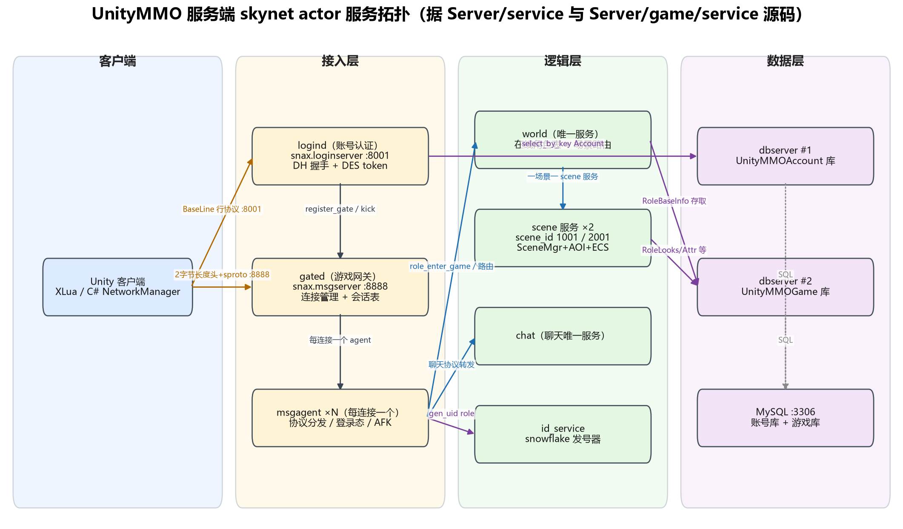

> **图 3：后端 skynet actor 服务拓扑（PNG）。** 按列分四组：客户端、接入层（logind/gated/msgagent）、逻辑层（world/scene/chat/id_service）、数据层（dbserver×2 → MySQL）。边上标注了实际协议端口与调用关系，例如 gated 启动时预创建 **10 个** msgagent 进连接池（`Server/service/gated.lua` 第 99~102 行：`local n = 10` → `for i = 1, n do table.insert(pool, skynet.newservice "msgagent") end`；注意 `server.logout_handler` 第 61~63 行回收 agent 回池的代码是被注释掉的，即池只进不出，agent 退出后不会复用）。

---

## 8. 服务端模块与职责

### 8.1 skynet 服务清单

| 服务文件 | 类型 | 职责 |
| --- | --- | --- |
| `Server/service/main.lua` | 入口 | `skynet.start` 里顺序拉起 protoloader、console、debug_console、logind、gated、两个 dbserver、id_service，然后自己 `skynet.exit()` |
| `Server/service/logind.lua` | snax.loginserver | 账号密码校验、禁止多端登录、向 gated 注册 servername |
| `Server/service/gated.lua` | snax.msgserver | TCP 监听 8888；维护 `users[uid]` 与会话；新登录从 agent 池取/建 msgagent；转发客户端协议 |
| `Server/service/msgagent.lua` | 普通 service（每连接一个） | 注册 `PTYPE_CLIENT` 协议；解析 4 字节 tag；按 tag 范围分发：100~199 走当前 scene 服务，其余走本地 Dispatcher/公共服务 |
| `Server/service/dbserver.lua` | 普通 service | 封装 `skynet.db.mysql`，提供 `insert/update/delete/select_by_key/select_all`，每小时 `select 1` 保活 |
| `Server/service/protoloader.lua` | uniqueservice | 把 `Lua/Proto/*.lua` 拼成一份 sproto 文本，`sprotoparser.parse` 后存到 sprotoloader slot 1 |
| `Server/game/service/world.lua` | uniqueservice | `online_role[role_id] = user_info`；按角色上次下线 scene_id 路由到对应 scene 服务；处理跨场景切换 `change_to_scene` |
| `Server/game/service/scene.lua` | newservice ×2 | 每个场景一个；持有一个 `SceneMgr` 实例；接收 agent 的 `scene_walk/cast_skill/relive` 等命令 |
| `Server/game/service/chat.lua` | uniqueservice | 聊天频道；目前实现很薄（`Chat_GetHistory` 返回空 list） |
| `Server/game/service/id_service.lua` | 普通 service | **snowflake 算法**发号器：`time_delta(38bit) | platform(9bit) | server(5bit) | sequence(11bit)` |

### 8.2 业务模块（挂在 agent 上的 Dispatcher）

`msgagent.lua` 的 `registerAllModule` 里写死了模块清单：

```lua
local handlers = {
    "game.account.Account",   -- 角色列表/创角/进入游戏
    "game.task.Task",         -- 任务
    "game.bag.BagMgr",        -- 背包
    "game.gm.GM",             -- GM 命令
}
```

tag 号段约定（`Server/service/msgagent.lua`）：

- **100~199**：场景内玩法（移动/技能/进入离开视角等）——`is_game_play_proto`（`msgagent.lua` 第 93~94 行 `tag >= 100 and tag <= 199`）为真，先经 world 查到角色所在 scene 服务，再 `skynet.call` 过去。
- **1~99 / 200~299**：账号（`proto_1_account.lua`）、任务（`proto_200_task.lua`）——agent 本地 Dispatcher 查 handler，回调签名 `handler(user_info, content)`。
- **300~499**：**msgagent 层把这一整段合并路由**（`msgagent.lua` 第 123 行 `if tag >= 300 and tag <= 499 then`），且回调签名特殊化为 `handler(content)`（只传请求体、不传 user_info，注释标了 `--Cat_Todo : for temporary`）。其中 300 段对应背包（`proto_300_bag.lua`）、400 段对应 GM（`proto_400_gm.lua`），这个"300/400"的细分**只体现在协议文件名与 Dispatcher 模块注册表里**，msgagent 的路由判断本身并不按 300/400 分界。
- **500~599**：聊天（`proto_500_chat.lua`）——Dispatcher 查不到本地 handler 时，按 `GetSprotoService` 路由到 chat 唯一服务。

### 8.3 服务端启动流程图

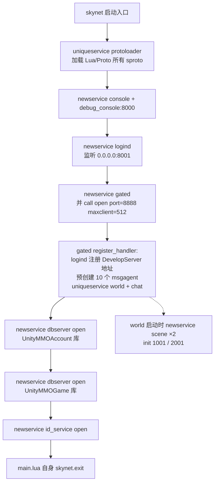

> **图 4：服务端启动流程（main.lua 真实调用链）。**
>
> 解读：main 只做"拉起子服务然后退出"，符合 skynet 标准做法。值得注意的细节：`world` 是在 gated 的 `register_handler` 里才 `uniqueservice` 起来的（`gated.lua` 末尾），而 `world` 启动时立刻 fork 出两个 scene 服务（1001 新手村、2001 副本），场景 actor 数 = 配置场景数，**不是动态开的**。

---

## 9. 客户端模块与职责

### 9.1 C# / Lua 边界

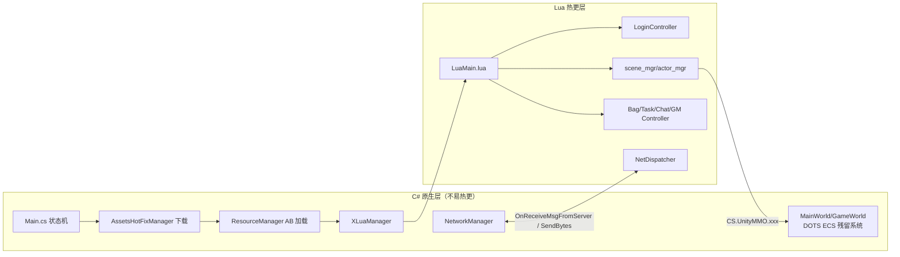

> **图 5：客户端 C# 与 Lua 职责边界。**
>
> 解读：C# 只做"发动机"：状态机、AB 包管理、TCP 收发、XLua 虚拟机、以及少量仍残留的 DOTS 表现层系统（`UploadMainRolePosSystem` 等）。Lua 做全部业务：协议分发、登录、UI、场景表现。Lua 通过 `CS.命名空间.类.静态方法` 反向调 C#（如 `CS.UnityMMO.LoadingView.Instance`、`CS.XLuaFramework.NetMgr`）。

### 9.2 PNG：客户端分层

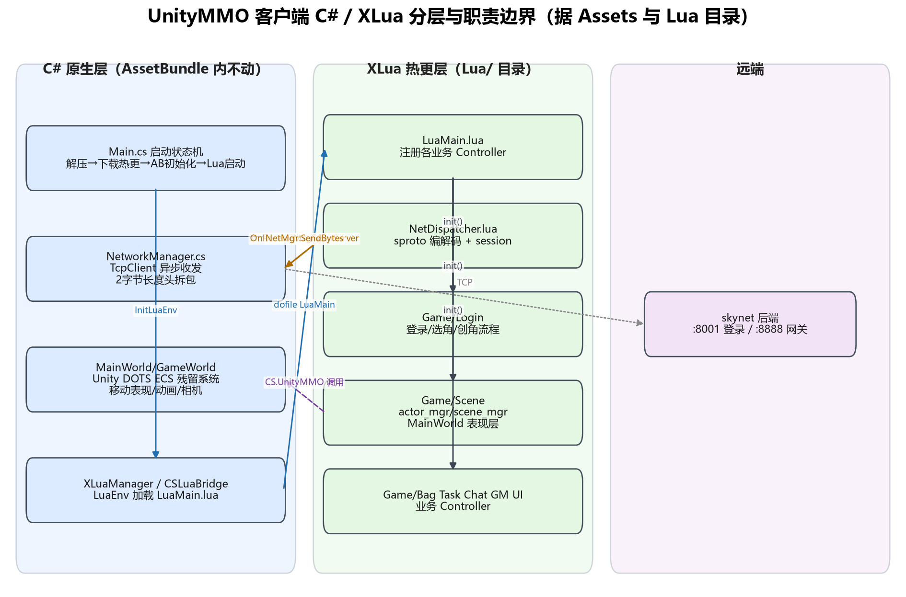

> **图 6：客户端分层 PNG。** 三层从左到右：C# 原生层、XLua 热更层、远端 skynet。红色虚线标注 Lua→C# 的反向调用与 TCP 通道。

### 9.3 Lua 目录模块划分

| Lua 目录 | 职责 |
| --- | --- |
| `Lua/LuaMain.lua` | Lua 入口，`Game:OnInitOK()` 里初始化事件系统、Lua 对象池、UIMgr、注册各业务 Controller |
| `Lua/NetDispatcher.lua` | sproto 编解码、session 管理、`Listen` 长轮询封装 |
| `Lua/Game/Login/` | LoginController/View/Model/SelectRole/CreateRole |
| `Lua/Game/Scene/` | main_world、actor_mgr、LRoleMgr、MainRole、scene_mgr、ReliveView |
| `Lua/Game/Bag|Task|Chat|GM|MainUI|UI` | 各业务 MVC |
| `Lua/Common/` | UI 组件基类、事件系统、定时器、sproto/lua 实现、UnityEngine 数学库 |
| `Lua/ecs/` | 与服务端同源的 Lua ECS（客户端表现层也用了一部分） |

### 9.4 资源管理与热更

- `Main.cs` 状态机（`XLuaFramework/Scripts/Main.cs`）：
  `CheckExtractResource → UpdateResourceFromNet → InitAssetBundle → StartLogin → StartGame → Playing`。
- `AssetsHotFixManager` 负责首次解压与从 HTTP 服务器拉最新 AB；`config_unitymmo.json` 里的 `FileServerURL` 指向 `http://192.168.43.130`，按平台拼 `WindowsStreamingAssets/`、`AndroidStreamingAssets/`、`IOSStreamingAssets/`。
- Lua 脚本本身也走 AB：`AppConfig.LuaBundleMode`、`LuaByteMode`、`SprotoBinMode` 三个开关控制是否把 Lua/sproto 打成 bundle/字节码。编辑器下默认全部关闭，直接读 `Assets/Lua/`。

---

## 10. 网络通信

### 10.1 两条 TCP 通道

| 通道 | 端口 | 封包格式 | 用途 |
| --- | --- | --- | --- |
| 登录通道 | 8001 | **基于行（`\n` 分隔）** | skynet loginserver 标准 DH 握手 |
| 游戏通道 | 8888 | **头 2 字节大端长度 + 负载** | gated/msgagent 上的 sproto 协议 |

客户端切换封装在 `NetworkManager.cs` 的 `NetPackageType` 枚举：

```csharp
public enum NetPackageType {
    BaseLine = 1,   // 基于行的解析
    BaseHead = 2,   // 头两字节为包大小
}
```

### 10.2 游戏通道线格式

**请求（C→S）**：

```text
[2 字节大端长度][4 字节大端 sproto tag][N 字节 sproto request body][4 字节大端 session]
```

证据：

- 长度头：`NetworkManager.SendBytes` 里 `Util.SwapUInt16((UInt16)message.Length)` 写在前。
- 负载：`Lua/NetDispatcher.lua` `SendMessage`：

  ```lua
  local pack_str = string.pack(">I4", tag)
                 .. string.pack("c"..#code, code)
                 .. string.pack(">I4", self.session)
  NetMgr:SendBytes(pack_str)
  ```

- 服务端拆包：`Server/service/msgagent.lua`：

  ```lua
  skynet.dispatch("client", function(_,_, msg)
      local tag, msg = string.unpack(">I4c"..#msg-4, msg)
      local proto_info = c2s_sproto:query_proto(tag)
      local content = c2s_sproto:request_decode(tag, msg)
      ...
  end)
  ```

  注意服务端只读前 4 字节当 tag，剩下的 body 直接交给 sproto 解码（尾部 session 4 字节被 sproto 解码自然忽略）。

**响应（S→C）**：

```text
[2 字节大端长度][M 字节 sproto response body][1 字节 result][4 字节大端 session]
```

证据：客户端 `NetDispatcher:OriginOnMessage`：

```lua
local content_size = #code - 5
local content, result, session = string.unpack("c"..content_size.."B>I4", code)
```

即响应体 = body（长度 N-5）+ 1 字节结果码 + 4 字节 session。客户端用 session 找到对应回调。

### 10.3 心跳与重连

- **没有显式心跳包**：`NetworkManager` 只在 socket 异常/读 0 字节时触发 `OnDisConnectCallBack`。
- 客户端把"服务器主动推送"伪装成**长轮询**：`NetDispatcher:Listen(req_name, req_arg, cb)` 发一次请求，等 response 回来后立刻再发下一次（见 `NetDispatcher.lua` 注释："因为用了 skynet 的 loginserver 那一套，是不支持后端主推协议的，所以只好每次收到回复后再请求"）。
- 断线后 `LoginController:Disconnect` 弹"重连/重新登录"窗，**真正的重连只回退到登录界面，没有 session 恢复**。

### 10.4 协议定义在哪

- 协议文本：`Lua/Proto/proto_{1,100,200,300,400,500}_*.lua`，每份是一段 sproto DSL 字符串。
- 服务端：`Server/service/protoloader.lua` 启动时 `io.popen("ls ../Lua/Proto")` 把所有 `.lua` 拼成一个大字符串，`sprotoparser.parse` 后 `sprotoloader.save(..., 1)`。
- 客户端：`NetDispatcher:InitSpb()` 做同样的拼接；或直接用预编译好的 `sproto_c2s.spb`。
- C# 协议类由 `Tools/sprotodump` 从 sproto 文件生成（`Assets/Scripts/Net/Sproto/`），`UploadMainRolePosSystem.cs` 里直接 `new scene_walk.request()`。

---

## 11. 数据存储

### 11.1 数据库选型

- **MySQL**，驱动 `skynet.db.mysql`，无 Redis。
- 两个独立 dbserver actor，分别连两个库（`main.lua`）：
  - `.AccountDBServer` → 库 `UnityMMOAccount`
  - `.GameDBServer` → 库 `UnityMMOGame`

### 11.2 dbserver 接口

`Server/service/dbserver.lua` 把 SQL 拼接封装成通用命令：

```lua
function CMD.select_by_key(tablename, key, value)
    local sql = string.format("select * from %s where %s = '%s';", tablename, key, value)
    local result = db:query(sql)
    ...
end
```

提供：`insert / update / delete / query / select_by_key / select_one_by_key / select_by_condition / select_all`。

**注意**：SQL 拼接时用 `mysql.quote_sql_str` 转义字符串，但 `update/select` 里 `value` 直接 `%s` 进字符串引号，对数字类型未做转义，是个安全小坑。

### 11.3 核心表（从代码反推）

| 表 | 所在库 | 字段（从代码读出） | 用途 |
| --- | --- | --- | --- |
| `Account` | Account | `account_id`, `password` | 账号密码（**明文**，`logind.lua` 自己注释"不要明文保存密码"） |
| `RoleList` | Game | `account_id`, `role_id`, `create_time` | 账号下角色列表（最多 3 个，`Account.lua` `#role_list >= 3`） |
| `RoleBaseInfo` | Game | `role_id, name, career, level, hp, scene_id, pos_x, pos_y, pos_z` | 角色基础位置与当前场景 |
| `RoleLooksInfo` | Game | `role_id, body, hair, weapon, wing` | 外观 |
| `AttrInfo` | Game | `role_id, att, hp, def, hit, dodge, crit` | 初始属性 |
| `TaskList` | Game | `roleID, taskID, status, subTaskIndex, subType, curProgress, maxProgress, contentID` | 任务进度 |
| `Bag` | Game | `roleID, pos, cell, typeID, num` | 背包格子（cellNum=200） |

### 11.4 角色数据落盘时机

- 进入游戏：`Account.account_select_role_enter_game` → `world.role_enter_game` → 从 `RoleBaseInfo` 读 `scene_id/pos_*`。
- 离开场景/退出：`RoleMgr:RoleLeave` 里 `save_role_base_info` 把当前 hp、pos 等 update 回库。
- 背包/任务：操作时即时 `insert/update`。

---

## 12. 启动流程

客户端从 Unity 启动到进入场景的完整链路：

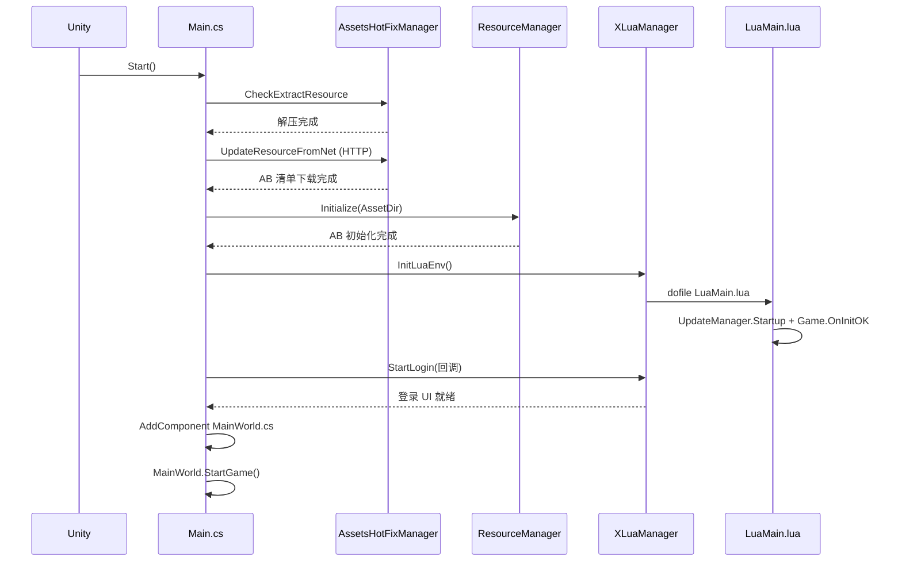

> **图 7：客户端启动时序。** 见 `Assets/XLuaFramework/Scripts/Main.cs` 的状态机。`MainWorld.cs` 是 C# 侧最后挂上的组件，它会接管表现层 ECS；业务流程控制权已经在 Lua 手里。

---

## 13. 登录与账号流程

### 13.1 完整时序

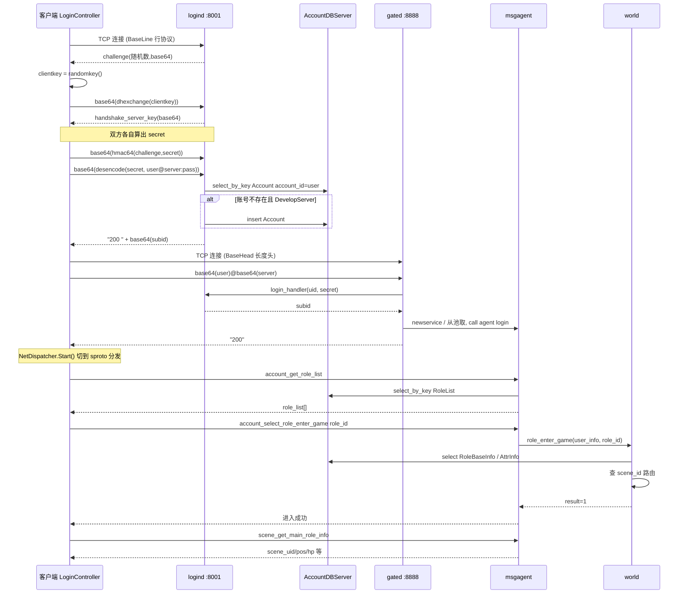

> **图 8：登录→选角→进入场景时序图。**
>
> 解读：这是**教科书级的 skynet 多服登录套路**——
> 1. 第一连接走 `snax.loginserver` 完成 DH 密钥协商 + DES token，校验账号密码；
> 2. 第二连接直连游戏 gate，用第一段拿到的 `subid + secret` 做握手；
> 3. gated 通过 logind 查在线表，必要时踢旧连接；
> 4. gated 给玩家分配一个 `msgagent` actor；
> 5. agent 加载账号/角色模块，后续业务全在 agent + scene 之间转发。

关键代码：`Lua/Game/Login/LoginController.lua` 的 `OnReceiveLine` 用 `crypt.dhexchange/dhsecret/hmac64/desencode` 走完整个握手；`Server/service/logind.lua` 的 `auth_handler` 解析 `user@server:password` 三段 base64 token。

---

## 14. 角色创建与进入场景

### 14.1 创角

`Server/game/account/Account.lua` `account_create_role`：

1. 查 `RoleList`，超过 3 个返回 `FullCreateRoleNum`。
2. 通过 `id_service` 用 snowflake 生成新 `role_id`。
3. 依次 insert 四张表：`RoleList`、`RoleBaseInfo`（name/career/level=1/hp=10000）、`RoleLooksInfo`（随机 body/hair）、`AttrInfo`（att=100, hp=10000, def=100, hit=100, dodge=120, crit=100）。
4. 用 `skynet.queue()` 包了一层，防并发创角。

### 14.2 进入场景

`world.lua` `role_enter_game`：

1. 查 `RoleBaseInfo.scene_id`，决定进哪个场景服务。
2. 没找到就默认进 `scene_ids[1] = 1001`（新手村）。
3. 调对应 scene 服务的 `role_enter_scene`。

`RoleMgr:RoleEnter`（`Server/game/scene/RoleMgr.lua`）：

1. `SceneHelper:NewSceneUID(ObjectType.Role)` 生成场景内唯一 uid。
2. 从 DB 读 `RoleBaseInfo` + `RoleLooksInfo`。
3. `aoi:add()` 申请一个 AOI 节点，绑定 `scene_uid`。
4. 用 ECS `CreateArchetype`（包含 Position/TargetPos/UID/TypeID/HP/SceneObjType/MoveSpeed/AOIHandle/Beatable/DamageEvents/MsgAgent/CD/Buff/BaseAttr/FightAttr/Ability 等 16 个组件）创建实体。
5. 把 `BaseAttr` 拷一份到 `FightAttr`（战斗属性可被 Buff 修改，基础属性不动）。
6. 推一条 `SceneChange` 私有事件给客户端。

### 14.3 初始视野与 AOI

`role_info` 结构：

```lua
{scene_uid=..., base_info=..., looks_info=..., aoi_handle=handle,
 around_objs={}, radius_short=5000, radius_long=6000,
 skill_events_in_around={}, hurt_events_in_around={}}
```

注意 `radius_short=5000 / radius_long=6000` 是**硬编码字面量**：它直接写在 `Server/game/scene/RoleMgr.lua` 第 107 行 `RoleEnter` 里构造 `roleList[roleID]` 表时（`around_objs={}, radius_short=5000, radius_long=6000, ...`），**不来自任何配置表**（全仓 grep `radius_short` 只命中 RoleMgr.lua 第 107 行一处赋值、`SceneMgr.lua` 第 50 行消费处与 aoi.lua 的形参，`Server/game/config/scene/` 下无对应字段）。因为线上坐标是厘米（客户端 `RealToLogic=100`，米×100 变厘米），即**进入视野距离 50 米，离开视野距离 60 米**（10 米滞后带，防止在边界抖动反复进出）。`aoi.lua` 第 206 行还有兜底 `radius_long = radius_long or radius_short`。

---

## 15. 移动同步

### 15.1 同步模型

**状态同步（非帧同步）**，服务器半权威：

- 客户端每 50ms（20Hz）检查一次，若主角目标点位移 >0.5 米就上报一次 `scene_walk`（`Assets/Scripts/Game/Modules/Role/UploadMainRolePosSystem.cs`）。
- 上报内容 = 当前坐标 + 目标坐标（`start_x/y/z` + `end_x/z`），**不带速度不带朝向**，本质是"我要走到这个点"。
- 服务器 `RoleMgr:RoleWalk` 直接信任客户端给的 start 坐标，写入 `UMO.Position`，把 end 写入 `UMO.TargetPos`，**没有做速度校验、没有做位置合理性校验**（代码里 `-- Cat_Todo : 记得做校验`）。
- 服务器 ECS `MovementUpdateSystem` 按 `speed*dt` 自己把实体从 Position 往 TargetPos 推（玩家 speed=100 cm/s = 1 m/s）。
- 服务器不主动给本人回走路上报，而是把"目标点变更"作为场景事件广播给周围人。

### 15.2 广播管线

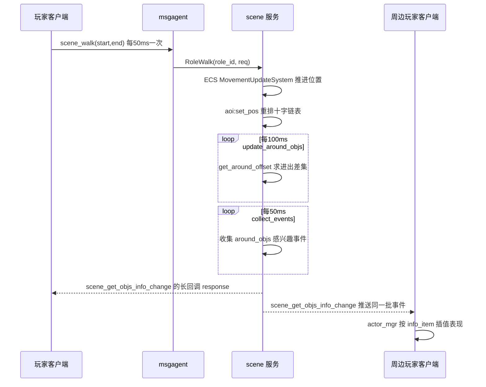

> **图 9：移动同步与 AOI 广播时序。**

### 15.3 AOI 实现：三维十字链表

`Server/game/scene/aoi.lua` 是经典 skynet 风格的**三维十字链表**：

```lua
function aoi:init()
    self.counter = 0
    self.nodes = {}
    self.link_heads = {}  -- 三维度，即三个链表指针
end
```

- 每个节点在 X/Y/Z 三个方向各有一条有序双向链表（`next[dimension]` / `last[dimension]`）。
- `set_pos` 时按新坐标沿链表前后扫描找到插入点，摘链重插（O(k)，k 是相邻跨越节点数）。
- `get_around_offset(handle, radius_short, radius_long)`：沿 X 链表前后扫到超过 radius 为止，对候选节点再校验 Y/Z 是否在 radius 内；与上次 `around_list` 比较得出"新进视野=1 / 离开视野=2"差集。

### 15.4 PNG：AOI 与广播管线

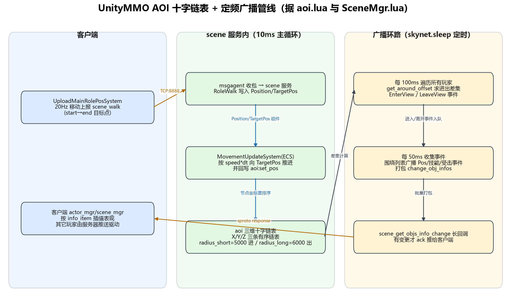

> **图 10：AOI 十字链表 + 三段定时环路 PNG。** 三个环路的节奏来自 `skynet.sleep` 的 1/100 秒单位：
>
> - 主逻辑 `sleep(1)` ≈ 10ms（100Hz）跑 ECS System。
> - 场景信息广播 `sleep(5)` ≈ 50ms（20Hz）。
> - 战斗事件广播 `sleep(5)` ≈ 50ms。
> - AOI 进出计算 `sleep(10)` ≈ 100ms。
>
> 这个节奏与 LYFMMORGP 自研 20Hz Tick 几乎一致，可对照参考。

### 15.5 客户端插值

客户端收到 `info_item`（key=EnterView/LeaveView/PosChange/TargetPos/HPChange/JumpState/SceneChange...）后由 `Lua/Game/Scene/actor_mgr.lua` / `scene_mgr.lua` 落地。服务器只给"目标点"，客户端自己按本地速度做平滑移动（预表现）；**服务器不做回滚，也不发位置校正包**——这是一个明显的简化。

### 15.6 寻路

服务端**没有寻路**：`RoleWalk` 只信客户端给的 end 点，`MovementUpdateSystem` 做直线匀速推进。寻路在客户端用 Unity NavMesh（`Assets/Scripts/Game/Scene/Editor/NavMesh/NavMeshExporter.cs` 还能把 NavMesh 导出给服务器，但本服务端代码里没消费）。

---

## 16. 战斗、技能与属性

### 16.1 技能系统骨架

- 配置：`Server/game/config/scene/config_skill.lua`，每个 skill_id 下有 `detail[level]`，含 `area`（范围）等字段。
- 入口：`scene.lua` `scene_cast_skill` → `FightMgr:CastSkill(uid, req_data)`。
- `FightMgr:CastSkill` 做的事：
  1. 查配置、查 CD（`FightHelper:IsSkillInCD`）。
  2. 构造 `skillData` 表（施法者、目标点、方向、目标列表、时间戳）。
  3. `SkillActions:GetActionCreator(skill_id)(skillCfg)` 创建一个 Action 节点，`ActionMgr:AutoUpdate` 驱动。
  4. 写 CD。
  5. 发 `skill_event` 给周围人。

### 16.2 Action 体系

`Server/lualib/Action/` 是一套自研 Action 节点库：`Sequence / And / Or / Repeat / Delay / CallFunc / If / Random`。技能的具体效果（伤害、buff、位移）都拆成 Action 节点在 timeline 上跑，与 Unity 侧的 Timeline（`Assets/Scripts/Game/Timeline/CastSkillClip.cs`）配合。

### 16.3 伤害公式

`FightMgr:CalDamage` 是个**占位实现**：

```lua
function FightMgr:CalDamage(fight_info, entity)
    return math.random(100, 550)
end
```

完全没有用攻防属性结算，作者留了 TODO。`AddDamageEventForDefenders` 会给被打者的 `UMO.DamageEvents` 组件塞一条 `{attacker, damage, direction, impulse}`。

### 16.4 Buff

`Server/game/scene/fight/BuffActions.lua` 实现：火、毒、冰冻、晕眩、吸血、扣属性（防御/攻击）、沉默（README 2019.09.07）。Buff 也是 Action，挂在 `UMO.Buff` 组件上，由 `BuffSys` 统一 Update。

### 16.5 属性

- `UMO.BaseAttr`：基础属性（从 DB `AttrInfo` 拷来，恒定）。
- `UMO.FightAttr`：战斗属性（= BaseAttr 的深拷贝，Buff 改这个）。
- `RoleMgr:ChangeAttr` 直接改 FightAttr 表。

---

## 17. AI 与怪物

### 17.1 怪物生成

`MonsterMgr:InitMonster` 按 `config_monster.lua` 与 `config_scene_1001/2001.lua` 的 `monster_list` 刷怪巢：每个巢点有 `pos, radius, monster_type_id, monster_num`，在巢点半径内随机散布。

### 17.2 AI 架构

作者把服务端 AI 拆成两套自研框架：

- `lualib/Blueprint/`：蓝图/FSM 框架，含 `Graph / Blackboard / FSMGraph / FSMState`，支持事件节点、变量节点、控制节点（Branch/ForLoop/Gate/WhileLoop...）。
- `game/scene/ai/MonsterFSM.lua`：怪物 FSM 状态表，三个状态：
  - `PatrolState`（巡逻）
  - `FightState`（战斗）
  - `DeadState`（死亡）

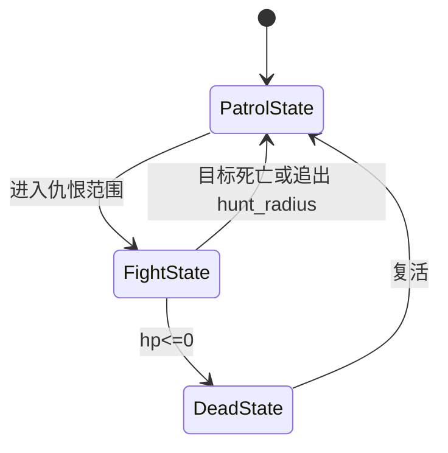

> **图 11：怪物 FSM 状态机。** 见 `MonsterFSM.lua` 与 `ai/state/FightState.lua`。

### 17.3 FightState 行为

`FightState:OnUpdate`：

- 子状态：`Chase / Fighting / GoBack`。
- 每 0.5 秒重瞄一次目标：距离 < `attack_area.max_distance` 且 > `min_distance` 就开打；> `hunt_radius` 就脱战回巡逻；否则用 `GetAssailablePos` 算一个走位点写进 `TargetPos`。
- 攻击：从 `cfg.ai.skill_list` 按权重 `random(1,100)` 随机选技能，调 `FightMgr:CastSkill`；攻击间隔 `math.random(2,5)` 秒。

---

## 18. 背包、物品、装备

- 表：`Bag(roleID, pos, cell, typeID, num)`，`cellNum=200`（`BagMgr.lua`）。
- 堆叠：`ConfigGoods[typeID].overlap` 控制单格堆叠上限。
- 找空格：`findEmptyCellIndex` 顺序扫第一个空缺 cell。
- 找同类可叠：`findGoodsInList(typeID, ignoreFullOverlap)`。
- 道具生成：`id_service` 发号。
- 装备外观：装备改 `RoleLooksInfo(body/hair/weapon/wing)`，玩家进入视野时通过 `scene_get_role_look_info` 拉取。

---

## 19. 任务、NPC、对话

- 任务配置：`Lua/Config/ConfigTask`（客户端），服务端 `Server/game/task/Task.lua`。
- 任务结构：每个任务有 `subTasks[]`，当前只跑第一个子任务；子类型 `KillMonster` / 对话 NPC 等。
- 流程：玩家接任务 → `Task.monsterTargetIDs[role_id][contentID] += 1`（登记要杀哪类怪几只）→ 杀怪时在 `DamageSystem` 里回报 → 进度推进 → 满了自动交。
- README 19.07.03 提到"自动寻路去找 npc 对话和打怪"，对应客户端点击地面寻路 + NPC 交互。
- 任务进度推送也是长轮询：`ackTaskProgressChanged = skynet.fork(...)`，有变化时 `skynet.wakeup(co)` 唤醒协程回包。

---

## 20. 交易、经济、商城、社交

- **聊天**：`game/service/chat.lua`，目前 `Chat_GetHistory` 返回空 list，`Chat_Send` 仅做角色信息查询，没有真正广播。
- **交易/邮件/好友/公会/商城**：**未实现**，代码里找不到对应模块。
- GM 系统：`Server/game/gm/GM.lua`，提供调试命令（刷道具/刷怪/传送等）。

---

## 21. 其他特色系统

### 21.1 自研 Lua ECS

`Server/lualib/ECS/` 完整移植了 Unity DOTS 的概念：`World / EntityManager / ArchetypeManager / Chunk / ComponentType / ComponentSystem / EntityGroupManager / ScriptBehaviourManager`。作者 2021.06.28 明确说因为 Unity Entities 不好热更，才在 Lua 里又写了一套。

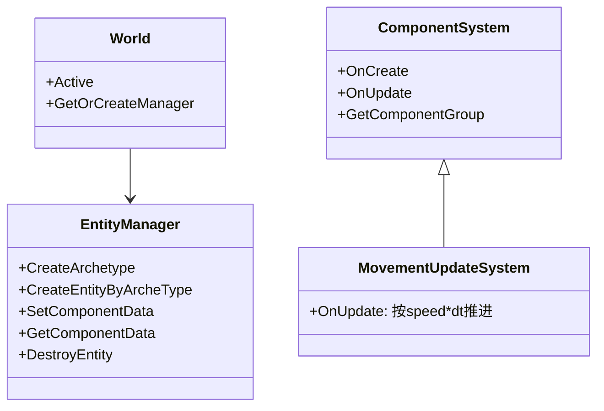

> **图 12：自研 Lua ECS 核心类关系。**

服务端 `SceneMgr:Init` 里：

```lua
self.ecs_world = ECS.InitWorld("scene_world")
self.entityMgr = ECS.World.Active:GetOrCreateManager(ECS.EntityManager.Name)
self.ecsSystemMgr = require("game.scene.ECSSystemMgr").New()
self.ecsSystemMgr:Init(self.ecs_world, self)
```

注册的 System（`game/scene/system/`）：`ActionSys / AISystem / DamageSystem / MovementUpdateSystem / SkillSys`。

### 21.2 协议 → C# 自动生成

`Tools/sprotodump/` 是 skynet 官方 sprotodump 的魔改版，多了一个 `module/cSharp.lua`，把 sproto 文件直接生成 C# 协议类（命名空间 `SprotoType`），客户端 C# 代码里可以强类型 `new scene_walk.request()`。这是它区别于普通 skynet demo 的一个工程化亮点。

### 21.3 客户端场景八叉树

`Assets/Scripts/Game/Scene/SceneSeparateFrameWork/`：自己写了一套八叉树/四叉树式场景对象分帧加载（`SceneSeparateTree`、`SceneTransformDetector`、`SceneCameraDetector`），按相机距离决定加载/卸载/LOD，配合 AutoLOD 插件做手机端优化。

---

## 22. 关键核心文件代码走读

### 22.1 `Server/service/msgagent.lua` —— 每连接的协议分发器

职责：一个玩家连接对应一个 agent；拆 tag、按 tag 号段路由到 scene 服务或本地模块。

```lua
skynet.dispatch("client", function(_,_, msg)
    local tag, msg = string.unpack(">I4c"..#msg-4, msg)
    local proto_info = c2s_sproto:query_proto(tag)
    local content = c2s_sproto:request_decode(tag, msg)
    local response
    if is_game_play_proto(tag) then          -- 100~199
        local scene_service = skynet.call(world, "lua",
            "get_role_scene_service", user_info.cur_role_id)
        response = skynet.call(scene_service, "lua",
            proto_info.name, user_info, content)
    else
        local handler = Dispatcher:GetSprotoHandler(proto_info.name)
        response = handler(user_info, content)
    end
    local ok, response_str = pcall(c2s_sproto.response_encode, ...)
    skynet.ret(response_str)
end)
```

要点：场景玩法协议（tag 100~199）必须经 `world` 路由到 scene 服务，因为一个进程里可能跑多个 scene actor。

### 22.2 `Server/game/scene/aoi.lua` —— 三维十字链表

见第 15.3 节。核心是 `set_pos`（沿链表重排）与 `get_around_offset`（进/出差集）。设计上与云风博客公开的 skynet AOI 一致。

### 22.3 `Server/game/scene/SceneMgr.lua` —— 场景服务主控

四个 `skynet.fork` 协程构成服务端心跳：

```lua
fork_loop_logic(self)              -- sleep(1) ≈ 10ms：ECS + Action + BP Tick
fork_loop_scene_info_change(self)  -- sleep(5) ≈ 50ms：广播进出/位置事件
fork_loop_fight_event(self)        -- sleep(5) ≈ 50ms：广播技能/受击事件
fork_loop_update_around(self)      -- sleep(10) ≈ 100ms：重算 around_objs
```

"长轮询"模型：客户端先发 `scene_get_objs_info_change` 把 `ack_scene_get_objs_info_change = skynet.response()` 存起来，服务端有变更时才 `ack(true, change_obj_infos)` 唤醒——等价于服务端推送，但复用了 skynet request/response 语义。

### 22.4 `Server/game/service/world.lua` —— 全局路由

```lua
function CMD.role_enter_game(user_info, role_id)
    online_role[role_id] = user_info
    local role_info = skynet.call(gameDBServer, "lua",
        "select_by_key", "RoleBaseInfo", "role_id", role_id)
    local scene_id = role_info[1].scene_id
    local scene = scene_services[scene_id] or scene_services[scene_ids[1]]
    user_info.scene_service = scene
    skynet.call(scene, "lua", "role_enter_scene", role_id, user_info.agent)
end
```

`online_role[role_id]` 同时承担"多端登录检测"（重复进游戏会 `kick`）。

### 22.5 `Lua/NetDispatcher.lua` —— 客户端协议分发

```lua
function NetDispatcher:SendMessage(req_name, req_arg, response_call_back)
    self.session = self.session + 1
    local code, tag = self.sproto_c2s:request_encode(req_name, req_arg)
    if response_call_back then
        self.response_call_back[self.session] = {req_name, response_call_back}
    end
    local pack_str = string.pack(">I4", tag)
                  .. string.pack("c"..#code, code)
                  .. string.pack(">I4", self.session)
    NetMgr:SendBytes(pack_str)
end
```

session 从 `Int32.MaxValue/2` 开始自增，与 C# 侧 `GameConst.MinLuaNetSessionID` 对齐——把 session 号段切成"C# 用一半、Lua 用一半"，避免两侧冲突。

### 22.6 `Assets/XLuaFramework/Scripts/Manager/NetworkManager.cs` —— TCP 收发

- `TcpClient` 异步 BeginConnect/BeginRead，`NoDelay=true`，收发各 8KB 缓冲。
- 网络线程回调只 `AddEvent` 入队，主线程 `Update` 里统一出队执行，**保证所有网络回调在主线程**（与 LYFMMORGP "网络回调入队、主线程消费" 完全同思路）。
- 拆包：维护一个 `MemoryStream`，循环读 2 字节大端长度，不够就把残留字节留到下次。

### 22.7 `Assets/Scripts/Game/Modules/Role/UploadMainRolePosSystem.cs` —— 移动上报

```csharp
protected override void OnUpdate() {
    if (Time.time - lastSynchTime < 0.05 || !GameVariable.IsNeedSynchSceneInfo)
        return;
    ...
    if (distance <= 0.5 && distance_with_last <= 0.5) continue;
    scene_walk.request walk = new scene_walk.request();
    walk.start_x = (long)(pos.x * GameConst.RealToLogic);   // 米 → 厘米
    walk.end_x   = (long)(targetPos.x * GameConst.RealToLogic);
    NetMsgDispatcher.GetInstance().SendMessage<Protocol.scene_walk>(walk);
    lastSynchTime = Time.time;
}
```

20Hz 检查、位移 >0.5 米才上报，坐标米×100 转整数厘米。

### 22.8 `Server/game/service/id_service.lua` —— Snowflake 发号

```lua
local uid = (deltaTime << left_shift_for_time)
          | (this.platform_id << left_shift_for_platform)
          | (this.server_id << left_shift_for_server)
          | increase_num
```

位布局：`time_delta(38bit) | platform(9bit) | server(5bit) | sequence(11bit)`，每 10ms 窗口 2048 个序列号。

---

## 23. 可借鉴到 LYFMMORGP 的设计

> LYFMMORGP 现状：Unity 2023.2 + HybridCLR + YooAsset + Protobuf；.NET Framework 4.8 四服 Center/Login/Gate/Game；MySQL+Redis；TCP；GameCommand 入队、20Hz Tick；AOI 约 100 米广播。

| # | UnityMMO 设计 | 对应本项目模块 | 借鉴方式 | 接入成本 |
| --- | --- | --- | --- | --- |
| 1 | **aoi.lua 三维十字链表 + radius_short/radius_long 进出差集**（50m 进 / 60m 出） | GameServer AOI | 把当前"约 100 米一刀切"改成短半径进、长半径出，避免在视野边界抖动反复广播 | 低，核心算法 ~200 行 |
| 2 | **gated 预创建 10 个 msgagent 连接池**（`Server/service/gated.lua` 第 99~102 行 `local n = 10` + for 循环） | GateServer 会话/转发 | Gate 不再每连接即时 new 一个 handler 协程，改为池化复用，降低短连接/重连抖动 | 中 |
| 3 | **world 服务做场景路由表**（`online_role[role_id].scene_service`），agent 不直接持有场景引用 | GameServer 多场景/跨服切场景 | 切场景时由 Center/World 统一改路由，agent 只做转发，避免 agent 里堆场景状态 | 中 |
| 4 | **长轮询伪装服务端推送**（`skynet.response()` 存起来，有变更才 ack） | Gate→客户端事件推送 | 在现有"GameCommand 队列 + 20Hz Tick"上加一层"事件订阅表"，把视野事件/技能事件攒一批批量回包，减少小包数量 | 低 |
| 5 | **sproto tag 号段路由**（100~199 场景玩法走 scene 服务，其他走 agent 本地模块） | 协议分发 | 本项目 protobuf 可以给协议号分段：1xx 走 Game 场景服，2xx 走 Chat 等公共服，写一张路由表 | 低 |
| 6 | **客户端坐标 ×100 转整数厘米**再上线 | 移动同步协议 | 现在用 float 上线路包体积大；改成 `int cm` 可显著压缩移动/位置协议，sproto/protobuf 都支持 | 低 |
| 7 | **服务端 ECS MovementUpdateSystem 按 speed*dt 推目标点** | GameServer 移动校验 | 本项目"无服务端物理/速度校验"，可以在 GameServer 侧也做一份"客户端给目标点、服务器按速度推"的轻量推进，作为弱校验 | 中 |
| 8 | **sprotodump 从协议文本直接生成 C# 强类型类** | Protobuf 已比它强，但"协议单源 + 代码生成"的纪律一致 | 继续坚持 Luban/proto 单源，不要手写协议类 | 无 |
| 9 | **怪物 FSM（Patrol/Fight/Dead）+ Blackboard + 子状态 Chase/Fighting/GoBack** | GameServer AI | 本项目若要做怪物仇恨/脱战/巡逻，可直接照搬这个三态结构 + hunt_radius 脱战判定 | 低 |
| 10 | **DB 拆两个 actor（账号库 / 游戏库）串行 SQL** | CenterServer 持久化 | 账号登录热路径与游戏数据热路径分开 actor，避免一条慢 SQL 卡登录 | 低 |

**差异提醒**：UnityMMO 是单 skynet 进程内多 actor，协程切换零成本；LYFMMORGP 是多进程 TCP，world/scene 之间是跨进程消息，借鉴时要把"actor call"换成"TCP RPC"，注意序列化与异步等待。

---

## 24. 局限、坑与二次开发注意

| # | 问题 | 证据 | 影响 |
| --- | --- | --- | --- |
| 1 | **位置校验完全缺失** | `RoleMgr:RoleWalk` 直接信客户端 start 坐标；`FightMgr:CastSkill` 注释 `-- Cat_Todo : 记得做校验` | 外挂可以瞬移、加速、改坐标打远处 |
| 2 | **伤害公式是 `math.random(100,550)`** | `FightMgr:CalDamage` | 属性/Buff 系统没有真正结算，只是壳 |
| 3 | **密码明文存 MySQL** | `logind.lua` 自己注释 `-- Cat_Todo : 不要明文保存密码` | 不能直接上生产 |
| 4 | **无心跳、无重连恢复** | NetworkManager 只在 socket 异常时回调 | 切后台/弱网必掉线，重连只能回登录界面 |
| 5 | **长轮询代替推送，延迟≥50ms 且浪费请求数** | `NetDispatcher:Listen` 注释自承认 | 高频移动下包量翻倍 |
| 6 | **DOTS 残留与 Lua ECS 并存** | C# 侧 `UploadMainRolePosSystem` 等仍是 `BaseComponentSystem` | 维护时要搞清楚哪份代码在跑 |
| 7 | **子模块未拉取无法编译服务端** | `Server/skynet` 空目录 | 本快照无法直接运行 |
| 8 | **MySQL 密码硬编码 `root/123456`** | `main.lua` | 部署必须改 |
| 9 | **协议字段在请求体尾部塞 session** | 服务端 `request_decode` 依赖 sproto 忽略尾字节 | 协议比较 hack，调试不直观 |
| 10 | **项目已停更**（README 最后动态 2020.10） | GitHub 仓库 | 生产使用要自己接坑 |

---

## 25. 面试讲述话术

**30 秒一句话**：

> UnityMMO 是一个 Unity 2019 + XLua 热更客户端、skynet 后端、sproto 协议的 3D MMO 教学项目，最有价值的部分是它把 skynet 官方 loginserver/msgserver 套路和"每连接一个 msgagent + 每场景一个 scene 服务 + 三维十字链表 AOI"完整拼了一遍。

**2 分钟展开**：

1. 客户端：Unity 2019.4，业务用 XLua 热更，C# 只做 TCP/AB/启动骨架；网络层 `NetworkManager` 用 `TcpClient` 异步收，回调入队主线程执行；协议是 sproto，由 `Tools/sprotodump` 从一份 `.lua` DSL 同时生成客户端 Lua 解析器和 C# 强类型类。
2. 登录：第一连接连 logind:8001，走 skynet 标准 DH 握手（challenge → dhexchange → dhsecret → hmac64 → DES token），拿到 subid；第二连接连 gated:8888，用 subid + secret 握手，gate 给玩家分配一个 msgagent。
3. 进入场景：agent 把 tag 100~199 的协议转发给 world 路由到对应 scene 服务；scene 服务里用自研 Lua ECS 建实体，挂 Position/TargetPos/HP/AOIHandle 等组件。
4. 移动同步：客户端 20Hz 上报"我要走到哪"（start+end 点），服务器信这个目标点，由 ECS MovementUpdateSystem 按 speed*dt 推进；AOI 是三维十字链表，半径 50 米进、60 米出，每 50ms 把视野内事件批量推给周围玩家。
5. 后端：单 skynet 进程，8 个 worker 线程；logind/gated/msgagent/dbserver/world/scene/chat/id_service 各司其职；MySQL 直连，账号库与游戏库拆两个 dbserver actor；snowflake 发号。
6. 局限：位置不校验、伤害是随机数、密码明文、无心跳——这些都是 demo 阶段的简化，正好说明一个 MMO 原型到生产还要补哪些功课。

**8 条高频追问参考要点**：

1. **AOI 为什么用十字链表而不是九宫格？** 十字链表每个节点在 X/Y/Z 三条有序链上，移动时只沿链摘插，O(k)；九宫格是 O(1) 查表但边界格跳转复杂、内存重。这个实现选了云风博客的经典方案。
2. **为什么 radius_short/radius_long 要两个值？** 防止玩家在 50 米边界来回走时反复进出视野造成抖动，进用 50、出用 60，10 米滞后带。
3. **为什么用长轮询而不是服务端推送？** skynet 的 msgserver 默认是 request/response 语义，作者没改 gate 代码，就在客户端层用"收到 response 立刻发下一个 request"模拟推送，代价是每方向至少 50ms 延迟。
4. **agent 与 scene 服务的关系？** agent 是"玩家的入口 actor"，scene 是"场景的逻辑 actor"；一个 scene 里有几十个 agent 转发进来的请求。tag 号段 100~199 是判断"这条协议该去 scene 还是留 agent"的唯一依据。
5. **客户端预测和服务器校正怎么做？** 本项目**没做**——客户端自己播动画，服务器只把 TargetPos 广播给别人，自己不校正自己；这是它和商业 MMO 最大的差距。
6. **sproto 相比 protobuf 有什么区别？** sproto 是云风为 skynet 设计的二进制协议，DSL 更紧凑、编码快、支持 request/response 语义；不支持反射 schema 演进那么强，但够用。
7. **为什么 2021 年要把 Unity DOTS 换成自研 Lua ECS？** 作者原话：Unity Entities 不好热更也不好用；Lua 版 ECS 虽然性能差一截，但业务能随 Lua 一起热更，对个人项目更划算。
8. **如果让你把这套搬到生产要先补什么？** ①位置/速度校验 ②真伤害公式 ③密码哈希 ④心跳与断线重连 ⑤把长轮询改成 gate 真推送 ⑥MySQL 加连接池/Redis 缓存热点数据。

---

## 26. 附录

### 26.1 关键文件清单（≥20 条）

| # | 路径 | 一句话职责 |
| --- | --- | --- |
| 1 | `README.md` | 项目自述、Unity 版本、资源仓库链接、更新时间线 |
| 2 | `.gitmodules` | 子模块：skynet、lsocket |
| 3 | `Server/config` | skynet 启动配置（8 线程、harbor、入口 main） |
| 4 | `Server/service/main.lua` | 入口：拉起 protoloader/logind/gated/dbserver×2/id_service |
| 5 | `Server/service/logind.lua` | snax.loginserver 实例，账号密码校验，禁止多端 |
| 6 | `Server/service/gated.lua` | snax.msgserver 实例，会话表 + agent 池 |
| 7 | `Server/service/msgagent.lua` | 每连接协议分发，按 tag 路由 |
| 8 | `Server/service/dbserver.lua` | MySQL 封装：insert/update/select_by_key 等 |
| 9 | `Server/service/protoloader.lua` | 合并 Lua/Proto/*.lua → sprotoloader slot 1 |
| 10 | `Server/game/service/world.lua` | 在线角色表 + 场景路由 + 多端登录检测 |
| 11 | `Server/game/service/scene.lua` | 单场景 actor，转发到 SceneMgr |
| 12 | `Server/game/service/id_service.lua` | snowflake 发号器 |
| 13 | `Server/game/service/chat.lua` | 聊天服务（薄） |
| 14 | `Server/game/scene/SceneMgr.lua` | 场景主控，4 个 fork 协程跑逻辑/广播/AOI |
| 15 | `Server/game/scene/aoi.lua` | 三维十字链表 AOI |
| 16 | `Server/game/scene/RoleMgr.lua` | 角色进/出场景、移动、复活、属性 |
| 17 | `Server/game/scene/MonsterMgr.lua` | 刷怪巢、怪物 ECS 实体、FSM 初始化 |
| 18 | `Server/game/scene/FightMgr.lua` | 技能入口、CD、范围选目标、伤害（占位） |
| 19 | `Server/game/scene/system/MovementUpdateSystem.lua` | 服务端移动推进 |
| 20 | `Server/game/scene/ai/MonsterFSM.lua` | 怪物三态 FSM 定义 |
| 21 | `Server/game/scene/ai/state/FightState.lua` | 追/打/走回 子状态 |
| 22 | `Server/game/account/Account.lua` | 角色列表/创角/进入游戏 |
| 23 | `Server/game/bag/BagMgr.lua` | 背包格子、堆叠 |
| 24 | `Server/game/task/Task.lua` | 任务进度 |
| 25 | `Lua/Proto/proto_1_account.lua` | 账号协议 sproto 定义 |
| 26 | `Lua/Proto/proto_100_scene.lua` | 场景协议（walk/objs_info_change/cast_skill/relive 等） |
| 27 | `Lua/LuaMain.lua` | Lua 入口，注册所有业务 Controller |
| 28 | `Lua/NetDispatcher.lua` | 客户端 sproto 编解码 + session + 长轮询 |
| 29 | `Lua/Game/Login/LoginController.lua` | DH 握手 + 选角 + 进入游戏 |
| 30 | `Assets/XLuaFramework/Scripts/Main.cs` | C# 启动状态机 |
| 31 | `Assets/XLuaFramework/Scripts/Manager/NetworkManager.cs` | TCP 收发 + 拆包 |
| 32 | `Assets/XLuaFramework/Scripts/Manager/XLuaManager.cs` | XLua 虚拟机启动 |
| 33 | `Assets/XLuaFramework/Scripts/AppConfig.cs` | 路径/热更开关/平台资源目录 |
| 34 | `Assets/Scripts/Game/Modules/Role/UploadMainRolePosSystem.cs` | 20Hz 移动上报 |
| 35 | `Assets/Scripts/Game/Config/GameConst.cs` | RealToLogic=100 等常量 |
| 36 | `Packages/manifest.json` | Unity 包清单（含 entities 0.1.1-preview） |
| 37 | `Tools/sprotodump/sprotodump.lua` | sproto → C# 代码生成 |
| 38 | `Tools/LuaEncoder/luajit.exe` | LuaJIT 字节码编译工具 |

### 26.2 官方链接

- 仓库：https://github.com/liuhaopen/UnityMMO
- Wiki：https://github.com/liuhaopen/UnityMMO/wiki
- 后端参考：https://github.com/liuhaopen/SkynetMMO
- 资源仓库：https://github.com/liuhaopen/UnityMMO-Resource
- 自研 Lua ECS：https://github.com/liuhaopen/ecs
- skynet：https://github.com/cloudwu/skynet

### 26.3 术语表

| 术语 | 含义 |
| --- | --- |
| skynet | 云风开源的 Lua actor 服务器框架，基于消息调度 |
| snax | skynet 的高级服务封装库（loginserver、msgserver） |
| sproto | skynet 配套的二进制协议 DSL |
| AOI | Area of Interest，兴趣区域/视野管理 |
| 十字链表 | AOI 经典实现：每个节点在多坐标轴上各有一条有序双向链表 |
| msgagent | 本项目中"每个客户端连接对应的 skynet 服务实例" |
| radius_short / radius_long | 进入视野半径 / 离开视野半径（带滞后带防抖动） |
| sprotodump | sproto DSL → 多语言代码（C#/Go/...）生成器 |

---

> **自检声明**：本解析基于 `F:\MMORPG_OpenSource\UnityMMO\` 静态源码阅读完成，未做任何编译与运行；`Server/skynet` 与 `Server/lsocket` 子模块在本快照中为空，相关 C 层实现未直接阅读，结论来自 `Server/config` 与业务 Lua 代码反推。
