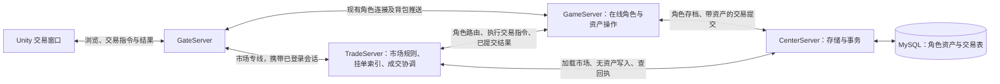

# 玩家交易商城设计

2026-11-25 · 已确定的服务架构：首期独立部署 TradeServer，本服玩家一口价寄售

TradeServer 负责市场，GameServer 负责在线角色的资产操作，CenterServer 负责将角色资产和交易结果一起持久化。首期使用现有 MySQL；交易服可单独部署和重启。本服材料寄售已接入实际角色背包。当前使用 `trade_listing` 保存剩货和待领银两，`stall_receipt` 保存请求结果；下文的装备、其他频道和扩展表仍为方案。

## 1. 首期玩家能做什么

卖家从真实背包选一件物品或一叠材料，按单价寄售。上架成功后，物品由商城保管，卖家可以离线。买家打开现有交易窗口，按分类浏览，选择某一笔挂单和数量，确认后扣银两、物品进包。卖家在「出售 → 我的摊位」看到成交记录、领取收益，也可以撤下剩余货物。

| 现有入口 | 首期内容 | 后续开放条件 |
|---|---|---|
| 摆摊 → 购买 | 左侧沿用分类，中间显示物品、在售数量和最低单价。点物品看真实挂单，按单价、挂单号排序。材料可部分买，装备逐件看实例属性。 | 公共查询按本服过滤。 |
| 摆摊 → 出售 | 沿用包裹、摊位布局。摊位内看在售、成交待领、撤单或到期待取回。买家收到“背包已满”可整理后再买。 | 流通品种由服务端规则开放。 |
| 本服珍品、公示、神厨 | 可复用同一口价订单。珍品公示另加可购买时间，神厨需确定菜品时效。 | 首期先收起尚未接通的频道或页签。 |
| 求购、全服、拍卖、信誉 | 求购须预扣买家资金，部分供货分次结算；跨服须明确交易域与角色归属；竞拍须托管出价、退还落标款并处理截标；信誉须从真实成交定义统计口径。 | 分别立项，避免在没有成交记录时展示似乎能付款的入口。 |

**本服材料摆摊实装数值。** 单币种用银两（客户端显示对应 `ItemEnum.ROMONEY`，物品 ID 102），8 个在售摊位、寄售 24 小时、成交税 8%、上架费 0。当前按物品主类型开放未绑定且永久有效的材料。先用材料跑通，随后用具有强化、宝石、词条及特技的装备验证实例流转。货币道具自身不进入商品白名单。第一版固定上架单价，下架或到期后可以改价重新上架，也可以取回余货。

**例子。** 卖家以每份 100 银两挂 10 份材料，买家选中这一笔买 4 份。买家支付 400 银两并拿到 4 份；挂单还剩 6 份，订单记税 32、卖家待领 368。此时卖家撤单，可取回 6 份，并单独领取已成交的 368 银两。买家返回超时后重连，看到同一成交结果。

## 2. 现有项目能直接接什么

| 已核对的位置 | 当前事实 | 设计中的接法 |
|---|---|---|
| `MainView`、`MainCtrl`、`TradeMarketWindow` | 已注册 `WindowType.TradeMarketWindow`；打开时绑定 `RoItemComponent`，显示四种真实余额。目录按配置陈列，挂单页为空，弹窗还能编辑本地草稿。 | 保留打开窗口、RO 外观和分类结构；把最低价、数量、卖家挂单及提交结果换成服务端数据。 |
| `TradeMarketCatalog.asset`、`TradeMarketCategories.json` | 有分类目录和可手改的中文可见性开关，支持按组、货架、快捷入口隐藏。 | 保留现有文件。隐藏分类只影响公共浏览；卖家仍能从「我的摊位」取回旧货、领取旧款。 |
| `ItemConfigBase`、服务端 `RoItemComponent` | 已有物品配置、堆叠上限、背包类别、绑定状态、按 UID 查物品和虚拟货币接口；`SellPrice` 是既有商店价格。 | 出售点击必须从选中的背包实例传 `itemUid`。成交价格使用挂单单价，装备展示读取寄售实例。 |
| `DBMgr`、`CRoleWriteTask`、`RoleNetSender` | CenterServer 用 SqlSugar/MySQL；GameServer 维护在线背包，单角色只有一份在途存档。中心服会按提交的包类型删旧写新，并以 `role.ItemSaveVersion` 判版本。 | 把市场写操作纳入同一角色资产写入顺序；市场事务和正常存档共用角色版本。 |
| `item`、`equip` 及扩展表，`RoleItemInfo` | 背包物品主键含 `RoleID + ItemUID`。现有 Protobuf 能保存绑定、原购价、创建/到期时间、强化、六孔宝石、词条和特技。 | 托管完整实例数据，使用时替换归属与格位。货币沿用虚拟物品栏。已有 NPC 购买统计 `RoleShopPurchaseTable` 继续服务 NPC 商店。 |

## 3. 独立交易服的部署与代码结构

**首期拓扑已确定。** 在 `LYF_Server.sln` 中增加可独立启动、停止和重启的 `TradeServer.exe`，每个本服交易域只由一个活动实例受理。它监听内网 TCP；GateServer 与 GameServer 主动连接它，TradeServer 主动连接 CenterServer。角色存档仍走已有的 GameServer → CenterServer 连接。客户端继续连接 GateServer。MasterServer 保留现有职责，交易服通过注册到本进程的 GameServer 连接找到在线角色。

| 服务 | 它决定什么 | 它持有什么 |
|---|---|---|
| GateServer | 根据命令把市场流量转到 TradeServer，将结果转回发起会话。 | 客户端连接与服务端确认的角色会话标识。 |
| TradeServer | 决定可卖品种、市场与价格规则、实际命中的挂单、成交数量与税费；受理撤单、到期及领取，发布市场结果。 | 本服在售索引、报价、在线角色所在 GS、正在处理的挂单号及操作号。已成交事实、未领款和剩货以中心库记录为准。 |
| GameServer | 按实际角色状态核对物品 UID、绑定、可花银两、堆叠和格位；准备资产变动，提交成功后应用到在线角色。 | 在线背包及虚拟钱包、当前角色会话、在途存档和已确认的 `ItemSaveVersion`。 |
| CenterServer | 执行带前置条件的持久化，裁定哪个并发写入实际成功，并提供查询回执与重载数据。 | 角色表及交易三表的唯一数据库写入口。撮合、选货、定价和税率策略由 TradeServer 提供。 |

**会话与结果。** 角色进入世界后，GameServer 通过受信内网连接向 TradeServer 绑定「登录会话标识、本服 ID、角色 ID、所属 GS」。GameServer 为本次登录分配内网会话标识；GateServer 从进服的服务端响应取得同一标识，转发请求时附上；客户端只提供业务参数。现有 `unity_session_id` 和 `gate_session_id` 属于各自连接，跨进程以这次绑定关联，避免直接比较两个进程的本地连接号。断线时仅注销对应会话；重新连接后重建绑定。市场结果按原会话经 TradeServer → GateServer 返回，背包变化经现有 GameServer → GateServer 下发。两路消息用操作号和角色版本关联，窗口读取角色背包组件显示最新余额。

### 3.1 建议的代码分工

下列名称用于后续开发估算，本次只更新设计文档。新增项目可照现有 `MasterServer.csproj` 的可执行项目结构组织，基础通信沿用 `Network` 和 Protobuf。

| 位置（相对项目根） | 拟新增或接入 | 职责 |
|---|---|---|
| `LYF_Server/TradeServer/` | `TradeServer.csproj`、`TradeServerApp.cs`、`Network/TradeRoleRoutes.cs` | 进程入口、内网监听、识别 Gate/GS 来源、连接 Center、恢复市场后开放入口、处理角色路由。 |
| `LYF_Server/TradeServer/Stall/` | `StallManager.cs`、`StallCatalog.cs`；`MessageHandler/Stall/` 放各命令处理器 | Manager 负责受理一口价寄售、选择挂单、定价、操作占用和到期；Catalog 维护展示索引、分页和搜索。首期只建设摆摊模块；普通交易和拍卖按玩法后续接入同一进程。 |
| `LYF_Server/GameServer/` | `Service/TradeServerLink.cs`、`MessageHandler/Trade/TradeAssetHandler.cs`；接入 `OnlineRole`、`RoItemComponent`、`RoleNetSender` | 注册角色路由、准备实际资产变更，把市场指令与资产计划一并提交给 Center，接收回执、应用一次并通知 Trade。 |
| `LYF_Server/CenterServer/` | `Ctrl/CenterTradeCtrl.cs`、`DB/Modle/TradeMarketModel.cs`、`DB/Task/CTradeCommitTask.cs`、`DB/Table/TradeListingTable.cs`、`TradeOrderTable.cs`、`TradeRequestTable.cs` | 只读查询与回执检索、表映射、事务执行。现有 `DBMgr` 的写队列元素是具体的 `CRoleWriteTask`，接入时让普通存档与交易提交共用该串行写入点；公共查询独立于写队列。 |
| `LYF_Server/GateServer/`、`LYF_Server/Network/`、`LYF_Server/ProtoBuf/proto/` | `GateTradeCtrl.cs`、Trade 连接及服务类型、可配置内网端口、`TradeMarket.proto` 和命令注册 | 分开客户端市场命令与内部角色资产、持久化命令，完成上行和回包寻址；方案阶段不预占具体端口、命令号。 |
| `LYF_MMO/Assets/LYF_Game/Scripts/` | `controller/UIController/TradeMarketCtrl.cs` 接入现有 `MainView → MainCtrl → TradeMarketWindow` 和 Widget | 展示服务端挂单、订单与回执；提交玩家选中的 UID/挂单号及报价。现有 RO 布局和分类 JSON 继续使用。 |
| 策划配置 | `TradeMarketRule`、`TradeGoodsRule`，结合现有 Luban 物品配置 | 由 TradeServer 读取市场币种、摊位上限、期限、费率、物品白名单和单价范围。运营停止上新后，仍可履行旧单。 |

### 3.2 消息边界

| 调用方向 | 消息草案 | 必要输入和结果 |
|---|---|---|
| Gate → Trade | 查目录 / 查挂单 / 查我的摊位 / 查操作结果 | 会话、市场、筛选、分页游标；返回本服结果。个人摊位按绑定角色查，包含已隐藏分类的旧货待办。 |
| Gate → Trade | 上架 / 购买 / 撤单 / 取回 / 领款 | 客户端为每次确认生成 `requestId`。上架带物品 UID、数量和单价；购买带挂牌号、数量、确认单价和币种；撤单及取回带挂牌号；领款带成交号。 |
| Trade → Game | `PrepareAndCommitTrade` | 内部交易指令携带角色会话、操作号、原始参数摘要、币种、交易服计算的金额、挂牌/成交标识及所见行版本；购买、取回还携带托管物品信息。 |
| Game → Center | `CommitTradeWithAssets` | 原样传递交易服的业务指令，并附上 GameServer 从当前角色生成的资产变更计划、期望角色版本和所属会话。中心服返回终态、订单/挂单版本、角色新版本与已提交资产差量。 |
| Trade → Center | `LoadActiveListings`、`QueryOwnTrades`、`QueryTradeReceipt`、`CloseListing` | 装载在售索引、查询历史和回执；撤单/系统到期仅需持久化市场状态。Center 在有挂单变更的事务提交后，对已订阅的 Trade 连接发出挂牌号与已提交版本。 |
| Game → Trade → Gate | `TradeCommitted` / 终态失败 | 市场展示使用已提交回执；Game 单独向角色推送已应用的资产变化。原请求超时时可用同一操作号查询。 |

完整资产写操作示例见第 5 节。首期逐笔买入玩家确认的明确挂单；RO 支持的同价多单合并报价留作后续玩法。

### RO 参考项目的实际部署与摆摊结算

本节依据本地 `Ro_cs422nb` 服务端源码。**RO 单独编译并运行 `tradeserver` 进程**，进程初始化和主循环分别注册、更新 `TradeManager`、`StallManager`、`AuctionManager`。普通交易、玩家摆摊和拍卖各有处理入口。玩家之间一口价寄售最直接的参照是 `stall`。[构建目标](F:/UnityPro/ro/Ro_cs422nb/roserver/tradeserver/CMakeLists.txt:65) · [模块注册](F:/UnityPro/ro/Ro_cs422nb/roserver/tradeserver/process.cpp:94)

| 玩家操作 | RO 源码中的处理顺序 |
|---|---|
| 上架 | GateServer 把客户端 C→J 交易 RPC 转到 `tradelink`。交易服校验售价、上架数量等条件并锁住卖家的上架操作，经 MasterServer 找到卖家所在 GameServer。游戏服按 UID 核对实物，处理上架费用并移出货物；成功回包后，交易服按返回的物品数据创建挂单。[网关路由](F:/UnityPro/ro/Ro_cs422nb/roserver/gateserver/config.cpp:103) · [交易服建单](F:/UnityPro/ro/Ro_cs422nb/roserver/tradeserver/protocol/stall/rpcc2j_stallsellitem.cpp:223) · [游戏服移出物品](F:/UnityPro/ro/Ro_cs422nb/roserver/gameserver/protocol/stall/rpcm2g_stallsellitemcost.cpp:136) |
| 购买 | 对可合并的同物品、同价货物，界面的一组报价可以对应多笔卖单。交易服分配各单出货数量并锁住涉及的挂单，把扣币、发货和背包容量检查放入一次角色资产变更 RPC。MasterServer 转发给买家的 GameServer。收到成功回包后，交易服逐笔扣剩余数量、累加卖家待领款。卖家在线时另发通知与红点，保存摊位数据不依赖卖家在线。[报价组](F:/UnityPro/ro/Ro_cs422nb/roserver/tradeserver/stall/role_stall_buy_info.cpp:145) · [锁单和扣款请求](F:/UnityPro/ro/Ro_cs422nb/roserver/tradeserver/protocol/stall/rpcc2j_stallitembuy.cpp:174) · [路由到角色](F:/UnityPro/ro/Ro_cs422nb/roserver/masterserver/protocol/role/rpcj2m_traderoleitemchange.cpp:25) · [更新卖单](F:/UnityPro/ro/Ro_cs422nb/roserver/tradeserver/protocol/stall/rpcc2j_stallitembuy.cpp:243) |
| 领款 | 待领款记在卖单的 `money` 字段。可单笔领取或一键领取；交易服先计算金额，经角色资产接口给币，成功回包后再清待领款。RO 此处的上架费用和摆摊结算货币常量都取物品 ID 101。本项目设计稿中的银两 102、8 摊位和 8% 税率采用本项目录屏交互与配置。[领款请求](F:/UnityPro/ro/Ro_cs422nb/roserver/tradeserver/protocol/stall/rpcc2j_stalldrawmoney.cpp:221) · [结算货币](F:/UnityPro/ro/Ro_cs422nb/roserver/tradeserver/stall/stall_define.h:6) |

**存储与恢复。** 交易服启动时按 `serverid` 读取 `stall_role_sell`。卖家摊位保存时，将物品明细、数量、单价、待领款和到期时间打包为 Protobuf，经分帧任务送 DBServer，保存在 `sellitems` 字段。全局基准价及统计另以 `stall_info` 保存。这条路径能确认游戏服资产回包与摊位落库分属两个步骤；本次只读源码核对，未运行 RO 多进程断线或故障恢复测试。[交易服读取](F:/UnityPro/ro/Ro_cs422nb/roserver/tradeserver/stall/stall_manager.cpp:937) · [提交摊位保存](F:/UnityPro/ro/Ro_cs422nb/roserver/tradeserver/stall/stall_manager.cpp:1125) · [数据库写入](F:/UnityPro/ro/Ro_cs422nb/roserver/dbserver/db/task/stall_save_role_task.cpp:43)

**本项目采用的对应关系。** 沿用 RO 的独立交易进程、网关市场入口和在线角色资产职责。LYFMMORGP 的 TradeServer 通过直连 GameServer 的角色路由下达交易指令，CenterServer 复用现有角色版本和 MySQL 事务一次提交双方已经确定的市场与资产变更。这是本项目对 RO 服务边界的适配，RO 原实现的摆摊分步存档可由上方源码追溯。

## 4. 数据库设计

首期在中心服现有 MySQL 中新增 **三张 InnoDB 表**。交易数据的业务归属是 TradeServer；表映射、事务和数据库连接放在 CenterServer。TradeServer 通过内部接口读取和提交，不配置 MySQL 写账号。沿用现有 `role`、`item`、`equip`、装备词条/特技表和 `roleKnapsack`。公开行情取自挂单，实际成交取自订单；在线余额继续按虚拟物品栏统计。

| 建议新表 | 一行代表什么 | 关键列及约束 |
|---|---|---|
| `trade_listing` | 一次寄售及尚未交付的货 | `ListingId BIGINT` 主键，`ServerId, MarketType, SellerRoleId, ItemTypeId, CurrencyItemId INT`，`UnitPrice BIGINT`，`InitialQty, HeldQty, ReturnedQty INT`，`Status`，`ListingVersion BIGINT`（每次变更递增），`FeeBps`，`ListedAt, ExpiresAt, ClosedAt`，`EscrowItemUid BIGINT`、`ItemPayload BLOB`、`PayloadVersion`、`HeldAcquisitionCost BIGINT`。快照存挂单的原始物品属性，托管数量和剩余原购成本分别以两列为准。 |
| `trade_order` | 一次已成交的购买，也是这笔卖方应收 | `OrderId BIGINT` 主键，`ListingId` 关联挂单，`ServerId, BuyerRoleId, SellerRoleId, ItemTypeId, CurrencyItemId, Quantity`，`UnitPrice, Gross, Fee, Net BIGINT`，`TradedAt, ClaimedAt`。成交金额按当时值固定；`ClaimedAt` 为空表示可领，非空表示已入卖家虚拟背包。一次部分购买一行。 |
| `trade_request` | 某角色一次已提交的写操作及可重放回执 | 复合主键 `(RoleId, RequestId)`，`RequestId BINARY(16)`，另存 `ActionType, ArgumentDigest, ListingId, OrderId, ResultCode, ResultPayload, CommittedAt`。按类型允许引用号为空。回执与业务变更同事务写入；同号同参返回原回执，同号异参拒绝。摘要取客户端确认的原始业务参数；重试时的服务端版本、计划或连接号不参与摘要。回执保留当次提交的角色版本和市场行版本，便于重启后查明结果。 |

**查询索引。** 挂单按 `(ServerId, MarketType, Status, ItemTypeId, UnitPrice, ListingId)` 查某商品在售列表；`(SellerRoleId, Status, ListingId)` 查个人摊位并用于计数；`(Status, ExpiresAt, ListingId)` 找到期批次。订单按 `(SellerRoleId, ClaimedAt, OrderId)` 查待领和出售记录、按 `(ListingId, OrderId)` 对账、按 `(BuyerRoleId, OrderId)` 查购买记录。公开查询同时过滤截止时间；名称搜索先从允许展示的配置解析出物品 ID，再查本服挂单。对外在售查询由 TradeServer 的已提交挂单索引提供；CenterServer 使用以上索引完成启动加载、按行刷新及历史查询。

**状态与守恒。** `在售 → 售罄 / 已撤 / 已到期`。每次购买只减少 `HeldQty`；减到零才售罄。撤单或到期保留剩余托管量，取回成功才清零并增加 `ReturnedQty`。进程内占用只覆盖一次在途操作；是否仍可成交，由数据库事务核对 `Status`、`ListingVersion`、截止时间与 `HeldQty`。始终满足 **上架数 = 已成交数量之和 + 当前托管数 + 已取回数**。卖家待领款就是未领订单的 `Net` 之和。挂单已关闭且货款或货物仍待领取时继续保留记录。

**货物身份。** 装备与整叠移交保留原 UID，原背包在同一事务移出；买家接收时将 Protobuf 内物品和装备扩展的角色归属一起改为买家，使用目标格位。上架拆堆或部分交付时，为拆出的实体分配独立 UID；合入兼容堆时沿用目标堆 UID。堆叠兼容需核对配置 ID、绑定、期限和价格来源等实例属性。退回保留原购成本；拆堆按比例分摊原成本，整数尾差留给剩余堆，最后一份取尽。购买写入买方此次实际货币类型及购入总价。装备详情展示的快照与最终发货来自同一托管记录。

**结算口径。** 金额以最小货币单位计算。下单前校验数量、单价、乘积和虚拟物品接口范围。建议限制单笔成交总额不超过 `2,147,483,647`，与当前 `GiveVirtualItem` 的单次入账上限一致；账表用 `BIGINT`，单笔单领。税率上架时以基点固定，8% 写 800。为免拆成小单改变总税，本次手续费取“同一挂单累计成交额计税向下取整”减“此前累计已扣税”，计算中间值用足够精度。每单实付等于卖家净收加税。调税后旧挂单沿用挂牌时费率。

**失败回执。** 对已经作出终态判断的业务拒绝，例如挂单已售罄或背包已满，可在没有资产改动的事务内持久化原请求的失败码。客户端处理完原因并重新确认时使用新号。数据库连接中断或事务未能提交属于结果未知，继续查询或重发原号，避免把暂时没有回执当成失败。

## 5. 从受理到落库

| 操作 | 同一个事务内必须一起完成 | 提交后 |
|---|---|---|
| 上架 | 核对角色版本、实例归属、非绑定和可交易规则，检查服务器端数量、价格及摊位上限；从卖家包移出/拆堆，保存托管属性、创建挂单、推进角色版本、写回执。 | 背包减少，我的摊位出现挂单。失败时两处都保持原状。 |
| 购买 | 锁买家角色与目标挂单；核对本服、非本人、在售、未到期、报价和库存；检查容纳本次商品的真实格数。扣买家虚拟银两、发货入买家背包、减少托管数、写订单及应收、推进买家版本、写回执。 | 买家取得物品。卖家离线也有一笔可领取收益，卖家背包在成交这一刻无需写入。 |
| 撤单 / 到期 | 锁挂单，仅在当前仍可售时关闭销售；玩家撤单核对所有者，系统到期按 UTC 处理。到期扫描尚未运行时，购买事务仍以实际截止时间判定。 | 剩余货物可领取；背包满也能停止销售。已经产生的成交款仍可领。 |
| 取回剩货 | 锁卖家角色与已关闭的挂单；有足够格位时恢复原物、减少托管数、增加已取回数、更新角色版本并写回执。 | 背包满时保留待取回状态；整理后可继续。 |
| 领取收益 | 锁卖家角色及本人的订单，校验 `ClaimedAt` 为空，即刻增加指定虚拟货币并将该笔订单标记已领、推进角色版本、写回执。 | 列表和余额一起刷新。换一个请求号再点，仍不能二次入账。 |

### 一次购买的完整时序

1. **受理。** 买家确认「4 份、单价 100 银两」。Gate 转给 Trade，Trade 按会话核对本服和买家，找到选中的挂单，判断报价与余量，占用该挂单，按挂牌时费率计算实付 400、税 32、卖家应收 368。Trade 向买家所在 Game 发出市场指令。占用期间市场索引不预扣库存。
2. **准备角色资产。** Game 在角色逻辑线程上等已有在途存档结束，保存此前已脏的相关角色状态，取得已确认的 `ItemSaveVersion`。按真实背包准备扣 400 和放入 4 份材料的计划，保留具体物品 UID、格位和堆叠变动。交易结束前，涉及同一角色保存版本的背包、次数和技能写入按序处理。准备阶段即可确定的余额不足或满包，走失败回执。
3. **唯一提交点。** Game 将该计划和 Trade 的原指令交 Center。Center **先查 `(RoleId, RequestId)` 的回执，再比较版本**。新请求在同一事务内复核角色归属、版本、实际余额/格位、挂牌版本与库存，并核对资产计划中的物品、数量、实付金额与本挂单指令一致，同时写买家资产、挂单剩量、成交单及回执。只推进买家的角色版本。两个买家竞争最终一件时，以满足条件并成功提交的那一笔为准。
4. **发布结果。** Game 收到已提交结果后按版本应用一次、解除该角色的资产操作占用、同步背包，并把回执发给 Trade。Trade 按返回的挂牌版本更新索引、解除挂单占用，再经 Gate 通知买家；卖家在线可以刷新摊位，离线时由 `trade_order` 保留应收。落后的行版本不能覆盖已发布的较新库存。
5. **其他操作如何走。** 上架、取回和领取收益按同一路径交 Game 准备资产，再由 Center 原子提交。撤单由 Trade 直接交 Center，校验所有者与行版本，关闭销售并保留托管余量；系统到期以相同条件关闭，还要核对数据库 UTC 截止时间。定时重复扫描已关闭挂单时不产生第二次返货。各操作的写集合见本节表格。

### 重启、断线与争用

| 情形 | 恢复方法与可观察结果 |
|---|---|
| Trade 在成交前后重启 | 新进程先向 Center 订阅本交易域的已提交挂单变更，收到订阅确认后按稳定的挂牌号游标分页读取在售行，同时暂存本连接收到的变更编号。加载结束时与 Center 的提交队列做一次顺序标记，重新读取截至标记受影响的挂牌号（含已关闭记录），按版本合并再开放受理。其后继续消费实时变更。该有序连接断开即重新订阅、装载；进程内挂单占用随重启清除，中心库的行版本仍约束所有提交。GS 报告的未决操作按原号查回执。 |
| Center 已提交，Game/Trade/客户端丢失回包 | 重发原号或向 Center 查 `trade_request`。Game 收到同一回执只应用一次；角色已重登时以重新载入的权威背包和版本为准。Trade 据回执同步挂单，再告知玩家；不得第二次扣款或发货。 |
| Center 不可用、在途请求超时且尚未查到回执 | 界面显示“处理中”。原提交方用同一操作号和原参数重试。若必须在换服/重连时终止未决请求，由 Center 以同一唯一键原子执行“返回旧回执，否则登记已终止”；先完成的一侧决定终态，迟到提交读取该回执。角色资产以已确认结果继续。 |
| 普通存档、换服或买家退出 | Game 按角色排列交易与正常存档。换服时先结束旧会话的资产写资格，再交接新会话；Center 的市场提交及普通存档入口均需核对当前写入角色的 GS/会话归属。新会话从 Center 重载角色。进服/切服时的写资格交接是后续实现点。 |
| 买、撤、到期或领取并发 | 资产写入锁定顺序为发起角色、相关挂单、相关订单；纯市场命令只涉及挂单。条件更新检查在售状态、挂牌版本、截止时间、库存或未领取标记。竞争失败返回已有结果或最新挂单；新请求号也无法再领取已领订单。 |

## 6. 开发拆分与验收

| 开发顺序 | 交付范围 | 放行条件 |
|---|---|---|
| 1. 独立进程与只读市场 | 将 TradeServer 工程纳入解决方案，接通 Gate/GS/Center 内网链路、角色路由、数据库加载、查询和入口开关。 | 能独立启停交易服；停服期间玩家仍可正常移动，市场提示暂不可用。恢复后只显示本服已提交、未过期的挂单；隐藏分类的历史待办仍可访问。 |
| 2. 所有权转移 | 材料上架、部分买、撤单、到期、领货领款，打通角色存档与交易的串行提交。 | 两账号跑完上面的 10 份例子；余额不足和满包都不扣钱；两人抢最后一件只有一单；重复请求和换号重复领取均不能多发。 |
| 3. 装备和故障验收 | 带属性装备、离线卖家、重连、服务器重启、金额与税率边界。 | 装备 UID、强化、六个宝石孔、特技/激活槽及词条逐项对比。分别终止 Trade、Game、Center，覆盖重载期间旧请求晚到、事务提交前停机、提交后丢回包、领取与切服交错。对照角色版本、回执和市场行版本，混合战利品、技能及定时存档后重登，无半单、回档或重复发货。 |
| 4. 扩展玩法 | 依据上线数据决定珍品公示、求购、神厨、跨服、竞拍的优先级。 | 每种玩法先定托管对象、退回条件和结算时间，再开放相应入口。 |

联调时按挂单逐笔核对数量守恒、按订单核对资金守恒，并核对已领金额进入了正确角色的虚拟背包。以上均为拟定验收用例；本次做了源码与协议核对、算例推演，未建表、执行 SQL、运行交易或测量吞吐。

## 项目依据

- [独立内网进程参考](../LYF_Server/MasterServer/MasterServerApp.cs) · [游戏服的现有启动连接](../LYF_Server/GameServer/GameServerApp.cs) · [中心服主循环](../LYF_Server/CenterServer/CenterApp.cs) · [现有会话包头](../LYF_Server/ProtoBuf/proto/RequestEntity.proto)

- [交易窗口](../LYF_MMO/Assets/LYF_Game/Scripts/UI/Main/Window/TradeMarketWindow.cs) · [本地交易草稿](../LYF_MMO/Assets/LYF_Game/Scripts/UI/Main/Window/Widget/TradeMarketDialog.cs) · [可手改分类文件](../LYF_MMO/Assets/LYF_Game/Config/TradeMarketCategories.json)
- [物品和装备协议](../LYF_Server/ProtoBuf/proto/ResultEntity.proto) · [游戏服背包](../LYF_Server/GameServer/Components/RoItemComponent.cs) · [实例主表](../LYF_Server/CenterServer/DB/Table/ItemTable.cs)
- [单角色在途存档](../LYF_Server/GameServer/Entity/Role/RoleNetSender.cs) · [中心服背包事务](../LYF_Server/CenterServer/DB/Task/CRoleWriteTask.cs) · [中心服建表与写任务调度](../LYF_Server/CenterServer/DB/DBMgr.cs)
