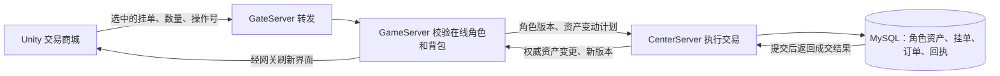

# 玩家交易商城设计

2026-11-25 · 功能与技术设计稿 · 首期为本服玩家一口价寄售

## 1. 首期玩家能做什么

卖家从真实背包选一件物品或一叠材料，按单价寄售。上架成功后，物品由商城保管，卖家可以离线。买家打开现有交易窗口，按分类浏览，选择某一笔挂单和数量，确认后扣银两、物品进包。卖家在「出售 → 我的摊位」看到成交记录、领取收益，也可以撤下剩余货物。

| 现有入口 | 首期内容 | 后续开放条件 |
|---|---|---|
| 摆摊 → 购买 | 左侧沿用分类，中间显示物品、在售数量和最低单价。点物品看真实挂单，按单价、挂单号排序。材料可部分买，装备逐件看实例属性。 | 公共查询按本服过滤。 |
| 摆摊 → 出售 | 沿用包裹、摊位布局。摊位内看在售、成交待领、撤单或到期待取回。买家收到“背包已满”可整理后再买。 | 流通品种由服务端规则开放。 |
| 本服珍品、公示、神厨 | 可复用同一口价订单。珍品公示另加可购买时间，神厨需确定菜品时效。 | 首期先收起尚未接通的频道或页签。 |
| 求购、全服、拍卖、信誉 | 求购须预扣买家资金，部分供货分次结算；跨服须明确交易域与角色归属；竞拍须托管出价、退还落标款并处理截标；信誉须从真实成交定义统计口径。 | 分别立项，避免在没有成交记录时展示似乎能付款的入口。 |

**建议起步数值，均待策划确认。** 单币种用银两（客户端显示对应 `ItemEnum.ROMONEY`，物品 ID 102），8 个在售摊位、寄售 24 小时、成交税 5%、上架费 0。仅开放白名单内、未绑定、未穿戴、未到期且永久有效的物品。先用材料跑通，随后用具有强化、宝石、词条及特技的装备验证实例流转。货币道具自身不进入商品白名单。第一版固定上架单价，改价通过撤单、取回和重新上架完成。

**例子。** 卖家以每份 100 银两挂 10 份材料，买家选中这一笔买 4 份。买家支付 400 银两并拿到 4 份；挂单还剩 6 份，订单记税 20、卖家待领 380。此时卖家撤单，可取回 6 份，并单独领取已成交的 380 银两。买家返回超时后重连，看到同一成交结果。

## 2. 现有项目能直接接什么

| 已核对的位置 | 当前事实 | 设计中的接法 |
|---|---|---|
| `MainView`、`MainCtrl`、`TradeMarketWindow` | 已注册 `WindowType.TradeMarketWindow`；打开时绑定 `RoItemComponent`，显示四种真实余额。目录按配置陈列，挂单页为空，弹窗还能编辑本地草稿。 | 保留打开窗口、RO 外观和分类结构；把最低价、数量、卖家挂单及提交结果换成服务端数据。 |
| `TradeMarketCatalog.asset`、`TradeMarketCategories.json` | 有分类目录和可手改的中文可见性开关，支持按组、货架、快捷入口隐藏。 | 保留现有文件。隐藏分类只影响公共浏览；卖家仍能从「我的摊位」取回旧货、领取旧款。 |
| `ItemConfigBase`、服务端 `RoItemComponent` | 已有物品配置、堆叠上限、背包类别、绑定状态、按 UID 查物品和虚拟货币接口；`SellPrice` 是既有商店价格。 | 出售点击必须从选中的背包实例传 `itemUid`。成交价格使用挂单单价，装备展示读取寄售实例。 |
| `DBMgr`、`CRoleWriteTask`、`RoleNetSender` | CenterServer 用 SqlSugar/MySQL；GameServer 维护在线背包，单角色只有一份在途存档。中心服会按提交的包类型删旧写新，并以 `role.ItemSaveVersion` 判版本。 | 把市场写操作纳入同一角色资产写入顺序；市场事务和正常存档共用角色版本。 |
| `item`、`equip` 及扩展表，`RoleItemInfo` | 背包物品主键含 `RoleID + ItemUID`。现有 Protobuf 能保存绑定、原购价、创建/到期时间、强化、六孔宝石、词条和特技。 | 托管完整实例数据，使用时替换归属与格位。货币沿用虚拟物品栏。已有 NPC 购买统计 `RoleShopPurchaseTable` 继续服务 NPC 商店。 |

## 3. 代码结构和消息边界

下表中的「建议新增」都是后续实现位置。本次交付只有设计文档。

| 层 | 复用 | 建议新增、职责 |
|---|---|---|
| Unity | `MainView → MainCtrl.ShowMainWindow → TradeMarketWindow`；`TradeMarketCard`、`TradeMarketDialog` 与原预制体 | `Scripts/controller/UIController/TradeMarketCtrl.cs` 发送查询和写请求、按当前查询条件接收结果，通知窗口刷新。Window/Widget 展示、输入、抛事件。货币图标按服务端返回的货币 ID 取现有资源。 |
| 共享协议、GateServer | `LYF_Server/ProtoBuf/proto`、`NetDefine`、网关上下行转发和 Unity 会话寻址 | 建议独立 `TradeMarket.proto`，为命令注册转发；上下行沿已有 Gate 链路。服务端从已登录会话确定角色和区服。 |
| GameServer | `MessageHandler`、`OnlineRole`、`RoItemComponent`、`RoleNetSender` | `MessageHandler/TradeMarket/` 接收市场消息。建议 `Service/TradeMarket/TradeMarketService.cs` 负责校验在线角色、选择实例、按堆叠与格子规则准备变动，并将中心服提交结果同步回游戏。 |
| CenterServer | `Ctrl`、`DB/Modle`、`DB/Table`、`DBMgr` 的串行写入点 | 建议 `CenterTradeMarketCtrl` 路由，`TradeMarketModel` 查询，`CTradeMarketWriteTask` 完成一次市场事务，三个同名表映射各一文件。现有写队列只收具体类型 `CRoleWriteTask`，落地时将入口最小泛化为串行数据库写任务基类，两个任务共用同一消费者。 |
| 策划配置 | 现有 Luban 物品主表、分类 JSON 和商城图标 | 建议增加 `TradeMarketRule`（市场、币种、摊位数、期限、税率）和 `TradeGoodsRule`（物品 ID、市场、可上架、单价上下限）。展示分类关闭与停止受理新上架分别生效。 |

**消息草案。** 数量用整型，UID、挂牌号、成交号和金额用 64 位；货币在协议中传物品 ID。以下名称用于设计，命令号在开发时统一分配。

| 请求 | 客户端输入 | 成功回包与界面行为 |
|---|---|---|
| 查目录摘要、查某物品挂单 | 当前市场、分类/查询词、物品 ID、排序游标和页长 | 目录按物品给最低单价和在售数量；挂单返回 `listingId`、剩余数量、单价、币种、到期时间及装备必要详情。游标包含排序末项的价格和挂单号，换分类或排序即清空。 |
| 查我的摊位及成交 | 在售 / 待取回 / 已成交、游标 | 只返回本人挂单及订单；展示待领取金额、数量和状态。即便物品被策划移出公开货架，也可访问。 |
| 上架 | `requestId, itemUid, quantity, unitPrice, market` | 返回挂单号、服务端到期时间、上架数量，并同步背包变化。选择相同物品 ID 的两件装备时，UID 决定具体哪件。 |
| 购买 | `requestId, listingId, quantity, expectedUnitPrice, currencyItemId` | 绑定用户确认的挂单和报价。返回成交号、实付、剩余数量和权威背包变化。货量不足、余额不足、背包放不下分别提示；不自动改买下一家。 |
| 撤单、取回货物、领取收益 | 独立操作，各携带 `requestId`；撤单和取货传 `listingId`，领款传 `orderId` | 撤单返回可取回数量，取回后同步背包，领款后同步银两和订单状态。查询操作结果可用相同请求标识恢复。 |

## 4. 数据库设计

首期在中心服现有 MySQL 中新增 **三张 InnoDB 表**。沿用现有 `role`、`item`、`equip`、装备词条/特技表和 `roleKnapsack`。公开行情取自挂单，实际成交取自订单；在线余额继续按虚拟物品栏统计。

| 建议新表 | 一行代表什么 | 关键列及约束 |
|---|---|---|
| `trade_listing` | 一次寄售及尚未交付的货 | `ListingId BIGINT` 主键，`ServerId, MarketType, SellerRoleId, ItemTypeId, CurrencyItemId INT`，`UnitPrice BIGINT`，`InitialQty, HeldQty, ReturnedQty INT`，`Status`，`FeeBps`，`ListedAt, ExpiresAt, ClosedAt`，`EscrowItemUid BIGINT`、`ItemPayload BLOB`、`PayloadVersion`、`HeldAcquisitionCost BIGINT`。快照存挂单的原始物品属性，托管数量和剩余原购成本分别以两列为准。 |
| `trade_order` | 一次已成交的购买，也是这笔卖方应收 | `OrderId BIGINT` 主键，`ListingId` 关联挂单，`ServerId, BuyerRoleId, SellerRoleId, ItemTypeId, CurrencyItemId, Quantity`，`UnitPrice, Gross, Fee, Net BIGINT`，`TradedAt, ClaimedAt`。成交金额按当时值固定；`ClaimedAt` 为空表示可领，非空表示已入卖家虚拟背包。一次部分购买一行。 |
| `trade_request` | 某角色一次已提交的写操作及可重放回执 | 复合主键 `(RoleId, RequestId)`，`RequestId BINARY(16)`，另存 `ActionType, ArgumentDigest, ListingId, OrderId, ResultPayload, CommittedAt`。按类型允许引用号为空。回执与业务变更同事务写入；同号同参返回原回执，同号异参拒绝。库中不预写一个可被误认为成功的结果。 |

**查询索引。** 挂单按 `(ServerId, MarketType, Status, ItemTypeId, UnitPrice, ListingId)` 查某商品在售列表；`(SellerRoleId, Status, ListingId)` 查个人摊位并用于计数；`(Status, ExpiresAt, ListingId)` 找到期批次。订单按 `(SellerRoleId, ClaimedAt, OrderId)` 查待领和出售记录、按 `(ListingId, OrderId)` 对账、按 `(BuyerRoleId, OrderId)` 查购买记录。公开查询同时过滤截止时间；名称搜索先从允许展示的配置解析出物品 ID，再查本服挂单。浏览流量无需进入角色资产写队列。

**状态与守恒。** `在售 → 售罄 / 已撤 / 已到期`。每次购买只减少 `HeldQty`；减到零才售罄。撤单或到期保留剩余托管量，取回成功才清零并增加 `ReturnedQty`。始终满足 **上架数 = 已成交数量之和 + 当前托管数 + 已取回数**。卖家待领款就是未领订单的 `Net` 之和。挂单已关闭且货款或货物仍待领取时继续保留记录。

**货物身份。** 装备与整叠移交保留原 UID，原背包在同一事务移出；买家接收时将 Protobuf 内物品和装备扩展的角色归属一起改为买家，使用目标格位。上架拆堆或部分交付时，为拆出的实体分配独立 UID；合入兼容堆时沿用目标堆 UID。堆叠兼容需核对配置 ID、绑定、期限和价格来源等实例属性。退回保留原购成本；拆堆按比例分摊原成本，整数尾差留给剩余堆，最后一份取尽。购买写入买方此次实际货币类型及购入总价。装备详情展示的快照与最终发货来自同一托管记录。

**结算口径。** 金额以最小货币单位计算。下单前校验数量、单价、乘积和虚拟物品接口范围。建议限制单笔成交总额不超过 `2,147,483,647`，与当前 `GiveVirtualItem` 的单次入账上限一致；账表用 `BIGINT`，单笔单领。税率上架时以基点固定，5% 写 500。为免拆成小单改变总税，本次手续费取“同一挂单累计成交额计税向下取整”减“此前累计已扣税”，计算中间值用足够精度。每单实付等于卖家净收加税。调税后旧挂单沿用挂牌时费率。

**失败回执。** 对已经作出终态判断的业务拒绝，例如挂单已售罄或背包已满，可在没有资产改动的事务内持久化原请求的失败码。客户端处理完原因并重新确认时使用新号。数据库连接中断或事务未能提交属于结果未知，继续查询或重发原号，避免把暂时没有回执当成失败。

## 5. 每个动作如何落库

| 操作 | 同一个事务内必须一起完成 | 提交后 |
|---|---|---|
| 上架 | 核对角色版本、实例归属、非绑定和可交易规则，检查服务器端数量、价格及摊位上限；从卖家包移出/拆堆，保存托管属性、创建挂单、推进角色版本、写回执。 | 背包减少，我的摊位出现挂单。失败时两处都保持原状。 |
| 购买 | 锁买家角色与目标挂单；核对本服、非本人、在售、未到期、报价和库存；检查容纳本次商品的真实格数。扣买家虚拟银两、发货入买家背包、减少托管数、写订单及应收、推进买家版本、写回执。 | 买家取得物品。卖家离线也有一笔可领取收益，卖家背包在成交这一刻无需写入。 |
| 撤单 / 到期 | 锁挂单，仅在当前仍可售时关闭销售；玩家撤单核对所有者，系统到期按 UTC 处理。到期扫描尚未运行时，购买事务仍以实际截止时间判定。 | 剩余货物可领取；背包满也能停止销售。已经产生的成交款仍可领。 |
| 取回剩货 | 锁卖家角色与已关闭的挂单；有足够格位时恢复原物、减少托管数、增加已取回数、更新角色版本并写回执。 | 背包满时保留待取回状态；整理后可继续。 |
| 领取收益 | 锁卖家角色及本人的订单，校验 `ClaimedAt` 为空，即刻增加指定虚拟货币并将该笔订单标记已领、推进角色版本、写回执。 | 列表和余额一起刷新。换一个请求号再点，仍不能二次入账。 |

**与现有角色存档串行。** 这是首期开发的第一个技术验收点。若直接改 `item` 而游戏服仍持旧的完整包，一次较新版本的普通存档就可能恢复旧余额或旧装备。建议按下面顺序实现。

1. 准备上架、购买、取回或领款时，GameServer 在角色逻辑执行点串行处理本次资产命令。先让在途普通存档结束，并落完此前已有脏状态；同一角色后到、会推进同一保存版本的物品/次数/技能变更排在本命令之后。其他角色、移动和浏览照常执行。
2. GameServer 依照现有背包规则准备变更计划，发送源角色的已确认版本和操作号。CenterServer **先查重复回执，再比较版本**，在同一事务中复核数据库内的角色版本、实际 UID、可花货币和目标格位，写角色资产、挂单或订单等变更。涉及角色的市场事务只写发起人，锁顺序固定为角色、挂单、订单；到期任务只锁挂单。
3. 提交成功后回传新版本和已提交的资产变更。GameServer 在同一角色执行点应用一次，再释放后续命令；普通定时存档从新版本继续。数据库拒绝时丢弃预演。提交前客户端只显示处理中。此处需要专门的市场提交结果应用入口，避免把服务器返回的变化重新当作待保存的本地增减。
4. 回包超时不能直接退币或重新发货；用原操作号查结果或重发同参请求。相同请求在唯一约束处碰撞时，回滚本次动作、读取已提交回执。已重登的角色从当前存档恢复，旧回执只用来显示订单结果，避免再次套用旧余额。若原进程已失联，新会话先取得该角色的资产写入权并排清旧命令；需覆盖“查询先到、旧命令后到”的切服/重连测试。终态业务失败重新确认后使用新请求号。
5. 两位买家抢最后一份时，后一个事务在拿到挂单锁后重新核对数量；购买与撤单同理。卖家的待领款由成交订单承接，不要求买卖双方在线握手，也无需给离线角色另建钱包。

## 6. 开发拆分与验收

| 开发顺序 | 交付范围 | 放行条件 |
|---|---|---|
| 1. 只读市场 | 策划白名单、单服市场规则、表映射、按品类查挂单、个人摊位、入口开关。 | 空市场显示零在售；不同服互不可见；个人仍能看到隐藏分类的旧挂单；翻页不会混入上一类结果。 |
| 2. 所有权转移 | 材料上架、部分买、撤单、到期、领货领款，打通角色存档与交易的串行提交。 | 两账号跑完上面的 10 份例子；余额不足和满包都不扣钱；两人抢最后一件只有一单；重复请求和换号重复领取均不能多发。 |
| 3. 装备和故障验收 | 带属性装备、离线卖家、重连、服务器重启、金额与税率边界。 | 装备 UID、强化、六个宝石孔、特技/激活槽及词条逐项对比。事务前停机无半单，提交后丢回包仍只成交一次；混合战利品、技能及定时存档后重登，无回档或丢货。 |
| 4. 扩展玩法 | 依据上线数据决定珍品公示、求购、神厨、跨服、竞拍的优先级。 | 每种玩法先定托管对象、退回条件和结算时间，再开放相应入口。 |

联调时按挂单逐笔核对数量守恒、按订单核对资金守恒，并核对已领金额进入了正确角色的虚拟背包。以上均为拟定验收用例；本次做了源码与协议核对、算例推演，未建表、执行 SQL、运行交易或测量吞吐。

## 项目依据

- [交易窗口](../LYF_MMO/Assets/LYF_Game/Scripts/UI/Main/Window/TradeMarketWindow.cs) · [本地交易草稿](../LYF_MMO/Assets/LYF_Game/Scripts/UI/Main/Window/Widget/TradeMarketDialog.cs) · [可手改分类文件](../LYF_MMO/Assets/LYF_Game/Config/TradeMarketCategories.json)
- [物品和装备协议](../LYF_Server/ProtoBuf/proto/ResultEntity.proto) · [游戏服背包](../LYF_Server/GameServer/Components/RoItemComponent.cs) · [实例主表](../LYF_Server/CenterServer/DB/Table/ItemTable.cs)
- [单角色在途存档](../LYF_Server/GameServer/Entity/Role/RoleNetSender.cs) · [中心服背包事务](../LYF_Server/CenterServer/DB/Task/CRoleWriteTask.cs) · [中心服建表与写任务调度](../LYF_Server/CenterServer/DB/DBMgr.cs)
