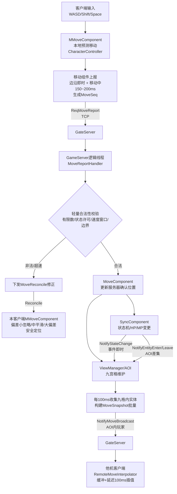

# 移动同步与状态同步设计文档

> 适用项目：LYFMMORGP（Unity 2023.2.20f1c1 客户端 + .NET Framework 4.8 C# 7.3 服务端 + Google.Protobuf + TCP）
> 服务端固定帧：50ms（20Hz）。
> 本文档已经按 2026-09-26 项目源码复核。第 0 节是当前有效的落地基线；后续旧参考代码只表达职责，不可直接复制。凡旧段落与第 0 节冲突，以第 0 节为准。


***

## 0. 项目现状复核与强制修订（2026-09-26）

### 0.1 可行性结论

方案采用“客户端即时移动、GameServer 接受位置快照并做轻量校验、附近客户端插值显示”的状态同步方向，符合本项目当前目标，**有条件可行**。原方案不能直接开发，必须先补齐场景世界生命周期、会话身份、GateServer 双向路由和服务器时间基线，并按本节修订移动校验、AOI、状态事件及客户端纠偏。

本项目本阶段不做服务端 Unity 场景物理模拟，不导入完整碰撞体或坡面数据。因此，下文所称“服务器确认位置”是 GameServer 对客户端上报位置完成轻量校验后接受的共享位置，不是服务器独立计算出的物理权威位置。服务器可以发现明显超速、异常瞬移、非法移动状态和越界，但不能可靠判定穿墙、坡面高度或精确落地点。

### 0.2 当前源码前置缺口

| 缺口 | 当前事实 | 落地要求 |
| --- | --- | --- |
| 场景世界未接入 | `GameGlobal` 固定帧调用 `SceneManager.Update`，但该方法当前为空；`EntityWorld` 和 `BindSceneEntity` 尚未进入正式业务链 | `SceneManager` 按地图和场景实例持有 `EntityWorld`；进入世界创建 `PlayerEntity`、初始化位置并绑定 `OnlineRole.SceneUid`；退出、断线、换图时解绑并销毁 |
| 会话到实体链未闭环 | `OnlineRole.SceneUid` 已存在，但不能用持久 `RoleId` 代替运行时实体 UID | 请求身份只使用 `GateSessionId + UnitySessionId -> OnlineRole -> SceneUid -> EntityWorld`，客户端上传的角色 ID 或实体 UID 均不可信 |
| GateServer 未注册新协议 | 只在 `NetDefine` 或 GameServer 注册不够；Gate 对未知下行协议会拒绝转发 | 同步修改 GateServer 上行注册与路由、下行协议放行、客户端接收注册和 Protobuf 生成产物 |
| 服务端场景组件为空壳 | `MoveComponent`、`SyncComponent`、`ViewComponent` 尚无正式业务实现 | 先打通单场景移动主链，再实现 AOI；禁止把现有空壳描述成已完成能力 |
| 旧附近玩家同步仍在运行 | `RoleManager` 进入世界时仍用旧协议发送同地图附近角色 | 新 AOI 与旧同步只能由迁移开关二选一，不能同时发送导致客户端重复创建实体 |

### 0.3 修订后的同步边界

客户端继续使用 `MMoveComponent + CharacterController + MModel.ApplyMovement` 完成本地即时移动、重力和三段跳。GameServer 不复刻 Unity 物理，只保存最近一次通过校验的位置、朝向、移动阶段及跳跃阶段，并向观察者广播。其他客户端使用快照缓冲插值显示。

正常合法上报后，GameServer 直接采用客户端位置作为服务器确认位置。只有出现明显超速、无权限传送、状态禁止移动、坐标非法或地图边界异常时才拒绝本次位置并返回修正。MVP 不保存输入历史，因此不宣称支持“丢弃未确认输入并重放”；客户端只做轻量平滑校正。

### 0.4 修订后的上报与广播节奏

客户端采用“事件边沿 + 移动中低频快照”，而不是无条件固定 10Hz：

1. 开始移动立即上报。
2. 持续移动时每 150~200ms 上报一次；具体值由双端压测后配置。
3. 停止移动立即上报，确保他机及时停下。
4. 每段跳跃开始、落地、技能开始、技能结束和传送完成时立即补发位置。
5. 长时间静止时可每 2 秒发送一次低频位置心跳，或由已有心跳承担连接存活检查。
6. GameServer 对观察者默认每 100ms 批量广播一次发生变化的移动快照。

100ms 广播间隔等于两个 50ms 逻辑帧；200ms 等于四个逻辑帧。插值延迟建议从 150~200ms 起步，根据实测抖动调整，不应把 100ms 错写成两个 100ms 广播间隔。

### 0.5 修订后的移动校验

禁止使用“最大速度 × 0.05 秒”检查一个 150~200ms 才到达的上报包。校验时间差必须来自服务器单调时钟或服务器记录的接收时间，`ClientTimeMs` 仅用于日志诊断，不能参与权威速度计算。

校验顺序如下：

1. 校验所有坐标、速度和朝向都是有限数，拒绝 `NaN`、正负无穷及超出地图安全边界的值。
2. 通过复合会话取得 `OnlineRole`，再确认角色仍绑定当前 `scene_instance_id` 和 `SceneUid`。
3. 校验 `move_session_id`、`MoveSeq` 和场景代次；重连、切图或重新出生时创建新的移动代次。
4. 由服务器角色状态和配置决定当前允许的最大速度；不得直接相信客户端上传的移动模式或速度。
5. 使用服务器实际接收间隔计算本次可移动距离，并在约 1 秒滑动窗口内累计距离，允许有限突发容差但不能每包重复赠送大额容差。
6. 同一逻辑帧可能消费多个 TCP 包，不能因 Tick 相同或 `dt=0` 把合法积压包全部拒绝；应使用记录的单调接收时间并设置合理的最小、最大计算区间。
7. 合法时接受位置；非法时保留上一次确认位置，返回结构化修正原因并记录审计日志。

TCP 单连接提供有序可靠传输，`MoveSeq` 主要用于重复包防护、调试、重连代次内的新旧判断和修正确认，不用于宣称普通 TCP 包会乱序。`uint32` 序列号必须使用可处理回绕的比较方法，不能永久使用普通 `<=`。广播给他机的速度应由已接受位移推导或限制到服务器允许范围，不能原样转发客户端任意速度。

### 0.6 本地纠偏与他机插值

本地纠偏不能直接写角色 `Transform`，否则会绕过 `CharacterController`、`MMoveComponent` 和接地状态。应由 `MMoveComponent` 提供纠偏接口：小偏差忽略；中偏差把校正偏移分帧叠加到本地移动；大偏差临时安全重置 `CharacterController` 后设置确认位置。收到新修正时替换旧修正目标。

他机插值按 `server_time_ms + snapshot_seq` 或等价的服务器时间轴排序。每个远端实体至少保留 3~5 个快照；相同序号覆盖或丢弃。播放时间位于两个快照之间时插值，超过最新快照后才进入最多 200ms 的受限外推，超时后停止。客户端必须建立服务器时间与本地到达时间的映射；不能用互不共用时钟基准的 `ClientTimeMs` 与 `ServerTick` 直接计算 RTT。

### 0.7 跳跃同步

三段跳除位置外还应同步 `jump_phase`、`jump_count`、垂直速度或等价运动状态，以及起跳/每段跳跃/落地边沿。GameServer 只校验状态机是否允许起跳、跳跃段数、最大滞空时间、水平累计距离和宽松的 Y 变化范围；落地后重置跳跃段数。

由于服务器没有地形高度和碰撞数据，不能信任客户端 `is_grounded` 就宣称“服务器判定地面”，也不能承诺防飞天或精确验证坡面。需要更强校验时，另行导出导航、高度或简化碰撞数据，不在本 MVP 范围内。

### 0.8 状态与属性同步

Idle、Walk、Run 由确认速度、停止边沿和移动模式派生，不再与移动包并行发送一套独立权威动作状态，避免移动快照与状态事件互相覆盖。Skill、BeHit、Stun、Dead 等离散业务状态使用独立有序事件，携带 `state_seq`、服务器开始时间和适用时长；同一逻辑帧内的“开始/结束”都必须保留，不能只存最后状态。

状态枚举复用 `MMoRpgCommon` 现有 `StateDefine` 数值，禁止在协议里另建 `0=Idle, 1=Move...` 的冲突枚举。`DurationMs` 只用于服务端能确定时长的状态；移动、待机和不定长蓄力不能依赖固定时长。

TCP 已可靠传输，不再每 5 秒向整个 AOI 无条件广播全部状态和属性。恢复策略改为：EnterView 全量、事件增量、重连/切场景全量；可选 10~30 秒发送低频摘要，只有版本或摘要不一致时请求/推送全量。Buff 尚无完整协议和组件实现，本阶段明确延后；后续至少需要实例 ID、配置 ID、层数、来源、开始/到期服务器时间、操作类型和版本。

### 0.9 AOI 修订

AOI 使用 `map_id + scene_instance_id + grid` 隔离，不允许不同副本相同坐标互见。格子坐标使用 `floor`，保证负坐标正确。格子尺寸和可见半径是两个独立参数；视野半径覆盖多少格应由半径计算，不能固定认为九宫格 15m 就等于 30~40m 视野。

关系必须双向维护：`VisibleEntities[playerUid]` 表示玩家看见谁，`Observers[entityUid]` 表示谁看见实体。出生、跨格、销毁、断线和换图统一更新两侧关系。差集定义为：

* `新可见集合 - 旧可见集合 = EnterView`。
* `旧可见集合 - 新可见集合 = LeaveView`。
* 交集继续保留，不发送生命周期事件。

只在跨格、进入、离开和场景迁移时重算受影响关系，不必每个 Tick 为所有实体重算完整集合。主城高密度场景还需要最大可见人数、距离/重要性优先级、更新频率分级及 Enter/Leave 滞回区，避免边界反复创建销毁和广播风暴。

同一广播帧应先冻结一份待发送快照/事件批次，发送给全部观察者后再统一清理脏位。不能让第一个观察者消费并清空共享数据，导致后续观察者漏包。移动脏位、状态事件队列和属性脏位分别管理。

### 0.10 协议及项目接线要求

新协议保持当前项目生成风格，不添加 `package LYFMMORGP`。运行时实体 UID 使用 `fixed64/ulong`；持久角色 `RoleId` 与场景实体 `UID` 必须在命名和注释中明确区分。客户端移动请求不携带可信角色 ID 或实体 UID，至少包含：

* `scene_instance_id`：当前场景实例标识。
* `move_session_id`：进入场景或重连后生成的移动代次。
* `move_seq`：当前代次内的移动序号。
* 位置、朝向、移动边沿/阶段、跳跃阶段和跳跃段数。
* `client_time_ms`：只用于诊断。

服务端广播至少包含 `scene_instance_id`、`snapshot_seq`、实体 `uid`、服务器时间、确认位置/朝向、受约束速度、移动阶段和跳跃信息。状态事件单独包含 `state_seq`。协议错误和业务拒绝返回结构化错误码或修正原因。

完整接线必须覆盖：Protobuf 源文件与生成项目、`NetDefine`、GameServer `GameMessageProtocolRegister`、一个协议一个 `IGameMessageHandler`、GateServer 上行命令注册与 `GateRoleCtrl` 路由、GateServer 下行协议放行、客户端接收注册。GameServer Handler 只解析和校验，再调用场景组件；定时广播使用 `OnlineRole.SendToClient`，不能保存历史请求上下文用于广播。

### 0.11 修订后的实施顺序

| 阶段 | 内容 | 验收重点 |
| --- | --- | --- |
| P0 | 协议字段、复合会话身份、场景实例、服务器单调时间基线；`SceneManager -> EntityWorld` 生命周期接线 | 进入/退出/重连后 `OnlineRole.SceneUid` 和场景实体严格对应，无跨实例串线 |
| P1 | 单场景移动上报、轻量校验和他机广播，暂时复用现有有限范围候选查询 | 两个独立客户端能看到对方开始、持续、停止和转向；正常移动不误判 |
| P2 | 他机插值、停止边沿、三段跳边沿和落地处理 | 抖动可接受，停止不滑行，跳跃阶段不乱序 |
| P3 | 服务器拒绝与客户端 `MMoveComponent` 纠偏 | 超速、非法传送和状态禁止移动能修正；正常移动无频繁橡皮筋 |
| P4 | 双向 AOI 替换旧附近角色同步 | 进入/离开、断线、换图、负坐标和多实例正确；新旧链路不重复发送 |
| P5 | 离散动作状态、属性增量和按需全量恢复 | 技能/受击/死亡顺序正确，EnterView 和重连能恢复完整表现 |
| P6 | 主城压测、自适应上报/广播频率和可见人数限制 | CPU、带宽、队列积压和客户端帧率达到项目目标 |

测试必须使用 Unity Editor + 独立构建，或两个独立进程/设备登录；两个 Game View 不是两个独立网络客户端。当前文档审查只验证设计与源码接口，没有执行上述运行验收。

## 1. 名词解释

每个名词按 "是什么 / 为什么需要 / 在本方案怎么用" 三段说明。

### 1.1 状态同步 vs 帧同步


* **是什么**：


  * **状态同步（State Synchronization）**：服务端周期性把每个实体的最新位置、朝向、HP、状态机状态等“结果状态”广播给客户端；客户端收到后在本地插值播放。战斗、属性和离散业务状态由服务端权威决定；移动位置在本阶段由服务端对客户端快照轻量校验后确认。

  * **帧同步（Lockstep / Deterministic Lockstep）**：所有客户端跑同一份确定性逻辑，只同步玩家输入指令，不广播状态；要求双方逻辑、随机数、浮点数完全一致。

* **为什么需要**：MMORPG 同时在线人数多、实体多（玩家、怪物、宠物、投射物），帧同步要求全客户端确定性模拟并广播输入，带宽与调试成本极高；状态同步带宽可控、服务端权威、反外挂强。

* **在本方案怎么用**：本项目选择**状态同步**。客户端本地即时移动；GameServer 接受并轻量校验位置快照，再向附近玩家广播服务器确认位置。当前 `SceneManager.Update` 仍为空，实现前必须按第 0.2 节接入按场景实例划分的 `EntityWorld`，不能把它当作已经运行的链路。

### 1.2 客户端预测（Client-Side Prediction）


* **是什么**：本地玩家按下按键后，客户端不等服务端回包，立即在本地按输入计算并播放移动。

* **为什么需要**：网络 RTT 通常 50\~150ms，若每次移动都等服务端确认，操作会明显卡顿。

* **在本方案怎么用**：客户端 `MMoveComponent` 已实现本地 CharacterController 移动（走 / 跑 / 三段跳 / 重力）。新增 `MoveReporter` 把本地预测位置按序列号上报服务端；本地表现不等待回包。

### 1.3 服务端调和 / 回滚（Reconciliation）


* **是什么**：服务端拒绝某次异常位置上报后，下发最近一次服务器确认位置；客户端通过 `MMoveComponent` 把本地角色平滑或立即校正到该位置。

* **为什么需要**：客户端预测可能穿墙、超速、被服务端反外挂拦截，必须用服务端结果纠正，否则本地表现与其他玩家看到的不一致。

* **在本方案怎么用**：MVP 不保存输入历史，不做未确认输入回放。纠偏逻辑进入 `MMoveComponent`：小偏差忽略，中偏差将纠偏量叠加到后续若干帧，大偏差安全重置 `CharacterController` 后定位；不能直接写 `Transform`。

### 1.4 插值（Interpolation）


* **是什么**：他机客户端不直接用最新广播位置，而是把收到的快照放入缓冲，延迟约 100ms 后在两个相邻快照之间做线性（位置）/ 球面（朝向）插值。

* **为什么需要**：广播是离散的（如 10Hz），直接跳变会抖动；插值把离散快照变成连续运动。同时天然吸收网络抖动。

* **在本方案怎么用**：远端移动组件维护按服务器时间和快照序号排序的 3~5 个快照，初始播放延迟建议 150~200ms；位置使用 `Vector3.Lerp`，朝向使用角度插值，实测后再调整延迟。

### 1.5 外推 / 预测（Extrapolation）


* **是什么**：当他机广播丢包或暂停时，客户端用最后一次速度向量继续预测一小段时间，而不是立刻停住。

* **为什么需要**：TCP 不会静默丢失应用数据，但网络抖动、队列积压、GC 或连接中断会造成快照到达间隔变长；短时外推可以减少“卡顿 - 瞬移”。

* **在本方案怎么用**：外推上限 200ms（按 100ms 广播计算为 2 个间隔），超时仍无新包则按停止处理（速度归零）。外推期间不做穿墙检测，因为这只是表现层。

### 1.6 抖动缓冲（Jitter Buffer）


* **是什么**：在接收端维护一个小队列（缓冲深度 N），把到达时间不均匀的网络包排成均匀的播放节奏。

* **为什么需要**：TCP 虽然可靠，但受网关调度、GC、固定帧批量发送影响，到达间隔不均；缓冲把抖动转化为固定延迟。

* **在本方案怎么用**：默认保存 3~5 个快照，播放时间比估算的服务器当前时间落后 150~200ms。缓冲只按服务器时间轴消费，相同序号不重复插入。

### 1.7 AOI（Area of Interest，兴趣区域）


* **是什么**：服务端只把每个玩家附近（同地图、一定距离内）的实体状态广播给它，而不是全图广播。

* **为什么需要**：MMORPG 一个场景可能有几百上千实体，全图广播带宽与 CPU 都不可接受。

* **在本方案怎么用**：使用按地图和场景实例隔离的网格候选集，再按配置视野半径筛选。格子尺寸与视野半径相互独立，视野可以覆盖超过九宫格的多个格子。

### 1.8 九宫格 / 网格法


* **是什么**：把地图平面切成固定大小的正方形格子，实体按坐标落入格子；某实体的视野 = 它所在格子 + 周围 8 个格子。

* **为什么需要**：网格能缩小距离筛选的候选集合；实际复杂度仍受候选实体数量和可见关系数量影响，主城密集区域不能视为固定 O(1)。

* **在本方案怎么用**：每个场景实例维护自己的网格；`ViewManager` 对进入、跨格、离开、断线和换图统一维护 `VisibleEntities` 与 `Observers` 两侧关系。

### 1.9 EnterView / LeaveView


* **是什么**：实体 A 第一次进入实体 B 的视野时，B 收到 A 的全量快照（出生）；A 离开 B 视野时，B 收到 A 离开通知（销毁）。

* **为什么需要**：客户端只需要知道视野内有谁；进入时要全量信息，离开时要移除表现对象。

* **在本方案怎么用**：`新可见集合 - 旧可见集合` 发送 EnterView；`旧可见集合 - 新可见集合` 发送 LeaveView；交集继续保留。

### 1.10 固定帧 Tick


* **是什么**：服务端按固定时间步长（本项目 50ms）驱动所有逻辑，而不是按真实帧率。

* **为什么需要**：逻辑确定性、便于做上限校验（位移 = 速度 × 50ms）、便于快照编号。

* **在本方案怎么用**：`GameGlobal` 每 50ms 调用 `SceneManager.Update(delta)`；但当前该方法为空。P0 必须让 `SceneManager` 推进各场景实例的 `EntityWorld`，完成后才能依赖场景 Tick 生成快照。

### 1.11 RTT / Ping


* **是什么**：从客户端发一个包到收到服务端回包的往返时间。

* **为什么需要**：预测调和、外推、缓冲深度都要参考 RTT；RTT 高时需要更大插值缓冲。

* **在本方案怎么用**：`ClientTime` 与 `ServerTick` 不共用时钟基准，不能直接相减计算 RTT。MVP 使用独立 Ping/Pong 往返采样；插值先采用 150~200ms 配置值，后续再依据抖动统计自适应。

### 1.12 快照（Snapshot）


* **是什么**：某一 Tick 时刻一个实体的完整或增量状态（位置、朝向、HP、状态）。

* **为什么需要**：广播的最小单位；新玩家进视野时需要全量快照，运行时只发增量。

* **在本方案怎么用**：复用公共类型 `EntitySnapshot`（UID / 类型 / 生命周期 / ConfigId/MapId/Transform/HP/MP）；移动快照单独定义 `EntityMoveSnapshot`，状态变更单独定义 `EntityStateSync`。

### 1.13 橡皮圈漂移（Rubber-banding）


* **是什么**：本地玩家被服务端拉回修正时表现出的 "往前走又被拽回来" 的橡皮筋现象。

* **为什么需要**：修正过于生硬会让玩家觉得操作不跟手。

* **在本方案怎么用**：小偏差（<0.5m）不回拉；中偏差（0.5\~2m）用 200ms Lerp 平滑回拉；只有大偏差（> 2m，疑似外挂 / 穿墙）才瞬移。跳跃期间垂直方向不回拉，只校验水平位移。

### 1.14 延迟补偿（Lag Compensation）


* **是什么**：服务端在处理命中时，按攻击者当时的 RTT 把目标位置 "回退" 到攻击者看到的时刻。

* **为什么需要**：高延迟下你打中他 "看起来在的位置" 但服务端他已经走开，体验很差。

* **在本方案怎么用**：**本阶段不做**。移动同步文档只负责位置 / 状态广播；命中回退属于战斗系统，需要服务端维护位置历史环，后续战斗同步文档单独设计。本文档只在风险点中列出。

### 1.15 同步频率（上行 / 广播 Hz）


* **是什么**：客户端每秒上报几次位置；服务端每秒广播几次附近实体。

* **为什么需要**：频率越高越流畅但带宽越大；越低越省流量但越卡。

* **在本方案怎么用**：移动开始、停止、每段跳跃、落地、技能开始/结束和传送完成立即上报；持续移动每 150~200ms 上报；服务端默认每 100ms 广播变化快照。最终频率必须通过主城并发压测确定。

### 1.16 序列号 / 时间戳


* **是什么**：每个移动包递增的序号（MoveSeq）和客户端 / 服务端时间戳。

* **为什么需要**：TCP 单连接已有顺序和可靠性；序号用于代次内重复防护、调试、修正确认和重连边界，服务器时间用于远端插值。

* **在本方案怎么用**：`MoveSeq` 在 `move_session_id` 内递增；重连、切图和重新出生更换移动代次。序号比较必须处理 `uint32` 回绕；他机广播另用服务器生成的 `snapshot_seq`。

### 1.17 幂等（Idempotency）


* **是什么**：同一个包重复到达服务端多次，结果与到达一次相同。

* **为什么需要**：TCP 理论上不重复，但重连、网关重发、客户端超时重传可能导致重复包；重复处理位置上报不应产生副作用。

* **在本方案怎么用**：移动包按 `(move_session_id, MoveSeq)` 防重，状态事件按 `(scene_instance_id, UID, state_seq)` 防重。普通整数 `<=` 仅可用于不会回绕的受限版本，不能直接用于长期运行的 `uint32` 移动序号。


***

## 2. 总体架构

### 2.1 数据流图




### 2.2 同步层级


| 层级        | 内容                                                | 触发方式                     | 频率                | 带宽优先级   |
| --------- | ------------------------------------------------- | ------------------------ | ----------------- | ------- |
| L1 移动同步   | 位置 X/Y/Z、朝向 Yaw、受约束速度、移动/跳跃阶段 | 边沿即时上报 + 移动中低频快照 + 服务端批量广播 | 上行约 5~6.7Hz / 广播 10Hz | 高 |
| L2 离散状态同步 | Skill/BeHit/Stun/Dead 等有业务语义的状态切换 | 有序事件 + 进视野/重连全量 + 按需恢复 | 事件驱动 | 中 |
| L3 属性同步   | HP/MP；Buff 延后单独设计 | 增量变更随广播窗口合并 + 进视野/重连全量 | 事件驱动 | 中 |
| L4 生命周期同步 | 出生 EnterView / 销毁 LeaveView                       | AOI 跨格差集                 | 跨格时即时             | 低但关键    |

### 2.3 推荐频率与参数表


| 参数                 | 推荐值                       | 依据                                                   |
| ------------------ | ------------------------- | ---------------------------------------------------- |
| 服务端固定帧 Tick        | 50ms（20Hz）                | 项目现状，`GameGlobal` 已实现                                |
| 客户端移动上报间隔 | 开始/停止等边沿即时；移动中 150~200ms | 减少静止流量，关键边沿仍能及时送达；最终按压测配置 |
| 服务端移动广播间隔 | 100ms（10Hz，每 2 个 Tick 一次） | 批量发送变化实体，不要求与上行频率相同 |
| 他机插值延迟 | 150~200ms | 至少落后 1~2 个广播间隔，吸收 TCP 队列与帧调度抖动 |
| 插值缓冲深度 | 3~5 个快照 | 以服务器时间和 `snapshot_seq` 排序，相同序号不重复插入 |
| 外推上限时间 | 200ms | 按 100ms 广播计算为 2 个间隔；超时归零停止 |
| 速度校验容差 | 服务器许可速度 × 配置容差 | 速度由装备、Buff、状态和移动模式共同决定，不信任客户端声明 |
| 位移校验窗口 | 服务器接收间隔 + 约 1 秒滑动窗口 | 禁止用单个 50ms Tick 限制 150~200ms 的上报位移 |
| 调和小偏差阈值            | 0.5m                      | 小于此值忽略，不回拉，避免频繁抖动                                    |
| 调和中偏差阈值            | 2.0m                      | 0.5\~2.0m 用 200ms Lerp 平滑回拉                          |
| 调和大偏差 | > 2.0m（首版建议值） | 通过移动组件安全定位；不宣称一定代表穿墙 |
| AOI 格子尺寸 | 待主城密度压测 | 与可见半径分开配置，半径可覆盖多格 |
| 旧 RoleManager 距离阈值 | 迁移阶段二选一 | 与新 AOI 不可同时发送实体生命周期协议 |
| 状态恢复 | EnterView/重连/切图全量，摘要 10~30s 可选 | TCP 下不做无条件 5 秒全量广播 |
| 属性增量批量窗口           | 100ms（随下一个广播帧）            | 一帧内多次 HP 变化合并为一个增量包                                  |
| EnterView 全量快照     | 进入时立即发                    | 包含位置 / 朝向 / HP/MP/ 状态机 / ConfigId                    |


***

## 3. 移动同步详细设计

### 3.1 客户端：输入采集与本地预测


1. `MMoveComponent` 已实现本地 CharacterController 移动：

* 水平输入来自 `PlayerInputCtr`；

* 走路速度 1.8m/s，按住 Shift 跑步 5m/s；

* 三段跳、重力 -20m/s²、落地检测。

1. 在本地 `PlayerEntity` 的 `MMoveComponent` 中接入上报职责，或由同一实体组件容器持有专用同步组件；不要创建脱离实体生命周期、随意挂载的 Transform 工具：

* 移动开始/停止、每段跳跃/落地、技能开始/结束和传送完成即时采样，持续移动每 150~200ms 采样；

* 生成 `MoveSeq`（uint32，本地递增）、`ClientTime`（毫秒）；

* 组装 `ReqMoveReport` 发给服务端；

* 本地不等待回包，继续按输入移动。

1. 静止时不上报（或每 2s 发一次心跳位置包），停止移动时立即发一次 `SyncReason=Stop`。

### 3.2 客户端：服务端修正调和（Reconciliation）

收到 `NotifyMoveReconcile`：


1. 取出修正包中的 `MoveSeq`、服务器确认位置、朝向和拒绝原因。

2. 计算本地预测位置与服务器确认位置的水平距离 `d`。

3. 分支处理：

* `d < 0.5m`：忽略，不回拉。

* `0.5m <= d < 2.0m`：由 `MMoveComponent` 将纠偏偏移分帧叠加到正常移动；期间新输入照常生效。

* `d >= 2.0m`：由 `MMoveComponent` 临时安全处理 `CharacterController` 后定位到服务器确认位置，清理旧纠偏目标并记录 Warning 日志。

1. 垂直方向（Y）不做小偏差回拉：跳跃期间 Y 差异由重力模拟误差引起，只在落地后用水平距离判断。

### 3.3 服务端：接收上报与合法性校验

`MoveReportHandler` 在逻辑线程被调用：


1. 使用请求携带的 `GateSessionId + UnitySessionId` 调用 `RoleManager.GetOnlineRoleBySession`，取得 `OnlineRole` 后，再用 `SceneUid` 查询当前场景实例的 `EntityWorld`。禁止信任客户端上传的 RoleId 或实体 UID。

2. 校验 `scene_instance_id + move_session_id + MoveSeq`。序号比较必须支持 `uint32` 回绕；切图、重连和重新出生时重置移动代次。

3. 校验：

* 计算上报位置与服务端当前位置的位移 `deltaPos`；

* 使用服务器单调接收时间计算距上次上报的时间差 `dt`，客户端时间只记日志；

* 客户端水平速度 `v = |deltaPos.xz| / dt`；

* 若 `v > 配置最大速度 × 1.2`，判为超速：不下发新位置，下发 `NotifyMoveReconcile` 把客户端拉回服务端位置。

* 在约 1 秒滑动窗口内累计水平距离，检查长期平均速度和有限突发预算；不得按固定 50ms 限制一个跨越多个 Tick 的网络包。

* MVP 不做穿墙和坡面高度校验；只有以后确实导出服务器导航/高度数据时再增加对应查询接口。

1. 合法则：`MoveComponent` 更新服务器确认的 Transform、序号和服务器接收时间。

2. 不立即广播；由 `EntityWorld` 每 100ms 统一收集九格内实体构建批量广播。

### 3.4 服务端：AOI 广播收集

P0 完成后，`SceneManager.Update(delta)` 每 50ms 推进每个场景实例的 `EntityWorld.Update(delta)`；当前源码尚未接通这条链路：


1. 驱动所有实体 `MoveComponent.Update`、`SyncComponent.Update`、`ViewComponent.Update`。

2. 每累计 100ms（每 2 个 Tick）触发一次广播收集：

* 遍历每个在线玩家；

* 通过 `ViewManager.GetViewEntities(playerUid)` 拿到九格内可见实体列表；

* 对每个可见实体，若自上次广播后位置 / 朝向 / 速度有变化，加入 `NotifyMoveBroadcast` 批量包；

* 发送给该玩家对应的 Gate 会话。

1. 跨格时 `ViewManager` 计算 EnterView/LeaveView：

* EnterView：发送 `NotifyEntityEnterView`，附带新实体的全量 `EntitySnapshot`；

* LeaveView：发送 `NotifyEntityLeaveView`，只带 `UID`。

### 3.5 他机表现：插值缓冲与播放

`RemoteMoveInterpolator` 挂在每个他机 `RoleEntity` 上：


1. 收到 `NotifyMoveBroadcast` 中的远端实体条目后，按 `server_time_ms + snapshot_seq` 插入缓冲，相同或更旧快照覆盖/丢弃。

2. 维护与服务端时间映射的 `_playbackTime`，默认比估算的服务端当前时间慢 150~200ms。

3. 每帧：

* 找到缓冲中 `playbackTime` 前后相邻的两个快照 A、B；

* 计算 `t = (playbackTime - A.time) / (B.time - A.time)`；

* 位置 `Vector3.Lerp(A.pos, B.pos, t)`；

* 朝向：角度插值（处理 0/360 环绕），`Mathf.LerpAngle(A.yaw, B.yaw, t)`。

1. 丢包处理：若缓冲中找不到 `playbackTime` 之后的快照，用最后一次速度向量外推，外推时间从 0 累加到 200ms；超时则把速度归零，角色停住。

2. 缓冲清理：丢弃 `playbackTime` 之前的快照；缓冲长度超过 5 时丢弃最旧的。

### 3.6 跳跃 / 垂直同步


* 跳跃是垂直方向，水平位移仍由正常移动校验。

* 客户端上报 Y、跳跃阶段、当前跳跃段数、垂直速度，以及起跳/每段跳跃/落地边沿。

* 服务端不模拟跳跃抛物线，只记录通过轻量校验的 Y 和跳跃阶段；校验状态许可、最多三段、最大滞空时间、水平累计距离和宽松 Y 变化范围。

* 他机插值时 Y 也走 Lerp。服务器没有地形数据，不能根据客户端 `IsGrounded` 宣称已经判定地面，也不承诺在本阶段检测飞天或精确落点。

### 3.7 坐骑 / 传送带等特殊移动


* `MoveMode` 字段区分步行 / 跑步 / 骑乘 / 游泳；服务端按 `MoveMode` 取不同最大速度配置。

* 坐骑：速度上限配置表驱动，默认 8m/s。

* 传送带 / NPC 推动：由服务端主动修改实体位置并广播（不等客户端上报）；此时客户端 `MoveComponent` 标记为 `RootMotion`，暂停本地输入调和，直接按服务端位置播放。


***

## 4. 状态同步详细设计

### 4.1 状态机状态枚举

协议和服务端直接复用 `MMoRpgCommon` 已有 `StateDefine` 数值，不再创建第二套状态枚举。下表只说明表现语义，不代表新的协议数值映射：


| 状态        | 说明      | 对应客户端组件                 |
| --------- | ------- | ----------------------- |
| Idle      | 默认状态下速度为零的表现，不单独作为业务状态事件 | MDefaultActionComponent |
| Move      | 默认状态下由速度和移动模式派生的表现，不单独作为业务状态事件 | MMoveComponent |
| Attack    | 普通攻击    | MSkillComponent         |
| SingSkill | 施法中     | MSkillComponent         |
| BeHit     | 受击      | MBeHitComponent         |
| Stun      | 眩晕      | MStunComponent          |
| Dead      | 死亡      | MDeadComponent          |
| Born      | 出生 / 复活 | —                       |
| Collect   | 采集      | —                       |
| Climb     | 攀爬 / 游泳 | —                       |

离散状态变更事件至少包含：`(scene_instance_id, UID, state_seq, NewState, StateKey, ServerStartTimeMs, DurationMs)`。`StateKey` 用于区分同一状态下的具体技能 ID、受击类型等；`DurationMs` 只用于服务端确定时长的状态。

### 4.2 状态同步方式


1. **事件即时广播**：服务端状态机切换时（如玩家放技能、被打、死亡），通过 `ViewManager` 向可见玩家广播独立有序事件；同一 Tick 内的开始和结束都必须保留。

2. **进视野全量**：`NotifyEntityEnterView` 携带当前状态、状态版本、开始时间、剩余持续信息、HP/MaxHp、MP/MaxMp 和角色表现所需资料。

3. **恢复与校验**：重连、切图和 EnterView 发送全量；可选每 10~30 秒发送版本摘要，版本不一致时才补全量。TCP 下不做无条件 5 秒 AOI 全量广播。

### 4.3 属性同步（HP/MP）


* **增量**：HP 变化时记录 `(UID, AttrKey, NewValue, ChangeReason)`，随下一个广播帧（100ms）批量发出；一帧内多次变化合并为最后值。

* **全量恢复**：EnterView、重连、切图时发送 HP/MP/MaxHp/MaxMp；摘要版本不一致时按需补发。

* 属性 key 枚举：`Hp`、`Mp`、`MaxHp`、`MaxMp`、`Speed`。

### 4.4 实体生命周期同步


* **出生（EnterView）**：新实体进入视野时，客户端创建对应的 `RoleEntity` / 怪物实体，按全量快照初始化位置、朝向、HP、状态机、ConfigId。

* **销毁（LeaveView）**：客户端收到后回收实体对象到对象池，移除表现。

* **死亡**：`State=Dead` 不等于 LeaveView；死亡尸体仍在视野内，直到被回收或离开视野。

### 4.5 非玩家实体策略


| 实体类型      | 移动同步                                           | 状态同步               |
| --------- | ---------------------------------------------- | ------------------ |
| 怪物 NPC    | 服务端 AI 驱动移动，每 100ms 广播位置                       | 攻击 / 受击 / 死亡状态事件广播 |
| 宠物 / 雇佣兵  | 跟随主人逻辑由服务端计算，广播位置                              | 同玩家                |
| 投射物       | 高频广播（10Hz）或由客户端按初速度 + 重力本地模拟（推荐后者，服务端只广播生成与命中） | 生成 / 销毁事件          |
| 采集物 / 传送点 | 不移动，进视野时全量即可                                   | 无状态变更              |
| 掉落物       | 不移动，进视野全量                                      | 拾取事件广播             |

投射物推荐 "客户端本地模拟"：服务端只发 `NotifyProjectileSpawn`（初速度、方向、出生点、存活时间），客户端本地按物理模拟飞行，命中由服务端权威结算；这样大幅省带宽。


***

## 5. AOI 视野管理设计

### 5.1 网格九宫格方案


* 地图平面按格子尺寸 15m 切分。格子坐标 `(gridX, gridZ)` = `(floor(pos.x / 15), floor(pos.z / 15))`。

* 每个场景实例的 `AoiGrid` 维护 `Dictionary<long, HashSet<ulong>>`（key = 编码后的格子坐标，value = 该格内实体 UID 集合）。运行时实体 UID 与现有代码统一使用 `ulong`。

* 编码：`gridKey = ((long)gridX << 32) | (uint)gridZ`。

* 实体进入 / 离开格子时更新集合；实体跨格时触发 `ViewManager.OnEntityCrossGrid`。

### 5.2 视野计算


* 根据配置视野半径计算需要覆盖的格子范围；九宫格仅是半径较小时的一种情况。候选实体还需按真实距离、实体类型和可见人数上限筛选。

* 玩家 A 的可见实体列表 = 遍历 A 的九格，收集每格的 UID 集合。

### 5.3 EnterView / LeaveView 差集

实体 E 从旧九格 G\_old 跨到新九格 G\_new：


1. 对每个观察者 O：

* O 在 G\_old 但不在 G\_new → O 收到 `NotifyEntityLeaveView(E.UID)`。

* O 不在 G\_old 但在 G\_new → O 收到 `NotifyEntityEnterView(E.UID, E 全量快照)`。

1. 实际实现：`ViewManager` 同时维护 `VisibleEntities[playerUid]` 与 `Observers[entityUid]`，在进入、跨格、离开、断线和换图时对称更新。发送 Enter 全量后才能发送该实体的后续增量；销毁实体前先生成 Leave 通知。

### 5.4 与现有逻辑衔接


* 现有 `RoleManager` 的“附近角色”逻辑只用于迁移前版本；新链路上线时必须用配置开关二选一，禁止作为同时运行的兜底。

* AOI 上线后：


  * 进世界时不再全图广播 `RoleBaseInfo`；改为 `ViewManager` 在玩家进入地图时立即计算一次九格，对九格内所有实体发 EnterView，对九格内其他玩家发自己的 EnterView。

  * 新 AOI 验证通过后停用旧的 100m 进入世界同步；仅标记 `[Obsolete]` 不会阻止重复发送。

* `EntityWorld` 目前只有实体字典和 Update 骨架，尚未由 `SceneManager` 正式持有和驱动。`ViewComponent` 只保存实体 AOI 状态，跨实体关系由场景级 `ViewManager` 管理。


***

## 6. 历史参考代码（已弃用，禁止直接实现）

> 以下代码是早期结构示意，已经发现部分接口名、UID 类型、构造方式、插值边界和 AOI 关系维护与当前源码不一致，**不可复制到项目**。正式开发应先按第 0 节重新形成接口清单，再遵守无 namespace、禁止 foreach、禁止三目、强类型载荷、中文注释和“一类一文件”等项目约束实现。

### 6.1 公共数据结构


```
using System.Collections.Generic;

using Google.Protobuf;

/// \<summary>

/// 移动上报的客户端采样数据（公共层用于客户端与服务端之间传递）。

/// 对应协议 ReqMoveReport，不直接作为网络消息，而是协议解析后的强类型载体。

/// \</summary>

public sealed class MoveReportData

{

&#x20;   /// \<summary>实体 UID，服务端从会话取，客户端填 0。\</summary>

&#x20;   public long EntityUid;

&#x20;   /// \<summary>客户端本地递增的移动序号，用于幂等与调和定位。\</summary>

&#x20;   public uint MoveSeq;

&#x20;   /// \<summary>客户端采样时间戳（毫秒），仅用于排查，不作权威时间。\</summary>

&#x20;   public ulong ClientTimeMs;

&#x20;   /// \<summary>采样位置 X（世界单位）。\</summary>

&#x20;   public float PosX;

&#x20;   /// \<summary>采样位置 Y（世界单位）。\</summary>

&#x20;   public float PosY;

&#x20;   /// \<summary>采样位置 Z（世界单位）。\</summary>

&#x20;   public float PosZ;

&#x20;   /// \<summary>水平朝向（角度，0\~360）。\</summary>

&#x20;   public float Yaw;

&#x20;   /// \<summary>水平速度 X 分量（世界单位/秒）。\</summary>

&#x20;   public float VelX;

&#x20;   /// \<summary>水平速度 Z 分量（世界单位/秒）。\</summary>

&#x20;   public float VelZ;

&#x20;   /// \<summary>是否落地（CharacterController.isGrounded）。\</summary>

&#x20;   public bool IsGrounded;

&#x20;   /// \<summary>移动模式：0=步行 1=跑步 2=骑乘 3=游泳。\</summary>

&#x20;   public byte MoveMode;

}

/// \<summary>

/// 他机移动广播的单实体快照（一条批量广播中的一项）。

/// \</summary>

public sealed class MoveSnapshotItem

{

&#x20;   /// \<summary>实体 UID。\</summary>

&#x20;   public long EntityUid;

&#x20;   /// \<summary>服务端 Tick 号（递增，50ms 一个 Tick）。\</summary>

&#x20;   public uint ServerTick;

&#x20;   /// \<summary>移动序号，与客户端上报序号对齐。\</summary>

&#x20;   public uint MoveSeq;

&#x20;   /// \<summary>位置 X。\</summary>

&#x20;   public float PosX;

&#x20;   /// \<summary>位置 Y。\</summary>

&#x20;   public float PosY;

&#x20;   /// \<summary>位置 Z。\</summary>

&#x20;   public float PosZ;

&#x20;   /// \<summary>水平朝向（角度）。\</summary>

&#x20;   public float Yaw;

&#x20;   /// \<summary>水平速度 X（外推用）。\</summary>

&#x20;   public float VelX;

&#x20;   /// \<summary>水平速度 Z（外推用）。\</summary>

&#x20;   public float VelZ;

}

/// \<summary>

/// 状态变更同步数据。

/// \</summary>

public sealed class EntityStateSyncData

{

&#x20;   /// \<summary>实体 UID。\</summary>

&#x20;   public long EntityUid;

&#x20;   /// \<summary>新状态枚举（0=Idle 1=Move 2=Attack 3=SingSkill 4=BeHit 5=Stun 6=Dead 7=Born 8=Collect 9=Climb）。\</summary>

&#x20;   public byte NewState;

&#x20;   /// \<summary>状态关键字（技能 ID / 受击类型等），无则填 0。\</summary>

&#x20;   public int StateKey;

&#x20;   /// \<summary>状态开始的服务端 Tick。\</summary>

&#x20;   public uint StartTick;

&#x20;   /// \<summary>状态预期持续毫秒，0 表示直到下次状态切换。\</summary>

&#x20;   public uint DurationMs;

}

/// \<summary>

/// 属性增量同步数据。

/// \</summary>

public sealed class AttrDeltaData

{

&#x20;   /// \<summary>实体 UID。\</summary>

&#x20;   public long EntityUid;

&#x20;   /// \<summary>属性 key：1=Hp 2=Mp 3=MaxHp 4=MaxMp 5=Speed。\</summary>

&#x20;   public byte AttrKey;

&#x20;   /// \<summary>属性新值。\</summary>

&#x20;   public int NewValue;

&#x20;   /// \<summary>变化原因（伤害/治疗/ buff 等），仅用于日志。\</summary>

&#x20;   public int ChangeReason;

}

/// \<summary>

/// 插值缓冲中的一个快照条目（客户端使用）。

/// \</summary>

public sealed class InterpEntry

{

&#x20;   /// \<summary>对应的服务端 Tick。\</summary>

&#x20;   public uint ServerTick;

&#x20;   /// \<summary>移动序号。\</summary>

&#x20;   public uint MoveSeq;

&#x20;   /// \<summary>位置。\</summary>

&#x20;   public float PosX;

&#x20;   /// \<summary>位置 Y。\</summary>

&#x20;   public float PosY;

&#x20;   /// \<summary>位置 Z。\</summary>

&#x20;   public float PosZ;

&#x20;   /// \<summary>朝向（角度）。\</summary>

&#x20;   public float Yaw;

&#x20;   /// \<summary>速度 X。\</summary>

&#x20;   public float VelX;

&#x20;   /// \<summary>速度 Z。\</summary>

&#x20;   public float VelZ;

}
```

### 6.2 服务端组件：MoveComponent（补全）


```
using System;

/// \<summary>

/// 服务端实体移动组件：维护权威位置、速度、已应用的移动序号。

/// 由 EntityWorld 固定帧驱动，不直接发包；广播由 SyncComponent/ViewManager 统一收集。

/// \</summary>

public sealed class MoveComponent : RuntimeEntityComponent

{

&#x20;   /// \<summary>单 Tick 合法位移系数：最大速度 × Tick 秒数 × 容差系数。\</summary>

&#x20;   private const float TeleportTolerance = 1.5f;

&#x20;   /// \<summary>50ms Tick 秒数。\</summary>

&#x20;   private const float TickSeconds = 0.05f;

&#x20;   /// \<summary>最近一次成功应用的客户端移动序号，用于幂等。\</summary>

&#x20;   public uint LastAppliedSeq;

&#x20;   /// \<summary>最近一次上报到达的服务端 Tick。\</summary>

&#x20;   public uint LastReportTick;

&#x20;   /// \<summary>上次校验时的位置 X，用于计算位移。\</summary>

&#x20;   public float LastPosX;

&#x20;   /// \<summary>上次校验时的位置 Z。\</summary>

&#x20;   public float LastPosZ;

&#x20;   /// \<summary>当前水平速度 X（由上报推算）。\</summary>

&#x20;   public float VelX;

&#x20;   /// \<summary>当前水平速度 Z。\</summary>

&#x20;   public float VelZ;

&#x20;   /// \<summary>自上次广播后位置是否有变化（脏标记）。\</summary>

&#x20;   public bool Dirty;

&#x20;   /// \<summary>

&#x20;   /// 应用一次客户端上报（合法性通过后调用）。

&#x20;   /// \</summary>

&#x20;   /// \<param name="data">客户端上报数据。\</param>

&#x20;   /// \<param name="currentTick">当前服务端 Tick。\</param>

&#x20;   public void ApplyReport(MoveReportData data, uint currentTick)

&#x20;   {

&#x20;       LastPosX = Entity.Transform.PosX;

&#x20;       LastPosZ = Entity.Transform.PosZ;

&#x20;       Entity.Transform.PosX = data.PosX;

&#x20;       Entity.Transform.PosY = data.PosY;

&#x20;       Entity.Transform.PosZ = data.PosZ;

&#x20;       Entity.Transform.Yaw = data.Yaw;

&#x20;       VelX = data.VelX;

&#x20;       VelZ = data.VelZ;

&#x20;       LastAppliedSeq = data.MoveSeq;

&#x20;       LastReportTick = currentTick;

&#x20;       Dirty = true;

&#x20;   }

&#x20;   /// \<summary>

&#x20;   /// 计算上报位置与当前权威位置的水平距离。

&#x20;   /// \</summary>

&#x20;   public float DistanceTo(float posX, float posZ)

&#x20;   {

&#x20;       float dx = posX - Entity.Transform.PosX;

&#x20;       float dz = posZ - Entity.Transform.PosZ;

&#x20;       return (float)Math.Sqrt(dx \* dx + dz \* dz);

&#x20;   }

&#x20;   /// \<summary>

&#x20;   /// 取当前移动模式的最大速度（米/秒）。MVP 从配置表读取，此处给默认值。

&#x20;   /// \</summary>

&#x20;   public float GetMaxSpeed(byte moveMode)

&#x20;   {

&#x20;       if (moveMode == 0)

&#x20;       {

&#x20;           return 1.8f;

&#x20;       }

&#x20;       if (moveMode == 1)

&#x20;       {

&#x20;           return 5.0f;

&#x20;       }

&#x20;       if (moveMode == 2)

&#x20;       {

&#x20;           return 8.0f;

&#x20;       }

&#x20;       return 1.8f;

&#x20;   }

&#x20;   /// \<summary>

&#x20;   /// 判断一次上报是否合法（速度与瞬移校验）。

&#x20;   /// \</summary>

&#x20;   /// \<param name="data">上报数据。\</param>

&#x20;   /// \<param name="dtSeconds">距上次上报的秒数。\</param>

&#x20;   /// \<returns>true=合法；false=超速/瞬移，需要下发修正。\</returns>

&#x20;   public bool IsValidReport(MoveReportData data, float dtSeconds)

&#x20;   {

&#x20;       if (dtSeconds <= 0.001f)

&#x20;       {

&#x20;           return false;

&#x20;       }

&#x20;       float dx = data.PosX - Entity.Transform.PosX;

&#x20;       float dz = data.PosZ - Entity.Transform.PosZ;

&#x20;       float dist = (float)Math.Sqrt(dx \* dx + dz \* dz);

&#x20;       float speed = dist / dtSeconds;

&#x20;       float maxSpeed = GetMaxSpeed(data.MoveMode) \* 1.2f;

&#x20;       if (speed > maxSpeed)

&#x20;       {

&#x20;           return false;

&#x20;       }

&#x20;       float maxStep = GetMaxSpeed(data.MoveMode) \* TickSeconds \* TeleportTolerance;

&#x20;       if (dist > maxStep \* 4)

&#x20;       {

&#x20;           return false;

&#x20;       }

&#x20;       return true;

&#x20;   }

}
```

### 6.3 服务端组件：SyncComponent（补全）


```
using System.Collections.Generic;

/// \<summary>

/// 服务端实体状态/属性同步组件：维护状态机状态、HP/MP 脏标记、增量缓冲。

/// 事件即时广播由 ViewManager 触发；定期校准由 EntityWorld 驱动。

/// \</summary>

public sealed class SyncComponent : RuntimeEntityComponent

{

&#x20;   /// \<summary>当前状态枚举（同 EntityStateSyncData.NewState）。\</summary>

&#x20;   public byte CurrentState;

&#x20;   /// \<summary>当前状态关键字。\</summary>

&#x20;   public int StateKey;

&#x20;   /// \<summary>状态开始 Tick。\</summary>

&#x20;   public uint StateStartTick;

&#x20;   /// \<summary>待广播的属性增量缓冲（本 Tick 内多次变化合并）。\</summary>

&#x20;   public List\<AttrDeltaData> AttrDeltaBuffer = new List\<AttrDeltaData>();

&#x20;   /// \<summary>自上次广播后状态是否有变化。\</summary>

&#x20;   public bool StateDirty;

&#x20;   /// \<summary>

&#x20;   /// 切换状态并标记脏位；实际广播由 ViewManager 在下一收集帧发出。

&#x20;   /// \</summary>

&#x20;   public void ChangeState(byte newState, int stateKey, uint startTick, uint durationMs)

&#x20;   {

&#x20;       CurrentState = newState;

&#x20;       StateKey = stateKey;

&#x20;       StateStartTick = startTick;

&#x20;       StateDirty = true;

&#x20;   }

&#x20;   /// \<summary>

&#x20;   /// 记录一次属性增量（一帧内多次调用由调用方合并最后值）。

&#x20;   /// \</summary>

&#x20;   public void PushAttrDelta(byte attrKey, int newValue, int changeReason)

&#x20;   {

&#x20;       AttrDeltaData data = new AttrDeltaData();

&#x20;       data.EntityUid = Entity.UID;

&#x20;       data.AttrKey = attrKey;

&#x20;       data.NewValue = newValue;

&#x20;       data.ChangeReason = changeReason;

&#x20;       AttrDeltaBuffer.Add(data);

&#x20;   }

&#x20;   /// \<summary>

&#x20;   /// 取出并清空本帧属性增量缓冲。

&#x20;   /// \</summary>

&#x20;   public List\<AttrDeltaData> DrainAttrDelta()

&#x20;   {

&#x20;       List\<AttrDeltaData> result = AttrDeltaBuffer;

&#x20;       AttrDeltaBuffer = new List\<AttrDeltaData>();

&#x20;       StateDirty = false;

&#x20;       return result;

&#x20;   }

}
```

### 6.4 服务端 AOI：AoiGrid


```
using System.Collections.Generic;

/// \<summary>

/// 平面网格：维护格子坐标到实体 UID 集合的映射。

/// 格子尺寸 15m，覆盖 45m×45m 九格视野。

/// \</summary>

public sealed class AoiGrid

{

&#x20;   /// \<summary>格子尺寸（米）。\</summary>

&#x20;   public const float CellSize = 15.0f;

&#x20;   /// \<summary>格子映射：key = 编码后的格子坐标，value = 该格内实体 UID 集合。\</summary>

&#x20;   private Dictionary\<long, HashSet\<long>> \_cells = new Dictionary\<long, HashSet\<long>>();

&#x20;   /// \<summary>每个实体当前所在格子编码（用于跨格对比）。\</summary>

&#x20;   private Dictionary\<long, long> \_entityCell = new Dictionary\<long, long>();

&#x20;   /// \<summary>

&#x20;   /// 把世界坐标转为格子编码。

&#x20;   /// \</summary>

&#x20;   public static long EncodeCell(float posX, float posZ)

&#x20;   {

&#x20;       int gx = (int)(posX / CellSize);

&#x20;       int gz = (int)(posZ / CellSize);

&#x20;       return ((long)gx << 32) | (uint)gz;

&#x20;   }

&#x20;   /// \<summary>

&#x20;   /// 实体进入或移动后更新所在格子；返回是否发生跨格。

&#x20;   /// \</summary>

&#x20;   /// \<param name="entityUid">实体 UID。\</param>

&#x20;   /// \<param name="posX">当前位置 X。\</param>

&#x20;   /// \<param name="posZ">当前位置 Z。\</param>

&#x20;   /// \<param name="oldCell">输出：旧格子编码。\</param>

&#x20;   /// \<param name="newCell">输出：新格子编码。\</param>

&#x20;   /// \<returns>true=发生跨格；false=仍在原格。\</returns>

&#x20;   public bool UpdateEntityCell(long entityUid, float posX, float posZ, out long oldCell, out long newCell)

&#x20;   {

&#x20;       newCell = EncodeCell(posX, posZ);

&#x20;       bool hasOld = \_entityCell.TryGetValue(entityUid, out oldCell);

&#x20;       if (hasOld && oldCell == newCell)

&#x20;       {

&#x20;           return false;

&#x20;       }

&#x20;       if (hasOld)

&#x20;       {

&#x20;           HashSet\<long> oldSet = null;

&#x20;           if (\_cells.TryGetValue(oldCell, out oldSet))

&#x20;           {

&#x20;               oldSet.Remove(entityUid);

&#x20;           }

&#x20;       }

&#x20;       HashSet\<long> newSet = null;

&#x20;       if (!\_cells.TryGetValue(newCell, out newSet))

&#x20;       {

&#x20;           newSet = new HashSet\<long>();

&#x20;           \_cells\[newCell] = newSet;

&#x20;       }

&#x20;       newSet.Add(entityUid);

&#x20;       \_entityCell\[entityUid] = newCell;

&#x20;       return true;

&#x20;   }

&#x20;   /// \<summary>

&#x20;   /// 实体离开地图时移除。

&#x20;   /// \</summary>

&#x20;   public void RemoveEntity(long entityUid)

&#x20;   {

&#x20;       long cell = 0;

&#x20;       if (\_entityCell.TryGetValue(entityUid, out cell))

&#x20;       {

&#x20;           HashSet\<long> set = null;

&#x20;           if (\_cells.TryGetValue(cell, out set))

&#x20;           {

&#x20;               set.Remove(entityUid);

&#x20;           }

&#x20;           \_entityCell.Remove(entityUid);

&#x20;       }

&#x20;   }

&#x20;   /// \<summary>

&#x20;   /// 收集某格子周围九格内的所有实体 UID。

&#x20;   /// \</summary>

&#x20;   public List\<long> CollectNineGrid(long cell)

&#x20;   {

&#x20;       List\<long> result = new List\<long>();

&#x20;       int gx = (int)(cell >> 32);

&#x20;       int gz = (int)(cell & 0xFFFFFFFF);

&#x20;       for (int dx = -1; dx <= 1; dx++)

&#x20;       {

&#x20;           for (int dz = -1; dz <= 1; dz++)

&#x20;           {

&#x20;               long key = ((long)(gx + dx) << 32) | (uint)(gz + dz);

&#x20;               HashSet\<long> set = null;

&#x20;               if (\_cells.TryGetValue(key, out set))

&#x20;               {

&#x20;                   foreachAdd(result, set);

&#x20;               }

&#x20;           }

&#x20;       }

&#x20;       return result;

&#x20;   }

&#x20;   /// \<summary>辅助：把 HashSet 元素加入 List（项目禁用 foreach，这里用临时数组复制）。\</summary>

&#x20;   private void foreachAdd(List\<long> dest, HashSet\<long> src)

&#x20;   {

&#x20;       long\[] arr = new long\[src.Count];

&#x20;       src.CopyTo(arr);

&#x20;       for (int i = 0; i < arr.Length; i++)

&#x20;       {

&#x20;           dest.Add(arr\[i]);

&#x20;       }

&#x20;   }

}
```

### 6.5 服务端 AOI：ViewManager


```
using System.Collections.Generic;

/// \<summary>

/// 视野管理器：维护每个实体的九格观察者集合，计算 EnterView/LeaveView 差集。

/// \</summary>

public sealed class ViewManager

{

&#x20;   /// \<summary>网格实例。\</summary>

&#x20;   private AoiGrid \_grid = new AoiGrid();

&#x20;   /// \<summary>每个实体上一 Tick 的观察者集合（看到它的玩家 UID）。\</summary>

&#x20;   private Dictionary\<long, HashSet\<long>> \_lastObservers = new Dictionary\<long, HashSet\<long>>();

&#x20;   /// \<summary>

&#x20;   /// 实体位置变化后调用：更新格子，若跨格则计算 Enter/Leave 差集。

&#x20;   /// \</summary>

&#x20;   /// \<param name="entityUid">实体 UID。\</param>

&#x20;   /// \<param name="posX">位置 X。\</param>

&#x20;   /// \<param name="posZ">位置 Z。\</param>

&#x20;   /// \<param name="enterObservers">输出：新进入视野的玩家 UID 列表。\</param>

&#x20;   /// \<param name="leaveObservers">输出：离开视野的玩家 UID 列表。\</param>

&#x20;   public void OnEntityMove(long entityUid, float posX, float posZ, out List\<long> enterObservers, out List\<long> leaveObservers)

&#x20;   {

&#x20;       enterObservers = new List\<long>();

&#x20;       leaveObservers = new List\<long>();

&#x20;       long oldCell = 0;

&#x20;       long newCell = 0;

&#x20;       bool crossed = \_grid.UpdateEntityCell(entityUid, posX, posZ, out oldCell, out newCell);

&#x20;       if (!crossed)

&#x20;       {

&#x20;           return;

&#x20;       }

&#x20;       List\<long> newViewers = \_grid.CollectNineGrid(newCell);

&#x20;       HashSet\<long> newSet = new HashSet\<long>(newViewers);

&#x20;       HashSet\<long> oldSet = null;

&#x20;       if (!\_lastObservers.TryGetValue(entityUid, out oldSet))

&#x20;       {

&#x20;           oldSet = new HashSet\<long>();

&#x20;       }

&#x20;       foreachHashSetDiff(oldSet, newSet, leaveObservers, true);

&#x20;       foreachHashSetDiff(newSet, oldSet, enterObservers, false);

&#x20;       \_lastObservers\[entityUid] = newSet;

&#x20;   }

&#x20;   /// \<summary>计算差集（禁用 foreach，用数组复制）。\</summary>

&#x20;   private void foreachHashSetDiff(HashSet\<long> a, HashSet\<long> b, List\<long> diff, bool aNotInB)

&#x20;   {

&#x20;       long\[] arr = new long\[a.Count];

&#x20;       a.CopyTo(arr);

&#x20;       for (int i = 0; i < arr.Length; i++)

&#x20;       {

&#x20;           if (aNotInB)

&#x20;           {

&#x20;               if (!b.Contains(arr\[i]))

&#x20;               {

&#x20;                   diff.Add(arr\[i]);

&#x20;               }

&#x20;           }

&#x20;           else

&#x20;           {

&#x20;               if (!b.Contains(arr\[i]))

&#x20;               {

&#x20;                   diff.Add(arr\[i]);

&#x20;               }

&#x20;           }

&#x20;       }

&#x20;   }

&#x20;   /// \<summary>

&#x20;   /// 取得某玩家九格内可见的所有实体 UID（用于批量广播收集）。

&#x20;   /// \</summary>

&#x20;   public List\<long> GetViewEntities(long playerUid, float posX, float posZ)

&#x20;   {

&#x20;       long cell = AoiGrid.EncodeCell(posX, posZ);

&#x20;       return \_grid.CollectNineGrid(cell);

&#x20;   }

&#x20;   /// \<summary>实体销毁时调用。\</summary>

&#x20;   public void OnEntityDestroy(long entityUid)

&#x20;   {

&#x20;       \_grid.RemoveEntity(entityUid);

&#x20;       \_lastObservers.Remove(entityUid);

&#x20;   }

}
```

### 6.6 服务端：移动上报处理器


```
using GameServer.manger;

/// \<summary>

/// 处理客户端 ReqMoveReport 协议。

/// 由 ClientMessageManager 在逻辑线程调用，禁止直接发包；校验结果通过命令携带发送。

/// \</summary>

public sealed class MoveReportHandler

{

&#x20;   /// \<summary>

&#x20;   /// 处理一次移动上报。

&#x20;   /// \</summary>

&#x20;   /// \<param name="entity">上报玩家对应的服务端实体。\</param>

&#x20;   /// \<param name="data">上报数据。\</param>

&#x20;   /// \<param name="currentTick">当前服务端 Tick。\</param>

&#x20;   /// \<param name="dtSeconds">距上次上报秒数。\</param>

&#x20;   /// \<param name="reconcileReason">输出：若需要修正，填修正原因；0 表示正常。\</param>

&#x20;   public void Handle(ROObject entity, MoveReportData data, uint currentTick, float dtSeconds, out byte reconcileReason)

&#x20;   {

&#x20;       reconcileReason = 0;

&#x20;       MoveComponent move = entity.GetComponent\<MoveComponent>();

&#x20;       if (move == null)

&#x20;       {

&#x20;           return;

&#x20;       }

&#x20;       if (data.MoveSeq <= move.LastAppliedSeq)

&#x20;       {

&#x20;           return;

&#x20;       }

&#x20;       bool valid = move.IsValidReport(data, dtSeconds);

&#x20;       if (!valid)

&#x20;       {

&#x20;           reconcileReason = 1;

&#x20;           return;

&#x20;       }

&#x20;       move.ApplyReport(data, currentTick);

&#x20;   }

}
```

### 6.7 客户端：MoveReporter（本地移动上报器）


```
using UnityEngine;

/// \<summary>

/// 客户端本地玩家移动上报器：每 100ms 采样一次本地预测位置并发给服务端。

/// \</summary>

public sealed class MoveReporter

{

&#x20;   /// \<summary>上报间隔（秒）。\</summary>

&#x20;   private const float ReportInterval = 0.1f;

&#x20;   /// \<summary>本地递增的移动序号。\</summary>

&#x20;   private uint \_moveSeq;

&#x20;   /// \<summary>累计计时。\</summary>

&#x20;   private float \_timer;

&#x20;   /// \<summary>本地玩家 Transform。\</summary>

&#x20;   private Transform \_owner;

&#x20;   /// \<summary>最近一次上报时的位置（用于计算速度）。\</summary>

&#x20;   private Vector3 \_lastPos;

&#x20;   /// \<summary>是否正在移动。\</summary>

&#x20;   private bool \_moving;

&#x20;   /// \<summary>

&#x20;   /// 初始化上报器。

&#x20;   /// \</summary>

&#x20;   public void Init(Transform owner)

&#x20;   {

&#x20;       \_owner = owner;

&#x20;       \_lastPos = owner.position;

&#x20;       \_moveSeq = 0;

&#x20;   }

&#x20;   /// \<summary>每帧调用。\</summary>

&#x20;   public void Tick(float deltaTime)

&#x20;   {

&#x20;       \_timer += deltaTime;

&#x20;       if (\_timer < ReportInterval)

&#x20;       {

&#x20;           return;

&#x20;       }

&#x20;       float dt = \_timer;

&#x20;       \_timer = 0f;

&#x20;       Vector3 pos = \_owner.position;

&#x20;       Vector3 velocity = (pos - \_lastPos) / dt;

&#x20;       \_lastPos = pos;

&#x20;       \_moveSeq++;

&#x20;       MoveReportData data = new MoveReportData();

&#x20;       data.MoveSeq = \_moveSeq;

&#x20;       data.ClientTimeMs = (ulong)System.DateTimeOffset.UtcNow.ToUnixTimeMilliseconds();

&#x20;       data.PosX = pos.x;

&#x20;       data.PosY = pos.y;

&#x20;       data.PosZ = pos.z;

&#x20;       data.Yaw = \_owner.eulerAngles.y;

&#x20;       data.VelX = velocity.x;

&#x20;       data.VelZ = velocity.z;

&#x20;       data.IsGrounded = true;

&#x20;       data.MoveMode = 1;

&#x20;       NetSender.SendMoveReport(data);

&#x20;   }

}
```

### 6.8 客户端：MoveReconciler（服务端修正调和）


```
using UnityEngine;

/// \<summary>

/// 客户端本地玩家位置调和器：收到服务端修正后按偏差分级处理。

/// \</summary>

public sealed class MoveReconciler

{

&#x20;   /// \<summary>小偏差阈值（米）。\</summary>

&#x20;   private const float SmallThreshold = 0.5f;

&#x20;   /// \<summary>大偏差阈值（米）。\</summary>

&#x20;   private const float BigThreshold = 2.0f;

&#x20;   /// \<summary>平滑回拉时长（秒）。\</summary>

&#x20;   private const float LerpDuration = 0.2f;

&#x20;   /// \<summary>本地玩家 Transform。\</summary>

&#x20;   private Transform \_owner;

&#x20;   /// \<summary>是否正在平滑回拉。\</summary>

&#x20;   private bool \_lerping;

&#x20;   /// \<summary>回拉起点。\</summary>

&#x20;   private Vector3 \_lerpFrom;

&#x20;   /// \<summary>回拉终点。\</summary>

&#x20;   private Vector3 \_lerpTo;

&#x20;   /// \<summary>回拉计时。\</summary>

&#x20;   private float \_lerpTimer;

&#x20;   /// \<summary>初始化。\</summary>

&#x20;   public void Init(Transform owner)

&#x20;   {

&#x20;       \_owner = owner;

&#x20;   }

&#x20;   /// \<summary>

&#x20;   /// 收到服务端修正。

&#x20;   /// \</summary>

&#x20;   /// \<param name="posX">权威位置 X。\</param>

&#x20;   /// \<param name="posY">权威位置 Y。\</param>

&#x20;   /// \<param name="posZ">权威位置 Z。\</param>

&#x20;   /// \<param name="yaw">权威朝向。\</param>

&#x20;   public void OnReconcile(float posX, float posY, float posZ, float yaw)

&#x20;   {

&#x20;       Vector3 target = new Vector3(posX, posY, posZ);

&#x20;       Vector3 cur = \_owner.position;

&#x20;       float dx = target.x - cur.x;

&#x20;       float dz = target.z - cur.z;

&#x20;       float dist = Mathf.Sqrt(dx \* dx + dz \* dz);

&#x20;       if (dist < SmallThreshold)

&#x20;       {

&#x20;           return;

&#x20;       }

&#x20;       if (dist < BigThreshold)

&#x20;       {

&#x20;           \_lerping = true;

&#x20;           \_lerpFrom = cur;

&#x20;           \_lerpTo = target;

&#x20;           \_lerpTimer = 0f;

&#x20;           return;

&#x20;       }

&#x20;       \_owner.position = target;

&#x20;       \_owner.rotation = Quaternion.Euler(0f, yaw, 0f);

&#x20;       \_lerping = false;

&#x20;   }

&#x20;   /// \<summary>每帧调用。\</summary>

&#x20;   public void Tick(float deltaTime)

&#x20;   {

&#x20;       if (!\_lerping)

&#x20;       {

&#x20;           return;

&#x20;       }

&#x20;       \_lerpTimer += deltaTime;

&#x20;       float t = Mathf.Clamp01(\_lerpTimer / LerpDuration);

&#x20;       \_owner.position = Vector3.Lerp(\_lerpFrom, \_lerpTo, t);

&#x20;       if (t >= 1f)

&#x20;       {

&#x20;           \_lerping = false;

&#x20;       }

&#x20;   }

}
```

### 6.9 客户端：RemoteMoveInterpolator（他机插值器）


```
using System.Collections.Generic;

using UnityEngine;

/// \<summary>

/// 他机移动插值器：维护按 Tick 排序的快照缓冲，延迟 100ms 播放，丢包外推 200ms。

/// \</summary>

public sealed class RemoteMoveInterpolator

{

&#x20;   /// \<summary>播放延迟（秒）。\</summary>

&#x20;   private const float PlaybackDelay = 0.1f;

&#x20;   /// \<summary>最大缓冲快照数。\</summary>

&#x20;   private const int MaxBuffer = 5;

&#x20;   /// \<summary>外推上限（秒）。\</summary>

&#x20;   private const float MaxExtrapolate = 0.2f;

&#x20;   /// \<summary>快照缓冲（按 ServerTick 升序）。\</summary>

&#x20;   private List\<InterpEntry> \_buffer = new List\<InterpEntry>();

&#x20;   /// \<summary>当前播放时间轴（秒，与服务端 Tick 对齐）。\</summary>

&#x20;   private float \_playbackTime;

&#x20;   /// \<summary>外推累计时间。\</summary>

&#x20;   private float \_extrapolateTime;

&#x20;   /// \<summary>他机 Transform。\</summary>

&#x20;   private Transform \_owner;

&#x20;   /// \<summary>是否已初始化播放起点。\</summary>

&#x20;   private bool \_initialized;

&#x20;   /// \<summary>初始化。\</summary>

&#x20;   public void Init(Transform owner)

&#x20;   {

&#x20;       \_owner = owner;

&#x20;   }

&#x20;   /// \<summary>

&#x20;   /// 收到一个他机快照。

&#x20;   /// \</summary>

&#x20;   public void OnSnapshot(MoveSnapshotItem item)

&#x20;   {

&#x20;       InterpEntry entry = new InterpEntry();

&#x20;       entry.ServerTick = item.ServerTick;

&#x20;       entry.MoveSeq = item.MoveSeq;

&#x20;       entry.PosX = item.PosX;

&#x20;       entry.PosY = item.PosY;

&#x20;       entry.PosZ = item.PosZ;

&#x20;       entry.Yaw = item.Yaw;

&#x20;       entry.VelX = item.VelX;

&#x20;       entry.VelZ = item.VelZ;

&#x20;       int insertIndex = 0;

&#x20;       while (insertIndex < \_buffer.Count && \_buffer\[insertIndex].ServerTick < entry.ServerTick)

&#x20;       {

&#x20;           insertIndex++;

&#x20;       }

&#x20;       \_buffer.Insert(insertIndex, entry);

&#x20;       if (\_buffer.Count > MaxBuffer)

&#x20;       {

&#x20;           \_buffer.RemoveAt(0);

&#x20;       }

&#x20;       if (!\_initialized)

&#x20;       {

&#x20;           \_playbackTime = item.ServerTick \* 0.05f;

&#x20;           \_initialized = true;

&#x20;       }

&#x20;   }

&#x20;   /// \<summary>每帧调用。\</summary>

&#x20;   public void Tick(float deltaTime, uint currentServerTick)

&#x20;   {

&#x20;       if (!\_initialized || \_buffer.Count == 0)

&#x20;       {

&#x20;           return;

&#x20;       }

&#x20;       float networkTime = currentServerTick \* 0.05f;

&#x20;       float targetPlayback = networkTime - PlaybackDelay;

&#x20;       \_playbackTime = Mathf.Min(targetPlayback, \_playbackTime + deltaTime);

&#x20;       int afterIndex = -1;

&#x20;       for (int i = 0; i < \_buffer.Count; i++)

&#x20;       {

&#x20;           float t = \_buffer\[i].ServerTick \* 0.05f;

&#x20;           if (t >= \_playbackTime)

&#x20;           {

&#x20;               afterIndex = i;

&#x20;               break;

&#x20;           }

&#x20;       }

&#x20;       if (afterIndex <= 0)

&#x20;       {

&#x20;           InterpEntry oldest = \_buffer\[0];

&#x20;           \_owner.position = new Vector3(oldest.PosX, oldest.PosY, oldest.PosZ);

&#x20;           \_owner.rotation = Quaternion.Euler(0f, oldest.Yaw, 0f);

&#x20;           return;

&#x20;       }

&#x20;       InterpEntry a = \_buffer\[afterIndex - 1];

&#x20;       InterpEntry b = \_buffer\[afterIndex];

&#x20;       float ta = a.ServerTick \* 0.05f;

&#x20;       float tb = b.ServerTick \* 0.05f;

&#x20;       if (tb - ta < 0.0001f)

&#x20;       {

&#x20;           \_owner.position = new Vector3(b.PosX, b.PosY, b.PosZ);

&#x20;           \_owner.rotation = Quaternion.Euler(0f, b.Yaw, 0f);

&#x20;       }

&#x20;       else

&#x20;       {

&#x20;           float t = (\_playbackTime - ta) / (tb - ta);

&#x20;           float x = Mathf.Lerp(a.PosX, b.PosX, t);

&#x20;           float y = Mathf.Lerp(a.PosY, b.PosY, t);

&#x20;           float z = Mathf.Lerp(a.PosZ, b.PosZ, t);

&#x20;           float yaw = Mathf.LerpAngle(a.Yaw, b.Yaw, t);

&#x20;           \_owner.position = new Vector3(x, y, z);

&#x20;           \_owner.rotation = Quaternion.Euler(0f, yaw, 0f);

&#x20;       }

&#x20;       while (\_buffer.Count > 0 && \_buffer\[0].ServerTick \* 0.05f < \_playbackTime - 0.2f)

&#x20;       {

&#x20;           \_buffer.RemoveAt(0);

&#x20;       }

&#x20;       float lastEntryTime = \_buffer\[\_buffer.Count - 1].ServerTick \* 0.05f;

&#x20;       if (\_playbackTime > lastEntryTime + 0.001f)

&#x20;       {

&#x20;           \_extrapolateTime += deltaTime;

&#x20;           if (\_extrapolateTime < MaxExtrapolate)

&#x20;           {

&#x20;               InterpEntry last = \_buffer\[\_buffer.Count - 1];

&#x20;               Vector3 pos = \_owner.position;

&#x20;               pos.x += last.VelX \* deltaTime;

&#x20;               pos.z += last.VelZ \* deltaTime;

&#x20;               \_owner.position = pos;

&#x20;           }

&#x20;       }

&#x20;       else

&#x20;       {

&#x20;           \_extrapolateTime = 0f;

&#x20;       }

&#x20;   }

}
```

### 6.10 客户端：状态同步应用器


```
/// \<summary>

/// 客户端状态同步应用器：把服务端状态变更应用到本地状态机。

/// \</summary>

public sealed class StateSyncApplier

{

&#x20;   /// \<summary>

&#x20;   /// 应用一次状态变更。

&#x20;   /// \</summary>

&#x20;   /// \<param name="entity">目标他机/本机实体。\</param>

&#x20;   /// \<param name="data">状态数据。\</param>

&#x20;   public void ApplyState(ROObject entity, EntityStateSyncData data)

&#x20;   {

&#x20;       // 本地状态机调用对应 Action 组件切换；具体映射由客户端 MStateMachine 完成。

&#x20;       // 此处只做占位：根据 NewState 调用 entity.Machine.SetState(...)。

&#x20;   }

&#x20;   /// \<summary>

&#x20;   /// 应用一次属性增量。

&#x20;   /// \</summary>

&#x20;   public void ApplyAttr(ROObject entity, AttrDeltaData data)

&#x20;   {

&#x20;       // 按 AttrKey 更新 entity.HP / entity.MP 等字段，并通知 UI 刷新血条。

&#x20;   }

}
```


***

## 7. 协议设计

### 7.1 协议字段提案

下列内容是字段提案，正式开发时在 `LYF_Server/ProtoBuf/proto` 中按项目现有无 `package` 风格定义，并在编码前确认协议号。移动、跳跃、状态及修正原因的枚举语义统一定义在 `MMoRpgCommon`，禁止客户端和服务器各写一套数值：


```
syntax = "proto3";

// 移动上报：客户端 -> 服务端；角色身份由会话确定，不上传 role_id 或 entity_uid。

message ReqMoveReport

{

&#x20;   fixed64 scene\_instance\_id = 1; // 当前场景实例标识，用于阻止跨场景旧包

&#x20;   uint32 move\_session\_id = 2; // 本次进入场景的移动代次

&#x20;   uint32 move\_seq = 3;        // 当前移动代次内递增序号

&#x20;   uint64 client\_time\_ms = 4; // 客户端采样时间（毫秒），仅排查用

&#x20;   float pos\_x = 5;            // 位置 X（Unity 世界单位）

&#x20;   float pos\_y = 6;            // 位置 Y（Unity 世界单位）

&#x20;   float pos\_z = 7;            // 位置 Z（Unity 世界单位）

&#x20;   float yaw = 8;               // 水平朝向，单位为角度，范围 [0, 360)

&#x20;   float vel\_x = 9;            // 客户端水平速度 X，仅作辅助校验

&#x20;   float vel\_y = 10;           // 客户端垂直速度，仅作跳跃阶段辅助校验

&#x20;   float vel\_z = 11;           // 客户端水平速度 Z，仅作辅助校验

&#x20;   uint32 move\_phase = 12;     // MMoRpgCommon 移动阶段：开始、持续、停止或传送完成

&#x20;   uint32 jump\_phase = 13;     // MMoRpgCommon 跳跃阶段：无、起跳、空中或落地

&#x20;   uint32 jump\_count = 14;     // 当前连续跳跃段数，范围 0~3

}

// 移动修正：服务端 -> 客户端，下发最近服务器确认位置。

message NotifyMoveReconcile

{

&#x20;   fixed64 scene\_instance\_id = 1; // 当前场景实例标识

&#x20;   uint32 move\_session\_id = 2; // 当前移动代次

&#x20;   uint32 move\_seq = 3;     // 被拒绝或确认的客户端序号

&#x20;   float pos\_x = 4;         // 服务器确认位置 X

&#x20;   float pos\_y = 5;         // 服务器确认位置 Y

&#x20;   float pos\_z = 6;         // 服务器确认位置 Z

&#x20;   float yaw = 7;           // 服务器确认朝向

&#x20;   uint32 reason = 8;       // MMoRpgCommon 修正原因；本阶段不定义“穿墙已判定”

}

// 移动批量广播：服务端 -> 客户端，一次携带多个附近实体的位置快照。

message NotifyMoveBroadcast

{

&#x20;   repeated MoveSnapshotItem items = 1;  // 本帧有移动的实体列表

}

// 单个实体移动快照（批量广播中的一项）。

message MoveSnapshotItem

{

&#x20;   fixed64 scene\_instance\_id = 1; // 场景实例标识

&#x20;   fixed64 entity\_uid = 2;  // 场景运行时实体 UID

&#x20;   uint64 server\_time\_ms = 3; // 服务端单调时间轴，单位毫秒

&#x20;   uint32 snapshot\_seq = 4; // 服务端生成的实体移动快照序号

&#x20;   float pos\_x = 5;

&#x20;   float pos\_y = 6;

&#x20;   float pos\_z = 7;

&#x20;   float yaw = 8;

&#x20;   float vel\_x = 9;

&#x20;   float vel\_y = 10;

&#x20;   float vel\_z = 11;

&#x20;   uint32 move\_phase = 12;

&#x20;   uint32 jump\_phase = 13;

&#x20;   uint32 jump\_count = 14;

}

// 状态变更同步：服务端 -> 客户端，事件即时广播。

message NotifyStateChange

{

&#x20;   fixed64 scene\_instance\_id = 1; // 场景实例标识

&#x20;   fixed64 entity\_uid = 2;   // 场景运行时实体 UID

&#x20;   uint32 state\_seq = 3;     // 服务端生成的离散状态事件序号

&#x20;   uint32 new\_state = 4;     // 复用 MMoRpgCommon.StateDefine 的既有数值

&#x20;   int32 state\_key = 5;      // 状态关键字（技能 ID/受击类型），无则 0

&#x20;   uint64 server\_start\_time\_ms = 6; // 状态开始的服务器时间，单位毫秒

&#x20;   uint32 duration\_ms = 7;   // 服务端确定的持续毫秒数；0 表示不由固定时长结束

}

// 属性增量同步：服务端 -> 客户端。

message NotifyAttrDelta

{

&#x20;   repeated AttrDeltaItem items = 1;

}

// 单条属性增量。

message AttrDeltaItem

{

&#x20;   fixed64 entity\_uid = 1;  // 实体 UID

&#x20;   uint32 attr\_key = 2;     // 1=Hp 2=Mp 3=MaxHp 4=MaxMp 5=Speed

&#x20;   int32 new\_value = 3;     // 新值

&#x20;   int32 change\_reason = 4; // 变化原因，仅日志

}

// 实体进入视野：服务端 -> 客户端，附带全量快照。

message NotifyEntityEnterView

{

&#x20;   EntitySnapshotData snapshot = 1;  // 新实体全量快照

}

// 实体离开视野：服务端 -> 客户端，只带 UID。

message NotifyEntityLeaveView

{

&#x20;   fixed64 entity\_uid = 1;  // 离开视野的实体 UID

}

// 全量实体快照（EnterView 时使用，复用公共 EntitySnapshot 字段）。

message EntitySnapshotData

{

&#x20;   fixed64 uid = 1;            // 实体 UID

&#x20;   uint32 entity\_type = 2;      // 实体类型

&#x20;   uint32 config\_id = 3;        // 配置表 ID

&#x20;   uint32 map\_id = 4;           // 地图 ID

&#x20;   fixed64 scene\_instance\_id = 5; // 场景实例标识

&#x20;   float pos\_x = 6;

&#x20;   float pos\_y = 7;

&#x20;   float pos\_z = 8;

&#x20;   float yaw = 9;

&#x20;   int32 hp = 10;

&#x20;   int32 max\_hp = 11;

&#x20;   int32 mp = 12;

&#x20;   int32 max\_mp = 13;

&#x20;   uint32 state = 14;           // MMoRpgCommon.StateDefine 当前状态

&#x20;   int32 state\_key = 15;        // 当前状态关键字

&#x20;   uint32 state\_seq = 16;       // 当前状态版本

&#x20;   uint64 state\_start\_time\_ms = 17; // 当前状态开始的服务器时间

&#x20;   uint32 state\_duration\_ms = 18; // 当前状态确定的持续时间，0 表示不定长

}
```

### 7.2 协议码命名建议

以下协议除了在 `NetDefine` / `GameMessageProtocolRegister` 注册，还必须完成 GateServer 和客户端接线：


| 协议码常量名                          | 方向  | 对应 message            |
| ------------------------------- | --- | --------------------- |
| `CMD_ReqMoveReportCode`         | C→S | ReqMoveReport         |
| `CMD_NotifyMoveReconcileCode`   | S→C | NotifyMoveReconcile   |
| `CMD_NotifyMoveBroadcastCode`   | S→C | NotifyMoveBroadcast   |
| `CMD_NotifyStateChangeCode`     | S→C | NotifyStateChange     |
| `CMD_NotifyAttrDeltaCode`       | S→C | NotifyAttrDelta       |
| `CMD_NotifyEntityEnterViewCode` | S→C | NotifyEntityEnterView |
| `CMD_NotifyEntityLeaveViewCode` | S→C | NotifyEntityLeaveView |

注册位置与责任：

* GameServer：参考现有 `GameMessageProtocolRegister`，在 `GameServer/MessageHandler/Move`、`Scene` 子目录按一个协议一个 `IGameMessageHandler` 创建处理类；Handler 实现 `CanHandle` 与 `Handle(GameMessageHandlerContext)`，只解析、校验并调用组件。
* GateServer：在 `GateServerApp` 注册上下行协议，在 `GateRoleCtrl` 增加 C→G→Game 路由，并在 `GateClientResponseForwarder` 放行 Game→Gate→Client 通知；否则未知协议会被拒绝。
* 客户端：注册每个下行协议并把强类型数据交给实体组件，网络处理类不保存移动业务状态。
* 定时广播：通过目标观察者的 `OnlineRole.SendToClient` 发送，不能复用请求者的历史 `BasePackage`。


***

## 8. 落地实施步骤与验收

### 8.1 分阶段计划


| 阶段 | 内容 | 产出 | 验收标准 |
| --- | --- | --- | --- |
| P0 世界与协议接线 | 场景实例持有 `EntityWorld`；角色进入/退出绑定 `SceneUid`；补齐 Game、Gate、Client 路由 | 可查询且可发送的场景实体 | 登录、断线、重连、切图均无残留实体或跨实例串线 |
| P1 基础移动主链 | 实现事件边沿/低频上报、服务器轻量校验和附近广播；先复用有限范围候选查询 | 服务器确认位置可观测 | 两个独立客户端能看到开始、持续、停止和转向；正常移动不误判 |
| P2 插值与跳跃 | 实现远端 3~5 包缓冲、受限外推、三段跳边沿与落地 | 他机移动与跳跃平滑 | 停止不滑行；快照抖动时无明显瞬移；三段跳顺序正确 |
| P3 本地纠偏 | 在 `MMoveComponent` 内实现中小偏差叠加和大偏差安全定位 | 非法移动可修正 | 超速、非法传送和禁移动状态被修正；正常操作无频繁橡皮筋 |
| P4 AOI | 实现场景隔离网格、双向可见关系、滞回和人数上限，停用旧附近角色同步 | 可扩展的视野管理 | Enter/Leave、负坐标、断线、换图、多实例正确且不重复创建 |
| P5 状态与属性 | 实现离散状态事件序号、属性增量和 Enter/重连全量恢复 | 技能、受击、死亡、血条一致 | 同 Tick 开始/结束不丢失；旧事件不覆盖新状态 |
| P6 压测调优 | 主城并发、频率、可见人数和带宽调优 | 配置化同步参数 | CPU、网络队列、带宽与客户端帧率达到项目指标 |

### 8.2 测试方法


* 多开客户端：使用 Unity Editor + 一个独立构建，或两个独立进程/设备连接同一 GameServer。两个 Game View 不是两个独立登录客户端。

* 观察项：


  * 他机移动是否平滑（相机跟随他机录制 10s 观察抖动）。

  * 快速转向是否有朝向插值滞后（`LerpAngle` 方向正确性）。

  * 跨格时是否正确 EnterView/LeaveView（无残留实体、无重复创建）。

  * 杀进程重连后是否能正确重建视野。

* 压力测试：模拟 50 个 NPC 在主城走动，观察单玩家每帧广播包数与带宽。

### 8.3 风险点与应对


| 风险    | 表现                | 应对                                                     |
| ----- | ----------------- | ------------------------------------------------------ |
| 广播风暴  | 主城人多时单玩家每秒收到上百条位置 | 格子尺寸 15m 限制九格范围；批量合并为一个 TCP 包；静止实体不广播                  |
| 穿墙漂移 | 他机表现可能进入墙体 | MVP 明确不承诺穿墙校验；外推最多 200ms 后停止，后续需要时再导出简化导航/高度数据 |
| 橡皮筋感 | 正常操作也被频繁拉回 | 校验按服务器实际收包间隔和滑动窗口；纠偏由 `MMoveComponent` 叠加，不直接写 Transform |
| 高延迟抖动 | RTT 200ms+ 时他机卡顿 | 通过独立 Ping/Pong 采样和到达抖动动态调整 3~5 包缓冲，不直接相减两端时间 |
| 状态不同步 | 一方看到站立一方看到攻击 | 状态事件按 `(场景实例, UID, state_seq)` 有序应用；Enter/重连全量，摘要异常时按需恢复 |
| 投射物带宽 | 大量弹幕广播            | 投射物改为客户端本地模拟，服务端只发生成 / 命中事件                            |


***

## 附录：与现有代码的衔接点


* 服务端空壳 `MoveComponent`、`SyncComponent`、`ViewComponent`（`GameServer/SceneEntity/`）需按第 0 节重新定义接口；第 6 节早期示例不可直接复制。

* 客户端本地上报、纠偏和远端插值应进入现有实体组件体系；网络 Handler 只解析并转交强类型数据，不直接操作 Transform。

* 公共类型 `EntityTransformSnapshot`、`EntitySnapshot`（`MMoRpgCommon/SceneEntity/`）与 proto `EntitySnapshotData` 字段对齐。

* `RoleManager` 现有 100m 附近广播与新 AOI 通过迁移开关二选一；新链路通过后停用旧发送，仅加 `[Obsolete]` 不足以避免重复协议。

* 客户端状态机 `MStateMachine` 与 Action 组件（`MSkillComponent` 等）作为状态同步的应用方，不改动其内部逻辑，只在状态切换时由 `StateSyncApplier` 触发。
