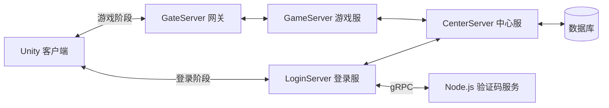

# 项目代码阅读指南

本项目由 Unity 客户端、四类 C# 服务端进程和独立的验证码服务组成。客户端负责输入、界面、动画和场景表现；游戏服负责在线角色的业务处理；中心服负责账号、角色数据及数据库操作；登录服和网关分别承接登录连接与游戏连接。

阅读代码时，可以先沿一次玩家操作往下找：**哪个界面或输入触发 → 谁发请求 → 哪个服务端处理 → 谁保存数据 → 回包后谁刷新显示**。这样比从目录第一个文件一路往后看更容易理解。

本文按 2026 年 11 月 3 日工作区源码说明当前职责。目录名保留项目原有拼写，例如 `Manger`、`manger`、`FunlModule`。第三方库、自动生成代码和参考工程不属于这次自研注释整理范围。

## 先看项目由哪些部分组成

| 位置 | 用通俗的话解释 | 建议先读 |
| --- | --- | --- |
| `LYF_MMO/Assets/Boot` | 安装包里的启动程序：准备资源、加载游戏代码、进入登录场景 | `Load.cs`、`HotUpdateView.cs` |
| `LYF_MMO/Assets/GM_Game/Scripts` | 客户端游戏逻辑：角色、界面、输入、网络接入和表现 | `Global.cs` |
| `LYF_MMO/Assets/GM_Game/Editor` | 只在 Unity 编辑器使用的技能和导航制作工具 | `Skill/SkillEditorAssetTools.cs` |
| `LYF_Server/LoginServer` | 接收注册、登录等请求，连接中心服，并调用验证码服务 | `LoginServer.cs` |
| `LYF_Server/GateServer` | 保管客户端连接，将游戏请求送给游戏服，把结果送回对应玩家 | `GateServerApp.cs` |
| `LYF_Server/GameServer` | 管理在线玩家，处理技能、背包、商城、队伍等游戏业务 | `GameServerApp.cs`、`GameGlobal.cs` |
| `LYF_Server/CenterServer` | 处理中心服协议，读取和保存账号、角色等长期数据 | `CenterApp.cs`、`DB/DBMgr.cs` |
| `LYF_Server/VarifyCodeServer` | 通过 gRPC 向登录服提供邮箱验证码服务，使用 Node.js 运行 | `m_server.js`、`message.proto` |
| `LYF_Server/Network` | 各服务共用的连接、消息封包、协议分发和配置读取工具 | `Socket/NetClient.cs`、`Socket/NetServer.cs` |
| `LYF_Server/MMoRpgCommon` | 共用的数据类型、物品定义、计时和枚举 | 按正在阅读的业务查找对应类型 |
| `LYF_Server/ProtoBuf/proto` | 客户端和服务器约定的请求、结果及通知字段 | `RequestEntity.proto`、`ResultEntity.proto` |

图中画的是职责和主要连接方向。具体消息是否转发、是否回包，还要看相应协议处理器；不能把所有消息都理解成沿整张图走一遍。

## 启动后先发生什么

入口是 `LYF_MMO/Assets/Boot/Load.cs`：

1. 初始化 YooAsset，并创建默认资源包 `DefaultPackage`。
2. 根据运行模式准备资源，查询版本并更新资源清单。
3. 下载本机缺少的资源；没有更新时直接进入下一步。
4. 读取 `GM_Game.dll` 和需要补充元数据的 AOT 程序集。
5. 给 HybridCLR 补充主包程序集的类型信息；非编辑器环境再加载热更 DLL。
6. 加载登录场景。

`HotUpdateView` 只显示进度、提示文字和光点位置。下载是否成功、失败时是否继续，都由 `Load` 判断。

这里的 **AOT** 指随安装包提前编译好的代码；**热更 DLL** 是启动时另外加载的游戏代码。补充 AOT 元数据，是让热更代码能够找到所需的类型和泛型信息，不是再下载一份游戏逻辑。

进入游戏代码后，`Scripts/Global.cs` 负责全局初始化和每帧更新：取得资源包，初始化网络和配置，准备动画资源，再建立场景实体世界。它还负责退出时释放这些资源。

## 登录界面如何连到服务器

从 `Scripts/controller/UIController/LoginCtrl.cs` 看起。它一边接收登录视图的按钮操作，一边注册登录类协议回包。账号、服务器选择和窗口切换都能在这里找到对应入口。

网络连接集中在 `Scripts/Manger/MNetClient.cs`。登录阶段连接登录服，选择游戏服务器后使用游戏连接。网关知道一条消息属于哪个客户端会话，因此游戏服返回结果后，网关可以把结果送回正确的玩家。

协议字段定义在 `.proto` 中。生成出来的 C# 类型负责读写这些字段；真正的登录、购买、施法等业务仍由控制器和消息处理器执行。

排查一条消息时，先记下它的协议号和请求类型，再找发送位置、注册位置、处理器和返回位置。只找到 `Send`，还不能说明服务器已经执行成功。

## 角色数据和场景模型怎样配合

客户端的统一入口是 `Scripts/FunlModule/Role/SceneWorldSystem.cs`。它保存本地玩家及其他玩家的查找关系，底层 `Scripts/SceneEntity/SceneEntityWorld.cs` 负责实体的创建、更新和回收。

可以把角色理解为两层：

- **实体和组件**保存状态并执行逻辑，例如当前动作、位置、技能和导航。
- **模型与动画**负责把这些状态显示出来，例如走路、转向、播放攻击动画或特效。

`SceneEntity/Component/State/MStateMachine.cs` 决定当前动作状态如何进入、更新和退出。`SceneEntity/Component/Action/MSkillComponent.cs` 处理客户端技能动作；`SceneEntity/Component/MNavigationComponent.cs` 接入导航和路点消费。

并非每个名字带 `AI`、`Projectile` 或 `Combat` 的组件都已经实现完整玩法。有些类目前只是保存字段、标识实体类别，或等待以后接入逻辑。阅读时以函数体和注释注明的当前行为为准。

## 游戏服为什么要有主循环

网络收包与游戏业务不是同一件事。游戏服收到消息后，先通过命令队列交给逻辑线程，再由对应处理器修改角色状态，避免网络回调直接同时改动游戏数据。

主要入口是：

- `GameServer/manger/Command`：保存待处理命令及分发关系。
- `GameServer/MessageHandler/ClientMessageManager.cs`：注册和分派业务协议。
- `GameServer/GameGlobal.cs`：消费待处理工作，并按固定逻辑帧推进管理器。

当前固定逻辑帧间隔是 **50 毫秒，即每秒 20 次**。`LogicTick` 表示逻辑时间刻度，涉及冷却时必须看代码怎样换算；它不能与 `DateTime.Ticks` 或任意名为 `time` 的变量混用。

## 一次施法应该沿哪些文件看

先看客户端 `MSkillComponent` 收集和处理技能动作，再看网络发送与回包。服务端重点看下面几个位置：

| 文件或目录 | 在施法流程中的作用 |
| --- | --- |
| `GameServer/MessageHandler/Skill/SkillCastHandler.cs` | 接收施法协议，找到对应在线角色并交给技能流程 |
| `GameServer/Components/RoleSingingComponent.cs` | 接入角色的吟唱阶段 |
| `GameServer/Components/ROSkillComponent.cs` | 检查和提交施法，处理法力、冷却及施法结果通知 |
| `GameServer/StateMutex` | 判断动作状态之间是否允许切换或打断 |
| `GameServer/SceneEntity/Skill` | 技能配置与技能实例相关数据 |

**技能配置**说明“这个技能是什么”；**技能实例**说明“这个角色这一次正在释放什么”。技能 ID、等级效果 ID、表现 ID 和一次施法的 UUID 也各有用途，不能因为都是数字就混作同一个编号。

客户端播放出动画，不等于服务器已接受施法。法力和冷却应沿服务端结果继续核对。读注释时要分清“检查能不能做”“真正扣除或修改数据”“通知别人显示结果”这三步。

## 背包和数据库要分开理解

客户端的背包组件保存用于界面显示的数据，窗口和格子组件负责展示。服务端 `GameServer/Service/item`、`Service/shop` 及角色组件处理业务规则，中心服负责长期数据的读取与保存。

普通包、装备包、消耗品包和材料包是不同的容器；身上已穿戴装备又有自己的容器。修改背包格数时，应先确认操作的是哪一种包。

`CenterServer/DB/Task/CRoleWriteTask.cs` 是角色写库任务的重要入口。这里需要区分内存快照、待写任务和已经成功写入的数据库记录。函数名带 `Save` 或变量名带“事务”，不自动代表所有操作都已完成、都已落库或都有回滚；具体边界由实现决定。

## 界面代码应该放在哪里

项目沿用 `View → WindowBase/Widget → Ctrl` 的组织方式：

- `View` 持有模块界面及子窗口，负责初始化和窗口入口。
- `WindowBase` 子类与 `Widget` 负责显示、控件状态和界面交互。
- `Ctrl` 接收操作、发送协议、处理回包，再把结果交回界面。

找一个按钮的功能时，先看窗口怎样绑定点击，再沿回调找到控制器。显示某个选项并不意味着已经实现该选项的服务器业务。

## 配置和编辑器怎样进入游戏

Luban 表格生成的数据与手写业务代码分开维护。`LYF_Server/Network/LubanManage/LubanMgr.cs` 是重要的配置读取入口，生成目录里的代码不应靠手工改注释或字段来维护。

技能编辑器的主窗口位于 `Assets/GM_Game/Editor/Skill/ActionEditor/Window`。同一个 `SkillEditorWindow` 拆成多个文件：

| 分部文件 | 主要职责 |
| --- | --- |
| `SkillEditorWindow.Timeline.cs` | 注册轨道，计算布局，绘制时间轴和事件 |
| `SkillEditorWindow.Interaction.cs` | 鼠标、快捷键、拖动、增删、复制粘贴 |
| `SkillEditorWindow.Inspector.cs` | 显示选中事件的属性和校验结果 |
| `SkillEditorWindow.Persistence.cs` | 新建、加载、保存、撤销、重做和迁移 |
| `SkillEditorWindow.Preview.cs` | 使用临时角色副本预览动画、特效和投掷物 |
| `SkillEditorWindow.AudioPreview.cs` | 试听声音以及处理暂停和跳帧 |
| `SkillEditorWindow.RoTracks.cs` | 接入 RO 专用轨道和它们的编辑操作 |

草稿保存和游戏运行数据导出是两个步骤。`SkillEditorBinding` 记录草稿对应哪条技能表现，`SkillEditorAssetTools` 检查并导出本游戏能读取的数据。编辑器里能看到的字段，不一定已经全部被游戏运行逻辑使用。

导航制作也有明确分工：Unity 先烘焙导航数据，`MNavigationMapExporter` 把结果导出成公共地图文件，运行时再读取和查询。编辑器里画出的蓝色网格只是预览，不代表服务端已经接入移动权威校验。

## 建议的阅读顺序

1. 先读 `Load → Global`，理解启动和全局资源从哪里来。
2. 再读 `LoginCtrl → MNetClient`，跟一条登录请求和回包。
3. 读 `SceneWorldSystem → SceneEntityWorld → PlayerEntity`，理解客户端角色如何组织。
4. 读 `GameGlobal → ClientMessageManager → 一个具体 Handler`，理解服务端怎样接收并执行请求。
5. 选技能或背包其中一条业务，从客户端一直追到服务端和数据库。
6. 最后阅读编辑器和配置导出，把制作数据与运行时消费连起来。

新的注释优先回答“做什么、数据表示什么、为什么这样处理”。仍然保留代码中的真实限制和未实现部分，避免把预留字段、未调用事件或编辑器预览写成已经完成的游戏功能。
